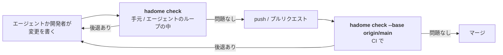
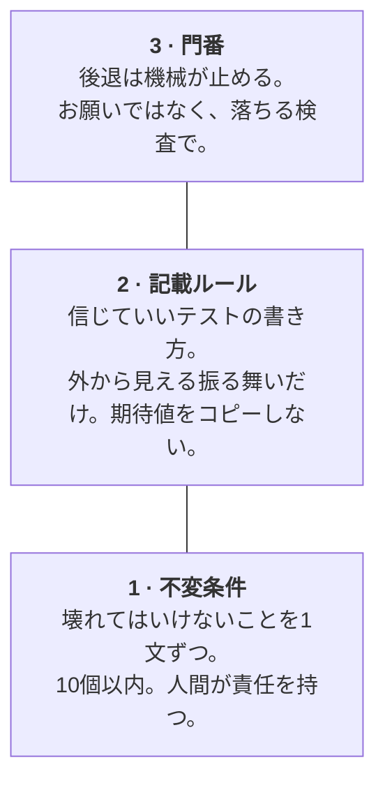

<p align="center">
  <picture>
    <source media="(prefers-color-scheme: dark)" srcset="docs/assets/logo-dark.svg">
    
  </picture>
</p>

<p align="center">
  <b>コードとテストの「後退」だけを止める。前進は止めない。</b><br>
  AI エージェントがコードの大半を書くリポジトリのための、ラチェット式チェッカー。
</p>

<p align="center">
  <a href="LICENSE"></a>
  <a href="https://github.com/rerorets/hadome/releases"></a>
  
</p>

<p align="center">
  <a href="README.md">English</a> · 日本語
</p>

---

> [!NOTE]
> **hadome はまだ若い版（0.x）です。** マイナーバージョンの間でルールや出力が変わることがあるので、はじめかたのとおり版を固定して使ってください。不具合や要望は [Issues](https://github.com/rerorets/hadome/issues) へどうぞ。

## 問題

エージェントが人の読める速さを超えてコードを書くようになると、**テストが速度の上限になります。** テストを信じられる範囲までしか、速く進めません。

ところが、テストが「通っている」ことと「信じられる」ことは別の話です。テストは派手に壊れることはまれで、たいてい黙って弱くなっていきます。

| 起きること | 見えるもの | 本当の意味 |
|---|---|---|
| assert が `assertTrue(true)` になる | 緑 | そのテストは何も確かめていない |
| 「とりあえず」スキップされる | 緑 | 理由を誰も覚えておらず、二度と戻らない |
| 変更を通すために assert を緩める | 緑、本数も同じ | 守っていた振る舞いが、もう守られていない |
| 作り直しのついでにテストを消す | 緑、1本減る | 重複だったのか、大事な何かの唯一の守りだったのか |
| 検査がデバッグビルドでしか動かない | CI では緑 | リリースビルドで黙って消える |

どれもビルドは落ちません。エージェントが変更を出す速さでは、コードレビューでも確実には拾えません。

## hadome がすること

hadome（歯止め）は、コードの品質のための**ラチェット**です。変更を main と比べて、**悪くなったものだけ**を落とします。今ある問題では止めません。後退だけを止めます。

```
今ある違反                 ──▶  そのまま通す（直すのはいつでもいい）
新しい違反                 ──▶  止める
テストが守る範囲を狭めるもの ──▶  止める
```

見るのはコードの書き方だけではありません。中心にあるのは**テストそのもの**、いわば「テストのテスト」です。

## はじめかた

### 1. プロジェクトに足す

自分の環境の行を選びます（版は固定します。詳しくは [配布の設計](docs/design/distribution.md)）。

```sh
npm install --save-dev --save-exact hadome      # TypeScript / JavaScript
uv add --dev hadome==0.1.0                       # Python
go get -tool github.com/rerorets/hadome/cmd/hadome  # Go（C コンパイラがあれば6言語、無ければ Go だけを読む）
cargo binstall hadome@0.1.0                      # Rust
brew install rerorets/tap/hadome                 # それ以外
```

```kotlin
// build.gradle.kts — Java / Kotlin
plugins { id("io.github.rerorets.hadome") version "0.1.0" }
```

### 2. 動かす

```sh
hadome check
```

設定は要りません。言語を検出し、組み込みのルールを当てて、main と比べます。main に今あるものがそのまま基準になるので、先に直すものはありません。

### 3. エージェントに知らせる

エージェントは、指示に書かれたことに従います。次のブロックを `CLAUDE.md` や `AGENTS.md` など、エージェントが読むファイルに足してください。`hadome agents --write CLAUDE.md` で hadome に書かせることもできます（2回目以降は、同じブロックをその場で書き換えます）。エージェント向けの詳しい手順は [docs/for-agents.md](docs/for-agents.md) にあります。

```markdown
<!-- hadome:begin -->
## hadome

This repository uses hadome to stop regressions in code and tests.

- Before you finish any change, run `hadome check --format json` and fix every regression it reports.
- Exit codes: `0` done · `1` regression, fix it · `2` configuration error, fix the configuration · `3` a person must review (a new exception, a loosened configuration, code that stopped being pure, or something hadome could not identify). On `3`, stop and ask. Never change the code just to make it pass.
- Never add `gate:allow` to get a check to pass. Add one only when the rule truly does not apply, with a specific reason, and tell the person.
- When a test guards a product-specific invariant, add `guards: <id>` to its doc comment; for `durable`, `erasable`, `append-only` and `fail-closed`, add `guards: <type> <target>`. `idempotent`, `round-trip` and `isolated` are recognised from the test's calls. `hadome explain invariants` lists them.
- When `hadome check` lists invariant candidates and one covers behaviour that matters, propose it to the person instead of adding it yourself.
- Before changing `.hadome.yml`, run `hadome explain <key>`. After changing it, run `hadome config check`.
<!-- hadome:end -->
```

ブロックは英語のままで大丈夫です（エージェントは英語の指示をそのまま読めます）。日本語にしたいときは `hadome agents --lang ja` で日本語版が出ます。

### 4. CI と push の前に入れる（任意）

```sh
hadome check --base origin/main   # CI で、プルリクエストごとに
```

### 5. 不変条件を見つける（任意）

```sh
hadome suggest
```

`hadome check` の出力にも、不変条件の候補（何かを作る、書き出しと読み込み、削除、利用者ごとの読み出し）が参考情報として出ます。`hadome suggest` はその一覧だけを出します。大事なものを採るだけです。エージェントが候補を見つけて提案してくれます。

## 開発の流れのどこで動くか

hadome はコマンド1つです。変更が次へ進む直前に呼ぶと、**「この変更で、何かが悪くなったか？」**の1つだけに答えます。



| 場面 | 呼ぶもの | 返ってくるもの | 起きること |
|---|---|---|---|
| **エージェントのループの中** | `hadome check --format json` | 後退ごとに、ルール・ファイルと行・なぜ困るか・直し方 | エージェントが提出前に自分で直す。CI の往復も、レビュアーの目も要らない |
| **push の前** | `hadome check`（push 前のフックとして） | 読みやすい一覧。後退が1つでもあれば終了コード `1` | 後退を直すか、理由つきの例外を書くまで push が止まる |
| **プルリクエストごとの CI** | `hadome check --base origin/main` | 終了コードと、コメントに貼れる要約 | 後退のあるプルリクエストはマージできない。今ある違反では止まらない |
| **導入の初日** | `hadome init` | 言語を検出し、既定のルールを書いた設定ファイル | 先に直すものは無い。main に今あるものが、そのまま基準になる |

hadome 自身は GitHub などのサービスと通信しません。要約をコメントに貼りたければ、CI の側で貼ります。

### 設定するもの

リポジトリにファイルを1つ置くだけです。上限の数字、依存の図、不変条件はあなたのものです。

```yaml
# .hadome.yml — schema 以外はすべて省略できる
schema: 1

invariants:
  - type: idempotent               # 組み込みの型。守っているテストは hadome が見つける
    target: api.CreatePost
  - id: billing-1                  # 製品固有。守るテストの doc コメントに `guards: billing-1` と書く
    says: "画面と API の合計が一致する"

rules:
  tests:
    io: [example.com/acme/db]      # 組み込みの表に足す。組み込みの分を消すことはできない
```

`hadome schema` で仕様の全体を JSON Schema として出せます。`hadome explain <キー>` で1つのキーの説明を出し、`hadome config check` で何も走らせずにファイルを検証します。

### 例外の書き方

当てはまる場所に、理由と一緒に書きます。理由が無ければ効きません。

```go
// gate:allow tests/no-sleep reason: OS のファイル監視には待てるイベントが無い
time.Sleep(50 * time.Millisecond)
```

### 終了コード

| コード | 意味 |
|---|---|
| `0` | 後退なし |
| `1` | 後退が1つ以上ある |
| `2` | 設定の誤り（検査を信じられないので、通さない） |
| `3` | 後退は無いが、**新しく**足された例外があり、人の確認が要る。main に前からある例外では返さない |

### 自分のプロダクトの門番

「ログの置き場に UPDATE を書かない」「マイグレーションは必ず冪等に」のような、自分のプロダクトだけが知っているルールは、**自分のリポジトリ**に小さなプログラムとして、好きな言語で書きます。hadome はそれを両方の版で呼び、組み込みのルールと同じものを全部与えます。後退だけを落とすこと、理由つきの例外、同じ報告と終了コード、自己テストです。プロダクトの知識がリポジトリの外に出ることはありません。詳しくは [Product-specific gates](docs/external-gates.md)（英語）。

## リンターとの違い

| | 一般的なリンター | hadome |
|---|---|---|
| 何と比べるか | ルールだけ。違反を全部出す | **main と比べる。** 新しい違反と後退だけを出す |
| 何を見るか | コードの書き方 | コードの書き方に加えて、**テストが実際に何を守っているか** |
| テストの削除 | 関知しない | **整理**（守る範囲は保たれた）と**後退**（守る範囲が狭まった）を見分ける |
| 言語 | 言語ごとに別の道具 | **1つのバイナリで6言語。** ルールは共通で、言語ごとのアダプタだけが違う |
| 例外 | 理由の無い無効化コメントが多い | **その場に理由を書いた印**でだけ認める。理由の無い印は効かない |

## 考え方：3つの段

hadome は1つの考えでできています。**人間が管理するのはテストケースではなく、「どんなテストなら信じていいか」というルールのほう。**



1. **不変条件** — 壊れてはいけないことの短い一覧（10個以内）。それぞれを守るテストを紐付け、消したり無効にしたりすると落ちる。
2. **記載ルール** — 外から見える振る舞いだけを確かめる。期待値を実装からコピーしない。時刻を直接読まない。sleep で待たない。黙ってスキップしない。
3. **門番** — hadome。ルールは「お願い」ではなく、落ちる検査で守らせる。

## 後退と整理

テストの本数では、整理と後退を見分けられません。どちらも「−3本」に見えるからです。hadome は代わりに**テストが守っている範囲**を測ります。

hadome は、テストごとの*対象*（そのテストが呼んでいるコードの関数やメソッド）を、誰にも宣言させずに割り出します。有効なテストが届いている対象の集合が、守っている範囲です。後の段階では、わざと壊して確かめる検査（ミューテーション）で、テストが実際に捕まえる壊れ方の集合へと精密にしていきます。

| やったこと | 本数 | 守る範囲 | hadome の判定 |
|---|---|---|---|
| 重複していた3本を1本にまとめた | ↓ | 同じ | ✅ 整理 |
| 他のテストと同じものしか捕まえないテストを消した | ↓ | 同じ | ✅ 整理 |
| コードを消し、そのテストも消した | ↓ | 対象ごと消えた | ✅ 整理（対象がもう無いことを確かめる） |
| 大事なテストを消した・弱くした | ↓ か同じ | 狭くなった | ❌ 後退 |
| 本数はそのまま assert を緩めた | 同じ | 狭くなった（ミューテーションで検出） | ❌ 後退 |

ある振る舞いをあえて守らなくするなら、仕様を変えて、その振る舞いごと消します。「テストだけ消して済ませる」道はありません。

## 検査するもの

ルールは分類つきの名前にしてあり、出力を見れば何を検査したかが分かります。

| 分類 | ルール |
|---|---|
| `tests/` | `scope-shrunk`（テストが守る範囲の縮小）・`invariant-unguarded`・`no-clock`・`no-sleep`・`always-true`・`skip-without-reason`・`no-mock`（純粋なコードのテストのモック）・`purity-lost` と `target-unknown`（確認待ち） |
| `deps/` | `not-in-diagram`（依存の図に無い import）・`diagram-stale`（何も指さない箱） |
| `size/` | `file-lines`・`function-lines`・`params`・`complexity`・`interface-methods` |
| `comments/` | `todo-format`（いつやるかの無い TODO）・`missing-doc`・`broken-reference`（無い文書を指すコメント） |
| `unknown/` | `unread`（確認待ち）: hadome が読めなかったファイル |
| `config/` | `loosened`（確認待ち）: 自分を判定するルールを緩める変更 |

製品固有の門番も、自分で付けた名前でここに加わります（[製品固有の門番](docs/external-gates.md)）。見つかったものにはそれぞれ、なぜ問題かと直し方が付きます。ルールの仕様は [docs/design](docs/design) にあります。

## 見え方

`store.Append` の唯一のテストを消し、別のテストに sleep を足し、依存の図が許していない import をした変更の結果です（出力は英語です）。

```console
$ hadome check --base main
✗ deps/not-in-diagram          import not in the diagram: store → core (no arrow store --> core)
  store/store.go:3
  why: the diagram (docs/deps.md) is how people and agents know what may depend on what; an import it does not draw makes it wrong
  fix: depend on what the diagram allows, often through an interface the importing unit declares; if the design changed, draw the arrow, which a person reviews
✗ tests/no-sleep               test waits by sleeping: time.Sleep(10 * time.Millisecond)
  worker/worker_test.go:11
  why: a sleep is either too long (a slow suite) or too short (a flaky test); it never waits for the actual event
  fix: wait for the event itself: a channel, a callback, or a condition with a deadline that fails loudly
✗ tests/scope-shrunk           guarded scope shrank: example.com/app/store.Append is no longer exercised by any active test (was: TestAppendKeepsRows)
  store/store_test.go:9
  why: the behaviour of example.com/app/store.Append can now change without any test noticing
  fix: keep or restore a test that calls example.com/app/store.Append, or remove example.com/app/store.Append itself if it is no longer needed
3 regression(s). 0 existing finding(s) unchanged (not blocking).
```

## 対応言語

バイナリは1つです。テストの見つけ方、import の読み方、大きさの測り方を言語のアダプタが受け持ち、ルールは共通です。

| | Go | TypeScript | Python | Rust | Java | Kotlin |
|---|:-:|:-:|:-:|:-:|:-:|:-:|
| `tests/` | ✅ | ✅ | ✅ | ✅ | ✅ | ✅ |
| `deps/` | ✅ | ✅ | ✅ | ✅ | ✅ | ✅ |
| `size/` | ✅ | ✅ | ✅ | ✅ | ✅ | ✅ |
| `comments/` | ✅ | ✅ | ✅ | ✅ | ✅ | ✅ |

✅ 対応済み

## 原則

- **後退で止め、過去では止めない。** 入れる前に全部を直す必要はない。
- **例外には理由を書く。** 理由は例外の場所に書く。理由が無ければ例外にならない。
- **ルールは設定に、仕組みは hadome に。** 上限の数字、依存の図、不変条件は、あなたのリポジトリのもの。
- **固有の検査も同じ形で差し込める。** プロダクト固有の門番も、入力・判定・自己テストという同じ形で書ける。
- **チェッカー自身もチェックする。** すべてのルールに自己テストを付ける。
- **通信しない。** hadome はリポジトリを読むだけで、外には何も送らない。

## 名前の由来

**歯止め**は、英語の **pawl**（爪車の爪）にあたります。ラチェットの歯車を一方向にだけ回し、逆に戻らないように止める小さな部品です。

日本語では「歯止めをかける」が「悪化を食い止める」という意味でも使われます。それがまさにこの道具の仕事です。コードベースを前に進ませ、後ろに滑らせない。

## 状況とロードマップ

- [x] 名前・範囲・考え方
- [x] 設計書（[docs/design](docs/design): エンジン、言語のアダプタ、設定、各ルール群、門番、候補、配布）
- [x] エンジン: 基準のブランチとの比較、名前の変更、理由つきの例外、自己テスト
- [x] 設定: 厳密な検証、JSON Schema、`explain`、共有の層、緩める変更は人の確認
- [x] `tests/` ルール — テストの書き方、守る範囲、不変条件、純粋さ
- [x] `hadome agents`・`suggest`・`init` と、[エージェント向けの手引き](docs/for-agents.md)
- [x] 製品固有の門番（[約束事](docs/external-gates.md)）
- [x] `deps/`・`size/`・`comments/` ルール
- [x] TypeScript・Python・Rust・Java・Kotlin（tree-sitter で読む。純粋な Go のビルドは Go だけを読み、ほかは「読めなかった」と報告する）
- [ ] 各エコシステムへの公開 — パッケージとリリースの流れはできている（[releasing](docs/releasing.md)）。公開は各レジストリのアカウント待ち
- [ ] ミューテーションによる範囲

## ライセンス

[MIT](LICENSE)
