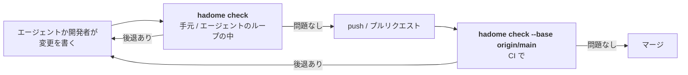
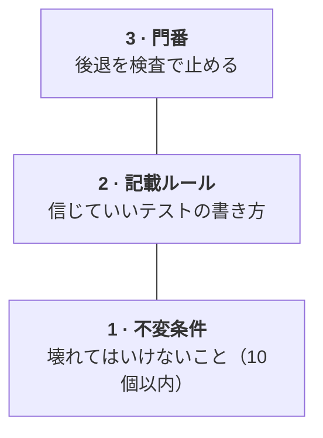

<p align="center">
  <picture>
    <source media="(prefers-color-scheme: dark)" srcset="docs/assets/logo-dark.svg">
    
  </picture>
</p>

<p align="center">
  変更で増えた違反と、弱くなったテストを報告するチェッカー。
</p>

<p align="center">
  <a href="LICENSE"></a>
  <a href="https://github.com/rerorets/hadome/releases"></a>
  
</p>

<p align="center">
  <a href="README.md">English</a> · 日本語
</p>

---

> [!NOTE]
> 不具合や要望は[Issues](https://github.com/rerorets/hadome/issues)へどうぞ。

---

## 概要

hadome（歯止め）は、コードの品質のためのラチェットツールです。変更差分をチェックし、悪くなったものだけを落とします。

中心はテストそのものです。テストの書き方のルールを検査するツールです。AIエージェントがコードの大半を書くリポジトリを想定しています。

| 変更に含まれるもの | 結果 |
|---|---|
| 新しい違反 | 止める |
| テストが守る範囲を狭めるもの | 止める |
| 前からある違反 | 通す（直すタイミングは開発者に任せます） |

## 対応言語

バイナリは1つです。テストの見つけ方、importの読み方、大きさの測り方を言語ごとのアダプタが受け持ち、ルールは共通です。

| | Go | TypeScript | Python | Rust | Java | Kotlin |
|---|:-:|:-:|:-:|:-:|:-:|:-:|
| `tests/` | ✅ | ✅ | ✅ | ✅ | ✅ | ✅ |
| `deps/` | ✅ | ✅ | ✅ | ✅ | ✅ | ✅ |
| `size/` | ✅ | ✅ | ✅ | ✅ | ✅ | ✅ |
| `comments/` | ✅ | ✅ | ✅ | ✅ | ✅ | ✅ |

✅ 対応済み

## はじめかた

### 1. 入れる

使っている言語のものを選びます。どれも版を固定して入れます（[配布の設計](docs/design/distribution.ja.md)）。どの入れ方でも、中身は同じバイナリで、設定も同じ`.hadome.yml`です。

以降は`hadome …`と書きます。`npx hadome …`や`go tool hadome …`など、入れた方法の呼び方に読み替えてください。

#### TypeScript / JavaScript

```sh
npm install --save-dev --save-exact hadome   # pnpm・yarn・bun でも同じ（bun add -d -E hadome → bunx hadome check）
npx hadome check
```

#### Python

```sh
uv add --dev hadome==0.1.1                   # pip なら pip install hadome==0.1.1
uv run hadome check
```

#### Go

```sh
go get -tool github.com/rerorets/hadome/cmd/hadome
go tool hadome check
```

ソースからビルドします。Cコンパイラがあれば6言語を読み、無ければGoだけを読みます。

#### Java / Kotlin（Gradle）

```kotlin
// build.gradle.kts
plugins { id("io.github.rerorets.hadome") version "0.1.1" }
```

`./gradlew hadomeCheck`で動かします。

#### Java / Kotlin（Maven）

```xml
<!-- pom.xml の <build><plugins> -->
<plugin>
  <groupId>io.github.rerorets</groupId>
  <artifactId>hadome-maven-plugin</artifactId>
  <version>0.1.1</version>
</plugin>
```

`mvn hadome:check`で動かします。

#### Rust

```sh
cargo binstall hadome@0.1.1
hadome check
```

#### それ以外

```sh
brew install rerorets/tap/hadome
hadome check
```

[リリース](https://github.com/rerorets/hadome/releases)のアーカイブから直接入れることもできます。

### 2. AIエージェントに覚えさせる

```sh
hadome agents --write CLAUDE.md
```

エージェントが読むファイルに、hadomeの使い方のブロックを書き込みます。`AGENTS.md`など、別のファイルを指定しても構いません。ファイルが無ければ作り、2回目以降は同じブロックを書き換えます。日本語のブロックにしたいときは`--lang ja`を付けます。詳しい手順は[エージェント向けの手引き](docs/for-agents.ja.md)にあります。

手で足すときは、次のブロックを貼り付けます。

<details>
<summary>ブロックの中身</summary>

```markdown
<!-- hadome:begin -->
## hadome

This repository uses hadome to stop regressions in code and tests.

- Before you finish any change, run `hadome check --format json` and fix every regression it reports.
- Exit codes: `0` done · `1` regression, fix it · `2` configuration error, fix the configuration · `3` a person must review (a new exception, a loosened configuration, code that stopped being pure, or something hadome could not identify). On `3`, stop and ask. Never change the code just to make it pass.
- Never add `gate:allow` to get a check to pass. Add one only when the rule truly does not apply, with a specific reason, and tell the person.
- When a test guards a product-specific invariant, add `guards: <id>` to its doc comment; for `durable`, `erasable`, `append-only` and `fail-closed`, add `guards: <type> <target>`. `idempotent`, `round-trip` and `isolated` are recognised from the test's calls. `hadome explain invariants` lists them.
- When `hadome check` lists invariant candidates and one covers behaviour that matters, propose it to the person instead of adding it yourself.
- Before changing `.hadome.yml`, run `hadome explain <key>`. After changing it, run `hadome config check`.
<!-- hadome:end -->
```

</details>

## 見え方

`store.Append`の唯一のテストを消し、別のテストにsleepを足し、依存の図に無いimportをした変更の結果です（出力は英語です）。

```console
$ hadome check --base main
✗ deps/not-in-diagram          import not in the diagram: store → core (no arrow store --> core)
  store/store.go:3
  why: the diagram (docs/deps.md) is how people and agents know what may depend on what; an import it does not draw makes it wrong
  fix: depend on what the diagram allows, often through an interface the importing unit declares; if the design changed, draw the arrow, which a person reviews
✗ tests/no-sleep               test waits by sleeping: time.Sleep(10 * time.Millisecond)
  worker/worker_test.go:11
  why: a sleep is either too long (a slow suite) or too short (a flaky test); it never waits for the actual event
  fix: wait for the event itself: a channel, a callback, or a condition with a deadline that fails loudly
✗ tests/scope-shrunk           guarded scope shrank: example.com/app/store.Append is no longer exercised by any active test (was: TestAppendKeepsRows)
  store/store_test.go:9
  why: the behaviour of example.com/app/store.Append can now change without any test noticing
  fix: keep or restore a test that calls example.com/app/store.Append, or remove example.com/app/store.Append itself if it is no longer needed
3 regression(s). 0 existing finding(s) unchanged (not blocking).
```

## 開発の流れのどこで動くか

hadomeはコマンド1つです。変更が次へ進む直前に呼ぶと、「この変更で何かが悪くなったか」に答えます。組み込みのルールで今の変更をmainと比べ、mainにすでにある違反は基準として扱います。入れる前に直すものはありません。



| 場面 | 呼ぶもの | 返ってくるもの |
|---|---|---|
| エージェントのループの中 | `hadome check --format json` | 後退ごとに、ルール・ファイルと行・なぜ困るか・直し方 |
| pushの前 | `hadome check`（pushの前のフックとして） | 読みやすい一覧。後退が1つでもあれば終了コード`1` |
| プルリクエストごとのCI | `hadome check --base origin/main` | 終了コードと、コメントに貼れる要約 |

hadome自身はGitHubなどのサービスと通信しません。要約をコメントに貼るなら、CIの側で貼ります。

## 設定

設定は`.hadome.yml`に書きます。上限の数字、依存の図、不変条件などです。ファイルは無くても動きます。

設定の変更や不変条件の提案は、エージェントが`hadome explain <キー>`で仕様を読んで行います（[エージェント向けの手引き](docs/for-agents.ja.md)）。人が決めるのは、提案を採るかどうかと、ルールを緩める変更を認めるかどうかです。緩める変更には、終了コード`3`で人の確認が入ります。

### 例外の書き方

当てはまる場所に、理由と一緒に書きます。理由が無ければ効きません。

```go
// gate:allow tests/no-sleep reason: OS のファイル監視には待てるイベントが無い
time.Sleep(50 * time.Millisecond)
```

### 終了コード

| コード | 意味 |
|---|---|
| `0` | 後退なし |
| `1` | 後退が1つ以上ある |
| `2` | 設定の誤り。検査を信じられないので通さない |
| `3` | 後退は無いが、人の確認が要るもの（新しい例外、ルールを緩める設定など）がある |

### 自分のプロダクトの門番

「ログの置き場にUPDATEを書かない」のような、自分のプロダクトだけのルールは、自分のリポジトリに小さなプログラムとして好きな言語で書きます。hadomeはそれを組み込みのルールと同じように扱います。後退だけを落とし、理由つきの例外が効き、同じ形で報告します。詳しくは[製品固有の門番](docs/external-gates.ja.md)。

## 検査するもの

| 分類 | ルール |
|---|---|
| `tests/` | `scope-shrunk`（テストが守る範囲の縮小）・`invariant-unguarded`・`no-clock`・`no-sleep`・`always-true`・`skip-without-reason`・`no-mock`（純粋なコードのテストのモック）・`purity-lost`と`target-unknown`（確認待ち） |
| `deps/` | `not-in-diagram`（依存の図に無いimport）・`diagram-stale`（何も指さない箱） |
| `size/` | `file-lines`・`function-lines`・`params`・`complexity`・`interface-methods` |
| `comments/` | `todo-format`（いつやるかの無いTODO）・`missing-doc`・`broken-reference`（無い文書を指すコメント） |
| `unknown/` | `unread`（確認待ち）: hadomeが読めなかったファイル |
| `config/` | `loosened`（確認待ち）: 自分を判定するルールを緩める変更 |

それぞれに、なぜ問題かと直し方が付きます。ルールの仕様は[docs/design](docs/design)にあります。

## リンターとの違い

| | 一般的なリンター | hadome |
|---|---|---|
| 何と比べるか | ルールだけ。違反を全部出す | mainと比べ、新しい違反と後退だけを出す |
| 何を見るか | コードの書き方 | コードの書き方と、テストが実際に何を守っているか |
| テストの削除 | 関知しない | 整理（守る範囲は保たれた）と後退（狭まった）を見分ける |
| 言語 | 言語ごとに別の道具 | 1つのバイナリで6言語。ルールは共通で、アダプタだけが言語ごとに違う |
| 例外 | 理由の無い無効化コメントが多い | その場に理由を書いた印でだけ認める |

## 後退と整理

テストの本数では、整理と後退を見分けられません。どちらも「−3本」に見えるからです。hadomeは代わりに、テストが守っている範囲を測ります。

テストごとに、そのテストが呼んでいる関数やメソッド（対象）を割り出します。有効なテストが届いている対象の集合が、守っている範囲です。

| やったこと | 本数 | 守る範囲 | 判定 |
|---|---|---|---|
| 重複していた3本を1本にまとめた | ↓ | 同じ | 整理 |
| コードを消し、そのテストも消した | ↓ | 対象ごと消えた | 整理 |
| 大事なテストを消した・弱くした | ↓か同じ | 狭くなった | 後退 |

ある振る舞いを守らなくするときは、仕様を変えて、その振る舞いごと消します。

## 考え方：3つの段

人が管理するのは、テストケースではなく「どんなテストなら信じていいか」のルールです。



1. 不変条件：壊れてはいけないことの短い一覧。守るテストを紐付け、消したり無効にしたりすると落ちる
2. 記載ルール：外から見える振る舞いだけを確かめる。期待値を実装からコピーしない。時刻を読まない。sleepで待たない。黙ってスキップしない
3. 門番：hadome。ルールを検査で守らせる

## 名前の由来

歯止めは、英語のpawl（爪車の爪）にあたります。ラチェットの歯車を一方向にだけ回し、逆に戻らないように止める部品です。

## 状況とロードマップ

- [x] 名前・範囲・考え方
- [x] 設計書（[docs/design](docs/design): エンジン、言語のアダプタ、設定、各ルール群、門番、候補、配布）
- [x] エンジン: 基準のブランチとの比較、名前の変更、理由つきの例外、自己テスト
- [x] 設定: 厳密な検証、JSON Schema、`explain`、共有の層、緩める変更は人の確認
- [x] `tests/`ルール — テストの書き方、守る範囲、不変条件、純粋さ
- [x] `hadome agents`・`suggest`・`init`と、[エージェント向けの手引き](docs/for-agents.ja.md)
- [x] 製品固有の門番（[約束事](docs/external-gates.ja.md)）
- [x] `deps/`・`size/`・`comments/`ルール
- [x] TypeScript・Python・Rust・Java・Kotlin（tree-sitterで読む。純粋なGoのビルドはGoだけを読み、ほかは「読めなかった」と報告する）
- [ ] 各エコシステムへの公開 — パッケージとリリースの流れはできている（[公開の手順](docs/releasing.ja.md)）。公開は各レジストリのアカウント待ち
- [ ] ミューテーションによる範囲

## ライセンス

[MIT](LICENSE)
