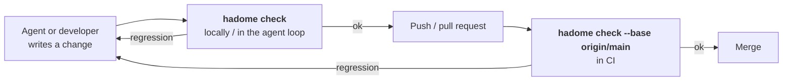
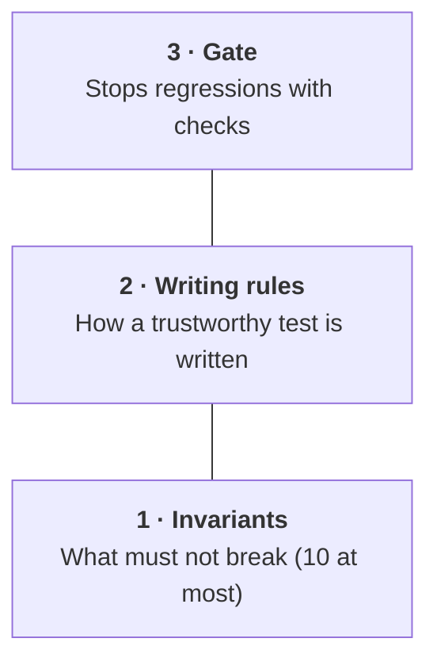

<p align="center">
  <picture>
    <source media="(prefers-color-scheme: dark)" srcset="docs/assets/logo-dark.svg">
    
  </picture>
</p>

<p align="center">
  A checker that reports the violations a change adds and the tests it weakens.
</p>

<p align="center">
  <a href="LICENSE"></a>
  <a href="https://github.com/rerorets/hadome/releases"></a>
  
</p>

<p align="center">
  English · <a href="README.ja.md">日本語</a>
</p>

---

> [!NOTE]
> Bugs and requests go to [Issues](https://github.com/rerorets/hadome/issues).

---

## Overview

hadome (歯止め) is a ratchet for code quality. It checks the changes in a diff and fails only on what got worse.

Its center is the tests themselves: it checks the rules for how tests are written. It is meant for repositories where AI agents write most of the code.

| What the change contains | Result |
|---|---|
| A new violation | Blocked |
| Anything that shrinks what the tests guard | Blocked |
| A violation that was already there | Allowed (fixing it is up to the developers) |

## Languages

One binary. Language adapters find tests, read imports and measure size; the rules are shared.

| | Go | TypeScript | Python | Rust | Java | Kotlin |
|---|:-:|:-:|:-:|:-:|:-:|:-:|
| `tests/` | ✅ | ✅ | ✅ | ✅ | ✅ | ✅ |
| `deps/` | ✅ | ✅ | ✅ | ✅ | ✅ | ✅ |
| `size/` | ✅ | ✅ | ✅ | ✅ | ✅ | ✅ |
| `comments/` | ✅ | ✅ | ✅ | ✅ | ✅ | ✅ |

✅ supported

## Quick start

### 1. Install

Pick the one for your language. Each pins the version ([distribution](docs/design/distribution.md)). Every way installs the same binary and reads the same `.hadome.yml`.

From here on, commands are written as `hadome …`. Use the form for how you installed it, such as `npx hadome …` or `go tool hadome …`.

#### TypeScript / JavaScript

```sh
npm install --save-dev --save-exact hadome   # pnpm, yarn and bun work too (bun add -d -E hadome, then bunx hadome check)
npx hadome check
```

#### Python

```sh
uv add --dev hadome==0.1.1                   # or pip install hadome==0.1.1
uv run hadome check
```

#### Go

```sh
go get -tool github.com/rerorets/hadome/cmd/hadome
go tool hadome check
```

Built from source. With a C compiler it reads all six languages; without one, Go only.

#### Java / Kotlin (Gradle)

```kotlin
// build.gradle.kts
plugins { id("io.github.rerorets.hadome") version "0.1.1" }
```

Run it with `./gradlew hadomeCheck`.

#### Java / Kotlin (Maven)

```xml
<!-- in pom.xml, under <build><plugins> -->
<plugin>
  <groupId>io.github.rerorets</groupId>
  <artifactId>hadome-maven-plugin</artifactId>
  <version>0.1.1</version>
</plugin>
```

Run it with `mvn hadome:check`.

#### Rust

```sh
cargo binstall hadome@0.1.1
hadome check
```

#### Anything else

```sh
brew install rerorets/tap/hadome
hadome check
```

You can also install from an archive on the [releases](https://github.com/rerorets/hadome/releases) page.

### 2. Tell your AI agents

```sh
hadome agents --write CLAUDE.md
```

Writes a block on how to use hadome into the file your agents read. Any other file, such as `AGENTS.md`, works too. The file is created if it is missing, and later runs update the block in place. Add `--lang ja` for a Japanese block. The full procedures are in [the guide for agents](docs/for-agents.md).

To add it by hand, paste this block.

<details>
<summary>The block</summary>

```markdown
<!-- hadome:begin -->
## hadome

This repository uses hadome to stop regressions in code and tests.

- Before you finish any change, run `hadome check --format json` and fix every regression it reports.
- Exit codes: `0` done · `1` regression, fix it · `2` configuration error, fix the configuration · `3` a person must review (a new exception, a loosened configuration, code that stopped being pure, or something hadome could not identify). On `3`, stop and ask. Never change the code just to make it pass.
- Never add `gate:allow` to get a check to pass. Add one only when the rule truly does not apply, with a specific reason, and tell the person.
- When a test guards a product-specific invariant, add `guards: <id>` to its doc comment; for `durable`, `erasable`, `append-only` and `fail-closed`, add `guards: <type> <target>`. `idempotent`, `round-trip` and `isolated` are recognised from the test's calls. `hadome explain invariants` lists them.
- When `hadome check` lists invariant candidates and one covers behaviour that matters, propose it to the person instead of adding it yourself.
- Before changing `.hadome.yml`, run `hadome explain <key>`. After changing it, run `hadome config check`.
<!-- hadome:end -->
```

</details>

## How it looks

A change that deletes the only test of `store.Append`, adds a sleep to another test, and adds an import the dependency diagram does not draw:

```console
$ hadome check --base main
✗ deps/not-in-diagram          import not in the diagram: store → core (no arrow store --> core)
  store/store.go:3
  why: the diagram (docs/deps.md) is how people and agents know what may depend on what; an import it does not draw makes it wrong
  fix: depend on what the diagram allows, often through an interface the importing unit declares; if the design changed, draw the arrow, which a person reviews
✗ tests/no-sleep               test waits by sleeping: time.Sleep(10 * time.Millisecond)
  worker/worker_test.go:11
  why: a sleep is either too long (a slow suite) or too short (a flaky test); it never waits for the actual event
  fix: wait for the event itself: a channel, a callback, or a condition with a deadline that fails loudly
✗ tests/scope-shrunk           guarded scope shrank: example.com/app/store.Append is no longer exercised by any active test (was: TestAppendKeepsRows)
  store/store_test.go:9
  why: the behaviour of example.com/app/store.Append can now change without any test noticing
  fix: keep or restore a test that calls example.com/app/store.Append, or remove example.com/app/store.Append itself if it is no longer needed
3 regression(s). 0 existing finding(s) unchanged (not blocking).
```

## Where it runs in your workflow

hadome is one command. Call it where a change is about to move on, and it answers whether the change made anything worse. It compares the current change with main using the built-in rules, and violations already in main are the baseline. There is nothing to fix before you start.



| Where | What you run | What you get back |
|---|---|---|
| In an agent's loop | `hadome check --format json` | Each regression with its rule, file and line, why it matters, and how to fix it |
| Before you push | `hadome check` (as a pre-push hook) | A readable list; exit code `1` on any regression |
| In CI, on every pull request | `hadome check --base origin/main` | An exit code and a summary you can post as a comment |

hadome itself never talks to GitHub or any other service. To post the summary, post it from CI.

## Configuration

Settings go in `.hadome.yml`: limits, the dependency diagram, invariants and so on. hadome works without the file.

Agents change the settings and propose invariants, reading the specification with `hadome explain <key>` ([the guide for agents](docs/for-agents.md)). People decide which proposals to accept and whether to allow a change that loosens the rules. Such a change stops with exit code `3` for a person's review.

### Writing an exception

Write it where it applies, with a reason. Without a reason it has no effect.

```go
// gate:allow tests/no-sleep reason: the OS file watcher offers no event to wait on
time.Sleep(50 * time.Millisecond)
```

### Exit codes

| Code | Meaning |
|---|---|
| `0` | No regressions |
| `1` | One or more regressions |
| `2` | Configuration error. The check cannot be trusted, so it does not pass |
| `3` | No regressions, but something needs a person's review (a new exception, a configuration that loosens the rules, and so on) |

### Your own gates

Rules only your product knows, such as "never UPDATE the log store", are small programs in your own repository, in any language. hadome treats them like the built-in rules: only regressions fail, reasoned exceptions work, and the report has the same shape. See [product-specific gates](docs/external-gates.md).

## What it checks

| Group | Rules |
|---|---|
| `tests/` | `scope-shrunk` (what tests guard shrank) · `invariant-unguarded` · `no-clock` · `no-sleep` · `always-true` · `skip-without-reason` · `no-mock` (mocks in tests of pure code) · `purity-lost` and `target-unknown` (review) |
| `deps/` | `not-in-diagram` (imports your dependency diagram does not draw) · `diagram-stale` (boxes that name nothing) |
| `size/` | `file-lines` · `function-lines` · `params` · `complexity` · `interface-methods` |
| `comments/` | `todo-format` (TODOs without a when) · `missing-doc` · `broken-reference` (comments pointing at missing documents) |
| `unknown/` | `unread` (review): a file hadome could not read |
| `config/` | `loosened` (review): a change that loosens the rules judging it |

Each finding says why it matters and how to fix it. The rules are specified in [docs/design](docs/design).

## How it differs from a linter

| | A typical linter | hadome |
|---|---|---|
| Compared with | The rules only; reports every violation | main; reports only new violations and regressions |
| Looks at | How code is written | How code is written, and what the tests actually guard |
| Deleting tests | Not its concern | Tells cleanup (the guarded scope is kept) from regression (it shrank) |
| Languages | A different tool per language | One binary for six languages; the rules are shared and only the adapters differ |
| Exceptions | Disabling comments, often without a reason | Only a marker with a reason, written where it applies |

## Regression vs. cleanup

The number of tests cannot tell cleanup from regression: both look like "−3 tests". hadome measures what the tests guard instead.

For each test, hadome works out the functions and methods it calls (its targets). The targets reached by active tests are the guarded scope.

| What you did | Count | Guarded scope | Verdict |
|---|---|---|---|
| Merged three duplicate tests into one | ↓ | Same | Cleanup |
| Deleted code together with its tests | ↓ | Gone with the targets | Cleanup |
| Deleted or weakened an important test | ↓ or same | Narrower | Regression |

To stop guarding a behaviour, change the specification and remove the behaviour itself.

## The model: three layers

People manage the rules for which tests can be trusted, not the test cases.



1. Invariants: a short list of what must not break. Each is tied to the tests that guard it; deleting or disabling them fails
2. Writing rules: test observable behaviour only. Never copy expected values from the implementation. Never read the clock. Never wait with sleep. Never skip silently
3. Gate: hadome. It enforces the rules with checks

## The name

歯止め (*hadome*) is the Japanese word for a pawl: the part that lets a ratchet wheel turn one way and stops it from slipping back.

## Status and roadmap

- [x] Name, scope and model
- [x] Design documents ([docs/design](docs/design): engine, language adapters, configuration, every rule group, gates, suggestions, distribution)
- [x] Engine: compare with the base branch, renames, reasoned exceptions, self-tests
- [x] Configuration: strict validation, JSON Schema, `explain`, shared layers, loosening needs review
- [x] `tests/` rules — how tests are written, the guarded scope, invariants and purity
- [x] `hadome agents`, `suggest` and `init`, and [a guide for agents](docs/for-agents.md)
- [x] Product-specific gates ([protocol](docs/external-gates.md))
- [x] `deps/`, `size/` and `comments/` rules
- [x] TypeScript, Python, Rust, Java and Kotlin (with tree-sitter; the pure-Go build reads Go only and reports the rest as unread)
- [ ] Published in every ecosystem — the packages and the release workflow are ready ([releasing](docs/releasing.md)); publishing waits for the registries' accounts
- [ ] Mutation-based scope

## License

[MIT](LICENSE)
