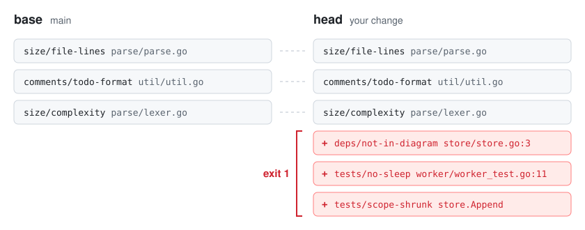

<p align="center">
  <picture>
    <source media="(prefers-color-scheme: dark)" srcset="docs/assets/logo-dark.svg">
    
  </picture>
</p>

<p align="center">
  A checker that reports the violations a change adds and the tests it weakens.
</p>

<p align="center">
  <a href="LICENSE"></a>
  <a href="https://github.com/rerorets/hadome/releases"></a>
  
</p>

<p align="center">
  English · <a href="README.ja.md">日本語</a>
</p>

## Overview

hadome (歯止め) compares a change with main and reports the violations the change adds and the tests it weakens. Violations already on main are not reported.

<p align="center">
  <picture>
    <source media="(prefers-color-scheme: dark)" srcset="docs/assets/compare-dark.svg">
    
  </picture>
</p>

It looks at how code is written (dependency direction, size, comments) and how tests are written. Tests are compared not by their number but by the functions they call. When deleting a test narrows that scope, it is reported as a regression.

It is meant for repositories where AI agents write most of the code. The result is also available as JSON, which agents read to fix what it reports.

One binary reads Go, TypeScript, Python, Rust, Java, Kotlin and Terraform.

## Quick start

Run every command at the root of the repository.

```sh
cd path/to/your-repo
```

### 1. Install

Pick the one for your language. Each pins the version ([distribution](docs/design/distribution.md)). Every way installs the same binary and reads the same `.hadome.yml`.

From here on, commands are written as `hadome …`. Use the form for how you installed it, such as `npx hadome …` or `go tool hadome …`.

#### TypeScript / JavaScript

```sh
npm install --save-dev --save-exact hadome   # pnpm, yarn and bun work too (bun add -d -E hadome, then bunx hadome check)
npx hadome check
```

#### Python

```sh
uv add --dev hadome==0.1.2                   # or pip install hadome==0.1.2
uv run hadome check
```

#### Go

```sh
go get -tool github.com/rerorets/hadome/cmd/hadome
go tool hadome check
```

Built from source. With a C compiler it reads all seven languages; without one, Go and Terraform only.

#### Java / Kotlin (Gradle)

```kotlin
// build.gradle.kts
plugins { id("io.github.rerorets.hadome") version "0.1.2" }
```

Run it with `./gradlew hadomeCheck`.

#### Java / Kotlin (Maven)

```xml
<!-- in pom.xml, under <build><plugins> -->
<plugin>
  <groupId>io.github.rerorets</groupId>
  <artifactId>hadome-maven-plugin</artifactId>
  <version>0.1.2</version>
</plugin>
```

Run it with `mvn hadome:check`.

#### Rust

```sh
cargo binstall hadome@0.1.2
hadome check
```

#### Anything else

```sh
brew install rerorets/tap/hadome
hadome check
```

You can also install from an archive on the [releases](https://github.com/rerorets/hadome/releases) page.

### 2. Tell your AI agents

This writes a block on how to use hadome into the file your agents read. The path is relative to the current directory: run it anywhere but the root and you get a separate `CLAUDE.md` there.

```sh
hadome agents --write CLAUDE.md
```

- Any other file, such as `AGENTS.md`, works too. List several, as in `hadome agents --write AGENTS.md CLAUDE.md`, to write into each.
- The file is created if it is missing. Later runs update the same block.
- Add `--lang ja` for a Japanese block.
- The details are in [the guide for agents](docs/for-agents.md).

To add it by hand, paste this block.

<details>
<summary>The block</summary>

```markdown
<!-- hadome:begin -->
## hadome

This repository uses hadome to stop regressions in code and tests.

- Before you finish any change, run `hadome check --format json` and fix every regression it reports.
- When `.hadome.yml` has `mutation`, also run `hadome mutate --format json` before you finish, after `check` exits `0`, and add a test for every mutant it reports. Its exit codes are `check`'s.
- Exit codes: `0` done · `1` regression, fix it · `2` configuration error, fix the configuration · `3` a person must review (a new exception, a loosened configuration, code that stopped being pure, or something hadome could not identify). On `3`, stop and ask. Never change the code just to make it pass.
- When you ask about `3`, give what hadome listed (the rule and its `why`), why you made that change, and the other way you would take if it is not accepted, with what that costs. Leave the decision to the person; do not tell them it is fine.
- Never add `gate:allow` to get a check to pass. Add one only when the rule truly does not apply, with a specific reason, and tell the person.
- When a test guards a product-specific invariant, add `guards: <id>` to its doc comment; for `durable`, `erasable`, `append-only` and `fail-closed`, add `guards: <type> <target>`. `idempotent`, `round-trip` and `isolated` are recognised from the test's calls. `hadome explain invariants` lists them.
- When `hadome check` lists invariant candidates and one covers behaviour that matters, propose it to the person instead of adding it yourself.
- Before changing `.hadome.yml`, run `hadome explain <key>`. After changing it, run `hadome config check`.
<!-- hadome:end -->
```

</details>

## Example output

A change that deletes the only test of `store.Append`, adds a sleep to another test, and adds an import the dependency diagram does not draw:

```console
$ hadome check --base main
✗ deps/not-in-diagram          import not in the diagram: store → core (no arrow store --> core)
  store/store.go:3
  why: the diagram (docs/deps.md) is how people and agents know what may depend on what; an import it does not draw makes it wrong
  fix: depend on what the diagram allows, often through an interface the importing unit declares; if the design changed, draw the arrow, which a person reviews
✗ tests/no-sleep               test waits by sleeping: time.Sleep(10 * time.Millisecond)
  worker/worker_test.go:11
  why: a sleep is either too long (a slow suite) or too short (a flaky test); it never waits for the actual event
  fix: wait for the event itself: a channel, a callback, or a condition with a deadline that fails loudly
✗ tests/scope-shrunk           guarded scope shrank: example.com/app/store.Append is no longer exercised by any active test (was: TestAppendKeepsRows)
  store/store_test.go:9
  why: the behaviour of example.com/app/store.Append can now change without any test noticing
  fix: keep or restore a test that calls example.com/app/store.Append, or remove example.com/app/store.Append itself if it is no longer needed
3 regression(s). 0 existing finding(s) unchanged (not blocking).
```

The output is in English by default. With `--lang ja`, or `messages: ja` in `.hadome.yml`, it comes out in Japanese: the findings' wording (`message`, `why`, `fix`), `hadome explain <rule>` and the summary line. JSON keys, rule IDs and exit codes do not change.

## What it checks

| Group | Rules |
|---|---|
| `tests/` | `scope-shrunk` (what tests guard shrank) · `invariant-unguarded` · `no-clock` · `no-sleep` · `always-true` · `skip-without-reason` · `no-mock` (mocks in tests of pure code) · `guards-nothing` (tests that call no product code) · `no-assertion` (tests without an assertion) · `duplicate` (tests with the same body) · `purity-lost` and `target-unknown` (review) |
| `deps/` | `not-in-diagram` (imports your dependency diagram does not draw) · `diagram-stale` (boxes that name nothing) |
| `size/` | `file-lines` · `function-lines` · `params` · `complexity` · `interface-methods` |
| `comments/` | `todo-format` (TODOs without a when) · `missing-doc` · `broken-reference` (comments pointing at missing documents) |
| `unknown/` | `unread` (review): a file hadome could not read |
| `config/` | `loosened` (review): a change that loosens the rules judging it |

Every rule reports why it matters and how to fix it. The rules are specified in [docs/design](docs/design).

## Regression vs. cleanup

When three tests disappear, their number alone cannot tell cleanup from regression. hadome works out the functions and methods each test calls (its targets), and compares the set of targets that active tests reach: the guarded scope.

| What you did | Count | Guarded scope | Verdict |
|---|---|---|---|
| Merged three duplicate tests into one | Down | Unchanged | Cleanup |
| Deleted code together with its tests | Down | Gone with the targets | Cleanup |
| Deleted or weakened only the tests | Down or same | Narrower | Regression |

A behaviour you no longer need passes as cleanup when you delete the code along with its tests.

The background, thinking of tests in three layers (invariants, writing rules, gate), is in [the model](docs/model.md).

## Where it runs and exit codes

| Where | What to run | What you get |
|---|---|---|
| Inside an agent's loop | `hadome check --format json` | For each regression: the rule, file and line, why it matters, how to fix it |
| Before a push | `hadome check` (as a pre-push hook) | A readable list |
| CI on every pull request | `hadome check --base origin/main` | An exit code and a summary to post as a comment |

| Exit code | Meaning |
|---|---|
| `0` | No regressions |
| `1` | One or more regressions |
| `2` | Configuration error. The check cannot be trusted, so it does not pass |
| `3` | No regressions, but something needs a person's review (a new exception, a configuration that loosens the rules, and so on) |

hadome only reads the repository and talks to no service such as GitHub. To post the summary as a comment, do it from CI. A GitHub Actions example is in [Using hadome in CI](docs/ci.md).

## Configuration and exceptions

Settings go in `.hadome.yml`: limits, the dependency diagram, invariants and so on. hadome works without the file.

Changing the settings and proposing invariants is the agents' job. Agents read the specification with `hadome explain <key>` ([the guide for agents](docs/for-agents.md)). People decide which proposals to accept and whether to allow a change that loosens the rules. Such a change stops with exit code `3` for a person's review.

### Writing an exception

Write it where it applies, with a reason. Without a reason it has no effect.

```go
// gate:allow tests/no-sleep reason: the OS file watcher offers no event to wait on
time.Sleep(50 * time.Millisecond)
```

### Rules only your product needs

A rule such as "never UPDATE the log store" is a small program in your own repository, in any language. hadome treats it like the built-in rules: it reports only regressions, and reasoned exceptions work for it too. How to write one is in [product-specific gates](docs/external-gates.md).

## The name

歯止め (*hadome*) is the Japanese word for a pawl: the part of a ratchet that lets the wheel turn one way and stops it from turning back. hadome likewise stops only changes that make things worse than main.

## Not yet done

- Publishing to npm and Maven Central (in progress; the other ways to install are published, see [releasing](docs/maintaining/releasing.md))
- Measuring what tests guard with mutations

While hadome is 0.x, behaviour may change between versions ([versioning](CONTRIBUTING.md#versioning)). Bugs and requests go to [Issues](https://github.com/rerorets/hadome/issues).

## License

[MIT](LICENSE)
