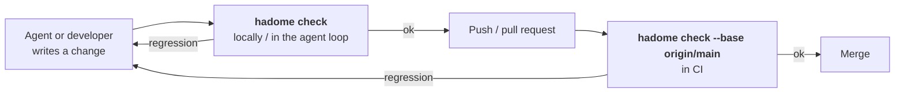
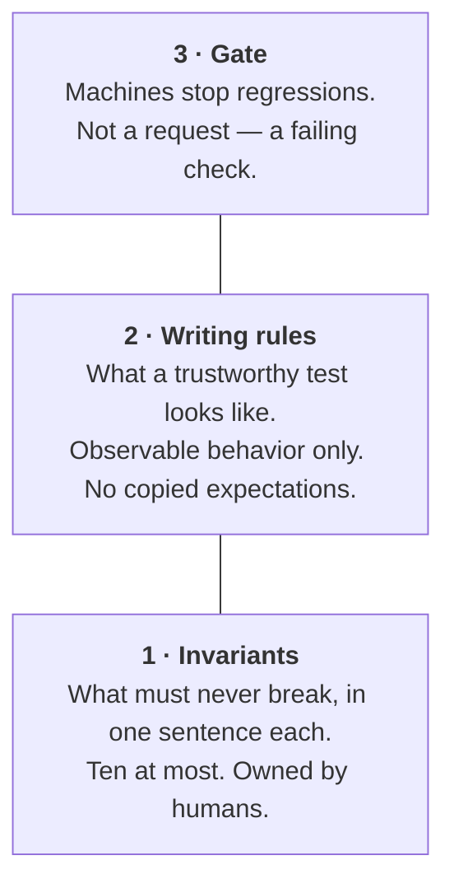

<p align="center">
  <picture>
    <source media="(prefers-color-scheme: dark)" srcset="docs/assets/logo-dark.svg">
    
  </picture>
</p>

<p align="center">
  <b>Stops regressions in your code and tests — not progress.</b><br>
  A ratcheting checker for codebases where AI agents write most of the code.
</p>

<p align="center">
  <a href="LICENSE"></a>
  <a href="https://github.com/rerorets/hadome/releases"></a>
  
</p>

<p align="center">
  English · <a href="README.ja.md">日本語</a>
</p>

---

> [!NOTE]
> **hadome is young (0.x).** Rules and output may still change between minor versions, so pin the exact version, as the quick start does. Problems and ideas are welcome in [Issues](https://github.com/rerorets/hadome/issues).

## The problem

When agents write code faster than anyone can read it, **your tests become the speed limit.** You can only move as fast as you can trust them.

But a passing test suite and a trustworthy test suite are not the same thing. Test suites rarely break loudly — they quietly get weaker:

| What happens | What you see | What it really means |
|---|---|---|
| An assertion becomes `assertTrue(true)` | Green | That test checks nothing |
| A test is skipped "for now" | Green | Nobody remembers why, and it never comes back |
| An assertion is loosened to make a change pass | Green, same test count | The behavior it guarded is no longer guarded |
| A test is deleted during a refactor | Green, one fewer test | Was it a duplicate, or the only guard for something important? |
| A check runs only in debug builds | Green in CI | It silently disappears in release |

None of these fail a build. Code review won't reliably catch them either — not at the rate agents produce changes.

## What hadome does

hadome (歯止め) is a **ratchet** for code quality. It compares your change against your main branch and fails only on things that got **worse**. Existing problems don't block you. Regressions do.

```
existing violations   ──▶  allowed (fix them when you like)
new violations        ──▶  blocked
anything that shrinks
what your tests guard ──▶  blocked
```

It looks at more than code style. Its center is the **test suite itself** — "tests for your tests".

## Quick start

### 1. Add it to your project

Pick the line for your ecosystem (versions are pinned; see [distribution](docs/design/distribution.md)).

```sh
npm install --save-dev --save-exact hadome      # TypeScript / JavaScript
uv add --dev hadome==0.1.0                       # Python
go get -tool github.com/rerorets/hadome/cmd/hadome  # Go (all six languages with a C compiler, Go only without)
cargo binstall hadome@0.1.0                      # Rust
brew install rerorets/tap/hadome                 # anything else
```

```kotlin
// build.gradle.kts — Java / Kotlin
plugins { id("io.github.rerorets.hadome") version "0.1.0" }
```

### 2. Run it

```sh
hadome check
```

No configuration is needed. hadome detects your languages, applies the built-in rules, and compares with your main branch. Everything already in main is the baseline, so there is nothing to fix first.

### 3. Tell your agents

Agents follow what their instructions say. Add this block to `CLAUDE.md`, `AGENTS.md`, or whatever file your agents read — or let hadome do it with `hadome agents --write CLAUDE.md` (it updates the block in place on later runs). The full procedures for agents are in [docs/for-agents.md](docs/for-agents.md).

```markdown
<!-- hadome:begin -->
## hadome

This repository uses hadome to stop regressions in code and tests.

- Before you finish any change, run `hadome check --format json` and fix every regression it reports.
- Exit codes: `0` done · `1` regression, fix it · `2` configuration error, fix the configuration · `3` a person must review (a new exception, a loosened configuration, code that stopped being pure, or something hadome could not identify). On `3`, stop and ask. Never change the code just to make it pass.
- Never add `gate:allow` to get a check to pass. Add one only when the rule truly does not apply, with a specific reason, and tell the person.
- When a test guards a product-specific invariant, add `guards: <id>` to its doc comment; for `durable`, `erasable`, `append-only` and `fail-closed`, add `guards: <type> <target>`. `idempotent`, `round-trip` and `isolated` are recognised from the test's calls. `hadome explain invariants` lists them.
- When `hadome check` lists invariant candidates and one covers behaviour that matters, propose it to the person instead of adding it yourself.
- Before changing `.hadome.yml`, run `hadome explain <key>`. After changing it, run `hadome config check`.
<!-- hadome:end -->
```

### 4. Add it to CI and pre-push (optional)

```sh
hadome check --base origin/main   # in CI, on every pull request
```

### 5. Find your invariants (optional)

```sh
hadome suggest
```

`hadome check` already lists invariant candidates as information — places that usually carry an invariant (things that create, export and import, delete, or read per user). `hadome suggest` prints just that list. Accept the ones that matter; your agents will propose them to you.

## Where it runs in your workflow

hadome is one command. You call it at the points where a change is about to move on, and it answers one question: **did this change make anything worse?**



| Where | What you run | What you get back | What happens |
|---|---|---|---|
| **In an agent's loop** | `hadome check --format json` | Each regression with its rule, file and line, why it matters, and how to fix it | The agent fixes it before submitting. No CI round trip, no reviewer needed to notice |
| **Before you push** | `hadome check` (as a pre-push hook) | A readable list, exit code `1` on any regression | The push stops until the regression is fixed or an exception is written with a reason |
| **In CI, on every pull request** | `hadome check --base origin/main` | Exit code and a summary you can post as a comment | The pull request cannot merge with a regression. Existing violations never block it |
| **On the first day** | `hadome init` | A config file with detected languages and default rules | Nothing to fix first. Everything already in main is the baseline |

hadome itself never talks to GitHub or any other service. CI posts the summary if you want it posted.

### What you configure

One file in your repository. Your thresholds, your dependency diagram, your invariants.

```yaml
# .hadome.yml — every key is optional except schema
schema: 1

invariants:
  - type: idempotent               # built-in type: hadome finds the tests that guard it
    target: api.CreatePost
  - id: billing-1                  # product-specific: tests say `guards: billing-1`
    says: "Totals on the screen and in the API match"

rules:
  tests:
    io: [example.com/acme/db]      # entries added to a built-in table; never removed from it
```

`hadome schema` prints the full specification as a JSON Schema, `hadome explain <key>` describes one key, and `hadome config check` validates the file without running anything.

### How an exception looks

Written where it applies, with a reason. Without a reason, it has no effect.

```go
// gate:allow tests/no-sleep reason: the OS file watcher offers no event to wait on
time.Sleep(50 * time.Millisecond)
```

### Exit codes

| Code | Meaning |
|---|---|
| `0` | No regressions |
| `1` | At least one regression |
| `2` | Configuration error (the check could not be trusted, so it does not pass) |
| `3` | No regressions, but a **new** exception was added and needs a person's review. Exceptions already in main never trigger this |

### Your own gates

Rules only your product knows — "never write UPDATE in the log store", "every migration must be idempotent" — are written as a small program in **your** repository, in any language. hadome calls it on both versions and gives it everything a built-in rule gets: only regressions fail, reasoned exceptions, the same report and exit codes, self-tests. Your product's knowledge never leaves your repository. See [Product-specific gates](docs/external-gates.md).

## How it differs from a linter

| | A typical linter | hadome |
|---|---|---|
| Compared against | The rules only. Reports every violation | **Your main branch.** Reports only new violations and regressions |
| Looks at | How code is written | How code is written, **plus what your tests actually guard** |
| Test deletion | Not its concern | Distinguishes **cleanup** (coverage kept) from **regression** (coverage lost) |
| Languages | One tool per language | **One binary, six languages.** Shared rules, per-language adapters |
| Exceptions | Disable comments, often without reasons | Allowed only with a **reason written in place**. A marker without a reason has no effect |

## The model: three layers

hadome is built around one idea: **humans manage the rules for trustworthy tests, not individual test cases.**



1. **Invariants** — A short list (ten at most) of things that must never break, each tied to the tests that guard it. Deleting or disabling those tests fails the check.
2. **Writing rules** — Test only observable behavior. Never copy expected values from the implementation. Don't read the clock; don't sleep. Never skip silently.
3. **Gate** — hadome. The rules are enforced by a failing check, not by asking nicely.

## Regression vs. cleanup

Counting tests can't tell cleanup from regression — both look like "−3 tests". hadome measures **what your tests guard** instead.

hadome works out the *target* of every test — the functions and methods of your code it calls — without anyone declaring it. The set of targets that active tests reach is the guarded scope. Later, mutation analysis refines it into the set of breakages your tests actually catch.

| What you did | Test count | Guarded scope | hadome says |
|---|---|---|---|
| Merged three duplicate tests into one | ↓ | Same | ✅ Cleanup |
| Removed a test that catches nothing others don't | ↓ | Same | ✅ Cleanup |
| Deleted code, and its tests with it | ↓ | Target is gone | ✅ Cleanup (verified: the target no longer exists) |
| Deleted or weakened an important test | ↓ or same | Shrinks | ❌ Regression |
| Loosened an assertion, same test count | Same | Shrinks (with mutation analysis) | ❌ Regression |

Want to stop guarding a behavior on purpose? Change the spec and remove the behavior. There is no path for "delete the test and hope".

## What it checks

Rules are grouped so that the output tells you what was checked.

| Group | Rules |
|---|---|
| `tests/` | `scope-shrunk` (what tests guard shrank) · `invariant-unguarded` · `no-clock` · `no-sleep` · `always-true` · `skip-without-reason` · `no-mock` (mocks in tests of pure code) · `purity-lost` and `target-unknown` (review) |
| `deps/` | `not-in-diagram` (imports your dependency diagram does not draw) · `diagram-stale` (boxes that name nothing) |
| `size/` | `file-lines` · `function-lines` · `params` · `complexity` · `interface-methods` |
| `comments/` | `todo-format` (TODOs without a when) · `missing-doc` · `broken-reference` (comments pointing at missing documents) |
| `unknown/` | `unread` (review): a file hadome could not read |
| `config/` | `loosened` (review): a change that loosens the rules judging it |

Your own gates join them under your own names ([product-specific gates](docs/external-gates.md)). Each finding says why it matters and how to fix it; the rules are specified in [docs/design](docs/design).

## How it looks

A change that deletes the only test of `store.Append`, adds a sleep to another test, and imports a package the dependency diagram does not allow:

```console
$ hadome check --base main
✗ deps/not-in-diagram          import not in the diagram: store → core (no arrow store --> core)
  store/store.go:3
  why: the diagram (docs/deps.md) is how people and agents know what may depend on what; an import it does not draw makes it wrong
  fix: depend on what the diagram allows, often through an interface the importing unit declares; if the design changed, draw the arrow, which a person reviews
✗ tests/no-sleep               test waits by sleeping: time.Sleep(10 * time.Millisecond)
  worker/worker_test.go:11
  why: a sleep is either too long (a slow suite) or too short (a flaky test); it never waits for the actual event
  fix: wait for the event itself: a channel, a callback, or a condition with a deadline that fails loudly
✗ tests/scope-shrunk           guarded scope shrank: example.com/app/store.Append is no longer exercised by any active test (was: TestAppendKeepsRows)
  store/store_test.go:9
  why: the behaviour of example.com/app/store.Append can now change without any test noticing
  fix: keep or restore a test that calls example.com/app/store.Append, or remove example.com/app/store.Append itself if it is no longer needed
3 regression(s). 0 existing finding(s) unchanged (not blocking).
```

## Languages

One binary. Language adapters handle how to find tests, read imports, and measure size. Rules stay the same.

| | Go | TypeScript | Python | Rust | Java | Kotlin |
|---|:-:|:-:|:-:|:-:|:-:|:-:|
| `tests/` | ✅ | ✅ | ✅ | ✅ | ✅ | ✅ |
| `deps/` | ✅ | ✅ | ✅ | ✅ | ✅ | ✅ |
| `size/` | ✅ | ✅ | ✅ | ✅ | ✅ | ✅ |
| `comments/` | ✅ | ✅ | ✅ | ✅ | ✅ | ✅ |

✅ supported

## Principles

- **Fail on regressions, not on history.** Adoption should never require fixing everything first.
- **Exceptions carry reasons.** A reason is written where the exception is. No reason, no exception.
- **Rules live in configuration, mechanics live in hadome.** Your thresholds, diagram and invariants belong to your repository.
- **Your own checks plug in.** Product-specific gates use the same interface: input, verdict, self-test.
- **The checker checks itself.** Every rule ships with a self-test.
- **No network, no telemetry.** hadome reads your repository and nothing else.

## The name

**歯止め** (*hadome*) is the Japanese word for a **pawl** — the small catch that lets a ratchet wheel turn one way and stops it from slipping back.

In everyday Japanese, 歯止めをかける (*hadome o kakeru*, "to apply the pawl") means **to put a stop to things getting worse.** That is exactly the job: let your codebase move forward, and keep it from sliding back.

## Status and roadmap

- [x] Name, scope and model
- [x] Design documents ([docs/design](docs/design): engine, language adapters, configuration, every rule group, gates, suggestions, distribution)
- [x] Engine: compare with the base branch, renames, reasoned exceptions, self-tests
- [x] Configuration: strict validation, JSON Schema, `explain`, shared layers, loosening needs review
- [x] `tests/` rules — how tests are written, the guarded scope, invariants and purity
- [x] `hadome agents`, `suggest` and `init`, and [a guide for agents](docs/for-agents.md)
- [x] Product-specific gates ([protocol](docs/external-gates.md))
- [x] `deps/`, `size/` and `comments/` rules
- [x] TypeScript, Python, Rust, Java and Kotlin (with tree-sitter; the pure-Go build reads Go only and reports the rest as unread)
- [ ] Published in every ecosystem — the packages and the release workflow are ready ([releasing](docs/releasing.md)); publishing waits for the registries' accounts
- [ ] Mutation-based scope

## License

[MIT](LICENSE)
