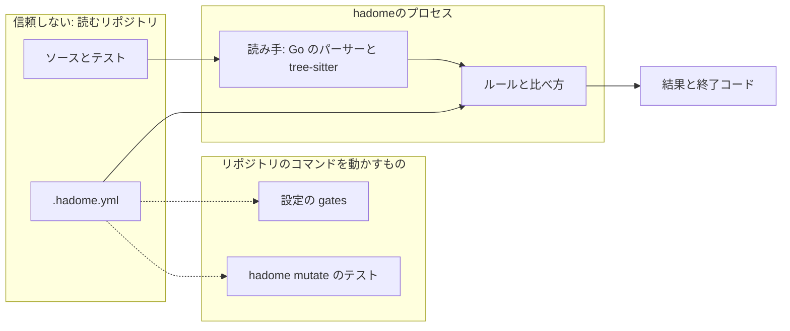

# セキュリティの保証

hadomeが何を守り、そのために何をしているかをまとめます。脆弱性の報告の手順は[セキュリティ](../SECURITY.ja.md)にあります。

## 守るもの

| 守るもの | 損なわれると何が起きるか |
|---|---|
| 利用者のマシンとCI | hadomeを動かしただけで、意図しないコマンドが動く、ファイルが書き換わる、外に情報が送られる |
| チェックの結果 | 壊れた入力で、止めるべき変更を通す、または落ちて止まる |
| 配るバイナリ | 配る途中で差し替えられたものが、利用者のマシンで動く |

## 信頼の境界

hadomeが信頼しないのは、読むリポジトリの中身です。変更を出した人が誰でも、その版のファイル・設定・テストはhadomeにとって外から来た入力です。

- **読むだけの部分。** `hadome check`は、ファイルを読んで構文を解析するだけです。リポジトリのコードを実行しません
- **コマンドを動かす部分。** 設定の`gates`と`hadome mutate`はリポジトリのコマンドを実行します。この2つは、リポジトリのほかのスクリプトと同じ信頼で動くものとして扱います。信頼できないリポジトリでは、`gates`を先に確かめ、`hadome mutate`は動かさないでください

## 脅威と対策

| 脅威 | 対策 |
|---|---|
| 細工したファイルで、解析の部分を壊す | Goで書いた部分はメモリ安全です。C で書かれた tree-sitter の文法には、ファズテストを AddressSanitizer つきで CI で流しています |
| 細工した設定やテストで、終わらなくする | `gates`のコマンドと`hadome mutate`のテストのコマンドには、時間の上限があります。テストのコマンドは、上限を超えたらプロセスの木ごと終わらせます（[ミューテーションの設計](design/mutation.ja.md)） |
| シンボリックリンクで、リポジトリの外を書き換える | hadomeはリポジトリの作業ツリーを書き換えません。`hadome mutate`の一時ディレクトリがシンボリックリンクか、ほかの利用者のものなら、書き込まずに終了コード`2`で止まります |
| 通信で情報を送る、設定を取りに行く | hadomeは通信しません。設定をネットワークから読まないことは、hadome自身の不変条件（`.hadome.yml`の`no-network`）として確かめています |
| 設定を緩めて、チェックをすり抜ける | 例外や設定を緩める変更は、終了コード`3`で人の確認に回ります。理由の無い例外は効きません |
| 配るバイナリの差し替え | リリースは GitHub Actions だけで作り、SHA256SUMS と minisign の署名を添えます。npm・PyPI・crates.io には、トークンを置かない trusted publishing で公開します。ワークフローの Actions はコミットの SHA で固定しています |

## 設計の原則

- **最小の権限。** ワークフローのトークンは既定で読み取りだけです。公開するジョブだけが要る権限を持ちます。公開の資格情報はバージョンのタグからしか使えない環境に置きます
- **既定で安全側。** 試せなかったもの、特定できなかったものは、通さずに人の確認（終了コード`3`）に回します
- **仕組みを小さく。** 1つのGoのバイナリで、実行時に取りに行くものはありません
- **入力の検査。** `.hadome.yml`は読み込むときにスキーマで確かめ、知らないキーや型の違う値は終了コード`2`で止めます

## よくある弱点への対策

| 弱点 | 対策 |
|---|---|
| メモリの破壊（CWE-119 など） | Goの部分は言語が防ぎます。Cの文法はファズテストとAddressSanitizerで確かめます |
| コマンドの注入（CWE-78） | 実行するのは、設定に書かれたコマンドとgitだけです。コマンドはシェルを通さず、引数の並びのまま実行します。`{tests}`などで入れるテストの名前も、それぞれ1つの引数として渡します |
| パスの書き換え（CWE-22・CWE-59） | 書き込むのは自分の作業用のディレクトリだけで、シンボリックリンクと他人のディレクトリには書きません |
| 秘密の漏れ（CWE-798） | リポジトリに資格情報を置きません。GitHubのシークレットの検出とpushの拒否を有効にしています |

## 確かめ方

- CodeQL がプルリクエストとmainへのpushのたびに、Go・Actionsなどのコードを解析します
- OpenSSF Scorecard が、リポジトリの設定を毎週確かめます
- 依存の脆弱性は Dependabot が知らせ、依存は毎週上げます
