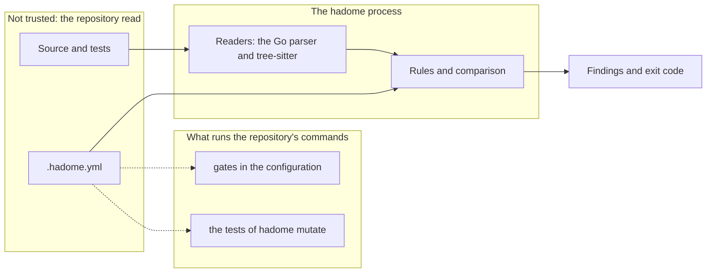

# Security assurance case

What hadome protects, and what it does to protect it. How to report a vulnerability is in [Security](../SECURITY.md).

## What is protected

| What | What happens if it is harmed |
|---|---|
| The user's machine and CI | Merely running hadome runs an unintended command, rewrites files or sends information out |
| The result of the check | Broken input lets a change through that should be stopped, or makes hadome crash |
| The binaries hadome ships | A binary replaced on the way runs on the user's machine |

## Trust boundaries

hadome does not trust the contents of the repository it reads. Whoever made the change, that version's files, configuration and tests are input from outside.

- **The part that only reads.** `hadome check` reads files and parses them. It does not run the repository's code
- **The parts that run commands.** `gates` in the configuration and `hadome mutate` run the repository's commands. They are treated as trusted to the same degree as the repository's other scripts. On a repository you do not trust, read its `gates` first, and do not run `hadome mutate`

## Threats and countermeasures

| Threat | Countermeasure |
|---|---|
| A crafted file breaks the parsing | The parts written in Go are memory-safe. The tree-sitter grammars, written in C, are fuzzed with AddressSanitizer in CI |
| A crafted configuration or test never finishes | The commands of `gates` and the test command of `hadome mutate` have a time limit. A test command over its limit is ended together with its whole process tree ([mutation design](design/mutation.md)) |
| A symbolic link makes hadome write outside the repository | hadome never rewrites the repository's working tree. If the temporary directory of `hadome mutate` is a symbolic link or belongs to another user, hadome stops with exit code `2` without writing to it |
| Information is sent out, or configuration is fetched, over the network | hadome does not talk to the network. That it never reads configuration from the network is one of hadome's own invariants (`no-network` in `.hadome.yml`) |
| A crafted file name or exception reason that slips a forged display or command into the terminal or the CI log | The `text` output writes a value with a control character quoted and escaped. In `json`, `encoding/json` escapes it. [The CI example](ci.md) escapes the values it puts into warning commands and table cells |
| Loosening the configuration to slip past the check | Exceptions and changes that loosen the configuration go to a person's review with exit code `3`. An exception without a reason has no effect |
| The shipped binaries are replaced | Releases are built only by GitHub Actions, with SHA256SUMS and minisign signatures. npm, PyPI and crates.io packages are published through trusted publishing, with no tokens stored. The workflows' actions are pinned to commit SHAs |

## Design principles

- **Least privilege.** Workflow tokens are read-only by default. Only the jobs that publish get the permissions they need. Publishing credentials are kept in environments that only version tags can use
- **Fail safe.** What hadome could not try or could not identify is not let through; it goes to a person's review (exit code `3`)
- **Economy of mechanism.** One Go binary that fetches nothing at run time
- **Input validation.** `.hadome.yml` is checked against its schema when read; unknown keys and values of the wrong type stop hadome with exit code `2`

## Common weaknesses

| Weakness | Countermeasure |
|---|---|
| Memory corruption (CWE-119 and others) | The language protects the Go parts. The C grammars are checked by fuzzing with AddressSanitizer |
| Command injection (CWE-78) | hadome runs only the commands written in the configuration, and git. Commands do not go through a shell; they run as lists of arguments. Test names put in through `{tests}` and the like are each passed as one argument |
| Path traversal and link following (CWE-22, CWE-59) | hadome writes only to its own working directories, and never to a symbolic link or another user's directory |
| Leaked secrets (CWE-798) | No credentials are kept in the repository. GitHub secret scanning and push protection are on |

## How this is checked

- CodeQL analyses the Go code, the Actions workflows and the rest on every pull request and push to main
- OpenSSF Scorecard checks the repository's setup every week
- Dependabot reports vulnerable dependencies, and dependencies are updated every week
