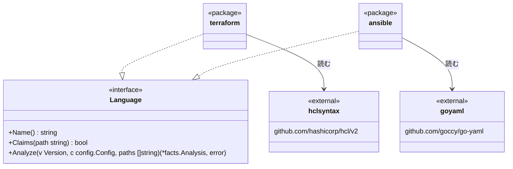

# Terraform と Ansible のアダプタ

この文書は [adapters.ja.md](adapters.ja.md) のうち、Terraform と Ansible の部分を書く。どちらもインフラの構成を書く言語で、関数もクラスも無い。そこで、ほかの言語と同じ事実のうち、意味の通るものだけを埋める。埋めない事実はルールから空に見え、そのルールは何も報告しない。

## 形



- パッケージ `internal/adapter/terraform` と `internal/adapter/ansible` を足す。どちらも Go のアダプタと同じく純粋な Go で書くので、cgo の無いビルドでも読める
- Terraform は、Terraform 自身が使う HCL のパーサー（`hashicorp/hcl/v2` の `hclsyntax`）で読む。tree-sitter の HCL の文法は使わない。Go のバインディングを持つ版が ABI 15 で、hadome が使う Go のバインディング（ABI 14 まで）では読めないからだ
- `hashicorp/hcl/v2` のライセンスは MPL-2.0 である。MPL はファイル単位で効くので、hadome のコードは MIT のままでよい。配る実行ファイルには MPL-2.0 の本文と、`hashicorp/hcl/v2` のソースの在りかを書いた文書を添える
- Ansible は設定を読むのに使っている `goccy/go-yaml` で読む。依存は増えない
- 依存の図には `internal/adapter --> internal/adapter/terraform` と、`internal/adapter/terraform` から `engine`、`config`、`facts` への矢印を足す。Ansible の矢印は、Ansible のアダプタを足すときに、使うものの分だけ足す

## ファイルと役割

| 言語 | 受け持つファイル | テストのファイル | 役割が other のもの |
|---|---|---|---|
| Terraform | `*.tf` | `*.tftest.hcl` | `*.tfvars`（値だけで、読むものが無い） |
| Ansible | `roles/<ロール>/` の下の `tasks/`、`handlers/`、`defaults/`、`vars/`、`meta/` の `*.yml` と `*.yaml`。`playbooks/` の下と、ルートの `site.yml`、`playbook.yml` | `molecule/<シナリオ>/` の下の `*.yml`（ロールの下にあるものも含む） | なし |

`files.tests` は Terraform のファイルに当てない。Go と同じく、テストかどうかは Terraform 自身が `*.tftest.hcl` という名前で決めるからだ。

Ansible が YAML のファイルをすべて受け持たないのは、YAML が CI の設定や `.hadome.yml` のように、Ansible でないものにも使われるからだ。受け持つかどうかはほかの言語と同じくパスだけで決める。

この配置から外れたプレイブック（ルートの `deploy.yml` など）は、`.hadome.yml` の `files.ansible` に glob で足す。

```yaml
files:
  ansible: ["deploy/*.yml", "ops/site-*.yml"]
```

- 足したファイルはプレイブックとして読む
- 項目を消すと、読むファイルが減るので緩める変更になる（`LooserWhenRemoved`）。足すのは緩めない

## ユニット

| 言語 | ユニット | ID | 場所 | シンボルの ID |
|---|---|---|---|---|
| Terraform | モジュール（ディレクトリ） | そのディレクトリ | そのディレクトリ | `<directory>.var.<name>`、`<directory>.output.<name>` |
| Ansible | ロール | ロールの名前 | `roles/<ロール>`。プレイブックはそのディレクトリ | `<role>.<name>` |

Terraform のシンボルの ID には、モジュールの中での呼び方（`var.region`、`output.region`）を入れる。同じ名前の `variable` と `output` を区別するためだ。ルートのモジュールでは、前にディレクトリを付けない（`var.region`、`output.vpc_id`）。

## import

| 言語 | import になるもの | 内部になるとき | 外部の名前 |
|---|---|---|---|
| Terraform | `module` ブロックの `source`。`terraform { required_providers { … } }` の各 `source` | `source` が `./` か `../` で始まる。そのディレクトリに解決する | レジストリのアドレス（`hashicorp/consul/aws`）、プロバイダのアドレス（`hashicorp/aws`）。git や `s3::` などの `source` は、`?ref=` などのクエリと `//` のあとのサブディレクトリを除いたもの |
| Ansible | `meta/main.yml` の `dependencies`、プレイの `roles:`、`include_role` と `import_role`（`ansible.builtin.` を付けたものを含む）の `name` | リポジトリにそのロールがある | ロールかコレクションの名前（`community.general`） |

- Ansible のロールの名前に `{{ }}` を使ったものは、行き先が実行するまで決まらない import（`Import.Unknown`）として `unknown/import` に回す
- Terraform の `source` には式を書けないので、行き先が決まらない import は無い
- `required_providers` の import は入出力（`IO`）とする。モジュールはプロバイダを通して外に触れるからだ。`module` の import が入出力になるのは、`rules.tests.io` に挙げたときだけである
- `resource` か `data` のブロックがあるファイルは、そのプロバイダの import を持つものとし、入出力とする。`required_providers` に書いていなくても、プロバイダに触れるからだ。プロバイダは、`provider` の引数か型の名前の最初の語（`aws_vpc` なら `aws`）を、同じモジュールの `required_providers` で引いて決める。そこに無ければ、Terraform と同じく `hashicorp/<名前>` とする
- `variable`、`output`、`locals` だけのモジュールは、外に触れないので純粋なままである

## シンボル

Terraform の `variable` と `output` はモジュールの入口と出口である。そこで、種類 `value` のシンボルとして、どちらも公開にする。`description` があれば doc があるとみなす。これで `comments/missing-doc` が `description` の無い新しい `variable` と `output` を報告する。

| 言語 | シンボル | 公開 | doc にあたるもの |
|---|---|---|---|
| Terraform | `variable` と `output`（種類 `value`） | いつも | `description` の属性 |
| Ansible | ロールの `defaults/main.yml` の各変数（種類 `value`） | 名前が `_` で始まらない | `meta/argument_specs.yml` の、その変数の `description` |

- `facts` に種類 `SymbolValue`（`"value"`）を足す。関数を数えるルール（`size/` の複雑度と引数、`hadome mutate` が壊す関数）は種類で絞っているので、`value` は数えない
- `resource`、`data`、`locals`、Ansible のタスクはシンボルにしない。外から名指されるものではないからだ

## テスト

| 言語 | テストとは | assert とみなすもの | 呼ぶもの（`Calls`） | 危険 |
|---|---|---|---|---|
| Terraform | `*.tftest.hcl` の各 `run` ブロック。名前は `run` のラベル | `assert` ブロック、`expect_failures` | `variables` で値を渡す `variable`、`assert` の `condition` が読む `output`。対象は、`run` の中の `module { source }` があればそのモジュール、無ければテストのファイルのモジュール（`tests/` の下なら1つ上のディレクトリ） | `mock_provider`、`override_resource`、`override_data`、`override_module` を `mock` とする |
| Ansible | Molecule の各シナリオの `verify.yml` | `assert`（`ansible.builtin.assert`）のタスク、`failed_when` を付けたタスク | 同じシナリオの `converge.yml` が使うロール | `pause`（`ansible.builtin.pause`）を `sleep` とする |

- どちらにもスキップの書き方は無い
- Terraform で `run` の外に書いた `variables` と `mock_provider` などは、そのファイルのすべての `run` に効くものとして読む
- テストの本体の指紋（`Test.Body`）はブロックかタスクの字句から、ほかの言語と同じ決まりで作る

## コメント

| 言語 | コメント | ディレクティブ |
|---|---|---|
| Terraform | `#`、`//`、`/* */` | `tflint-ignore`、`checkov:skip`、`trivy:ignore` |
| Ansible | `#` | `noqa`、`yamllint` |

例外の印（`gate:allow`）はどちらでもコメントに書く。

## 効くルール

| ルール | Terraform | Ansible |
|---|---|---|
| `deps/` | モジュールの依存。プロバイダを使ってよいモジュールを絞れる | ロールの依存 |
| `comments/` | `description` の無い `variable` と `output` | `argument_specs` に説明の無い変数 |
| `size/` | ファイルの行数 | ファイルの行数 |
| `tests/` | `run` の数と assert。`mock_provider` の使いすぎ | assert の無い `verify.yml` |
| `unknown/` | 読めなかったファイル | 読めなかったファイル。行き先の決まらないロール |
| `hadome mutate` | 関数が無いので壊さない | 同じ |

## 読めなかったファイル

HCL のパーサーが誤りを返した `*.tf`、または YAML として読めなかったファイルには、`Unread` の印を付ける。Go のアダプタと同じく、そのファイルからは何も読まない。

## 不変条件

1. どちらのアダプタもコードを実行せず、`terraform` も `ansible` も呼ばない。読むのはファイルの字句と構文だけである
2. 受け持つファイルは読むか、読めなかったと報告するかのどちらかで、無視されることは無い
3. 受け持つかどうかはパスと `files.ansible` だけで決まる。ファイルの中身は見ない

## 意図して入れなかったもの

- `*.tf.json`、Terragrunt、`terraform` の backend と workspace
- Ansible のインベントリ、コレクションのプラグイン（Python のファイルは Python のアダプタが読む）、`include_tasks` のファイル名での読み込み
- Molecule 以外の Ansible のテスト（`ansible-test` など）
- 式の評価。`count`、`for_each`、Jinja の式の値は読まない
