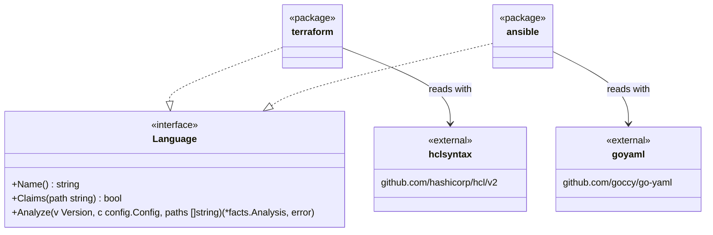

# Adapters for Terraform and Ansible

This document covers the Terraform and Ansible part of [adapters.md](adapters.md). Both describe infrastructure, and neither has functions or classes. So of the facts the other languages fill in, only those that make sense are filled. A fact left unfilled looks empty to the rules, and those rules report nothing.

## Shape



- Packages `internal/adapter/terraform` and `internal/adapter/ansible` are added. Both are pure Go, like the Go adapter, so the build without cgo reads them too
- Terraform is read with the HCL parser Terraform itself uses (`hclsyntax` from `hashicorp/hcl/v2`), not with tree-sitter's HCL grammar. The versions of that grammar with Go bindings are built for ABI 15, which the Go binding hadome uses (ABI 14 at most) cannot load
- `hashicorp/hcl/v2` is licensed under MPL-2.0. MPL applies file by file, so hadome's code stays MIT. The distributed executables ship with the MPL-2.0 text and a note on where the source of `hashicorp/hcl/v2` is
- Ansible is read with `goccy/go-yaml`, which already reads the configuration. No dependency is added
- The dependency diagram gains `internal/adapter --> internal/adapter/terraform & internal/adapter/ansible`, and arrows from both to `engine`, `config` and `facts`
- `Claims(path)` takes only a path, so it cannot see `files.ansible` in the configuration. The Ansible adapter therefore also has `ClaimsConfigured(c, path)`, and `internal/adapter` asks a language that has it through `ClaimsConfigured`

## Files and roles

| Language | Files claimed | Test files | Role other |
|---|---|---|---|
| Terraform | `*.tf` | `*.tftest.hcl` | `*.tfvars` (values only; nothing to read) |
| Ansible | `*.yml` and `*.yaml` under `tasks/`, `handlers/`, `defaults/`, `vars/` and `meta/` of `roles/<role>/`; under `playbooks/`; and `site.yml` and `playbook.yml` at the root | `*.yml` under `molecule/<scenario>/` (including those inside a role) | None |

`roles/`, `playbooks/` and `molecule/` may be at any depth, so that Ansible inside a larger repository (`ansible/roles/web`) is read too. Only the `site.yml` and `playbook.yml` at the root are claimed.

`files.tests` does not apply to Terraform and Ansible files. As for Go, Terraform itself decides what a test is, by the name `*.tftest.hcl`, and in Ansible the layout of Molecule's scenarios decides it.

Ansible does not claim every YAML file because YAML holds things that are not Ansible too, such as CI settings and `.hadome.yml`. As for the other languages, whether a file is claimed depends on its path alone.

A playbook outside this layout (a `deploy.yml` at the root, say) is added by glob under `files.ansible` in `.hadome.yml`.

```yaml
files:
  ansible: ["deploy/*.yml", "ops/site-*.yml"]
```

- The added files are read as playbooks
- Removing an entry reads fewer files, so it loosens the configuration (`LooserWhenRemoved`). Adding one does not

## Units

| Language | Unit | ID | Location | Symbol ID |
|---|---|---|---|---|
| Terraform | Module (a directory) | The directory | The directory | `<directory>.var.<name>`, `<directory>.output.<name>` |
| Ansible | Role | The role's name | `roles/<role>`; a playbook's is its directory | `<role>.<name>` |

A Terraform symbol's ID holds the name the module uses for it (`var.region`, `output.region`), so that a `variable` and an `output` of the same name stay apart. In the root module no directory goes in front (`var.region`, `output.vpc_id`).

## Imports

| Language | What is an import | Internal when | External name |
|---|---|---|---|
| Terraform | The `source` of a `module` block; each `source` in `terraform { required_providers { … } }` | The `source` starts with `./` or `../`; it resolves to that directory | A registry address (`hashicorp/consul/aws`) or a provider address (`hashicorp/aws`). A git, `s3::` or similar `source` without its query (`?ref=` and the like) and without the subdirectory after `//` |
| Ansible | `dependencies` in `meta/main.yml`, a play's `roles:`, and the `name` of `include_role` and `import_role` (also with `ansible.builtin.`) | The role is in the repository | The role's or collection's name (`community.general`) |

- An Ansible role name using `{{ }}` has a destination decided only at run time, so it is an import whose destination is unknown (`Import.Unknown`), for `unknown/import`
- A Terraform `source` cannot hold an expression, so no import has an unknown destination
- An Ansible import of an external role or collection performs input and output only when it is listed in `rules.tests.io`
- A `required_providers` import performs input and output (`IO`): a module reaches outside through its providers. A `module` import does only when it is listed in `rules.tests.io`
- A file with a `resource` or `data` block has an import of that block's provider, which performs input and output: it reaches the provider even when `required_providers` does not name it. The provider is the local name in the `provider` argument, or else the first word of the type (`aws` for `aws_vpc`), looked up in the same module's `required_providers`. A name not found there is `hashicorp/<name>`, as in Terraform
- A module of only `variable`, `output` and `locals` reaches nothing outside, so it stays pure

## Symbols

Terraform's `variable` and `output` are a module's way in and way out. So both are symbols of kind `value`, and both are exported. A `description` counts as a doc. With this, `comments/missing-doc` reports a new `variable` or `output` without a `description`.

| Language | Symbols | Exported | What counts as a doc |
|---|---|---|---|
| Terraform | `variable` and `output` (kind `value`) | Always | The `description` attribute |
| Ansible | Each variable in a role's `defaults/main.yml` (kind `value`) | When its name does not start with `_` | That variable's `description` in `meta/argument_specs.yml` |

- `facts` gains the kind `SymbolValue` (`"value"`). Rules that count functions (`size/` complexity and parameters, the functions `hadome mutate` breaks) select by kind, so they do not count values
- `resource`, `data`, `locals` and Ansible tasks are not symbols, since nothing outside names them

## Tests

| Language | What is a test | What counts as an assert | What it calls (`Calls`) | Hazards |
|---|---|---|---|---|
| Terraform | Each `run` block in `*.tftest.hcl`, named by its label | `assert` blocks and `expect_failures` | The `variable`s given values in `variables`, and the `output`s an `assert`'s `condition` reads. They belong to the module in the run's `module { source }` if there is one, or else to the test file's module (the directory above, for a file under `tests/`) | `mock_provider`, `override_resource`, `override_data` and `override_module` are `mock` |
| Ansible | Each Molecule scenario's `verify.yml`, named by the scenario | `assert` (`ansible.builtin.assert`) tasks, and tasks with `failed_when` | The repository's roles the same scenario's `converge.yml` uses | `pause` (`ansible.builtin.pause`) is `sleep` |

- Neither has a way to skip a test
- What an Ansible test calls is a role, that is, a unit itself. So `Call.Target` holds the role's name (the unit's ID). While the role is still in head, `tests/scope-shrunk` does not take it as removed
- A role `converge.yml` names with `{{ }}` counts as a call that could not be identified (`Unresolved`)
- Except that a role a scenario under `roles/<role>/molecule/<scenario>/` names as `{{ lookup('env', 'MOLECULE_PROJECT_DIRECTORY') | basename }}` is the role holding the scenario. Molecule sets that variable to the role's directory, so this is not a guess. Whitespace, the kind of quotes and the `ansible.builtin.env` spelling do not matter. In a scenario outside a role, it cannot be identified, like any other `{{ }}`
- In Terraform, `variables`, `mock_provider` and the like written outside `run` blocks apply to every `run` of the file
- A test's body fingerprint (`Test.Body`) is made from the block's or tasks' tokens, by the same rules as in the other languages

## Comments

| Language | Comments | Directives |
|---|---|---|
| Terraform | `#`, `//`, `/* */` | `tflint-ignore`, `checkov:skip`, `trivy:ignore` |
| Ansible | `#` | `noqa`, `yamllint` |

Exception markers (`gate:allow`) are written in comments in both.

## Rules that apply

| Rule | Terraform | Ansible |
|---|---|---|
| `deps/` | Module dependencies; which modules may use a provider can be limited | Role dependencies |
| `comments/` | `variable` and `output` without a `description` | Variables without a description in `argument_specs` |
| `size/` | File lines | File lines |
| `tests/` | The number of `run` blocks and asserts; `mock_provider` and `override_*` are mocks to `tests/no-mock` | A `verify.yml` without asserts; a role that lost its only scenario (`tests/scope-shrunk`); a scenario that uses no role of the repository (`tests/guards-nothing`); `pause` |
| `unknown/` | Files that could not be read | Files that could not be read; roles with an unknown destination |
| `hadome mutate` | Breaks nothing, since there are no functions | The same |

## Unread files

A `*.tf` file for which the HCL parser returns an error, or a file that cannot be read as YAML, is marked `Unread`. As in the Go adapter, nothing is read from it.

## Invariants

1. Neither adapter runs code, `terraform` or `ansible`. They read only the files' tokens and syntax
2. A claimed file is either read or reported as unread, never ignored
3. Whether a file is claimed depends on its path and `files.ansible` alone, never on its content

## Deliberately left out

- `*.tf.json`, Terragrunt, and `terraform` backends and workspaces
- Ansible inventories, collection plugins (their Python files are read by the Python adapter), and loading by file name through `include_tasks`
- Ansible tests other than Molecule (`ansible-test` and the like)
- Evaluating expressions: the values of `count`, `for_each` and Jinja expressions are not read
