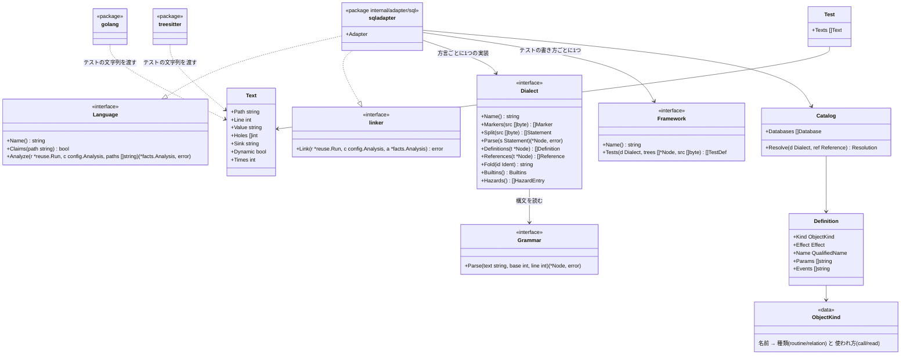

# SQL のアダプタ

この文書は [adapters.ja.md](adapters.ja.md) のうち SQL の部分を書きます。SQL のアダプタは `.sql` ファイルで定義したデータベースのオブジェクトを製品のシンボルにします。そして、テストの中の SQL の文字列がそのオブジェクトを名指すと、テストがそれを呼ぶ（または読む）と数えます。

例: `db/functions.sql` に次の定義があるとします。

```sql
CREATE FUNCTION billing.is_active(account_id int, ttl int) RETURNS boolean
LANGUAGE sql AS $$ SELECT true $$;
```

TypeScript のテストが次の文字列を渡すと、そのテストは `billing.is_active` を守ります。

```ts
const { rows } = await pool.query("SELECT billing.is_active(1, 3600) AS ok");
```

このテストは、`db/functions.sql` で定義した `billing.is_active` を確かめています。このアダプタは、`.sql` で定義したオブジェクトをシンボルとして読み、テストの SQL の文字列をその呼び出しとして読みます。そのため、このテストは `billing.is_active` を守るテストになります。`billing.is_active` を守る最後のテストを消すと、`tests/scope-shrunk` が後退として報告します。

## 責務

すること:

- `.sql` ファイルを方言ごとに読み、関数、手続き、ビュー、テーブルなどの定義をシンボルにします
- 移行（migration）のように同じオブジェクトを何度も定義し直すファイルの並びから、head の時点で残っているオブジェクトを決めます
- テストのコードが持つ文字列（ほかの言語のアダプタが渡す）を SQL として読み、名指したオブジェクトを `Calls` か `Reads` にします
- SQL で書いたテスト（pgTAP、tSQLt、utPLSQL）を、テストとして読みます
- 方言やオブジェクトを特定できないときは、推測せずに、特定できなかったと報告します

しないこと:

- データベースにつなぐこと、SQL を実行すること、`psql` などのツールを呼ぶこと
- 製品のコード（テストでないコード）の文字列の SQL を読むこと（「製品のコードの中の SQL」）
- 関数の本体の中を読んで、オブジェクトどうしの呼び出しをたどること
- ORM やクエリビルダが作る SQL を推し量ること

## 形



- **パッケージ。** `internal/adapter/sql` です。方言ごとのパーサは、その下の `internal/adapter/sql/grammar/<方言>` にあり、どれも生成したコードです（[sql-grammars.ja.md](../maintaining/sql-grammars.ja.md)）。依存の図では、`internal/adapter/sql/...` を1つの箱にし、`internal/adapter` からの矢印と、`engine`、`config`、`facts`、`walk` への矢印を引きます。ほかの言語のアダプタは `sql` を import しません
- **ほかのパッケージから見える型。** 増えるのは `facts` の3つだけです。`Test.Texts`（`Text` の並び）、シンボルの種類 `SymbolRoutine`（`"routine"`）と `SymbolRelation`（`"relation"`）です。`Dialect`、`Grammar`、`Framework`、`Catalog`、`Definition` は `sql` パッケージの中の型で、外からは見えません
- **`Text`。** テストのコードが持つ文字列です。ほかの言語のアダプタが埋めます。アダプタは SQL を知りません。文字列の値と、埋め込みの穴の位置と、どの呼び出しに渡したか（`Sink`）だけを渡します
  - `Holes` は、`${…}` や f 文字列の `{…}` のような埋め込みの位置です
  - `Sink` は、文字列を渡した引数の種類です。言語ごとの表（後述の「SQL を受け取る呼び出し」）で決まります。SQL を受け取る引数なら `sql`、それ以外は空です
  - `Dynamic` は、SQL を受け取る引数に、文字列のリテラルでない値を渡したときに真です。`Value` は空です
- **`linker`。** すべての言語が読み終わった後に、`internal/adapter` が呼ぶ省略できるインターフェースです。`ClaimsConfigured` と同じく、持つ言語にだけ呼びます。SQL のアダプタはここで各テストの `Texts` を読み、`Calls`、`Reads`、`Unresolved`、危険を足します
- **拡張の口。** 次の3つは既存のインターフェースの後ろに実装かデータを足すだけで済みます。ほかのパッケージが見る型は変わりません
  - **方言を足す**: `Dialect` の実装を1つ足し、方言の表に登録します
  - **オブジェクトの種類を足す**: `ObjectKind` の表に1行足します。行は種類の名前、シンボルの種類（`routine` か `relation`）、テストでの使われ方（`call` か `read`）です
  - **テストの SQL を渡す言語を足す**: その言語のアダプタが `Test.Texts` を埋めます。SQL のアダプタは変わりません
  - SQL で書いたテストの書き方を足すときは、`Framework` の実装を1つ足します
- **構文を読む部分の差し替え。** `Dialect` は構文を `Grammar` で読みます。方言の構文を読む実装を替えても、`Dialect` の外は変わりません

## 方言

### 対象にする方言

次の7つの方言の読み手を持ちます。方言は、下の「方言を有効にする条件」を満たしてから有効にします。有効でない方言は、読み手が hadome に入っていても選べません。

| 方言 | 名前（設定） | 文法 | 有効 | 理由 |
|---|---|---|---|---|
| PostgreSQL | `postgresql` | grammars-v4 の `sql/postgresql` | 有効 | 関数と手続きを製品のロジックとして使うことが多い |
| MySQL、MariaDB | `mysql` | grammars-v4 の `sql/mysql/Positive-Technologies` | 有効 | 広く使われる。MariaDB は MySQL と同じ読み手で読む |
| SQLite | `sqlite` | grammars-v4 の `sql/sqlite` | 有効でない | アプリに組み込むデータベースとして広く使われる。ビュー、トリガ、テーブルを持つ |
| SQL Server | `tsql` | bytebase/parser の `tsql`（grammars-v4 の `sql/tsql` を速くしたもの） | 有効でない | 手続きを製品のロジックとして使うことが多い |
| Oracle | `oracle` | grammars-v4 の `sql/plsql` | 有効でない | パッケージと手続きを製品のロジックとして使うことが多い |
| BigQuery | `bigquery` | bytebase/parser の `googlesql` | 有効 | データの処理で使う。関数、テーブル関数、手続きを SQL で書く |
| Snowflake | `snowflake` | grammars-v4 の `sql/snowflake` | 有効でない | データの処理で使う。関数、手続き、タスクを SQL で書く |

- どの文法も、元の文法から直したところに `hadome:` のコメントがあります（[sql-grammars.ja.md](../maintaining/sql-grammars.ja.md)）
- hadome のバイナリには、有効な方言の文法だけが入ります。有効でない方言の文法は、ビルドのタグ `sqlgrammars` を付けたときだけ入ります。試しと、その方言の読み手の単体テストに使います
- 有効でない方言を設定で選ぶと、設定の誤り（終了コード `2`）になります。有効でない方言を印が指すファイルは、読めなかったファイルになります
- 方言を有効にするときは、その方言の文法をすべてのビルドに入れ、設定が受け付ける方言の一覧に足します。ほかは変わりません（[sql-grammars.ja.md](../maintaining/sql-grammars.ja.md)）

### 方言を有効にする条件

方言を有効にするのは、次の2つを、実際のコードで確かめた後です。

- 定義を正しく読めること。シンボルの抜けと、無いシンボルの作り出しが無いこと
- テストの中の SQL の名指しを正しく解決できること。取り違えと見落としが無いこと

試しで見つけた抜けや取り違えは、自己テストの事例にしてから直します。有効にしていない方言は設定で選べません（終了コード `2`）。有効にしていない方言を印が指すファイルは、読めなかったファイルにします。

試しに使う公開のコードは、後述の「試しに使う公開のコード」にあります。

hadome そのものはネットワークに触れません（[adapters.ja.md](adapters.ja.md) の不変条件1）。試しのために公開のリポジトリを手元に取ってくるのは開発の作業で、hadome の動きではありません。

### 方言の決め方

ファイルごとに方言を決めます。決め方は次の順です。

1. 設定の `sql.databases` で、そのファイルを含むデータベースに `dialect` を書いていれば、それにします。設定がいつも勝ちます
2. 書いていなければ、ファイルの中身の印から決めます。印は方言ごとの表で、下はその例です
3. 印の無いファイルは、同じデータベースのほかのファイルの印がすべて1つの方言を指すとき、その方言にします
4. どれでも決まらないとき、または1つのファイルに2つ以上の方言の印があるときは、方言が分かりません。そのファイルを読めなかったファイル（`Unread`）として報告します。推測で選ぶことはしません

| 方言 | 印の例 |
|---|---|
| PostgreSQL | `$$` や `$tag$` で囲んだ本体、`LANGUAGE plpgsql`、`CREATE EXTENSION`、`::` の型変換 |
| MySQL | `DELIMITER` の行、`ENGINE=`、`` ` `` で囲んだ1つの名前、`AUTO_INCREMENT` |
| SQLite | `AUTOINCREMENT`、`WITHOUT ROWID`、`PRAGMA` |
| SQL Server | 1行だけの `GO`、`[` `]` で囲んだ名前、`@` で始まる変数、`CREATE PROCEDURE … AS BEGIN`、`NVARCHAR(MAX)` |
| Oracle | `CREATE PACKAGE`、`CREATE PACKAGE BODY`、1行だけの `/`、`VARCHAR2`、`IS BEGIN` |
| BigQuery | `` ` `` で囲んだ、`.` を含む名前（`` `proj.ds.t` ``）、`CREATE TABLE FUNCTION`、`LANGUAGE js`、`OPTIONS(` |
| Snowflake | `CREATE … TASK`、`CREATE … STREAM`、`CREATE … STAGE`、`LANGUAGE JAVASCRIPT`、`RETURNS VARIANT` |

- 印は文字列とコメントの外にあるものだけを数えます
- 方言が分からないファイルの報告は、`sql.databases` に `dialect` を書くよう、直し方の文で伝えます

## 読み方

構文は、方言ごとの公開された ANTLR の文法から作った、純粋な Go のパーサで読みます。ランタイムは `github.com/antlr4-go/antlr/v4` です。理由は次のとおりです。

- **方言の決まりどおりに読める。** T-SQL と PL/SQL の本体の中の `;`、`GO`、`DELIMITER` を、方言の文法のとおりに読みます。読めない文は誤りとして分かります
- **cgo が要らない。** テストの文字列は Go のテストからも来ます。cgo なしのビルド（[distribution.ja.md](distribution.ja.md)）でも、Go、Terraform、Ansible は読めます。SQL の読み手が cgo を要ると、そのビルドでは Go のテストの SQL を読めず、同じリポジトリで結果が変わります

読み方の決まりは次のとおりです。

- **2段で読む。** まず ANTLR の速い予測（SLL）で読み、誤りがあったときだけ完全な予測（LL）で読み直します。SLL で読めて LL で読めない入力は無いので、結果は LL だけで読んだときと同じです
- **読めない文。** 文法が読めない文が1つでもあるファイルは、ファイルごと読めなかったファイル（`Unread`）にします。読めない文が `DROP` や名前の変更かもしれず、ほかの文から作ったシンボルが誤りになり得るからです
- **本体。** 関数の本体（PostgreSQL の `$$` の中、BigQuery と Snowflake の JavaScript や Python の本体）は読みません。本体の中からほかのオブジェクトへの呼び出しは、事実にしないからです。T-SQL と PL/SQL の本体は文の一部なので、文の終わりを決めるために構文として読みます
- **出力。** ANTLR のランタイムが標準出力に書く誤りの報告は止めます。hadome の出力に混ざらないようにするためです

### 文の区切り

SQL のファイルには、データベースではなくクライアントが読む書き方があります。`Dialect.Split` が文法の前にこれを処理します。

| 方言 | クライアントの書き方 | 扱い |
|---|---|---|
| PostgreSQL | psql のメタコマンド（`\set`、`\i`、`\connect`）、`COPY … FROM stdin` の後のデータの行（`\.` まで） | 文から外す。`\i` の読み込み先はたどらない |
| MySQL | `DELIMITER //`、`source file` | `DELIMITER` は区切りの記号を替えて、以後の文を区切る。`source` は文から外す |
| SQLite | `.headers on` などのドットのコマンド | 文から外す |
| SQL Server | 1行だけの `GO`（`GO 5` も）、sqlcmd のコマンド（`:r`、`:setvar`） | `GO` はバッチの区切り。sqlcmd のコマンドは文から外す |
| Oracle | 1行だけの `/`、SQL*Plus のコマンド（`SET`、`PROMPT`、`@file`） | `/` は区切り。コマンドは、文の始まる位置（`;` か `/` の後）にあるときだけ文から外す。`UPDATE` の中の `SET` は文の一部だから |
| Snowflake | SnowSQL の `!set` などのコマンド | 文から外す |

移行のツールが印をコメントで書くものもあります。

- dbmate の `-- migrate:up` と `-- migrate:down`、goose の `-- +goose Up` と `-- +goose Down` は、`up` の側だけを読みます
- Liquibase の `--changeset` と `--rollback` はコメントのままです。`--rollback` の後の文はコメントの中なので読みません
- UTF-8 の BOM は空白に替えます。Windows の編集ソフトがファイルの先頭に付けるからです。空白にするので、行と位置は変わりません
- psql の変数（`:name`、`:'name'`）は、値がクライアントで決まるので読めません。それを含むファイルは読めなかったファイルになります

## ファイルと役割

| 受け持つファイル | テストのファイル | 役割が other のもの |
|---|---|---|
| `*.sql` | テストの補助のディレクトリ（`test/`、`tests/` など。[adapters-treesitter.ja.md](adapters-treesitter.ja.md)）の下の `*.sql`。`files.tests` に合う `*.sql` | 後述の「読まない SQL ファイル」 |

- 受け持つかどうかはパスだけで決めます。中身は見ません
- テストのファイルの `*.sql` から、製品のシンボルは作りません。例: `tests/fixtures/schema.sql` の `CREATE TABLE`
- テストのファイルのうち、SQL で書いたテストの書き方（後述）のものだけから、テストを読みます

**読まない SQL ファイル**: 次のファイルは役割 `other` にし、事実を読みません。データベースに当てる定義ではないからです。

- 移行を戻すファイル: 名前が `.down.sql` で終わるもの、`down/` の下のもの、Flyway の `U<版>__*.sql`、sqitch の `revert/` の下のもの
- sqitch の `verify/` の下のもの（定義を確かめるスクリプトで、製品の定義ではない）
- dbt のプロジェクト（`dbt_project.yml` のあるディレクトリ）の下のもの。Jinja のテンプレートで、SQL として読めないからです（「意図して入れなかったもの」）

## データベースとユニット

### データベース

**データベース**は、名前が1つの名前空間に入るオブジェクトのまとまりです。同じリポジトリに、別々のデータベース（例: 製品のデータベースと分析のデータベース）があることがあります。

- 設定の `sql.databases` が無いときは、リポジトリのすべての `.sql` ファイルを1つのデータベースとして読みます
- 設定ではデータベースごとに名前、方言、ファイルの glob、既定のスキーマ（または検索の順）を書けます（後述の「設定」）

### ユニット

| もの | ID | 例 |
|---|---|---|
| データベースのユニット（`File.Unit`） | `.sql`。データベースを2つ以上設定したときは `.sql/<データベースの名前>` | `.sql`、`.sql/analytics` |
| シンボル | `<データベースのユニット>/<スキーマ>.<名前>` | `.sql/billing.is_active`、`.sql/analytics/reports.daily` |
| Oracle のパッケージの手続き | `<データベースのユニット>/<スキーマ>.<パッケージ>.<名前>` | `.sql/BILLING.ACCOUNTS_PKG.IS_ACTIVE` |

- **ファイルのパスを ID に入れない理由。** 移行では同じオブジェクトを新しいファイルで何度も定義し直します。ID がファイルやディレクトリで決まると、定義し直すたびに base の対象が head に無くなります。すると `tests/scope-shrunk` はそれを正当な削除とみなし、守りが消えたことを見落とします。そのため、ID はデータベースの中の名前だけで決めます
- **`.sql` で始める理由。** hadome は `.` で始まるディレクトリを読みません。そのため、ほかの言語のシンボルの ID（ディレクトリから作る）と、決してぶつかりません。例: TypeScript の `billing/` ディレクトリの `is_active` は `billing.is_active` です
- **表示の名前。** ほかの言語と同じく、ユニットのパスの最後の要素と名前です。`.sql/billing.is_active` は `billing.is_active` と表示し、設定でもそう名指せます
- **設定と ID。** ほかの設定と同じく、両方の版の ID を head の設定で作ります。そのため、データベースを設定し直しても、それだけで base の対象が消えることはありません
- データベースのユニットは依存の図に入りません。`deps/` が数えるのは、リポジトリのディレクトリのユニットの間の import だけだからです

### 名前の決まり

名前は方言の決まりで正規化してから比べます。正規化は `Dialect.Fold` が持ちます。

| 方言 | 引用符の無い名前 | 引用符 | 修飾 | 既定のスキーマ |
|---|---|---|---|---|
| PostgreSQL | 小文字にする | `"…"` は大文字小文字をそのまま | `スキーマ.名前`、`データベース.スキーマ.名前` | 検索の順（`search_path`）。既定は `public` |
| MySQL | 関数と手続きは大文字小文字を区別しない。テーブルとビューも区別しないとして比べる | `` `…` `` | `データベース.名前`（データベースがスキーマにあたる） | 無い（後述） |
| SQLite | 区別しない | `"…"`、`[…]`、`` `…` `` | `スキーマ.名前`（`main`、`temp`、ATTACH したもの） | `main` |
| SQL Server | 区別しない（既定の照合順序） | `[…]`、`"…"` | `データベース.スキーマ.名前`。4つ目はリンクサーバで、外部とする | `dbo` |
| Oracle | 大文字にする | `"…"` はそのまま | `スキーマ.名前`、`スキーマ.パッケージ.名前`。`@dblink` は外部とする | 無い（後述） |
| BigQuery | データセットとテーブルは区別する。関数は区別しない | `` `…` ``。1つの引用符の中に `.` を含めてよい（`` `proj.ds.t` ``） | `プロジェクト.データセット.名前` | 無い（後述） |
| Snowflake | 大文字にする | `"…"` はそのまま | `データベース.スキーマ.名前` | `PUBLIC` |

- **既定のスキーマが無い方言。** MySQL、Oracle、BigQuery では、修飾の無い定義のスキーマは、デプロイするときの接続で決まります。設定の `default-schema` があればそれにします。無ければスキーマを空にし、ID は `.sql/<名前>` にします。テストの側の修飾の無い名前も同じに扱うので、両方がそろいます
- **データベースの部分。** 定義もテストも、データベース（BigQuery ではプロジェクト）の部分は、設定で `catalog` を書いたときだけ比べます。書いていなければその部分は無視して、スキーマと名前で比べます。プロジェクトの名前は環境ごとに違うことが多いからです
- **大文字小文字だけが違う2つのオブジェクト**を区別しない方言で見つけたときは、両方の名指しを未解決にします

## 定義

### オブジェクトの種類

オブジェクトの種類ごとに、シンボルにするか、テストでどう数えるかを決めます。決め方は、テストがそれを名指したとき、製品のロジックを動かすかどうかです。

| 種類 | シンボルの種類 | テストが名指したとき | 理由 |
|---|---|---|---|
| 関数（集約関数、テーブル関数、BigQuery の JavaScript の関数、Snowflake の JavaScript・Python・Java の関数を含む） | `routine` | 呼ぶ（`Calls`） | 製品のロジック |
| 手続き | `routine` | 呼ぶ | 製品のロジック |
| Oracle のパッケージの仕様にある関数と手続き | `routine` | 呼ぶ | 製品のロジック。パッケージ本体にしか無いものは外から呼べないので、シンボルにしない |
| ビュー（`SECURE VIEW` を含む） | `relation` | 呼ぶ | 問い合わせのロジックを持つ |
| マテリアライズドビュー、Snowflake の `DYNAMIC TABLE` | `relation` | 呼ぶ | 問い合わせのロジックを持つ |
| トリガ（本体を中に書く方言: MySQL、SQLite、SQL Server、Oracle） | `routine` | テストが、そのテーブルに、そのトリガの事象（`INSERT`、`UPDATE`、`DELETE`）で書き込むと呼ぶ | 書き込みで動くロジック |
| PostgreSQL のトリガ | シンボルにしない | テストがそのテーブルにその事象で書き込むと、トリガが実行する関数を呼ぶ | ロジックは関数にある |
| Snowflake のタスク | `routine` | `EXECUTE TASK` で呼ぶ | 予定で動く SQL のロジック |
| テーブル、外部テーブル、一時でないシーケンス、Snowflake のストリーム | `relation` | 読む（`Reads`） | 値を入れる場所。ロジックを持たないので対象にはしない。それでも値が変われば結果は変わり得る |
| Snowflake のステージ、パイプ、ファイルの形式、型、ドメイン、インデックス、制約、ポリシー、権限 | シンボルにしない | 何も数えない | テストが SQL で名指して動かすものではない。ポリシーと制約は「意図して入れなかったもの」 |

- `routine` と `relation` は新しいシンボルの種類です。関数を数えるルール（`size/` の複雑度と引数、`hadome mutate`）と `comments/missing-doc` は種類で絞っているので、この2つは数えません
- 一時のオブジェクト（`CREATE TEMP FUNCTION`、`CREATE TEMPORARY TABLE`、`#temp`）は、製品のファイルではシンボルにしません。そのスクリプトの間しか無いからです

### 方言ごとの定義の書き方

| 方言 | 読む定義 |
|---|---|
| PostgreSQL | `CREATE [OR REPLACE] FUNCTION`・`PROCEDURE`・`AGGREGATE`・`VIEW`・`MATERIALIZED VIEW`・`TABLE`・`SEQUENCE`・`TRIGGER`。本体は `$$` か `$tag$` か文字列 |
| MySQL | `CREATE [OR REPLACE] [DEFINER=…] FUNCTION`・`PROCEDURE`・`VIEW`・`TABLE`・`TRIGGER`。`DELIMITER` で区切った本体 |
| SQLite | `CREATE [TEMP] VIEW`・`TABLE`・`TRIGGER`。`IF NOT EXISTS` |
| SQL Server | `CREATE`・`ALTER`・`CREATE OR ALTER` の `FUNCTION`・`PROCEDURE`（`PROC`）・`VIEW`・`TABLE`・`TRIGGER`。`GO` で区切ったバッチ |
| Oracle | `CREATE [OR REPLACE] [EDITIONABLE] FUNCTION`・`PROCEDURE`・`PACKAGE`・`PACKAGE BODY`・`VIEW`・`MATERIALIZED VIEW`・`TABLE`・`SEQUENCE`・`TRIGGER`。`/` で区切る |
| BigQuery | `CREATE [OR REPLACE] [TEMP] FUNCTION`（SQL と JavaScript）・`TABLE FUNCTION`・`PROCEDURE`・`VIEW`・`MATERIALIZED VIEW`・`TABLE`。`BEGIN … END` のスクリプト |
| Snowflake | `CREATE [OR REPLACE] [SECURE] FUNCTION`・`PROCEDURE`（`LANGUAGE SQL`・`JAVASCRIPT`・`PYTHON`・`JAVA`・`SCALA`、本体は `$$`）・`VIEW`・`MATERIALIZED VIEW`・`DYNAMIC TABLE`・`TABLE`・`EXTERNAL TABLE`・`SEQUENCE`・`STREAM`・`TASK` |

### 作る、変える、消す

各文はオブジェクトに次のどれかの効果を持ちます（`Definition.Effect`）。

| 効果 | 文の例 |
|---|---|
| 作る | `CREATE`、`CREATE OR REPLACE`、`CREATE OR ALTER`、`CREATE … IF NOT EXISTS` |
| 変える（残る） | `ALTER FUNCTION … SET …`、`ALTER TABLE … ADD COLUMN`、`ALTER PROCEDURE`（SQL Server の定義し直し） |
| 名前を変える | `ALTER … RENAME TO`、`ALTER … SET SCHEMA`、`sp_rename`、`RENAME TABLE` |
| 消す | `DROP`、`DROP … IF EXISTS` |

- データベースのファイルを順に当てたあとで残っているオブジェクトが、その版のシンボルです
- シンボルの場所（`Path`、`Line`、`EndLine`）は、残っているオブジェクトを最後に作った（または定義し直した）文です
- 名前を変えたオブジェクトは新しい名前の別のシンボルです。ほかの言語で関数の名前を変えたときと同じく、base の対象は正当な削除になります
- 引数の型だけが違う同じ名前の関数（PostgreSQL などの多重定義）は、1つのシンボルにまとめます。テストの呼び出しの引数から、どれを呼ぶかを決めるには型の推定が要るからです。多重定義を1つずつ消しても、名前が残る限りシンボルは残ります

### ファイルを当てる順

作ると消すが別々のファイルにあるとき、結果は当てる順で変わります。順は次のように決めます。

1. 設定の `sql.databases[].order` があれば、その glob の順です
2. 無ければ、パスの自然な順（数字の並びを数として比べる順）です。`V2__` は `V10__` より前です。これは golang-migrate、Flyway の版、日時で始まる名前（Supabase、Prisma など）の順と同じです
3. Flyway の `R__` で始まるファイルは、版のあるファイルのあとに、名前の順で当てます。Flyway がそう当てるからです

同じオブジェクトを作るファイルと消すファイルが、順の決まらない場所にあることがあります。例: 版の番号の無い、別々のディレクトリ。このときは、オブジェクトを残っているものとします。消したと決めると、守っていた対象が正当な削除に見えて、`tests/scope-shrunk` が後退を見落とすからです。

## テストの中の SQL

### テストの文字列

ほかの言語のアダプタは各テストについて次の文字列を `Test.Texts` に入れます。どの文字列をそのテストのものとするかは、その言語で呼び出しをテストのものとする決まりと同じです。例: TypeScript の `beforeEach` の中の文字列は数え、Java の `@BeforeEach` の中の文字列は数えません。

- テストの本体と、テストがたどるヘルパー（テストのファイルの中と、テストの補助のファイル）の中の文字列のリテラル
- テストが読む、同じファイルの定数の文字列（`const SQL = "SELECT …"`）

| 言語 | 文字列の形 | 穴（`Holes`）にするもの |
|---|---|---|
| TypeScript | `'…'`、`"…"`、`` `…` ``、タグ付きテンプレート（`` sql`…` ``） | `${…}` |
| Python | 文字列、複数行の文字列、隣に並べた文字列、f 文字列 | f 文字列の `{…}` |
| Go | `"…"`、`` `…` `` | 無い |
| Rust | `"…"`、`r#"…"#`、マクロの引数の文字列（`sqlx::query!("…")`） | 無い |
| Java | `"…"`、テキストブロック（`"""…"""`） | 無い |
| Kotlin | `"…"`、`"""…"""` | `$name`、`${…}` |

- リテラルどうしをつないだもの（`"SELECT " + "1"`、Python で並べた文字列）は、1つの文字列にします
- リテラルとそうでない値をつないだもの（`"SELECT * FROM " + table`）は、つないだ位置を穴にします
- `fmt.Sprintf` や `%` の書式の文字列は、そのまま文字列として渡します。`%s` は SQL の側でパラメタとして扱います（後述）

### SQL を受け取る呼び出し

ほかの言語のアダプタは、データベースのクライアントのうち SQL の文字列を受け取る引数を、表で知っています。表は危険の表と同じくアダプタにあります。設定で足せますが、消せません。

| 言語 | 例 |
|---|---|
| TypeScript | `pg` の `query`、`mysql2` の `query`・`execute`、`better-sqlite3` の `prepare`・`exec`、`postgres` と `slonik` のタグ付きテンプレート、`knex.raw`、Prisma の `$queryRaw`・`$executeRaw`、`sequelize.query` |
| Python | DB-API の `cursor.execute`・`executemany`、SQLAlchemy の `text`・`exec_driver_sql`、`asyncpg` の `fetch`・`execute`、BigQuery と Snowflake のクライアントの `query`・`execute` |
| Go | `database/sql` の `Query`・`QueryRow`・`Exec`（`Context` 付きも）、`pgx` の同じ名前のもの、`sqlx` の `Select`・`Get` |
| Rust | `sqlx::query`・`query_as`・`query!` |
| Java、Kotlin | JDBC の `prepareStatement`・`prepareCall`・`executeQuery`・`execute`、Spring の `JdbcTemplate` の `query…`・`update`、JPA の `createNativeQuery` |

- この表に当たる引数の文字列は `Sink` を `sql` にします
- この表に当たる引数に、文字列のリテラルでない値を渡したときは、`Dynamic` を真にした `Text` を入れます。例: `pool.query(buildSql(id))`、`pool.query(q)`
- SQL の文字列で関数の名前だけを渡す書き方（JDBC の `{call billing.p(?)}`、手続きの名前だけを渡す呼び出し）も表で受け持ちます

### どの文字列を SQL として読むか

テストの文字列はすべて SQL の候補です。SQL を受け取る呼び出しに渡したものに限りません。SQL を定数やヘルパーやテストの表に置くことが多く、呼び出しに直接渡したものだけを読むと、多くの名指しを見落とすからです。

次の条件で SQL として読みます。

| 文字列 | 扱い |
|---|---|
| 文字列とコメントを除いた最初の語が、方言の文の頭（`SELECT`、`WITH`、`INSERT`、`UPDATE`、`DELETE`、`MERGE`、`CALL`、`EXEC`・`EXECUTE`、`VALUES`、`TABLE`、`REFRESH`、`TRUNCATE`、`BEGIN`、`DECLARE`、`CREATE`、`DROP`、`ALTER`）で、文として最後まで読める | SQL として読む |
| `Sink` が `sql` で、文として最後まで読める | SQL として読む（頭が文の頭でなくても） |
| 文の頭で始まるか `Sink` が `sql` で、文として読めない。そして穴があるか、文字列の中にデータベースのオブジェクトの名前と同じ語がある | 未解決を1つ数える |
| `Dynamic` が真 | 未解決を1つ数える |
| それ以外 | SQL ではないとして読まない |

**取り違えを防ぐ決まり**

- 文として最後まで読めた文字列の中で、名前の位置にある名前だけを数えます。名前の位置とは、関数の呼び出し、`FROM`・`JOIN`・`INTO`・`UPDATE`・`TABLE`・`CALL`・`EXEC` の後などです。例: `"select a plan"` は文として読めますが、名前の位置に名前が無いので何も数えません
- 列の名前（`t.is_active`）は数えません。後ろに `(` の無い `x.y` は、`FROM` の後でなければ列です
- 同じ文の中で決めた名前（`WITH` の名前、別名）、同じテストの文字列で作った一時のオブジェクト（`CREATE TEMP TABLE t`）は、その名前を隠します
- 方言の組み込みの関数とシステムのスキーマ（`pg_catalog`、`information_schema`、`sys`、`INFORMATION_SCHEMA`、`SNOWFLAKE.ACCOUNT_USAGE` など）は何も数えません。組み込みの一覧は `Dialect.Builtins` にあります

**穴とパラメタ**

- 穴は値の位置のパラメタとして読みます。例: `` `SELECT billing.is_active(${id}, 3600)` `` は読めます
- 穴は値 `0` として読みます。名前の位置の穴（`` `SELECT * FROM ${table}` ``）は、文として読めません。そのため、上の表で未解決になります
- ドライバのパラメタの書き方（`$1`、`?`、`:name`、`@p1`、`%s`、`%(name)s`）は、値 `0` として読みます。方言がその書き方を自分の構文に使うときは、そのまま読みます。例: PostgreSQL の `?`（`jsonb` の演算子）、SQL Server と MySQL の `@name`（変数）、`::` の型変換

### どのデータベースで解決するか

- データベースが1つなら、その方言で読み、そのデータベースで解決します
- 2つ以上なら、設定の `sql.databases[].tests` の glob に合うデータベースで解決します。書いていなければ、文字列を読める方言のデータベースをすべて試します。名前が2つ以上のデータベースのオブジェクトに当たるときは、未解決にします
- リポジトリに SQL のデータベースが1つも無い（`.sql` のファイルも設定も無い）ときは、テストの文字列を読みません。SQL を受け取る呼び出しに渡した文字列も、未解決と数えません。方言が分からず、名前を解決する先も無いので、確かに言えることが無いからです

### 名前の解決

| 名指し | 解決 |
|---|---|
| 修飾した名前（`billing.is_active`） | 正規化した名前が同じオブジェクト |
| 修飾の無い名前で、検索の順（`search-path`）を設定した | 検索の順で最初に見つかるスキーマのオブジェクト。データベースが名前を探すのと同じ順です。検索の順のどのスキーマにも無ければ未解決 |
| 修飾の無い名前で、検索の順を設定していない | 方言の既定のスキーマにあればそれ。無ければ、その名前のオブジェクトがデータベースに1つだけのときはそれ。2つ以上なら未解決 |
| 組み込みの関数と同じ名前 | 修飾していなければ組み込みとして、何も数えない。PostgreSQL がシステムのスキーマを先に探すのと同じです |
| データベースのどのオブジェクトにも、組み込みにも当たらない名前 | 未解決を1つ数える。ORM や別のツールで作ったオブジェクトかもしれず、製品を確かめているかもしれないからです |

### テストに足す事実

| 名指したもの | 足す事実 |
|---|---|
| `routine` の関数、手続き、パッケージの手続き、タスク | `Call`。`Times` は名指した回数とその文字列の `Times` の積。`Scopes` は、定義の引数の名前から決めたスコープの引数（[rules-tests.ja.md](rules-tests.ja.md)）に渡した、正規化した字句の数 |
| ビューとマテリアライズドビュー | `Call`。`Scopes` は 0 |
| テーブルなどの `relation` への読み書き | `Reads` を1つ |
| トリガのあるテーブルへの、その事象での書き込み | トリガ（またはその関数）への `Call`。加えて `Reads` を1つ |
| 未解決 | `Unresolved` を1つ |

**テストが製品のオブジェクトを作り直すとき**

テストの文字列が製品のオブジェクトを `CREATE OR REPLACE` などで作り直すと、`mock` の危険とします。製品のロジックを差し替えるからです。tSQLt の `FakeTable`・`SpyProcedure`・`FakeFunction` も同じです。

**危険**

| 分類 | 例 |
|---|---|
| `clock` | `now()`、`CURRENT_TIMESTAMP`、`CURRENT_DATE`、`GETDATE()`、`SYSDATE`、`SYSTIMESTAMP`、`CURRENT_TIMESTAMP()` |
| `sleep` | `pg_sleep`、MySQL の `SLEEP`、`WAITFOR DELAY`、`DBMS_LOCK.SLEEP`、`DBMS_SESSION.SLEEP`、Snowflake の `SYSTEM$WAIT` |

- 表は抜粋で、全体は `Dialect.Hazards` にあります。設定の `rules.tests.hazards` で足せます。消せません
- 危険の場所は文字列のあるファイルと行です

## SQL で書いたテスト

テストのファイルの `*.sql` のうち、次の書き方のものからテストを読みます。書き方ごとに `Framework` の実装を1つ持ちます。

| 書き方 | 方言 | テストとは | assert | スキップ | モック |
|---|---|---|---|---|---|
| pgTAP | PostgreSQL | `plan(…)` か `no_plan()` を呼ぶファイルは、ファイルが1つのテスト | `ok`、`is`、`isnt`、`matches`、`throws_ok`、`lives_ok`、`results_eq`、`has_…` など | `skip(理由, 数)` | 無い |
| myTAP | MySQL | pgTAP と同じ | pgTAP と同じ | pgTAP と同じ | 無い |
| tSQLt | SQL Server | `tSQLt.NewTestClass` で作ったスキーマの、名前が `test` で始まる手続き | `tSQLt.Assert…`、`tSQLt.Fail`、`tSQLt.ExpectException` | 無い | `tSQLt.FakeTable`、`SpyProcedure`、`FakeFunction` |
| utPLSQL | Oracle | `--%suite` を付けたパッケージの、`--%test` を付けた手続き。本体はパッケージ本体 | `ut.expect(…).to_…` | `--%disabled(理由)` | 無い |

- テストが呼ぶものは、テストの文の中の名指しから、「テストの中の SQL」と同じ決まりで決めます
- テストのファイルが作るオブジェクトは、そのテストの下ごしらえです。名指しても製品のオブジェクトとは数えません。例: pgTAP のファイルが `CREATE TABLE` で作り、`has_table` で確かめるテーブル
- テストの書き方の関数（pgTAP の `ok`、tSQLt の `tSQLt.AssertEquals` など）は、assert やモックとして数え、未解決とは数えません
- BigQuery と Snowflake には広く使われるテストの書き方が無いので、表にありません。dbt のテストは「意図して入れなかったもの」です

## 製品のコードの中の SQL

製品のコード（テストでないコード）の文字列の SQL は読みません。

- **定義**: 文字列の中の `CREATE` からシンボルは作りません。例: JavaScript のビルドのスクリプトが文字列で持つ `CREATE FUNCTION`。文字列の中の文字からシンボルを作らないことは、全言語の不変条件です（[adapters.ja.md](adapters.ja.md) の不変条件3）。このやり方でスキーマを作るリポジトリでは、テストの名指しは未解決になり、`tests/guards-nothing` で落ちることはありません
- **名指し**: 製品のコードからオブジェクトへの名指しも事実にしません。hadome は、どの言語でも製品のコードどうしの呼び出しを事実にしていないからです。依存のルールが見るのは import だけです

## 純粋さと入出力

- 各 `.sql` ファイルは、データベースのユニットから、入出力をするグローバルの API `database` を使うものとします（`Import` の `Global` と `IO` が真）。データベースのオブジェクトは、データベースの中でしか動かないからです
- そのため、データベースのユニットは決して純粋になりません。`tests/purity-lost` も出ません
- SQL のオブジェクトを呼ぶテストは、純粋でないユニットを呼ぶテストです。`tests/no-mock` は、そのテストのモックを報告しません。純粋なユニットだけを呼ぶテストは報告します
- SQL の名指しは `Calls` か `Reads` になるので、テストはアプリを外から動かすテスト（`Drives`）にはなりません。どのオブジェクトを守るかを言えるからです
- テストのファイルの import（`pg` など）は、純粋さに数えません

## 効くルール

| ルール | SQL での扱い |
|---|---|
| `tests/scope-shrunk` | `routine` とビューを守る最後のテストを消すと落ちる。オブジェクトを消すか名前を変えたときは正当な削除 |
| `tests/guards-nothing` | SQL のオブジェクトを呼ぶか読むテストは報告しない。未解決の名指しを持つテストも報告しない |
| `tests/target-unknown` | 名指しがすべて未解決の新しいテストは `3` を返す |
| `tests/invariant-unguarded` | 不変条件の対象に SQL のオブジェクトを書ける（`billing.is_active`）。`guards:` もほかの言語と同じ |
| `tests/no-clock`、`tests/no-sleep`、`tests/no-mock` | 上の「危険」 |
| `tests/no-assertion`、`tests/skip-without-reason`、`tests/duplicate` | SQL で書いたテストに効く。ほかの言語のテストでは、そのテストの言語で決まる |
| `comments/missing-doc` | 効かない。`routine` と `relation` は対象の種類に入らない |
| `comments/todo-format`、`comments/broken-reference` | `.sql` のコメントに効く |
| `size/file-lines` | `.sql` ファイルに効く |
| `size/` の複雑度と引数 | 効かない |
| `deps/` | 効かない。データベースのユニットは依存の図に入らない |
| `unknown/unread` | 方言が分からないファイル、読めない文のあるファイル |
| `hadome mutate` | 壊さない。SQL を壊したものを当てるには、テストの前にデータベースを作り直す手順が要り、hadome はそれを知らないからです |

`Symbol.Doc` は埋めます。直前のコメントの行、`COMMENT ON`、`COMMENT = '…'`、BigQuery の `OPTIONS(description=…)`、SQL Server の `MS_Description` の拡張プロパティを doc とします。`Symbol.Doc` を読むルールはありません。埋めておくのは、SQL のオブジェクトに説明を求めるルールを足しても、事実を変えずに済むようにするためです。

## コメント

| コメント | ディレクティブ |
|---|---|
| `--`、`/* */`（PostgreSQL は入れ子を読む）、MySQL の `#` | `noqa`、`sqlfluff:`、`-- migrate:`、`-- +goose`、`--changeset`、`--rollback`、`-- name:`（sqlc）、utPLSQL の `--%` |

例外の印（`gate:allow`）は、ほかの言語と同じくコメントに書きます。テストの文字列の中の SQL のコメントは、ホストの言語の文字列の一部なので、コメントとして報告しません。

## 読めなかったファイル

次のファイルには `Unread` の印を付け、何も読みません。

- 方言が決まらないファイル
- 方言の文法で読めない文が1つでもあるファイル
- 有効にしていない方言を印が指すファイル

`unknown/unread` は、これが head で新しく現れると `3` を返します。

## 設定

```yaml
sql:
  databases:
    - name: main
      dialect: postgresql
      paths: ["db/**/*.sql"]
      search-path: [billing, public]
      order: ["db/migrations/**", "db/functions/**", "db/views/**"]
    - name: analytics
      dialect: bigquery
      catalog: example-project
      default-schema: reports
      paths: ["warehouse/**/*.sql"]
      tests: ["warehouse/tests/**"]
```

| キー | 意味 | 緩めるとき |
|---|---|---|
| `name` | データベースの名前。2つ以上あるとき、ユニットの ID に入る | 変えるのは人の確認 |
| `dialect` | 方言。書けば印より勝つ | 変えるのは人の確認 |
| `paths` | データベースの `.sql` ファイルの glob | 項目を消すと読むファイルが減るので緩める（`LooserWhenRemoved`） |
| `search-path` | 修飾の無い名前を探す順 | 変えるのは人の確認 |
| `default-schema` | 修飾の無い定義のスキーマ | 変えるのは人の確認 |
| `catalog` | データベース（プロジェクト）の名前。書いたときだけ比べる | 変えるのは人の確認 |
| `order` | ファイルを当てる順 | 変えるのは人の確認 |
| `tests` | このデータベースで解決するテストのファイルの glob | 変えるのは人の確認 |

- `languages` を書くときは、`sql` を入れると SQL を読みます。書かないときは、`.sql` のファイルがあれば読みます
- 名前の解決を変えるキーは、どちらに変えると緩むかを hadome が言えません。そのため、変える変更はどれも人の確認（`config/loosened`）にします
- SQL を受け取る呼び出しは、言語ごとに `rules.tests.sql-sinks` で足せます。足すと SQL として読む文字列が増え、未解決の数え方も変わるので、人の確認にします

## 試しに使う公開のコード

方言ごとに、定義を持つ公開のコードと、それを SQL で確かめるテストを持つ公開のコードで試します。どれもリポジトリに取り込みません。手元に取ってきて hadome を当て、結果を確かめます。

| 方言 | 定義の試し | テストの名指しの試し |
|---|---|---|
| PostgreSQL | PostgreSQL の公式の文書と配布物にあるサンプルのデータベース、公開されたサンプルのスキーマ（映画のレンタルなど） | pgTAP を使う公開のリポジトリ、Supabase の公開の例、関数を TypeScript や Python のテストから呼ぶ公開のリポジトリ |
| MySQL、MariaDB | MySQL が公開するサンプルのデータベース、MariaDB の公開の例 | myTAP を使う公開のリポジトリ、`mysql2` や DB-API で SQL を渡す公開のリポジトリ |
| SQLite | SQLite の公開のテストの SQL、モバイルやデスクトップのアプリの公開のスキーマ | `better-sqlite3`、Python の `sqlite3`、Rust の `sqlx` で SQL を渡す公開のリポジトリ |
| SQL Server | Microsoft が公開するサンプルのデータベース | tSQLt を使う公開のリポジトリ、JDBC や Go の `database/sql` で手続きを呼ぶ公開のリポジトリ |
| Oracle | Oracle が公開するサンプルのスキーマ | utPLSQL とその公開の例、JDBC でパッケージを呼ぶ公開のリポジトリ |
| BigQuery | Google が公開するサンプルのデータセットと SQL の例、関数を集めた公開のリポジトリ | Python のクライアントで関数を確かめる公開のリポジトリ |
| Snowflake | Snowflake が公開するサンプルとデモのリポジトリ、dbt でない SQL を持つ公開のデータのプロジェクト | Python のコネクタで手続きを確かめる公開のリポジトリ |

- 試しで見るのは、シンボルの抜けと作り出し、名指しの取り違えと見落とし、未解決の数、読めなかったファイル、読む速さです
- 試しに使ったリポジトリの名前やコードは、hadome の事例に持ち込みません。事例はいつも一般的な名前（`billing.is_active`、`reports.daily`）で書き直します

## 自己テストの事例

自己テストの事例は、どのビルドでも読める Go のテストで SQL を渡します。名前の解決と定義の読み方は、`internal/adapter/sql` の単体テストが確かめます。

| ルール | 事例 |
|---|---|
| `tests/scope-shrunk` | SQL の関数を守る唯一の Go のテストを消すと落ちる · 関数とそのテストを消すと通る · 同じ関数を新しい移行のファイルで定義し直しても通る · 関数の名前を変えると通る · トリガのあるテーブルに書き込む唯一のテストを消すと落ちる · 唯一の pgTAP のテストを消すと落ちる |
| `tests/guards-nothing` | SQL の関数を呼ぶ文字列を渡すテストは通る · 定数に置いた SQL を渡すテストは通る · ヘルパーの中で SQL を渡すテストは通る · 組み込みの関数だけを呼ぶ SQL を渡す新しいテストは落ちる · `.sql` のファイルが無いリポジトリでは落ちる |
| `tests/target-unknown` | データベースに無い名前だけを名指す新しいテストは `3` を返す · SQL を受け取る呼び出しにリテラルでない値だけを渡す新しいテストは `3` を返す · 値の位置にドライバのパラメタのある SQL は解決して通る |
| `unknown/unread` | 印が2つの方言を指すファイルは `3` を返す · 設定で方言を書くと読む · 読めない文のあるファイルは `3` を返す |
| `tests/no-clock`、`tests/no-sleep` | テストの SQL の `now()` は `clock` · `pg_sleep` は `sleep` · SQL でない文字列の `now()` は数えない |
| `tests/no-assertion`、`tests/skip-without-reason` | assert の無い pgTAP のファイルは落ちる · 理由の無い pgTAP の `skip` は落ちる |

## 不変条件

1. アダプタはデータベースにつながず、SQL を実行せず、ネットワークに触れない
2. 同じ内容のファイルと同じ設定からは、どのビルド（cgo の有無）でも同じ事実が得られる
3. シンボルは `.sql` ファイルの定義からだけ作る。ほかの言語の文字列から作ることはない
4. シンボルの ID は、データベースの中の名前だけで決まる。定義を別のファイルに移しても、定義し直しても変わらない
5. テストの文字列の名前は、データベースのオブジェクトに確かに当たるときだけ `Calls` か `Reads` になる。当たるかどうか決まらないものは、未解決と数えるか、SQL でないとして読まない。推測で当てることはない
6. 方言の決まらないファイルは、読めなかったと報告する。推測で方言を選ぶことはない
7. 方言、オブジェクトの種類、テストの SQL を渡す言語、SQL で書いたテストの書き方を足しても、`facts` の型と `internal/adapter` が見るインターフェースは変わらない。足すのは `Dialect` か `Framework` の実装、`ObjectKind` の表の行、ほかの言語のアダプタが埋める `Test.Texts` だけである
8. 方言は、実際のコードでの試しを通るまで有効にしない

## 意図して入れなかったもの

- **dbt と Jinja のテンプレートの SQL。** `{{ ref('x') }}` で名指すモデルは、ファイルの名前がオブジェクトの名前になる別の仕組みです。別の設計にします
- **関数の本体の中の名指し。** 製品のオブジェクトどうしの呼び出しは、ほかの言語でも事実にしていません
- **多重定義を引数の型で分けること。** 呼び出しの引数の型の推定が要ります
- **行単位のセキュリティのポリシー、チェック制約、既定の値、生成列をシンボルにすること。** ロジックですが、テストがそれを名指す書き方がありません。テーブルへの書き込みが動かすと言えるのはトリガだけです
- **ORM のモデルやクエリビルダから SQL を推し量ること。** `knex('accounts').where(…)` のようなものは読みません。ORM のモデルは製品のコードなので、ほかの言語のアダプタがそのまま扱います
- **psql の `\i`、SQL*Plus の `@file` の読み込み先をたどること。** 読み込まれるファイルも `.sql` として読みます
- **Liquibase の XML や YAML の変更履歴、sqitch の計画のファイルから順を読むこと。** 順は `order` で書けます
- **Terraform と Ansible の中の SQL。** Ansible の `postgresql_query` のタスクなどです。足すときは、そのアダプタが `Test.Texts` を埋めます。SQL のアダプタは変わりません
- **ここに無い方言**（Db2、Redshift、ClickHouse、Spark SQL など）。足すときは `Dialect` の実装を足し、同じ試しを通します
- **pgTAP の xUnit の書き方。** `runtests()` で動かす `test` で始まる関数の assert は、関数の本体（PL/pgSQL）の中にあります。本体は読まないので、この書き方のテストは読みません
- **1つの tree-sitter の SQL の文法で読むこと。** 1つの文法では方言の違い（引用符、大文字小文字、本体の書き方）を区別しきれません。誤りを挟んで先を読むので、名前を黙って落とします。cgo も要るので、cgo なしのビルドで結果が変わります
- **PostgreSQL 自身のパーサ（libpg_query）で読むこと。** PostgreSQL では最も正確ですが、PostgreSQL だけで、cgo が要ります
- **目的に絞った手書きの読み手。** 本体を持つ方言では、どこまでが1つの文かの判断が文法の完全さに左右されます。読めない文を誤りとして見分けられません
