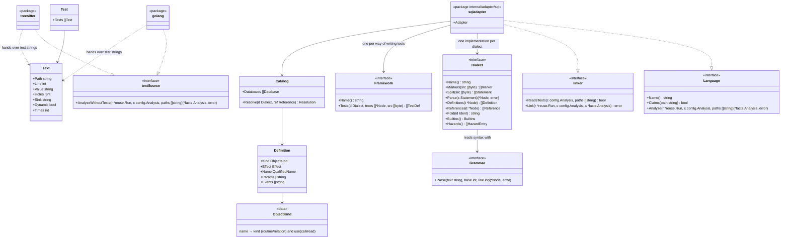

# The SQL adapter

This document is the SQL part of [adapters.md](adapters.md). The SQL adapter makes the database objects defined in `.sql` files product symbols. When an SQL string in a test names such an object, the test counts as calling (or reading) it.

Example: `db/functions.sql` holds this definition.

```sql
CREATE FUNCTION billing.is_active(account_id int, ttl int) RETURNS boolean
LANGUAGE sql AS $$ SELECT true $$;
```

A TypeScript test that passes the following string guards `billing.is_active`.

```ts
const { rows } = await pool.query("SELECT billing.is_active(1, 3600) AS ok");
```

This test checks `billing.is_active`, defined in `db/functions.sql`. This adapter reads the objects defined in `.sql` files as symbols, and the SQL strings in tests as calls to them. So this test guards `billing.is_active`. Deleting the last test that guards `billing.is_active` makes `tests/scope-shrunk` report a regression.

## Responsibility

What it does:

- Reads `.sql` files per dialect and makes the definitions of functions, procedures, views, tables and the like symbols
- From a sequence of files that redefine the same object many times, as migrations do, decides which objects remain at head
- Reads the strings of test code (handed over by the other language adapters) as SQL, and turns the objects they name into `Calls` or `Reads`
- Reads tests written in SQL (pgTAP, tSQLt, utPLSQL) as tests
- When it cannot identify a dialect or an object, reports that it could not, instead of guessing

What it does not do:

- Connect to a database, run SQL, or call tools such as `psql`
- Read SQL in the strings of product code (code that is not a test) ("SQL in product code")
- Read inside function bodies and follow calls between objects
- Guess the SQL an ORM or a query builder produces

## Shape



- **Package.** `internal/adapter/sql`. Each dialect's parser is under it, in `internal/adapter/sql/grammar/<dialect>`, all generated code ([sql-grammars.md](../maintaining/sql-grammars.md)). The dependency diagram draws `internal/adapter/sql/...` as one box, with an arrow from `internal/adapter` and arrows to `engine`, `config`, `facts`, `walk` and `reuse`. No other language adapter imports `sql`
- **Types other packages see.** Only three things in `facts` are added: `Test.Texts` (a list of `Text`), and the symbol kinds `SymbolRoutine` (`"routine"`) and `SymbolRelation` (`"relation"`). `Dialect`, `Grammar`, `Framework`, `Catalog` and `Definition` are types inside the `sql` package and invisible outside it
- **`Text`.** A string the test code holds. The other language adapters fill it. They know nothing about SQL. They hand over only the string's value, the positions of interpolation holes, and which call it was passed to (`Sink`)
  - `Holes` are the positions of interpolations such as `${…}` or an f-string's `{…}`
  - `Sink` is the kind of argument the string was passed to. A per-language table (below, "Calls that take SQL") decides it. `sql` for an argument that takes SQL, empty otherwise
  - `Dynamic` is true when a value that is not a string literal is passed to an argument that takes SQL. `Value` is then empty
- **`linker`.** An optional interface `internal/adapter` calls after every language has finished reading. Like `ClaimsConfigured`, it is called only for languages that have it. Here the SQL adapter reads each test's `Texts` and adds `Calls`, `Reads`, `Unresolved` and hazards
- **`ReadsTexts`.** A `linker` answers whether it reads the tests' strings of the version. Before any language starts reading, `internal/adapter` asks each `linker`, passing the paths it claimed: every path of the version is known before the languages read. The SQL adapter answers that it reads them only when it claimed a `.sql` file or the configuration has `sql.databases`. `Link` follows the same condition and does nothing when there is nothing to read
- **`textSource`.** An optional interface of the languages that hand over test strings (Go, and the five languages read with tree-sitter). `AnalyzeWithoutTexts` is `Analyze` collecting no `Test.Texts`. For a version where no `linker` reads strings, `internal/adapter` calls it instead of `Analyze`, because collecting strings means examining every node of every test body. Facts other than `Texts` do not change
  - Example: in a repository with neither a `.sql` file nor `sql.databases`, every test's `Texts` is empty
- **Extension points.** The following three need only an implementation or data added behind an existing interface. The types other packages see do not change
  - **Adding a dialect**: add one implementation of `Dialect` and register it in the dialect table
  - **Adding an object kind**: add one row to the `ObjectKind` table. A row is the kind's name, the symbol kind (`routine` or `relation`), and how tests use it (`call` or `read`)
  - **Adding a language that hands over test SQL**: that language's adapter fills `Test.Texts`. The SQL adapter does not change
  - A new way of writing tests in SQL is one more implementation of `Framework`
- **Replacing the syntax reader.** `Dialect` reads syntax through `Grammar`. Replacing the implementation that reads a dialect's syntax changes nothing outside `Dialect`

## Dialects

### Dialects in scope

hadome has readers for these seven dialects. A dialect is enabled after it meets "When a dialect is enabled" below. A dialect that is not enabled cannot be chosen, even though its reader is in hadome.

| Dialect | Name (configuration) | Grammar | Enabled | Why |
|---|---|---|---|---|
| PostgreSQL | `postgresql` | `sql/postgresql` of grammars-v4 | Enabled | Functions and procedures often hold product logic |
| MySQL, MariaDB | `mysql` | `sql/mysql/Positive-Technologies` of grammars-v4 | Enabled | Widely used. MariaDB is read by the same reader as MySQL |
| SQLite | `sqlite` | `sql/sqlite` of grammars-v4 | Not enabled | Widely used as an embedded database. Has views, triggers and tables |
| SQL Server | `tsql` | `tsql` of bytebase/parser (`sql/tsql` of grammars-v4, made faster) | Not enabled | Procedures often hold product logic |
| Oracle | `oracle` | `sql/plsql` of grammars-v4 | Not enabled | Packages and procedures often hold product logic |
| BigQuery | `bigquery` | `googlesql` of bytebase/parser | Enabled | Used for data processing. Functions, table functions and procedures are written in SQL |
| Snowflake | `snowflake` | `sql/snowflake` of grammars-v4 | Not enabled | Used for data processing. Functions, procedures and tasks are written in SQL |

- Every grammar has a `hadome:` comment wherever it differs from the original grammar ([sql-grammars.md](../maintaining/sql-grammars.md))
- The hadome binary holds the grammars of the enabled dialects only. The grammar of a dialect that is not enabled is built in only with the build tag `sqlgrammars`, for trials and for the unit tests of that dialect's reader
- Choosing a dialect that is not enabled in the configuration is a configuration error (exit code `2`). A file whose markers point to a dialect that is not enabled is unread
- Enabling a dialect is putting its grammar into every build and adding it to the dialects the configuration accepts. Nothing else changes ([sql-grammars.md](../maintaining/sql-grammars.md))

### When a dialect is enabled

A dialect is enabled after both of the following have been confirmed on real code.

- Definitions are read correctly: no symbol missed, no symbol made up
- SQL names in tests are resolved correctly: nothing mistaken, nothing missed

Misses and mistakes found in a trial become self-test cases before they are fixed. A dialect that is not enabled cannot be chosen in the configuration (exit code `2`). A file whose markers point to a dialect that is not enabled is unread.

The public code for the trials is in "Public code for the trials" below.

hadome itself never touches the network ([adapters.md](adapters.md), invariant 1). Fetching public repositories for a trial is a development activity, not something hadome does.

### How the dialect is decided

The dialect is decided per file, in this order.

1. If `sql.databases` in the configuration gives a `dialect` for the database holding the file, that is it. The configuration always wins
2. Otherwise it is decided from markers in the file's content. The markers are a per-dialect table; examples below
3. A file without markers takes a dialect when the markers of every other file of the same database point to that one dialect
4. When none of these decides, or when one file has markers of two or more dialects, the dialect is unknown. The file is reported as unread (`Unread`). hadome never picks one by guessing

| Dialect | Example markers |
|---|---|
| PostgreSQL | Bodies quoted with `$$` or `$tag$`, `LANGUAGE plpgsql`, `CREATE EXTENSION`, `::` casts |
| MySQL | A `DELIMITER` line, `ENGINE=`, a single name quoted with `` ` ``, `AUTO_INCREMENT` |
| SQLite | `AUTOINCREMENT`, `WITHOUT ROWID`, `PRAGMA` |
| SQL Server | `GO` alone on a line, names in `[` `]`, variables starting with `@`, `CREATE PROCEDURE … AS BEGIN`, `NVARCHAR(MAX)` |
| Oracle | `CREATE PACKAGE`, `CREATE PACKAGE BODY`, `/` alone on a line, `VARCHAR2`, `IS BEGIN` |
| BigQuery | Names in `` ` `` containing `.` (`` `proj.ds.t` ``), `CREATE TABLE FUNCTION`, `LANGUAGE js`, `OPTIONS(` |
| Snowflake | `CREATE … TASK`, `CREATE … STREAM`, `CREATE … STAGE`, `LANGUAGE JAVASCRIPT`, `RETURNS VARIANT` |

- Only markers outside strings and comments count
- The report for a file of unknown dialect tells, in its fix, to set `dialect` in `sql.databases`

## How SQL is read

Syntax is read with pure-Go parsers made from each dialect's public ANTLR grammar. The runtime is `github.com/antlr4-go/antlr/v4`. The reasons are these.

- **It reads by each dialect's rules.** It reads `;` inside T-SQL and PL/SQL bodies, `GO` and `DELIMITER` as the dialect's grammar says. A statement it cannot read is known to be an error
- **It needs no cgo.** Test strings also come from Go tests. A build without cgo ([distribution.md](distribution.md)) still reads Go, Terraform and Ansible. If the SQL reader needed cgo, that build could not read the SQL of Go tests, and the same repository would give different results

These are the rules of reading.

- **Two passes.** It reads with ANTLR's fast prediction (SLL) first, and reads again with the full prediction (LL) only when that finds an error. No input reads with SLL and fails with LL, so the result is the same as reading with LL alone
  - Reading again with LL reads the statement once more from its start. So the grammars are changed for common forms to read with SLL (see "Changes so that SLL reads" in [sql-grammars.md](../maintaining/sql-grammars.md)). The changes leave the tree of every statement that reads the same
- **Statements it cannot read.** A file with even one statement the grammar cannot read is unread (`Unread`) as a whole. The unreadable statement may be a `DROP` or a rename, so symbols built from the other statements could be wrong. A syntax error inside the query of a product view is not one of these (see "View queries" below)
- **Bodies.** Function bodies (inside PostgreSQL's `$$`, the JavaScript or Python bodies of BigQuery and Snowflake) are not read, because calls from a body to other objects are not facts. T-SQL and PL/SQL bodies are part of the statement, so they are parsed to find where the statement ends
- **Product view queries.** In product `.sql` files, the query after `AS` of views and table functions is not read with the grammar. See "View queries" below
- **Output.** The error reports the ANTLR runtime writes to standard output are stopped, so that they never mix with hadome's output

### View queries

In product `.sql` files, the query of views and table functions (after `AS`) is read as tokens only, not with the grammar. The kind, name, parameters and doc the catalog uses all come before `AS`. Parsing the queries takes most of the time spent reading SQL.

Example: in the statement below, the kind, name and doc of `sales.daily` are read from before `AS`. From `SELECT` to `;` only the tokens are read.

```sql
CREATE OR REPLACE VIEW sales.daily OPTIONS(description = "Sales per day") AS
SELECT day, SUM(amount) AS total FROM sales.orders GROUP BY day;
```

**Statements it applies to**

| Dialect | Statements |
|---|---|
| PostgreSQL | `CREATE [OR REPLACE] [RECURSIVE] VIEW`, `CREATE MATERIALIZED VIEW` |
| MySQL | `CREATE [OR REPLACE] [ALGORITHM=…] [DEFINER=…] [SQL SECURITY …] VIEW` |
| SQLite | `CREATE VIEW` |
| BigQuery | `CREATE [OR REPLACE] VIEW`, `CREATE [OR REPLACE] MATERIALIZED VIEW`, `CREATE [OR REPLACE] TABLE FUNCTION` |
| Snowflake | `CREATE [OR REPLACE] [SECURE] VIEW`, `CREATE [OR REPLACE] [SECURE] MATERIALIZED VIEW` |

- It does not apply to T-SQL or Oracle. In T-SQL the `;` that ends a statement may be left out, so the tokens cannot tell where the query ends. In Oracle the `WITH` of a query may declare PL/SQL functions, so a `;` can appear inside the query
- It does not apply to test `.sql` files. Test files are read whole with the grammar, which builds their trees. The ways of writing tests in SQL read tests from those trees

**How it reads**

1. When the tokens at the start of a statement (the start of a piece, or after `;`) have a form in the table above, it looks for the first `AS` outside parentheses after the kind word (`VIEW` or `FUNCTION`)
2. From after that `AS` up to the next `;` (or the end of the piece when there is none) is the query. A `;` inside a string or a comment is told apart by the tokens
3. The grammar is given the statement with the query replaced by `SELECT 1`. Clauses that follow the query (MySQL's `WITH CHECK OPTION`, PostgreSQL's `WITH NO DATA`) are inside the replaced range
4. The positions and lines of the other statements, and the symbol's `Line` and `EndLine`, are those of the original file

- A statement with no `AS` outside parentheses is read whole with the grammar
- A statement whose query has no token (`CREATE VIEW sales.daily AS;`) is a statement it cannot read

**Errors**

| Where the error is | How it is treated |
|---|---|
| Before `AS` (kind, name, parameters, `OPTIONS`) | A statement it cannot read. The grammar finds it, and the file is unread |
| In the query's tokens (an unclosed string or comment) | A statement it cannot read, because where the statement ends is not known |
| In the query's syntax | Not found. The file is not unread, and the view's definition is read |

- A syntax error in the query does not make the file unread because the effect of a view statement is decided before `AS`. A statement it cannot read makes the file unread because that statement may be a `DROP` or a rename. A view statement creates or recreates the view even when its query has an error. The symbols built from the other statements never become wrong
- The tokens decide only where the query ends. A query holds no `;`, so where it ends does not depend on how complete the grammar is. The start of the statement and the part before `AS` are read with the dialect's grammar. Functions and procedures, whose bodies hold `;`, are not covered. So the reason "a purpose-built hand-written reader" was rejected ("What is deliberately left out") does not apply here

### Splitting statements

SQL files contain forms that the client reads, not the database. `Dialect.Split` handles them before the grammar.

| Dialect | Client form | Handling |
|---|---|---|
| PostgreSQL | psql meta-commands (`\set`, `\i`, `\connect`), the data lines after `COPY … FROM stdin` (up to `\.`) | Removed from the statements. The file `\i` includes is not followed |
| MySQL | `DELIMITER //`, `source file` | `DELIMITER` switches the delimiter and splits the following statements with it. `source` is removed from the statements |
| SQLite | Dot commands such as `.headers on` | Removed from the statements |
| SQL Server | `GO` alone on a line (also `GO 5`), sqlcmd commands (`:r`, `:setvar`) | `GO` separates batches. sqlcmd commands are removed from the statements |
| Oracle | `/` alone on a line, SQL*Plus commands (`SET`, `PROMPT`, `@file`) | `/` separates. Commands are removed only where a statement may start (after `;` or `/`), because the `SET` of an `UPDATE` is part of the statement |
| Snowflake | SnowSQL commands such as `!set` | Removed from the statements |

Some migration tools write markers as comments.

- For dbmate's `-- migrate:up` and `-- migrate:down` and goose's `-- +goose Up` and `-- +goose Down`, only the `up` side is read
- Liquibase's `--changeset` and `--rollback` stay comments. Statements after `--rollback` are inside the comment and are not read
- A UTF-8 byte order mark becomes spaces. Editors on Windows put it at the start of files. As spaces, it changes no line or offset
- psql variables (`:name`, `:'name'`) cannot be read, because the client decides their values. A file holding them is unread

## Files and roles

| Files claimed | Test files | Role other |
|---|---|---|
| `*.sql` | `*.sql` under test support directories (`test/`, `tests/` and so on; [adapters-treesitter.md](adapters-treesitter.md)). `*.sql` matching `files.tests` | "SQL files not read" below |

- Whether a file is claimed depends only on its path, never on its content
- No product symbols come from test `*.sql` files. Example: the `CREATE TABLE` in `tests/fixtures/schema.sql`
- Tests are read only from test files that use one of the ways of writing tests in SQL (below)

**SQL files not read**: the following files get role `other` and no facts, because they are not definitions applied to the database.

- Files that undo migrations: names ending in `.down.sql`, files under `down/`, Flyway's `U<version>__*.sql`, files under sqitch's `revert/`
- Files under sqitch's `verify/` (scripts that check definitions, not product definitions)
- Files under a dbt project (a directory with `dbt_project.yml`). They are Jinja templates and cannot be read as SQL ("What is deliberately left out")

## Databases and units

### Databases

A **database** is a set of objects whose names share one namespace. One repository may have separate databases (for example a product database and an analytics database).

- Without `sql.databases` in the configuration, every `.sql` file of the repository is read as one database
- The configuration can give each database a name, a dialect, file globs, and a default schema (or search order) ("Configuration" below)

### Units

| Thing | ID | Example |
|---|---|---|
| The database's unit (`File.Unit`) | `.sql`. With two or more databases configured, `.sql/<database name>` | `.sql`, `.sql/analytics` |
| Symbol | `<database unit>/<schema>.<name>` | `.sql/billing.is_active`, `.sql/analytics/reports.daily` |
| Oracle package routine | `<database unit>/<schema>.<package>.<name>` | `.sql/BILLING.ACCOUNTS_PKG.IS_ACTIVE` |

- **Why the file path is not in the ID.** Migrations redefine the same object in new files again and again. If the ID depended on the file or directory, each redefinition would make the base target disappear at head. `tests/scope-shrunk` would then take it as a legitimate removal and miss the lost guard. So the ID depends only on the name inside the database
- **Why it starts with `.sql`.** hadome does not read directories starting with `.`. So the ID can never collide with another language's symbol IDs (which are built from directories). Example: `is_active` in a TypeScript `billing/` directory is `billing.is_active`
- **Display name.** As in other languages, the last element of the unit path and the name. `.sql/billing.is_active` is shown as `billing.is_active`, and the configuration names it that way
- **Configuration and IDs.** As with all configuration, both versions' IDs are built with head's configuration. So reconfiguring databases does not by itself make base targets disappear
- Database units are not in the dependency diagram. `deps/` counts only imports between the repository's directory units

### Name rules

Names are normalized by the dialect's rules before they are compared. `Dialect.Fold` holds the normalization.

| Dialect | Unquoted names | Quotes | Qualification | Default schema |
|---|---|---|---|---|
| PostgreSQL | Lower-cased | `"…"` keeps case | `schema.name`, `database.schema.name` | Search order (`search_path`); `public` by default |
| MySQL | Functions and procedures are case-insensitive. Tables and views are compared case-insensitively too | `` `…` `` | `database.name` (the database plays the schema) | None (below) |
| SQLite | Case-insensitive | `"…"`, `[…]`, `` `…` `` | `schema.name` (`main`, `temp`, attached ones) | `main` |
| SQL Server | Case-insensitive (default collation) | `[…]`, `"…"` | `database.schema.name`. A fourth part is a linked server and counts as external | `dbo` |
| Oracle | Upper-cased | `"…"` kept as written | `schema.name`, `schema.package.name`. `@dblink` counts as external | None (below) |
| BigQuery | Datasets and tables are case-sensitive. Functions are not | `` `…` ``; one quoted name may contain `.` (`` `proj.ds.t` ``) | `project.dataset.name` | None (below) |
| Snowflake | Upper-cased | `"…"` kept as written | `database.schema.name` | `PUBLIC` |

- **Dialects without a default schema.** In MySQL, Oracle and BigQuery, the schema of an unqualified definition is decided by the connection at deploy time. If the configuration has `default-schema`, that is it. Otherwise the schema is empty and the ID is `.sql/<name>`. Unqualified names on the test side are treated the same, so both sides agree
- **The database part.** For definitions and tests alike, the database part (the project in BigQuery) is compared only when `catalog` is set in the configuration. Otherwise that part is ignored and schema and name are compared. Project names often differ per environment
- **Two objects differing only in case** found in a case-insensitive dialect make every name that refers to them unresolved

## Definitions

### Object kinds

Each object kind decides whether it becomes a symbol and how tests count it. The test is whether naming it in a test runs product logic.

| Kind | Symbol kind | When a test names it | Why |
|---|---|---|---|
| Function (including aggregates, table functions, BigQuery JavaScript functions, Snowflake JavaScript, Python and Java functions) | `routine` | Called (`Calls`) | Product logic |
| Procedure | `routine` | Called | Product logic |
| Functions and procedures in an Oracle package specification | `routine` | Called | Product logic. Those only in the package body cannot be called from outside, so they are not symbols |
| View (including `SECURE VIEW`) | `relation` | Called | Holds query logic |
| Materialized view, Snowflake `DYNAMIC TABLE` | `relation` | Called | Holds query logic |
| Trigger (dialects that write the body inline: MySQL, SQLite, SQL Server, Oracle) | `routine` | Called when the test writes to its table with the trigger's event (`INSERT`, `UPDATE`, `DELETE`) | Logic that runs on a write |
| PostgreSQL trigger | Not a symbol | When the test writes to its table with its event, the function the trigger executes is called | The logic is in the function |
| Snowflake task | `routine` | Called with `EXECUTE TASK` | Scheduled SQL logic |
| Table, external table, non-temporary sequence, Snowflake stream | `relation` | Read (`Reads`) | A place that holds values. No logic, so not a target. Still, changing its values may change the result |
| Snowflake stage, pipe, file format; types, domains, indexes, constraints, policies, grants | Not a symbol | Nothing counted | Not something a test runs by naming it in SQL. Policies and constraints are in "What is deliberately left out" |

- `routine` and `relation` are new symbol kinds. The rules that count functions (`size/` complexity and parameters, `hadome mutate`) and `comments/missing-doc` filter by kind, so they count neither
- Temporary objects (`CREATE TEMP FUNCTION`, `CREATE TEMPORARY TABLE`, `#temp`) in product files are not symbols. They exist only while the script runs

### Definition forms per dialect

| Dialect | Definitions read |
|---|---|
| PostgreSQL | `CREATE [OR REPLACE] FUNCTION`, `PROCEDURE`, `AGGREGATE`, `VIEW`, `MATERIALIZED VIEW`, `TABLE`, `SEQUENCE`, `TRIGGER`. Bodies in `$$`, `$tag$` or a string |
| MySQL | `CREATE [OR REPLACE] [DEFINER=…] FUNCTION`, `PROCEDURE`, `VIEW`, `TABLE`, `TRIGGER`. Bodies delimited by `DELIMITER` |
| SQLite | `CREATE [TEMP] VIEW`, `TABLE`, `TRIGGER`. `IF NOT EXISTS` |
| SQL Server | `CREATE`, `ALTER` and `CREATE OR ALTER` of `FUNCTION`, `PROCEDURE` (`PROC`), `VIEW`, `TABLE`, `TRIGGER`. Batches separated by `GO` |
| Oracle | `CREATE [OR REPLACE] [EDITIONABLE] FUNCTION`, `PROCEDURE`, `PACKAGE`, `PACKAGE BODY`, `VIEW`, `MATERIALIZED VIEW`, `TABLE`, `SEQUENCE`, `TRIGGER`. Separated by `/` |
| BigQuery | `CREATE [OR REPLACE] [TEMP] FUNCTION` (SQL and JavaScript), `TABLE FUNCTION`, `PROCEDURE`, `VIEW`, `MATERIALIZED VIEW`, `TABLE`. `BEGIN … END` scripts |
| Snowflake | `CREATE [OR REPLACE] [SECURE] FUNCTION`, `PROCEDURE` (`LANGUAGE SQL`, `JAVASCRIPT`, `PYTHON`, `JAVA`, `SCALA`; body in `$$`), `VIEW`, `MATERIALIZED VIEW`, `DYNAMIC TABLE`, `TABLE`, `EXTERNAL TABLE`, `SEQUENCE`, `STREAM`, `TASK` |

### Create, alter, drop

Each statement has one of these effects on an object (`Definition.Effect`).

| Effect | Example statements |
|---|---|
| Create | `CREATE`, `CREATE OR REPLACE`, `CREATE OR ALTER`, `CREATE … IF NOT EXISTS` |
| Alter (stays) | `ALTER FUNCTION … SET …`, `ALTER TABLE … ADD COLUMN`, `ALTER PROCEDURE` (SQL Server redefinition) |
| Rename | `ALTER … RENAME TO`, `ALTER … SET SCHEMA`, `sp_rename`, `RENAME TABLE` |
| Drop | `DROP`, `DROP … IF EXISTS` |

- The objects that remain after applying the database's files in order are that version's symbols
- A symbol's location (`Path`, `Line`, `EndLine`) is the statement that last created (or redefined) the remaining object
- A renamed object is a different symbol under the new name. As when a function is renamed in another language, the base target is a legitimate removal
- Functions with the same name differing only in parameter types (PostgreSQL's overloads and the like) are one symbol. Deciding which one a test's call reaches would take type inference over the call's arguments. Dropping overloads one by one keeps the symbol as long as the name remains

### The order files are applied in

When a create and a drop are in different files, the result depends on the order. The order is decided as follows.

1. With `sql.databases[].order` in the configuration, the order of those globs
2. Otherwise the natural order of paths (runs of digits compared as numbers). `V2__` comes before `V10__`. This matches golang-migrate, Flyway's versions, and names starting with a timestamp (Supabase, Prisma and others)
3. Flyway's files starting with `R__` are applied after the versioned files, in name order, as Flyway applies them

A file creating an object and a file dropping it may sit where the order is not decided. Example: separate directories without version numbers. The object then counts as remaining. Deciding it was dropped would make a guarded target look like a legitimate removal, and `tests/scope-shrunk` would miss the regression.

## SQL in tests

### Test strings

The other language adapters put the following strings of each test into `Test.Texts`. Which strings belong to a test follows the same rule as which calls belong to it in that language. Example: strings inside a TypeScript `beforeEach` count; strings inside a Java `@BeforeEach` do not.

- String literals in the test body and in the helpers the test follows (in the test file and in test support files)
- Strings of constants in the same file that the test reads (`const SQL = "SELECT …"`)

| Language | String forms | What becomes a hole (`Holes`) |
|---|---|---|
| TypeScript | `'…'`, `"…"`, `` `…` ``, tagged templates (`` sql`…` ``) | `${…}` |
| Python | Strings, triple-quoted strings, adjacent strings, f-strings | An f-string's `{…}` |
| Go | `"…"`, `` `…` `` | None |
| Rust | `"…"`, `r#"…"#`, strings in macro arguments (`sqlx::query!("…")`) | None |
| Java | `"…"`, text blocks (`"""…"""`) | None |
| Kotlin | `"…"`, `"""…"""` | `$name`, `${…}` |

- Literals joined together (`"SELECT " + "1"`, adjacent strings in Python) become one string
- A literal joined with something that is not a literal (`"SELECT * FROM " + table`) gets a hole where they join
- `fmt.Sprintf` and `%` format strings are handed over as they are. `%s` is treated as a parameter on the SQL side (below)

### Calls that take SQL

The other language adapters know, from a table, the arguments of database clients that take SQL strings. Like the hazard tables, the table lives in the adapter. The configuration can add entries but not remove them.

| Language | Examples |
|---|---|
| TypeScript | `pg`'s `query`, `mysql2`'s `query` and `execute`, `better-sqlite3`'s `prepare` and `exec`, tagged templates of `postgres` and `slonik`, `knex.raw`, Prisma's `$queryRaw` and `$executeRaw`, `sequelize.query` |
| Python | DB-API `cursor.execute` and `executemany`, SQLAlchemy's `text` and `exec_driver_sql`, `asyncpg`'s `fetch` and `execute`, `query` and `execute` of the BigQuery and Snowflake clients |
| Go | `database/sql`'s `Query`, `QueryRow`, `Exec` (and the `Context` forms), `pgx`'s methods of the same names, `sqlx`'s `Select` and `Get` |
| Rust | `sqlx::query`, `query_as`, `query!` |
| Java, Kotlin | JDBC `prepareStatement`, `prepareCall`, `executeQuery`, `execute`; Spring `JdbcTemplate`'s `query…` and `update`; JPA `createNativeQuery` |

- A string at an argument in this table has `Sink` set to `sql`
- When a value that is not a string literal is passed to such an argument, a `Text` with `Dynamic` true is added. Examples: `pool.query(buildSql(id))`, `pool.query(q)`
- Forms that pass only a routine name in the SQL string (JDBC's `{call billing.p(?)}`, calls that pass only a procedure name) are covered by the table too

### Which strings are read as SQL

Every test string is an SQL candidate, not only those passed to calls that take SQL. SQL often sits in constants, helpers and test tables, and reading only what is passed straight to a call would miss many names.

Strings are read as SQL under these conditions.

| String | Handling |
|---|---|
| The first word outside strings and comments is a statement head of the dialect (`SELECT`, `WITH`, `INSERT`, `UPDATE`, `DELETE`, `MERGE`, `CALL`, `EXEC`/`EXECUTE`, `VALUES`, `TABLE`, `REFRESH`, `TRUNCATE`, `BEGIN`, `DECLARE`, `CREATE`, `DROP`, `ALTER`), and it reads to the end as statements | Read as SQL |
| `Sink` is `sql`, and it reads to the end as statements | Read as SQL (even without a statement head) |
| It starts with a statement head or `Sink` is `sql`, it does not read as statements, and it has a hole or contains a word equal to the name of a database object | Counts one unresolved |
| `Dynamic` is true | Counts one unresolved |
| Anything else | Not SQL; not read |

**Rules against mistaken matches**

- In a string that read to the end as statements, only names in name positions count. Name positions are function calls and the places after `FROM`, `JOIN`, `INTO`, `UPDATE`, `TABLE`, `CALL`, `EXEC` and the like. Example: `"select a plan"` reads as a statement, but has no name in a name position, so nothing counts
- Column names (`t.is_active`) do not count. An `x.y` with no `(` after it is a column unless it follows `FROM`
- Names defined in the same statement (`WITH` names, aliases) and temporary objects created by the same test's strings (`CREATE TEMP TABLE t`) hide those names
- The dialect's built-in functions and system schemas (`pg_catalog`, `information_schema`, `sys`, `INFORMATION_SCHEMA`, `SNOWFLAKE.ACCOUNT_USAGE` and others) count nothing. The built-in list is in `Dialect.Builtins`

**Holes and parameters**

- A hole is read as a parameter in a value position. Example: `` `SELECT billing.is_active(${id}, 3600)` `` reads
- A hole is read as the value `0`. A hole in a name position (`` `SELECT * FROM ${table}` ``) does not read as a statement. So it is unresolved by the table above
- Driver parameter forms (`$1`, `?`, `:name`, `@p1`, `%s`, `%(name)s`) are read as the value `0`. Where the dialect uses the form in its own syntax, it is read as it is. Examples: PostgreSQL's `?` (a `jsonb` operator), the `@name` variables of SQL Server and MySQL, `::` casts

### Which database resolves a name

- With one database, strings are read in its dialect and resolved against it
- With two or more, they are resolved against the database whose `sql.databases[].tests` globs match. Without those, every database whose dialect can read the string is tried. A name matching objects in two or more databases is unresolved
- When the repository has no SQL database at all (no `.sql` files and no configuration), test strings are not read. Strings passed to calls that take SQL are not counted as unresolved either. With no dialect and nothing to resolve against, nothing can be said for certain
  - The other language adapters then do not collect test strings either (see "`textSource`" above)

### Resolving names

| Name | Resolution |
|---|---|
| Qualified (`billing.is_active`) | The object with the same normalized name |
| Unqualified, with a search order (`search-path`) configured | The object in the first schema of the search order that has it, the same order the database searches. Unresolved when no schema of the search order has it |
| Unqualified, without a search order | The object in the dialect's default schema if there is one. Otherwise the object, if the database has exactly one with that name. With two or more, unresolved |
| Same name as a built-in function | When unqualified, the built-in; nothing counts. PostgreSQL also searches the system schema first |
| A name matching no object of the database and no built-in | Counts one unresolved. It may be an object created by an ORM or another tool, and the test may be checking the product |

### Facts added to the test

| What is named | Facts added |
|---|---|
| A `routine` function, procedure, package routine, task | A `Call`. `Times` is the number of times it is named times the string's `Times`. `Scopes` is the number of distinct normalized tokens passed at the scope parameter, chosen from the definition's parameter names ([rules-tests.md](rules-tests.md)) |
| Views and materialized views | A `Call`. `Scopes` is 0 |
| Reading or writing a `relation` such as a table | One `Reads` |
| Writing to a table with a trigger, with its event | A `Call` to the trigger (or its function), plus one `Reads` |
| Unresolved | One `Unresolved` |

**When a test recreates a product object**

When a test string recreates a product object with `CREATE OR REPLACE` or the like, that is a `mock` hazard, because it replaces product logic. tSQLt's `FakeTable`, `SpyProcedure` and `FakeFunction` are the same.

**Hazards**

| Category | Examples |
|---|---|
| `clock` | `now()`, `CURRENT_TIMESTAMP`, `CURRENT_DATE`, `GETDATE()`, `SYSDATE`, `SYSTIMESTAMP`, `CURRENT_TIMESTAMP()` |
| `sleep` | `pg_sleep`, MySQL's `SLEEP`, `WAITFOR DELAY`, `DBMS_LOCK.SLEEP`, `DBMS_SESSION.SLEEP`, Snowflake's `SYSTEM$WAIT` |

- The table is an excerpt; the full one is in `Dialect.Hazards`. `rules.tests.hazards` in the configuration can add entries but not remove them
- A hazard's location is the file and line of the string

## Tests written in SQL

Tests are read from test `*.sql` files written in one of the following ways. Each way has one implementation of `Framework`.

| Way | Dialect | What a test is | Assert | Skip | Mock |
|---|---|---|---|---|---|
| pgTAP | PostgreSQL | A file calling `plan(…)` or `no_plan()` is one test | `ok`, `is`, `isnt`, `matches`, `throws_ok`, `lives_ok`, `results_eq`, `has_…` and others | `skip(reason, count)` | None |
| myTAP | MySQL | Same as pgTAP | Same as pgTAP | Same as pgTAP | None |
| tSQLt | SQL Server | Procedures whose names start with `test` in a schema created by `tSQLt.NewTestClass` | `tSQLt.Assert…`, `tSQLt.Fail`, `tSQLt.ExpectException` | None | `tSQLt.FakeTable`, `SpyProcedure`, `FakeFunction` |
| utPLSQL | Oracle | Procedures annotated `--%test` in a package annotated `--%suite`. Bodies are in the package body | `ut.expect(…).to_…` | `--%disabled(reason)` | None |

- What a test calls is decided from the names in its statements, by the same rules as "SQL in tests"
- Objects a test file creates are that test's setup. Naming them does not count as naming product objects. Example: a table a pgTAP file creates with `CREATE TABLE` and checks with `has_table`
- The functions of the way of writing tests (pgTAP's `ok`, tSQLt's `tSQLt.AssertEquals` and the like) count as asserts or mocks, never as unresolved
- BigQuery and Snowflake have no widely used way of writing tests, so they are not in the table. dbt tests are in "What is deliberately left out"

## SQL in product code

SQL in the strings of product code (code that is not a test) is not read.

- **Definitions**: no symbols come from `CREATE` inside strings. Example: a `CREATE FUNCTION` held in a string by a JavaScript build script. Never making symbols from characters inside strings is an invariant of every language ([adapters.md](adapters.md), invariant 3). In repositories that build their schema this way, names in tests are unresolved, so `tests/guards-nothing` does not fail them
- **References**: references from product code to objects are not facts either. hadome does not record calls between pieces of product code in any language. The dependency rules look only at imports

## Purity and I/O

- Each `.sql` file counts as using, from the database's unit, the global I/O API `database` (an `Import` with `Global` and `IO` true). Database objects run only inside the database
- So a database unit is never pure, and `tests/purity-lost` never fires for it
- A test calling SQL objects calls a unit that is not pure. `tests/no-mock` does not report that test's mocks. Tests calling only pure units are reported
- SQL names become `Calls` or `Reads`, so the test is not one that drives the application from outside (`Drives`). Which objects it guards can be named
- The test file's imports (`pg` and the like) still do not count toward purity

## Rules that apply

| Rule | How it applies to SQL |
|---|---|
| `tests/scope-shrunk` | Deleting the last test guarding a `routine` or a view fails. Dropping or renaming the object is a legitimate removal |
| `tests/guards-nothing` | A test that calls or reads SQL objects is not reported. Neither is a test with unresolved names |
| `tests/target-unknown` | A new test whose names are all unresolved returns `3` |
| `tests/invariant-unguarded` | SQL objects can be invariant targets (`billing.is_active`). `guards:` works as in other languages |
| `tests/no-clock`, `tests/no-sleep`, `tests/no-mock` | "Hazards" above |
| `tests/no-assertion`, `tests/skip-without-reason`, `tests/duplicate` | Apply to tests written in SQL. For tests in other languages, the test's own language decides |
| `comments/missing-doc` | Does not apply. `routine` and `relation` are not among its kinds |
| `comments/todo-format`, `comments/broken-reference` | Apply to comments in `.sql` |
| `size/file-lines` | Applies to `.sql` files |
| `size/` complexity and parameters | Do not apply |
| `deps/` | Does not apply. Database units are not in the dependency diagram |
| `unknown/unread` | Files of unknown dialect, files with an unreadable statement |
| `hadome mutate` | Does not mutate. Applying broken SQL would need a step that rebuilds the database before the tests, and hadome does not know it |

`Symbol.Doc` is filled. The preceding comment lines, `COMMENT ON`, `COMMENT = '…'`, BigQuery's `OPTIONS(description=…)` and SQL Server's `MS_Description` extended property count as doc. No rule reads `Symbol.Doc`. It is filled so that a rule asking SQL objects for descriptions can be added without changing the facts.

## Comments

| Comments | Directives |
|---|---|
| `--`, `/* */` (nested ones read for PostgreSQL), MySQL's `#` | `noqa`, `sqlfluff:`, `-- migrate:`, `-- +goose`, `--changeset`, `--rollback`, `-- name:` (sqlc), utPLSQL's `--%` |

Exception markers (`gate:allow`) are written in comments, as in other languages. SQL comments inside a test string are part of the host language's string, so they are not reported as comments.

## Files that could not be read

The following files are marked `Unread`, and nothing is read from them.

- Files whose dialect is not decided
- Files with even one statement the dialect's grammar cannot read. A syntax error in the query of a product view is not one of these ("View queries")
- Files whose markers point to a dialect that is not enabled

`unknown/unread` returns `3` when such a file newly appears at head.

## Configuration

```yaml
sql:
  databases:
    - name: main
      dialect: postgresql
      paths: ["db/**/*.sql"]
      search-path: [billing, public]
      order: ["db/migrations/**", "db/functions/**", "db/views/**"]
    - name: analytics
      dialect: bigquery
      catalog: example-project
      default-schema: reports
      paths: ["warehouse/**/*.sql"]
      tests: ["warehouse/tests/**"]
```

| Key | Meaning | When it loosens |
|---|---|---|
| `name` | The database's name. With two or more, it is part of the unit ID | Changing it needs a person's review |
| `dialect` | The dialect. When set, it wins over markers | Changing it needs a person's review |
| `paths` | Globs of the database's `.sql` files | Removing an entry reads fewer files, so it loosens (`LooserWhenRemoved`) |
| `search-path` | The order unqualified names are searched in | Changing it needs a person's review |
| `default-schema` | The schema of unqualified definitions | Changing it needs a person's review |
| `catalog` | The database (project) name; compared only when set | Changing it needs a person's review |
| `order` | The order files are applied in | Changing it needs a person's review |
| `tests` | Globs of test files resolved against this database | Changing it needs a person's review |

- When `languages` is written, SQL is read when it lists `sql`. When it is not written, SQL is read whenever there are `.sql` files
- For keys that change name resolution, hadome cannot tell which direction loosens. So every change to them goes to a person's review (`config/loosened`)
- Calls that take SQL can be added per language with `rules.tests.sql-sinks`. Adding one makes more strings read as SQL and changes how unresolved names are counted, so it goes to a person's review

## Public code for the trials

Each dialect is tried on public code that has definitions, and on public code with tests that check them through SQL. None is brought into the repository. They are fetched locally, hadome is run on them, and the results are checked.

| Dialect | Definitions | Names in tests |
|---|---|---|
| PostgreSQL | Sample databases in PostgreSQL's official documentation and distribution, published sample schemas (a film rental one, for example) | Public repositories using pgTAP, Supabase's public examples, public repositories calling functions from TypeScript or Python tests |
| MySQL, MariaDB | MySQL's published sample databases, MariaDB's public examples | Public repositories using myTAP, public repositories passing SQL through `mysql2` or DB-API |
| SQLite | SQLite's public test SQL, public schemas of mobile and desktop apps | Public repositories passing SQL through `better-sqlite3`, Python's `sqlite3` or Rust's `sqlx` |
| SQL Server | Microsoft's published sample databases | Public repositories using tSQLt, public repositories calling procedures through JDBC or Go's `database/sql` |
| Oracle | Oracle's published sample schemas | utPLSQL and its public examples, public repositories calling packages through JDBC |
| BigQuery | Google's public sample datasets and SQL examples, public repositories collecting functions | Public repositories checking functions with the Python client |
| Snowflake | Snowflake's public sample and demo repositories, public data projects with SQL outside dbt | Public repositories checking procedures with the Python connector |

- A trial looks at symbols missed and made up, names mistaken and missed, the number of unresolved names, unread files, and reading speed
- Names and code of the repositories used in a trial are never brought into hadome's cases. Cases are always rewritten with generic names (`billing.is_active`, `reports.daily`)

## Self-test cases

The self-test cases pass SQL from Go tests, which every build reads. Name resolution and how definitions are read are checked by the unit tests of `internal/adapter/sql`.

| Rule | Cases |
|---|---|
| `tests/scope-shrunk` | Deleting the only Go test guarding an SQL function fails · deleting the function and its test passes · redefining the function in a new migration file passes · renaming the function passes · deleting the only test writing to a table with a trigger fails · deleting the only pgTAP test fails |
| `tests/guards-nothing` | A test passing a string that calls an SQL function passes · a test passing SQL held in a constant passes · a test passing SQL inside a helper passes · a new test passing SQL that calls only built-ins fails · in a repository without `.sql` files it fails |
| `tests/target-unknown` | A new test naming only names absent from the database returns `3` · a new test passing only non-literal values to a call that takes SQL returns `3` · SQL with a driver's parameter in a value position resolves and passes |
| `unknown/unread` | A file whose markers point to two dialects returns `3` · setting the dialect in the configuration makes it read · a file with an unreadable statement returns `3` · a file whose only syntax error is in the query of a product view is read · a file with an error before a view's `AS` returns `3` |
| `tests/no-clock`, `tests/no-sleep` | `now()` in test SQL is `clock` · `pg_sleep` is `sleep` · `now()` in a string that is not SQL does not count |
| `tests/no-assertion`, `tests/skip-without-reason` | A pgTAP file without asserts fails · a pgTAP `skip` without a reason fails |

## Invariants

1. The adapter never connects to a database, runs SQL, or touches the network
2. The same file contents and the same configuration give the same facts in every build (with or without cgo)
3. Symbols come only from definitions in `.sql` files, never from strings of another language
4. A symbol's ID depends only on its name inside the database. Moving the definition to another file or redefining it does not change it
5. A name in a test string becomes `Calls` or `Reads` only when it certainly matches a database object. What cannot be decided is counted as unresolved, or not read as SQL. Nothing is matched by guessing
6. A file whose dialect is not decided is reported as unread. A dialect is never picked by guessing
7. Adding a dialect, an object kind, a language that hands over test SQL, or a way of writing tests in SQL does not change the `facts` types or the interfaces `internal/adapter` sees. What is added is only an implementation of `Dialect` or `Framework`, a row of the `ObjectKind` table, or `Test.Texts` filled by another language adapter
8. A dialect is not enabled until it has passed a trial on real code

## What is deliberately left out

- **dbt and Jinja-templated SQL.** Models named by `{{ ref('x') }}` are a different mechanism, where the file name is the object name. A separate design
- **Names inside function bodies.** Calls between product objects are not facts in other languages either
- **Checking the syntax of product view queries.** No fact is made from a query. A syntax error shows when the database applies the migration
- **Telling overloads apart by parameter type.** It needs type inference over call arguments
- **Making row-level security policies, check constraints, defaults and generated columns symbols.** They are logic, but tests have no way of naming them. Triggers are the only thing a write to a table can be said to run
- **Guessing SQL from ORM models or query builders.** Things like `knex('accounts').where(…)` are not read. ORM models are product code, which the other language adapters handle
- **Following what psql's `\i` and SQL*Plus's `@file` include.** The included files are read as `.sql` files themselves
- **Reading the order from Liquibase XML or YAML changelogs or sqitch plan files.** The order can be written with `order`
- **SQL inside Terraform and Ansible.** Such as Ansible's `postgresql_query` tasks. To add it, that adapter fills `Test.Texts`. The SQL adapter does not change
- **Dialects not listed here** (Db2, Redshift, ClickHouse, Spark SQL and others). To add one, add a `Dialect` implementation and pass the same trial
- **pgTAP's xUnit style.** The asserts of the functions starting with `test` that `runtests()` runs are inside function bodies (PL/pgSQL). Bodies are not read, so tests written this way are not read
- **Reading with one tree-sitter SQL grammar.** One grammar cannot tell all dialect differences apart (quoting, case, body forms). It reads on past errors, so it drops names silently. It also needs cgo, so a build without cgo would give different results
- **Reading with PostgreSQL's own parser (libpg_query).** The most exact for PostgreSQL, but PostgreSQL only, and it needs cgo
- **A purpose-built hand-written reader.** For dialects with bodies, where a statement ends depends on how complete the grammar is. It cannot tell an unreadable statement for an error
