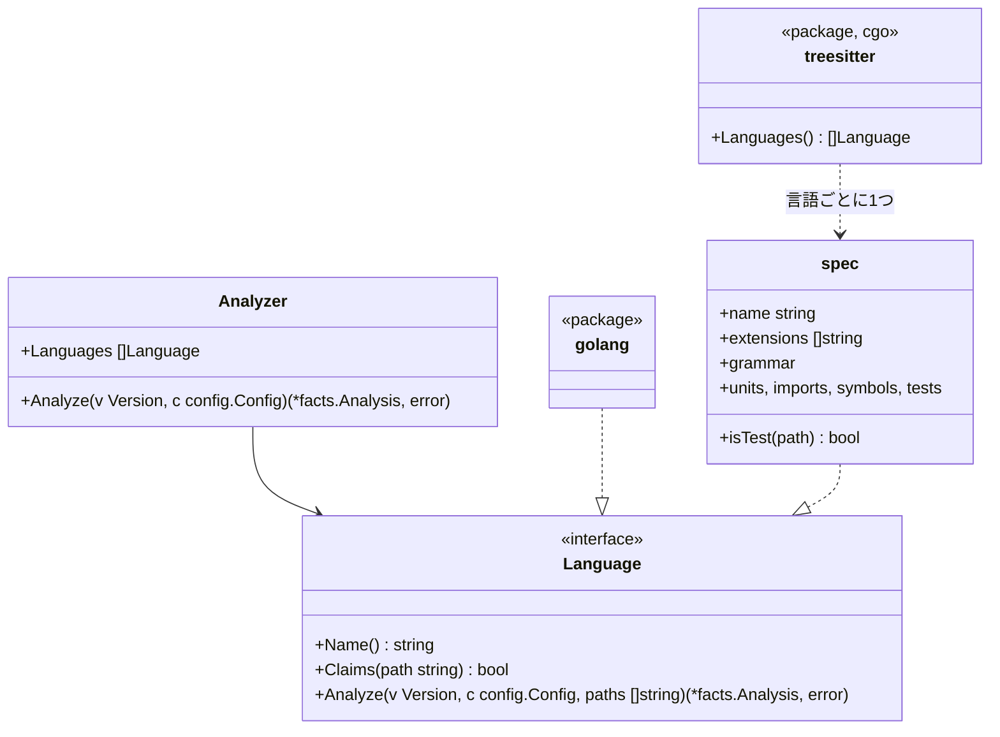

# TypeScript、Python、Rust、Java、Kotlin のアダプタ

この文書は [adapters.ja.md](adapters.ja.md) の言語ごとの半分だ。tree-sitter で読む5言語のそれぞれが、Go のアダプタと同じ事実をどう埋めるかを書く。ルールからその違いは見えない。

## 形

- パッケージ `internal/adapter` は、エンジンが使う解析器だ。版を1回たどり、各ファイルを最初に受け持つと言った言語に渡し、言語たちの報告をまとめ、どの言語も受け持たないファイルを役割 `other` で一覧に載せる（[adapters.ja.md](adapters.ja.md) の不変条件4）
- 設定の `languages:` で、ファイルを受け持つ言語を絞れる。省くと全言語が受け持つ
- パッケージ `internal/adapter/treesitter` は cgo があるときだけビルドされる（`//go:build cgo`）。無いときの `Languages()` は、5言語のファイルを受け持って `Unread` と印を付ける読み手を返す。こうして純粋な Go のビルド（[distribution.ja.md](distribution.ja.md)）がそれらを黙って無視することは無い
- tree-sitter の木をたどる汎用の読み手は1つだけだ。各言語は、ノードの種類と少しの関数（パスをユニットにどう対応させるか、import をどう解決するか、何でシンボルが公開になるか、どの呼び出しが危険か）からなる `spec` で表す

## ユニット

ユニットは、import が名指す **ID** と、依存の図が名指すリポジトリ内のパスである**場所**（`File.UnitPath`）を持つ。

| 言語 | ユニット | ID | 場所 | シンボルの ID |
|---|---|---|---|---|
| Go | パッケージ | import のパス | ディレクトリ | `<import path>.<Name>` |
| TypeScript | ディレクトリ | そのディレクトリ | そのディレクトリ | `<directory>.<name>` |
| Python | パッケージ（ディレクトリ） | そのディレクトリ | そのディレクトリ | `<module path>.<name>`。モジュールのパスはファイルのパスから `.py` を除いたもの（`src/app/store.create_post`）で、1つのパッケージの2つのモジュールがぶつからないようにする |
| Rust | モジュール | その場所 | `src/a/b.rs` や `src/a/b/mod.rs` なら `src/a/b`。`lib.rs` と `main.rs` なら `src` | `<location>.<name>` |
| Java、Kotlin | パッケージ | `package` の宣言 | ディレクトリ | `<package>.<Class>.<member>`。Kotlin のトップレベルの関数は `<package>.<name>` |

どのシンボルの ID も、ユニットのパスの最後の要素と名前で終わる。だから `store.append` のように設定した対象は、どの言語でもそれを名指せる（[rules-tests.ja.md](rules-tests.ja.md)）。

## import

| 言語 | 内部になるとき | 解決 |
|---|---|---|
| TypeScript | 指定子が `.` か `/` で始まるか、ルートの `tsconfig.json` の `compilerOptions.paths` の別名に当たる | パスそのもの、次に `.ts`、`.tsx`、`.js`、`.jsx`、`.mjs`、次に `/index.*` を試してファイルに解決する。ユニットはそのディレクトリ。それ以外は外部のパッケージで、パスの最初の要素（`@scope/name` なら2つ）で名指す |
| Python | モジュールがリポジトリにある（ディレクトリか `.py` ファイルとして、ルートか `src/` から） | 相対 import はファイルのパッケージから解決する。ユニットはモジュールのパッケージ。`b` がモジュールである `from a import b` はモジュールを束縛する |
| Rust | パスが `crate`、`self`、`super` で始まる | モジュールのファイルである最長の接頭辞に解決し、残りは項目を名指す |
| Java、Kotlin | リポジトリのどれかのファイルがそのパッケージを宣言している | `import a.b.C` はパッケージ `a.b`。`a.b.*` も同じ |

外部の import は名前をそのまま `ToUnit` に持ち、`io` の表と照らし合わせる。

## シンボル

| 言語 | 関数とメソッド | 型 | 公開 | doc コメント |
|---|---|---|---|---|
| TypeScript | 関数の宣言、メソッド、`const f = () =>` | クラス、インターフェース、型の別名、enum | 宣言に `export` がある | 直前の `/** */` コメント |
| Python | モジュールの直下とクラスの中の `def` | `class` | 名前が `_` で始まらない | docstring（本体の最初の文が文字列） |
| Rust | `fn` の項目と `impl` のメソッド | `struct`、`enum`、`trait`（インターフェースとして）、`type` | `pub` | 直前の `///` の行 |
| Java | メソッドとコンストラクタ | クラス、インターフェース、enum、record | `public` | 直前の `/** */` コメント |
| Kotlin | トップレベルとクラスの中の `fun` | クラス、インターフェース、object | `private`、`internal`、`protected` でない | 直前の `/** */` コメント |

テストだけの領域（Rust の `#[cfg(test)]` モジュール）の中のコードは、製品のコードではなくテストのコードだ。循環的複雑度は、各言語の `if`、ループ、`case` や match の腕（既定の腕は除く）、`catch`、`&&`、`||`、三項演算子を数える。

## テスト

| 言語 | テストファイル | テストとは | スキップ | 理由 |
|---|---|---|---|---|
| TypeScript | `*.test.*`、`*.spec.*`、`__tests__/` の下 | 名前と関数を渡す `it` か `test` の呼び出し | `.skip`、`xit`、`xtest`、`.todo`、または `describe.skip` の中 | スキップの行かその前の行のコメント |
| Python | `test_*.py`、`*_test.py` | モジュールの直下か `Test*` クラスの中の `test_*` 関数 | `@pytest.mark.skip`、`@unittest.skip`、`pytest.skip(...)` | `reason` 引数か最初の文字列の引数 |
| Rust | `tests/` の下のファイル。任意のファイル内の `#[cfg(test)]` モジュール | `#[test]` か `#[<crate>::test]` の付いた関数 | `#[ignore]` | `#[ignore = "…"]` |
| Java | `src/test/` の下 | `@Test`、`@ParameterizedTest`、`@RepeatedTest` の付いたメソッド | `@Disabled`、`@Ignore` | アノテーションの文字列の引数 |
| Kotlin | `src/test/` の下 | `@Test` の付いた関数 | `@Disabled`、`@Ignore` | アノテーションの文字列の引数 |

テストからの呼び出しは、Go のアダプタと同じように、各ファイルがリポジトリから import する名前と、import したクラスのコンストラクタで作った変数を通して対象に解決する。解決できない呼び出しは未解決として数える。

## 危険と io

| | TypeScript | Python | Rust | Java | Kotlin |
|---|---|---|---|---|---|
| `clock` | `Date.now`、`new Date()`、`performance.now` | `datetime.now`、`datetime.utcnow`、`date.today`、`time.time` | `SystemTime::now`、`Instant::now`、`Utc::now`、`Local::now` | `Instant.now`、`LocalDate(Time).now`、`System.currentTimeMillis`、`System.nanoTime` | Java と同じ、`Clock.System.now` |
| `sleep` | `setTimeout` | `time.sleep`、`asyncio.sleep` | `thread::sleep`、`tokio::time::sleep` | `Thread.sleep` | `Thread.sleep`、`delay` |
| `mock` | `jest.mock`、`vi.mock`、`sinon` の import | `unittest.mock`、`mock` の import。`mocker` | `mock!`、`#[automock]`、`mockall` の import | `org.mockito` の import | `io.mockk`、`org.mockito` の import |
| `always-true` | `expect(true).toBe(true)`、`expect(x).toBe(x)` | `assert True`、`assert x == x` | `assert!(true)`、`assert_eq!(x, x)` | `assertTrue(true)`、`assertEquals(x, x)` | Java と同じ |
| `io`（ユニット） | `fs`、`net`、`http`、`https`、`child_process`（`node:` の有無を問わない）、`axios`、`pg`、`mysql2`、`mongodb`、`redis` | `socket`、`os`、`subprocess`、`sqlite3`、`requests`、`httpx`、`urllib.request`、`psycopg`、`pymongo`、`redis` | `std::fs`、`std::net`、`std::process`、`tokio::fs`、`tokio::net`、`reqwest`、`sqlx`、`diesel` | `java.io`、`java.nio.file`、`java.net`、`java.sql`、`javax.sql` | Java と同じ、`io.ktor.client` |

設定での項目の足し方は Go と同じだ。`rules.tests.hazards` は各言語の書き方での `<unit>.<name>` を取り、`rules.tests.io` はユニットを取る。

## 文法

文法は、tree-sitter の言語 ABI 14 向けにビルドされた版に固定する。Go のバインディングが読める最新の ABI だ。文法はバインディングと一緒に上げ、単独では上げない。

## 読めなかったファイル

| ルール | 種類 | 後退になるとき |
|---|---|---|
| `unknown/unread` | 見つけるルール（人の確認） | この hadome のビルドが読めない、対応言語のファイル（純粋な Go のビルドが TypeScript に出会った場合など）が head で新しく現れた。終了コード `3` |

## 不変条件

1. どの言語も同じ事実を埋める。事実がどの言語から来たかを調べるルールは無い
2. 対応言語のファイルは、読むか、読めなかったと報告するかのどちらかで、無視されることは無い
3. 文字列とコメントの中の文字から、危険、import、シンボルは生まれない

## 意図して入れなかったもの

- 「コンストラクタで作った変数」を超える型の推定。それ以外のものへの呼び出しは未解決になる
- 各モジュールの仕組みの隅の場合（動的な import、Python のパスの操作、Rust の `#[path]`、TypeScript の project references）。外部か未解決として扱う
