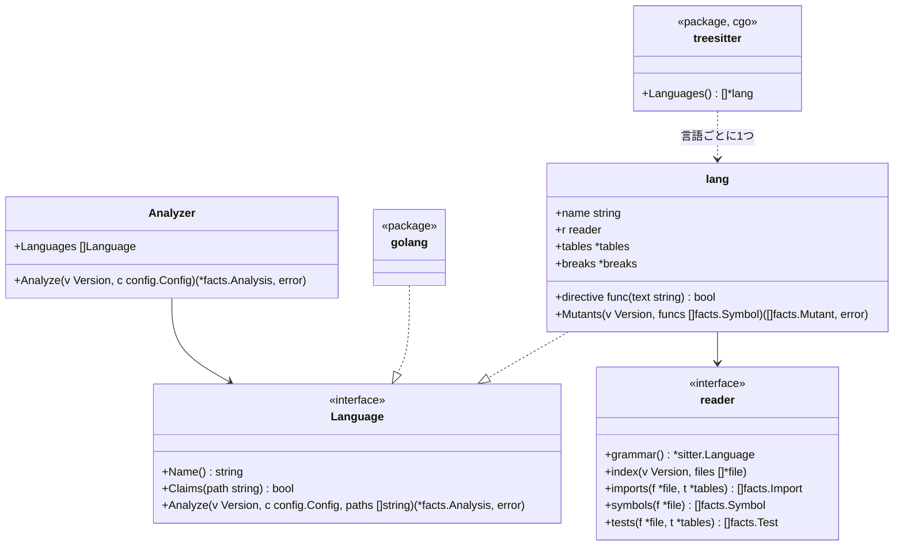

# TypeScript、Python、Rust、Java、Kotlin のアダプタ

この文書は [adapters.ja.md](adapters.ja.md) のうち言語ごとの部分です。tree-sitter で読む5言語のそれぞれが、Go のアダプタと同じ事実をどう埋めるかを書きます。ルールからその違いは見えません。

## 形

- **`internal/adapter`**: エンジンが使う解析器のパッケージです。次のことをします
  - 版を1回たどり、各ファイルを、最初に受け持つと言った言語に渡します
  - 言語たちの報告をまとめます
  - どの言語も受け持たないファイルを、役割 `other` で一覧に載せます（[adapters.ja.md](adapters.ja.md) の不変条件4）
- **`languages:`**: 設定のこのキーで、ファイルを受け持つ言語を絞れます。省くと全言語が受け持ちます
- **`internal/adapter/treesitter`**: cgo があるときだけビルドされるパッケージです（`//go:build cgo`）。cgo が無いときの `Languages()` は、5言語のファイルを受け持って `Unread` と印を付ける読み手を返します。そのため、純粋な Go のビルド（[distribution.ja.md](distribution.ja.md)）が5言語のファイルを黙って無視することはありません
- **`lang`**: tree-sitter の木をたどる汎用の読み手は1つだけで、各言語は `lang` で表します。ファイルを受け持つかどうかは拡張子で決めます。`lang` は次のものを持ちます
  - 言語の名前
  - 危険と io の表
  - 読み手（`reader`）。ノードの種類と少しの関数からなり、パスをユニットにどう対応させるか、import をどう解決するか、何でシンボルが公開になるか、テストをどう読むかを決めます

## ユニット

ユニットは **ID** と**場所**を持ちます。

- **ID**: import が名指すもの
- **場所**（`File.UnitPath`）: 依存の図が名指す、リポジトリ内のパス

| 言語 | ユニット | ID | 場所 | シンボルの ID |
|---|---|---|---|---|
| Go | パッケージ | import のパス | ディレクトリ | `<import path>.<Name>` |
| TypeScript | ディレクトリ | そのディレクトリ | そのディレクトリ | `<directory>.<name>` |
| Python | パッケージ（ディレクトリ） | そのディレクトリ | そのディレクトリ | `<module path>.<name>`。モジュールのパスはファイルのパスから `.py` を除いたもの（`src/app/store.create_post`）で、1つのパッケージの2つのモジュールがぶつからないようにする |
| Rust | モジュール | その場所 | `src/a/b.rs` や `src/a/b/mod.rs` なら `src/a/b`。`lib.rs` と `main.rs` なら `src` | `<location>.<name>` |
| Java、Kotlin | パッケージ | `package` の宣言 | ディレクトリ | `<package>.<Class>.<member>`。Kotlin のトップレベルの関数は `<package>.<name>` |

どのシンボルの ID もユニットのパスの最後の要素と名前で終わります。だから、`store.append` のように設定した対象は、どの言語でもそのシンボルを名指せます（[rules-tests.ja.md](rules-tests.ja.md)）。

## import

| 言語 | 内部になるとき | 解決 |
|---|---|---|
| TypeScript | 指定子が `.` か `/` で始まるか、ルートの `tsconfig.json` の `compilerOptions.paths` の別名に当たる | パスそのもの、次に `.ts`、`.tsx`、`.js`、`.jsx`、`.mjs`、次に `/index.*` を試してファイルに解決する。ユニットはそのディレクトリ。それ以外は外部のパッケージで、パスの最初の要素（`@scope/name` なら2つ）で名指す |
| Python | モジュールがリポジトリにある（ディレクトリか `.py` ファイルとして、ルートか `src/` から） | 相対 import はファイルのパッケージから解決する。ユニットはモジュールのパッケージ。`b` がモジュールである `from a import b` はモジュールを束縛する |
| Rust | パスが `crate`、`self`、`super`、またはそのファイルのクレートの名前（`Cargo.toml` の `[lib] name`、無ければ `[package] name` の `-` を `_` にしたもの）で始まる。クレートの名前は、`tests/` の結合テストやバイナリがライブラリを呼ぶときに使う | モジュールのファイルである最長の接頭辞に解決し、残りは項目を名指す |
| Java、Kotlin | リポジトリのどれかのファイルがそのパッケージを宣言している | `import a.b.C` はパッケージ `a.b`。`a.b.*` も同じ |

外部の import は名前をそのまま `ToUnit` に持ち、`io` の表と照らし合わせます。

TypeScript で型だけを持ち込む import と export は、import の一覧に載せません。`import type …`、`export type { … } from …`、名前がすべて `type` 付きの `import { type A, type B } from …` の3つです。コンパイルすると消えるので、実行するコードの依存ではないからです。値を1つでも持ち込むものは載せます。例: `import { type A, b } from …`、`import d, { type A } from …`。

## シンボル

| 言語 | 関数とメソッド | 型 | 公開 | doc コメント |
|---|---|---|---|---|
| TypeScript | 関数の宣言、メソッド、`const f = () =>` | クラス、インターフェース、型の別名、enum | 宣言に `export` がある | 直前の `/** */` コメント |
| Python | モジュールの直下とクラスの中の `def` | `class` | 名前が `_` で始まらない | docstring（本体の最初の文が文字列） |
| Rust | `fn` の項目と `impl` のメソッド | `struct`、`enum`、`trait`（インターフェースとして）、`type` | `pub` | 直前の `///` の行 |
| Java | メソッドとコンストラクタ | クラス、インターフェース、enum、record | `public` | 直前の `/** */` コメント |
| Kotlin | トップレベルとクラスの中の `fun` | クラス、インターフェース、object | `private`、`internal`、`protected` でない | 直前の `/** */` コメント |

テストだけの領域（Rust の `#[cfg(test)]` モジュール）の中のコードは、製品のコードではなくテストのコードです。循環的複雑度は各言語の次のものを数えます。

- `if`、ループ
- `case` や match の腕（既定の腕は除く）
- `catch`
- `&&`、`||`、三項演算子

## テスト

| 言語 | テストのファイル | テストとは | スキップ | 理由 |
|---|---|---|---|---|
| TypeScript | `*.test.*`、`*.spec.*`、`__tests__/` の下 | 名前と関数を渡す `it` か `test` の呼び出し | `.skip`、`xit`、`xtest`、`.todo`、または `describe.skip`・`xdescribe` の中 | スキップの行かその前の行のコメント |
| Python | `test_*.py`、`*_test.py` | モジュールの直下か `Test*` クラスの中の、名前が `test` で始まる関数 | `@pytest.mark.skip`、`@unittest.skip`、`pytest.skip(...)` | `reason` 引数か最初の文字列の引数 |
| Rust | `tests/`・`benches/` の下のファイル。任意のファイル内の `#[cfg(test)]` モジュール | `#[test]`、`#[tokio::test]`、`#[async_std::test]`、`#[sqlx::test]`、`#[test_log::test]`、`#[rstest]` の付いた関数 | `#[ignore]` | `#[ignore = "…"]` |
| Java | `src/` の下の、名前に test を含むディレクトリ（`src/test/`、`src/integrationTest/` など） | `@Test`、`@ParameterizedTest`、`@RepeatedTest`、`@TestFactory`、`@TestTemplate` の付いたメソッド | `@Disabled`、`@Ignore` | アノテーションの文字列の引数 |
| Kotlin | Java と同じ | Java と同じアノテーションの付いた関数 | `@Disabled`、`@Ignore` | アノテーションの文字列の引数 |

テストが何を呼ぶかは、import した名前と、テストの中で作ったオブジェクトから読みます。言語ごとに、次のものも読みます。

- **Java と Kotlin のフィールド**: テストのクラスのフィールドも読みます
  - コンストラクタで作ったフィールドは、そのクラスとして読みます
  - 初期値の無いフィールド（`lateinit`、注入、コンストラクタのプロパティ）は、宣言した型として読みます
  - モックなど、ほかの方法で作ったフィールドは読みません
  - Kotlin の `companion object` の中のフィールドとヘルパーも、クラスのものと同じに読みます
- **初期値で製品のコードの値を使うフィールド**: テストが `private val sql = QUERY.trim()` のようなフィールドを読むと、製品のコードの値を読んだと数えます（`Reads`）。製品のコードの値が変われば、テストの結果も変わり得るからです
- **TypeScript の動的な import**: テストが文字列で名指した `import('./x')` で読み込んだモジュールから取り出した名前も読みます。ファイルの中の関数が1つのモジュールだけを読み込んで返すとき（モジュールを読み直すヘルパー）は、その関数の結果から取り出した名前も読みます
- **TypeScript の JSX とヘルパー**: テストが呼ぶものには、JSX の要素（`<Page />`）で描いたリポジトリの部品も入ります。ファイルの中のヘルパーは、`function` の宣言でも、`const` に入れた関数（`const renderPage = () => …`）でもたどります。`describe` の中で宣言したものも同じです。オブジェクトに入れた関数（`const helpers = { twice: (n) => … }` の `helpers.twice`）もたどります
- **TypeScript のテストの外の変数**: `describe` の中などで宣言した変数は、次のものから型を読みます。`new` で作ったクラス、型の注釈（`let store: Store`）、`beforeEach` などでの代入（`store = new Store()`）
  - テストの中の同じ名前のローカルは外の変数を隠します
  - ファイルが同じ名前に2つのクラスを当てる変数は読みません
- **Python のテストが受け取るもの**: 次のものを読みます
  - テストの引数と同じ名前の pytest の fixture（`@pytest.fixture` の付いた関数）が、`return` か `yield` で返すクラス
  - クラスの `setUp`・`setup_method` などで `self` に入れたクラス（`self.store = Store()`）
  - ファイルの直下で名前に入れた lambda（`twice = lambda n: double(n)`）は、ヘルパーとしてたどります
  - テストの中で同じ名前に代入し直すと、fixture から受け取った型は消えます
  - ほかのファイルの fixture（`conftest.py`）と、辞書などに入れた lambda は読みません
- **HTTP のテストの道具**: 道具の入口を呼ぶテストは、アプリを外から動かすテスト（`Test.Drives`）とします。道具は、ファイルがその道具を import していることで見分けます。Python と Rust の道具は読みません

| 言語 | 道具の入口 | import |
|---|---|---|
| Java、Kotlin | REST Assured の `given()` | `io.restassured` |
| Java、Kotlin | MockMvc の `perform()` | `org.springframework.test.web.servlet` |
| Java、Kotlin | WebTestClient の `exchange()` | `org.springframework.test.web.reactive.server` |
| TypeScript | supertest の `request()` | |

テストからの呼び出しは Go のアダプタと同じように対象に解決します。たどるのは、各ファイルがリポジトリから import する名前と、import したクラスのコンストラクタで作った変数です。解決できない呼び出しは未解決として数えます。

## 危険と io

| | TypeScript | Python | Rust | Java | Kotlin |
|---|---|---|---|---|---|
| `clock` | `Date.now`、`new Date()`、`performance.now` | `datetime.now`、`datetime.utcnow`、`date.today`、`time.time` | `SystemTime::now`、`Instant::now`、`Utc::now`、`Local::now` | `Instant.now`、`LocalDate(Time).now`、`System.currentTimeMillis`、`System.nanoTime` | Java と同じ、`Clock.System.now` |
| `sleep` | `setTimeout` | `time.sleep`、`asyncio.sleep` | `thread::sleep`、`tokio::time::sleep` | `Thread.sleep` | `Thread.sleep`、`delay` |
| `mock` | `jest.mock`、`vi.mock`、`mock.module`（bun）、`vi.spyOn`、`jest.spyOn`、`vi.stubGlobal`、`sinon` の import | `unittest.mock`、`mock` の import。`mocker`。`monkeypatch.setattr`、`monkeypatch.delattr` | `mock!`、`#[automock]` が作る `Mock<名前>` の型を使うこと、`mockall` の import | `org.mockito` の import。`@Mock`、`@Spy`、`@MockBean`、Quarkus の `@InjectMock`・`@InjectSpy` を付けたフィールド | `io.mockk`、`org.mockito` の import。Java と同じ注釈、`@MockK`、`@SpyK` |
| `always-true` | `expect(true).toBe(true)`、`expect(x).toBe(x)` | `assert True`、`assert x == x` | `assert!(true)`、`assert_eq!(x, x)` | `assertTrue(true)`、`assertEquals(x, x)` | Java と同じ |
| `io`（ユニット） | `fs`、`net`、`http`、`https`、`child_process`（`node:` の有無を問わない）、`axios`、`undici`、`pg`、`mysql2`、`mongodb`、`redis`、`@prisma/client`、`@aws-sdk`、`@google-cloud` | `socket`、`os`、`subprocess`、`sqlite3`、`requests`、`httpx`、`urllib.request`、`psycopg`、`pymongo`、`redis`、`boto3`、`sqlalchemy`、`google.cloud` | `std::fs`、`std::net`、`std::process`、`tokio::fs`、`tokio::net`、`reqwest`、`sqlx`、`diesel` | `java.io`、`java.nio.file`、`java.net`、`java.sql`、`javax.sql`、`jakarta.persistence`、`javax.persistence`、`org.hibernate`、`io.quarkus.hibernate`、`com.google.cloud`、`jakarta.ws.rs.client`、`javax.ws.rs.client`、`software.amazon.awssdk` | Java と同じ、`io.ktor.client` |
| `io`（グローバルの API） | `fetch`、`navigator.sendBeacon`、`new WebSocket`、`new XMLHttpRequest`、`new EventSource`、`localStorage`・`sessionStorage`・`indexedDB` のメンバー。`window.`・`globalThis.`・`self.` が前に付いても同じ | 無い | 無い | 無い | 無い |

表の項目は抜粋です。すべての項目は、コードの表にあります。

グローバルの API は名前だけで見ます。同じ名前のローカルの変数を呼んでも数えます。数えると、ユニットは純粋でなくなります。そのため、取り違えたときは、`tests/no-mock` が報告を出さない側に間違えます。見つけた API は、`Global` を真にした import として一覧に載せます（[adapters.ja.md](adapters.ja.md)）。1つのファイルで同じ API は1回だけ載せます。

設定での項目の足し方は Go と同じです。

- `rules.tests.hazards` は、各言語の書き方での `<unit>.<name>` を取ります
- `rules.tests.io` は、ユニットを取ります

## ミュータント

`lang` は `Mutants` を持ち、`hadome mutate` の Mutator になります（[mutation.ja.md](mutation.ja.md)）。壊し方は Go と同じ5つです。どの言語でも、同じ汎用の読み手が木をたどってミュータントを作ります。言語ごとに違うのは次の3つだけで、`lang` が持つ壊し方の表（`breaks`）に書きます。

- 演算子の綴り
- ゼロの値
- 消した呼び出しの文の代わりに置くもの

| 壊し方 | TypeScript | Python | Rust | Java | Kotlin |
|---|---|---|---|---|---|
| 比較を逆にする | Go と同じ6つ、`===` ↔ `!==` | Go と同じ6つ | Go と同じ6つ | Go と同じ6つ | Go と同じ6つ、`===` ↔ `!==` |
| 真偽を反転する | `!x` → `x`、`true` ↔ `false` | `not x` → `x`、`True` ↔ `False` | `!x` → `x`、`true` ↔ `false` | `!x` → `x`、`true` ↔ `false` | `!x` → `x`、`true` ↔ `false` |
| 算術を入れ替える | `+` ↔ `-`、`*` ↔ `/`。片方が文字列のリテラルかテンプレート文字列なら作らない | `+` ↔ `-`、`*` ↔ `/`。片方が文字列のリテラル（f 文字列を含む）なら作らない | `+` ↔ `-`、`*` ↔ `/` | `+` ↔ `-`、`*` ↔ `/`。片方が文字列のリテラルなら作らない | `+` ↔ `-`、`*` ↔ `/`。片方が文字列のリテラルなら作らない |
| ゼロの値を返す | 下の表 | 下の表 | 下の表 | 下の表 | 下の表 |
| 呼び出しの文を消す | 文を `;` にする | 文を `pass` にする | `;` で終わる文を `;` にする | 文を `;` にする | 文を `Unit` にする |

Go と同じ6つとは、`<` → `>=`、`>=` → `<`、`<=` → `>`、`>` → `<=`、`==` ↔ `!=` です。

ゼロの値は宣言した戻り値の型から決めます。

| 言語 | 型とゼロの値 |
|---|---|
| TypeScript | `number` → `0`、`string` → `""`、`boolean` → `false`、`null` か `undefined` を含む union → その値 |
| Python | `int` → `0`、`float` → `0.0`、`str` → `""`、`bool` → `False`、`None` を含む型（`Optional[…]`、`X \| None`）→ `None` |
| Rust | 整数の型 → `0`、`f32` と `f64` → `0.0`、`bool` → `false`、`&str` → `""`、`String` → `String::new()`、`Option<…>` → `None`、`Vec<…>` → `Vec::new()` |
| Java | 整数の型と `float`、`double` → `0`、`boolean` → `false`、`String` → `""`、ほかの参照の型 → `null` |
| Kotlin | `Int`、`Short`、`Byte` → `0`、`Long` → `0L`、`Double` → `0.0`、`Float` → `0f`、`Boolean` → `false`、`String` → `""`、`?` の付いた型 → `null` |

- 次の関数ではこの壊し方を作りません
  - 表に無い型の関数
  - 戻り値の型を書いていない関数。例: TypeScript で型を省いた関数、Python で注釈の無い関数、Kotlin の式の本体
- 置き換えるのは `return` の値です。Rust では関数の本体の最後の式（`;` の無い式）も置き換えます。Rust では `return` を書かずに値を返すのがふつうだからです
- Go と同じく、次の文では作りません。真偽のリテラルを返す文（真偽の反転が壊す）と、すでにゼロの値を返す文です

ほかの決まりも Go と同じです。

- **アンカー**: 「関数 | 壊し方 | 行の字句 | 何番目か」でつくります。行の字句は、その行で始まる葉のノードの文字を、コメントを除いて空白1つでつないだものです。行を整形し直しても、行にコメントを足しても、アンカーは変わりません
- **入れ子の関数**: アロー関数、ラムダ、関数の中の `def`、クロージャ、無名クラスの中は壊しません。Go の関数リテラルと同じ扱いです。ただし、`const f = () =>` のアロー関数はそれ自体がシンボルなので、その本体を壊します
- **コンパイルできること**: 置き換えたあとのコードがコンパイルできるように、構文から分かる範囲で置き換えを選びます。それでもコンパイルできないミュータントは、テストのコマンドが失敗するので、捕まえたものとして扱われます。報告には出ません

## 文法

文法は tree-sitter の言語 ABI 14 向けにビルドされたバージョンに固定します。ABI 14 は、Go のバインディングが読める最新の ABI です。文法はバインディングと一緒に上げ、単独では上げません。

TypeScript は拡張子で文法を分けます。どちらの文法も、もう一方のファイルを読みきれないからです。

| 拡張子 | 文法 | もう一方の文法で読めない書き方 |
|---|---|---|
| `.ts`、`.mts`、`.cts` | TypeScript | `<string>x` の型の指定（TSX では JSX の要素と区別できない） |
| `.tsx`、`.js`、`.jsx`、`.mjs`、`.cjs` | TSX | JSX の要素 |

文法には、正しいコードでも読めない書き方があります。tree-sitter はそこで読むのを止めず、誤りのノードを挟んで先を読みます。そのため、ファイルの事実の多くは残りますが、誤りの近くの関数やテストは拾えないことがあります。手元のコードで見つかったものは次のとおりです。

| 言語 | 読めない書き方 |
|---|---|
| TypeScript | 型引数の付いたタグ付きテンプレート（styled-components の ``styled.div<{ open: boolean }>`…` ``）、JSX の文字列や本文の裸の `&` |
| Rust | `raw` という名前の変数への参照（`&raw`）。`&raw const` の構文と取り違える |
| Kotlin | アノテーションの引数の配列のリテラル（`[]`） |

こうしたファイルも読んだものとして扱い、`unknown/unread` には出しません（下の「意図して入れなかったもの」）。読めない書き方は文法を上げると減ります。

## 読めなかったファイル

| ルール | 種類 | 後退になるとき |
|---|---|---|
| `unknown/unread` | 見つけるルール（人の確認） | この hadome のビルドが読めない、対応言語のファイル（純粋な Go のビルドが TypeScript に出会った場合など）が head で新しく現れた。終了コード `3` |

## 不変条件

1. どの言語も同じ事実を埋める。事実がどの言語から来たかを調べるルールは無い
2. 対応言語のファイルは、読むか、読めなかったと報告するかのどちらかで、無視されることは無い
3. 文字列とコメントの中の文字から、危険、import、シンボルは生まれない

## 意図して入れなかったもの

- 「コンストラクタで作った変数」を超える型の推定。それ以外のものへの呼び出しは未解決になる
- 各モジュールの仕組みの隅の場合（テストの中で文字列で名指した `import()` のほかの動的な import、Python のパスの操作、Rust の `#[path]`、TypeScript の project references）。外部か未解決として扱う
- 型を推定して決めるゼロの値（戻り値の型を書いていない関数や、利用者が定義した型）
- Rust のマクロの呼び出し（`println!` など）を消すこと。マクロは、宣言や制御の流れを含むことがある
- Python の `is` と `in` を反転すること
- 構文の誤りのあるファイルを、読めなかったと報告すること。誤りのほとんどは、文法が正しいコードを読めずに出るもので、利用者がコードを直しても消せない確認になる
