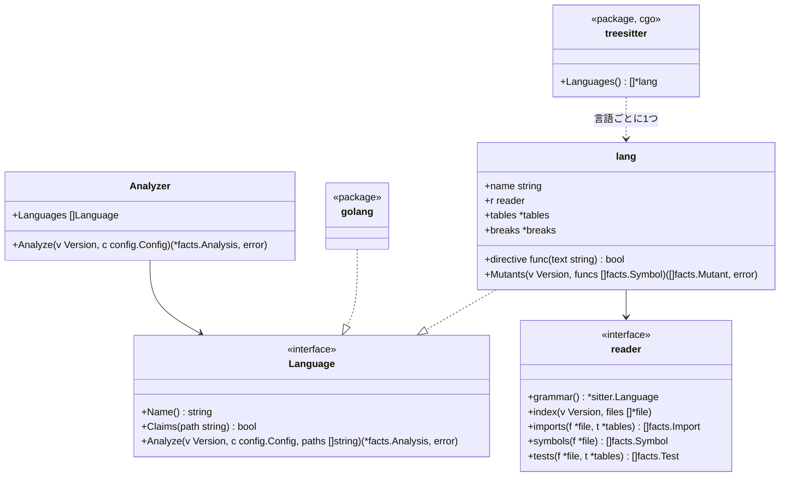

# TypeScript、Python、Rust、Java、Kotlin のアダプタ

この文書は [adapters.ja.md](adapters.ja.md) のうち言語ごとの部分です。tree-sitter で読む5言語のそれぞれが、Go のアダプタと同じ事実をどう埋めるかを書きます。ルールからその違いは見えません。

## 形

- **`internal/adapter`**: エンジンが使う解析器のパッケージです。次のことをします
  - 版を1回たどり、各ファイルを、最初に受け持つと言った言語に渡します
  - 言語たちの報告をまとめます
  - どの言語も受け持たないファイルを、役割 `other` で一覧に載せます（[adapters.ja.md](adapters.ja.md) の不変条件4）
- **`languages:`**: 設定のこのキーで、ファイルを受け持つ言語を絞れます。省くと全言語が受け持ちます
- **`internal/adapter/treesitter`**: cgo があるときだけビルドされるパッケージです（`//go:build cgo`）。cgo が無いときの `Languages()` は、5言語のファイルを受け持って `Unread` と印を付ける読み手を返します。そのため、純粋な Go のビルド（[distribution.ja.md](distribution.ja.md)）が5言語のファイルを黙って無視することはありません
- **`lang`**: tree-sitter の木をたどる汎用の読み手は1つだけで、各言語は `lang` で表します。ファイルを受け持つかどうかは拡張子で決めます。`lang` は次のものを持ちます
  - 言語の名前
  - 危険と io の表
  - 読み手（`reader`）。ノードの種類と少しの関数からなり、パスをユニットにどう対応させるか、import をどう解決するか、何でシンボルが公開になるか、テストをどう読むかを決めます

## ユニット

ユニットは **ID** と**場所**を持ちます。

- **ID**: import が名指すもの
- **場所**（`File.UnitPath`）: 依存の図が名指す、リポジトリ内のパス

| 言語 | ユニット | ID | 場所 | シンボルの ID |
|---|---|---|---|---|
| Go | パッケージ | import のパス | ディレクトリ | `<import path>.<Name>` |
| TypeScript | ディレクトリ | そのディレクトリ | そのディレクトリ | `<directory>.<name>`。同じディレクトリの2つ以上のファイルが同じ名前をトップレベルで宣言するときは `<拡張子を除いたファイルのパス>.<name>`（`src/store/a.append`） |
| Python | パッケージ（ディレクトリ） | そのディレクトリ | そのディレクトリ | `<module path>.<name>`。モジュールのパスはファイルのパスから `.py` を除いたもの（`src/app/store.create_post`）で、1つのパッケージの2つのモジュールがぶつからないようにする |
| Rust | モジュール | その場所 | `src/a/b.rs` や `src/a/b/mod.rs` なら `src/a/b`。`lib.rs` と `main.rs` なら `src` | `<location>.<name>` |
| Java、Kotlin | パッケージ | `package` の宣言 | ディレクトリ | `<package>.<Class>.<member>`。Kotlin のトップレベルの関数は `<package>.<name>` |

どのシンボルの ID もユニットのパスの最後の要素と名前で終わります。だから、`store.append` のように設定した対象は、どの言語でもそのシンボルを名指せます（[rules-tests.ja.md](rules-tests.ja.md)）。

TypeScript だけは、ぶつかる名前の ID にファイルのパスを使います。

- **理由**: TypeScript のユニットはディレクトリです。同じディレクトリの2つのファイルが同じ名前を宣言すると、ディレクトリだけの ID では1つの対象にまとまります。そうなると、片方のテストを消しても `tests/scope-shrunk` が出ません
- **範囲**: ファイルのパスを使うのは、ぶつかる名前だけです。ぶつからない名前の ID は `<directory>.<name>` のままです。依存のルールが見るユニットも、ディレクトリのままです
- **テストからの名指し**: テストが import した名前は、import が解決したファイルから宣言したファイルを探して、その ID にします。`export { x } from './a'` と `export * from './a'` はたどります。`export default` は、宣言の名前（`export default function Page` なら `Page`）にします
- **ID が変わるとき**: あとから同じ名前を宣言するファイルが増えると、前からあった方の ID が変わります。base の対象は head に無くなるので、`tests/scope-shrunk` は正当な削除として扱い、落としません

## import

| 言語 | 内部になるとき | 解決 |
|---|---|---|
| TypeScript | 指定子が `.` か `/` で始まる。ファイルに最も近い `tsconfig.json` の別名か `baseUrl` で、リポジトリのファイルに解決できる。リポジトリのパッケージの名前で始まる | 下の「TypeScript の解決」。それ以外は外部のパッケージで、パスの最初の要素（`@scope/name` なら2つ）で名指す |
| Python | モジュールがリポジトリにある（ディレクトリか `.py` ファイルとして、パッケージの根から） | パッケージの根は、ルート、`src/`、`pyproject.toml`・`setup.cfg`・`setup.py` のあるディレクトリ、そのディレクトリの `src/` です。import するファイルを含むディレクトリの根（その `src/` を含む）を、深いディレクトリのものから先に探します。そのあと、残りの根をパスの順に探します。相対 import はファイルのパッケージから解決する。ユニットはモジュールのパッケージ。`b` がモジュールである `from a import b` はモジュールを束縛する |
| Rust | パスが `crate`、`self`、`super`、またはそのファイルのクレートの名前（`Cargo.toml` の `[lib] name`、無ければ `[package] name` の `-` を `_` にしたもの）で始まる。クレートの名前は、`tests/` の結合テストやバイナリがライブラリを呼ぶときに使う | モジュールのファイルである最長の接頭辞に解決し、残りは項目を名指す |
| Java、Kotlin | リポジトリのどれかのファイルがそのパッケージを宣言している | `import a.b.C` はパッケージ `a.b`。`a.b.*` も同じ |

外部の import は名前をそのまま `ToUnit` に持ち、`io` の表と照らし合わせます。

TypeScript で型だけを持ち込む import と export は、import の一覧に載せません。`import type …`、`export type { … } from …`、名前がすべて `type` 付きの `import { type A, type B } from …` の3つです。コンパイルすると消えるので、実行するコードの依存ではないからです。値を1つでも持ち込むものは載せます。例: `import { type A, b } from …`、`import d, { type A } from …`。

### TypeScript の解決

指定子は次の順に試します。

1. `.` か `/` で始まる指定子は、ファイルのパスとして解決します
2. ファイルに最も近い `tsconfig.json` の `paths` の別名に当たれば、その行き先として解決します。行き先が複数あれば順に試します。2つの別名に当たるときは、接頭辞の長い方を使います
3. 同じ `tsconfig.json` に `baseUrl` があり、その下のファイルに解決できれば、それにします
4. リポジトリのどれかの `package.json` の `name` で始まれば、そのパッケージのソースとして解決します。`node_modules` の下の `package.json` は読みません
5. どれにも当たらなければ、外部のパッケージです

パスをファイルにするときは、次の順に試します。

- パスそのもの
- 拡張子（`.ts`、`.tsx`、`.js` など）を足したもの
- `/index.*`
- `.js`・`.mjs`・`.cjs` で終わるパスは、拡張子を `.ts`・`.tsx`・`.mts`・`.cts` に替えたもの。ESM の TypeScript は `./a.js` と書いて `a.ts` を読み込むからです

ユニットは解決したファイルのディレクトリです。

`tsconfig.json` は次のように読みます。

- `extends` をたどります。たどるのは、相対パスと、リポジトリのパッケージの中のファイル（`@acme/tsconfig/base.json`）です。`extends` が配列なら、後のものが前のものを上書きします
- `baseUrl` は、それを書いた設定ファイルの場所から解決します
- `paths` は `baseUrl` から解決します。`baseUrl` が無ければ、`paths` を書いた設定ファイルの場所から解決します
- 最も近い `tsconfig.json` に `paths` が無く、`references` があれば、`paths` を持つ最初の参照先の別名を使います。例: Vite の `tsconfig.app.json`
- コメントと、末尾のカンマは読み飛ばします

リポジトリのパッケージの名前だけの import（`@acme/shared`）は、パッケージのディレクトリの中の次のファイルに、この順で解決します。

1. `src/index.*`
2. `index.*`
3. `exports["."]`、`module`、`main`、`types` が名指すファイル。`dist/`・`lib/`・`build/`・`out/` の下を名指すときは、`src/` の下の同じ名前のソースも試します

`@acme/shared/sub` のようにパスが続くときは、パッケージのディレクトリと、その `src/` の下でパスを解決します。

### 解決できない import

リポジトリのものに見えるのに、どのファイルにも解決できない import があります。

| 言語 | リポジトリのものに見える import |
|---|---|
| TypeScript | `.` か `/` で始まる。`paths` の別名に当たる。リポジトリのパッケージの名前で始まる |
| Python | 相対 import。最初の要素がパッケージの根の下のパッケージである import（`app` があるときの `app.missing`） |

- テストのファイルがこうした import から取り出した名前を呼ぶと、その呼び出しを未解決（`Test.Unresolved`）と数えます
- 外部のパッケージとして扱って何も数えないと、製品のコードを呼んでいるかもしれないテストが `tests/guards-nothing` で落ちます。特定できないものは、`tests/target-unknown` で人の確認に回します
- テストでないファイルの import は、これまでどおり扱います。TypeScript では、名指したパスのディレクトリをユニットとする内部の import です。Python では外部の import です
- ただし、hadome が読まないディレクトリ（`dist/`、`build/`、`.generated/` など）の中を名指す import は、行き先の分からない import（`Import.Unknown` と `Import.Unread`）にします。ファイルがあってもなくても同じです。テストのファイルでは、ここから取り出した名前の呼び出しを未解決と数えます（[adapters.ja.md](adapters.ja.md) の「行き先の分からない import」）

## シンボル

| 言語 | 関数とメソッド | 型 | 公開 | doc コメント |
|---|---|---|---|---|
| TypeScript | 関数の宣言、メソッド、`const f = () =>` | クラス、インターフェース、型の別名、enum | 宣言に `export` がある | 直前の `/** */` コメント |
| Python | モジュールの直下とクラスの中の `def` | `class` | 名前が `_` で始まらない | docstring（本体の最初の文が文字列） |
| Rust | `fn` の項目と `impl` のメソッド | `struct`、`enum`、`trait`（インターフェースとして）、`type` | `pub` | 直前の `///` の行 |
| Java | メソッドとコンストラクタ | クラス、インターフェース、enum、record | `public` | 直前の `/** */` コメント |
| Kotlin | トップレベルとクラスの中の `fun` | クラス、インターフェース、object | `private`、`internal`、`protected` でない | 直前の `/** */` コメント。間に引数のあるアノテーションの行（`@Suppress("x")`）がいくつあっても、その上のコメント |

テストだけの領域（Rust の `#[cfg(test)]` モジュール）の中のコードは、製品のコードではなくテストのコードです。循環的複雑度は各言語の次のものを数えます。

- `if`、ループ
- `case` や match の腕（既定の腕は除く）
- `catch`
- `&&`、`||`、三項演算子

## テスト

| 言語 | テストのファイル | テストとは | スキップ | 理由 |
|---|---|---|---|---|
| TypeScript | `*.test.*`、`*.spec.*`、`__tests__/` の下、テストの補助のファイル | 名前と関数を渡す `it` か `test` の呼び出し（下の注） | `.skip`、`xit`、`xtest`、`.todo`、`.fixme`、または `describe.skip`・`xdescribe` の中。一部の場合だけのスキップは `.skipIf(条件)`・`.runIf(条件)` と、Playwright の `test.skip(条件, 説明)`・`test.fixme(条件, 説明)` | スキップの行かその前の行のコメント。Playwright の `test.skip` は条件の後の説明 |
| Python | `test_*.py`、`*_test.py` | モジュールの直下か `Test*` クラスの中の、名前が `test` で始まる関数 | `@pytest.mark.skip`、`@unittest.skip`、`pytest.skip(...)` | `reason` 引数か最初の文字列の引数 |
| Rust | `tests/`・`benches/` の下のファイル。任意のファイル内の `#[cfg(test)]` モジュール | `#[test]`、`#[tokio::test]`、`#[async_std::test]`、`#[sqlx::test]`、`#[test_log::test]`、`#[rstest]` の付いた関数 | `#[ignore]` | `#[ignore = "…"]` |
| Java | `src/` の下の、名前に test を含むディレクトリ（`src/test/`、`src/integrationTest/` など） | `@Test`、`@ParameterizedTest`、`@RepeatedTest`、`@TestFactory`、`@TestTemplate` の付いたメソッド | `@Disabled`、`@Ignore` | アノテーションの文字列の引数 |
| Kotlin | Java と同じ | Java と同じアノテーションの付いた関数 | `@Disabled`、`@Ignore` | アノテーションの文字列の引数 |

TypeScript のテストの宣言は、次のように読みます。

- **先に表か条件を渡す形**: `it.each(表)(名前, 関数)`、`` test.each`表`(名前, 関数) ``、`test.concurrent.each`、`describe.each`、`it.skipIf(条件)(名前, 関数)`、`it.runIf(条件)(名前, 関数)` もテストか `describe` です
  - `describe.each` の名前は中のテストの名前に入ります
  - 表はテストと一緒に動くので、表の中の呼び出しもテストの呼び出しに数えます
- **関数の位置**: テストの関数は最後の関数の引数です。vitest は名前と関数の間にオプションを取り（`it(名前, { retry: 2 }, 関数)`）、jest は関数の後にタイムアウトを取るからです。名前の文字列の後に関数の名前を渡したとき（`it('adds', checkAdd)`）は、ファイルの中のその関数をたどります
- **Playwright の条件つきのスキップ**: 関数を渡さない `test.skip(条件, 説明)` と `test.fixme(条件, 説明)` は、テストではありません。テストの中で呼ぶとそのテストを、`describe` の直下で呼ぶとその中のテストを、一部の場合だけスキップします。引数の無い `test.skip()` をテストの中で呼ぶと、そのテストは常にスキップします

テストが何を呼ぶかは、import した名前と、テストの中で作ったオブジェクトから読みます。言語ごとに、次のものも読みます。

- **Java と Kotlin のフィールド**: テストのクラスのフィールドも読みます
  - コンストラクタで作ったフィールドは、そのクラスとして読みます
  - 初期値の無いフィールド（`lateinit`、注入、コンストラクタのプロパティ）は、宣言した型として読みます
  - モックなど、ほかの方法で作ったフィールドは読みません
  - Kotlin の `companion object` の中のフィールドとヘルパーも、クラスのものと同じに読みます
  - `@Nested` などの内側のクラスのテストは外側のクラスのフィールドとヘルパーも使います
  - Kotlin のテストのクラスがテストのファイルにある別のクラスを継承するとき（`class StoreTest : StoreTestSupport()`）は、継承元のフィールド、ヘルパー、モックのフィールド、各テストの前に走るコードも、そのクラスのものと同じに読みます。継承元が別のクラスを継承していれば、それもたどります
  - 継承元は名前で探します。同じパッケージのものを先に探し、無ければ、その名前のクラスが1つだけのときに使います
  - 継承元のヘルパーの中の名前は継承元のファイルの import で読みます
- **Kotlin の変数の型**: 次の変数とフィールドも、製品のクラスとして読みます
  - `apply` か `also` で作ったもの（`Queue().apply { limit = 3 }`）。この2つは受け取ったオブジェクトを返すからです
  - enum の定数を入れたもの（`val kind = Kind.DAILY`）。その enum のクラスとして読みます
  - 作ったオブジェクトにそのまま続けた呼び出し（`Store().append(1)`）も、そのクラスのメソッドの呼び出しとして読みます
- **製品のクラスのメンバーの上の呼び出し**: Java と Kotlin で、`クラス.メンバー.メソッド()` の形の呼び出しは次のように読みます
  - メンバーが enum の定数なら、その enum のクラスのメソッドの呼び出しです（`Kind.ORDERS.toTable()` は `Kind.toTable`）
  - メンバーが内側のクラスなら、そのクラスのメソッドの呼び出しです（`Outer.Inner.build()`）
  - それ以外（`object` のプロパティなど）は、値のクラスが分かりません。そのため、製品のコードの値を読んだと数えます（`Reads`）
- **製品のオブジェクトのプロパティ**: Java と Kotlin で、製品のクラスとして読んだ変数のプロパティを読むと（`cache.ttl`）、製品のコードの値を読んだと数えます。メソッドを呼ぶ（`cache.clear()`）のは呼び出しで、読んだとは数えません
- **Kotlin の型引数とラムダを取る呼び出し**: `assertThrows<E> { … }` と `assertThrows<E>({ … })` は、文法の上では比べる式が2つ並んだ形（`(assertThrows < E) > { … }`）として読まれます。これも呼び出しとして読みます。`mockk<T> { … }` や、製品のコードの関数でも同じです。型引数は値として読みません
- **初期値で製品のコードの値を使うフィールド**: テストが `private val sql = QUERY.trim()` のようなフィールドを読むと、製品のコードの値を読んだと数えます（`Reads`）。製品のコードの値が変われば、テストの結果も変わり得るからです。Kotlin で継承元のクラスにあるフィールドも同じです
- **Kotlin の文字列テンプレート**: 文字列に埋め込んだ製品のコードの値（`"IN ($COUNTED)"`、`"${Kind.ORDERS.table}"`）も、読んだと数えます。`\$` で始まるものは埋め込みではありません。そうした文字列を初期値に使うフィールドも、上のフィールドと同じに数えます
- **TypeScript の動的な import**: テストが文字列で名指した `import('./x')` で読み込んだモジュールから取り出した名前も読みます。ファイルの中の関数が1つのモジュールだけを読み込んで返すとき（モジュールを読み直すヘルパー）は、その関数の結果から取り出した名前も読みます
- **TypeScript の `require`**: 文字列で名指した `require('./x')` は、ファイルの直下でも `describe` の中でもテストの中でも、import と同じに読みます。例: `const { send } = require('./mail')`、`const mail = require('./mail')`
- **TypeScript の JSX とヘルパー**: テストが呼ぶものには、JSX の要素（`<Page />`）で描いたリポジトリの部品も入ります。ファイルの中のヘルパーは、`function` の宣言でも、`const` に入れた関数（`const renderPage = () => …`）でもたどります。`describe` の中で宣言したものも同じです。オブジェクトに入れた関数（`const helpers = { twice: (n) => … }` の `helpers.twice`）もたどります。テストのファイルの中で宣言した部品（`function Harness() { return <Field /> }`、`const Wrapper = () => <Field />`）を要素で描いたときも、ヘルパーと同じにたどります。ヘルパーを呼ぶと、引数の既定の値（`function make(store = createStore())`）も動くので、それも数えます
- **TypeScript のテストの外の変数の型**: `describe` の中などで宣言した変数は、次のものから型を読みます。`new` で作ったクラス、型の注釈（`let store: Store`）、`beforeEach` などでの代入（`store = new Store()`）
  - テストの中の同じ名前のローカルは外の変数を隠します
  - ファイルが同じ名前に2つのクラスを当てる変数は読みません
- **TypeScript のテストの前に動くもの**: テストは次のものの呼び出しと読み取りも自分のものとして数えます
  - そのテストを囲む `describe` とファイルの直下の `beforeEach`・`beforeAll` の本体（`beforeEach(() => render(<Page />))`）
  - テストが使う外の変数を用意するもの。ファイルの直下か `describe` の直下で宣言した変数の初期値（`const shared = createStore()`、`const KEYS = Object.keys(words)`）、そこかフックの中での代入（`store = createStore()`）、そこでその変数を使う文（`register(app)`）です。変数を宣言した `describe` の中のテストだけが数えます
  - テストの補助のファイルのヘルパーが、そのファイルの直下で用意した値を使うときも、同じに数えます
  - テストが読む外のオブジェクトの getter。オブジェクトに入れたほかの関数は呼んだときだけ数えます
  - ファイルの直下の `const { add } = await import('./m')` と、`beforeAll` での `mod = await import('./m')`（`(await import('./m')) as T` も）で取った名前は、そのモジュールのものとして読みます
  - 値を使わずに `await import('./m')` だけをするファイルでは、どのテストもそのモジュール（ユニット）を呼ぶと数えます。読み込むだけで動くモジュールだからです
  - 一度だけ用意する値は、テストが何度使っても一度と数えます
- **Python のテストが受け取るもの**: 次のものを読みます
  - テストの引数と同じ名前の pytest の fixture（`@pytest.fixture` の付いた関数）が、`return` か `yield` で返すクラス
  - クラスの `setUp`・`setup_method` などで `self` に入れたクラス（`self.store = Store()`）
  - ファイルの直下で名前に入れた lambda（`twice = lambda n: double(n)`）は、ヘルパーとしてたどります
  - テストの中で同じ名前に代入し直すと、fixture から受け取った型は消えます
  - fixture が同じファイルに無ければ、テストのディレクトリとその上のディレクトリの `conftest.py` から探します。近いものが先です
  - テストが受け取る fixture の本体は、ヘルパーと同じようにたどります。fixture の中で呼んだ製品のコードも、テストが動かすからです
  - 辞書などに入れた lambda は読みません
- **HTTP のテストの道具**: 道具の入口を呼ぶテストは、アプリを外から動かすテスト（`Test.Drives`）とします。道具は、ファイルがその道具を import していることで見分けます。Python と Rust の道具は読みません

| 言語 | 道具の入口 | import |
|---|---|---|
| Java、Kotlin | REST Assured の `given()` | `io.restassured` |
| Java、Kotlin | MockMvc の `perform()` | `org.springframework.test.web.servlet` |
| Java、Kotlin | WebTestClient の `exchange()` | `org.springframework.test.web.reactive.server` |
| TypeScript | supertest の `request()` | `supertest` |
| TypeScript | Hono の `app.request(…)`。最初の引数が `/` で始まる文字列か `new Request(…)` のとき、またはオブジェクトがリポジトリから import した名前のとき | 要らない（呼び出しの形で見分ける） |
| TypeScript | `app.fetch(new Request(…))`。fetch の形で HTTP を受けるアプリに、メモリの中で要求を渡す | 要らない（呼び出しの形で見分ける） |

テストからの呼び出しは Go のアダプタと同じように対象に解決します。たどるのは、各ファイルがリポジトリから import する名前と、import したクラスのコンストラクタで作った変数です。解決できない呼び出しは未解決として数えます。

### テストの補助のファイル

テストのファイルではないのに、テストのためだけにあるファイルがあります。例: `test/helpers.ts`、`e2e/fixtures.ts`、`conftest.py`。これらは製品のコードではないので、テストの補助のファイルとして扱います。

| 言語 | テストの補助のファイル |
|---|---|
| TypeScript | 次のディレクトリの下のファイル: `test/`、`tests/`、`e2e/`、`__mocks__/`、`__fixtures__/`、`testutil/`、`testutils/`、`test-utils/`、`test_utils/`、`testhelper/`、`testhelpers/`。名前が test と helper(s) をつないだもので終わるファイル（`test_helpers.ts`、`test-helpers.ts`、`testHelpers.ts`）。`setupTests.*`、`jest.setup.*`、`vitest.setup.*` |
| Python | TypeScript と同じディレクトリの下のファイル。`conftest.py`。名前が test と helper(s) をつないだもので終わるファイル（`test_helpers.py`） |

- **役割**: `test` です。そのため、対象にならず、`comments/missing-doc` も求めず、依存の図にも入りません
- **中のテスト**: TypeScript では、補助のファイルの中の `it` や `test` もテストとして読みます。mocha は `test/` の下のファイルをテストとして読むからです。Python では、テストのファイルの名前（`test_*.py`、`*_test.py`）のものだけをテストとして読みます。pytest がそう集めるからです
- **たどり方**: テストが補助のファイルの関数を呼ぶと、その関数の中までたどります。中の呼び出しは、補助のファイル自身の import で解決します。そのため、ヘルパーを通して製品のコードを呼ぶテストは、その製品のコードを守ります
  - 例: `test/helpers.ts` の `createApp()` が `src/app.ts` の `buildApp()` を呼ぶなら、`createApp()` を呼ぶテストは `buildApp` を守ります
  - 補助のファイルの中で関数として見つからない名前（関数でない値など）を呼ぶと、未解決と数えます
- **ほかの役割の指定**: `files.tests` の glob に合うファイルは、これまでどおりテストのファイルです。`files.product` の glob に合うファイルは、テストの補助のファイルにせず、製品のコードとして読みます（[adapters.ja.md](adapters.ja.md)）
- **ディレクトリの一覧**: 一覧は `walk.SupportDir` にあります。Go のアダプタは、このうち `tests/` を除いたもの（`walk.GoSupportDir`）を使います。Go では `tests` という名前の製品のパッケージがあるからです（[adapters.ja.md](adapters.ja.md)）

## 危険と io

| | TypeScript | Python | Rust | Java | Kotlin |
|---|---|---|---|---|---|
| `clock` | `Date.now`、`new Date()`、`performance.now` | `datetime.now`、`datetime.utcnow`、`date.today`、`time.time` | `SystemTime::now`、`Instant::now`、`Utc::now`、`Local::now` | `Instant.now`、`LocalDate(Time).now`、`System.currentTimeMillis`、`System.nanoTime` | Java と同じ、`Clock.System.now`、`measureTimeMillis`、`measureNanoTime`、`measureTime`、`measureTimedValue`、`TimeSource.Monotonic.markNow` |
| `sleep` | `setTimeout` | `time.sleep`、`asyncio.sleep` | `thread::sleep`、`tokio::time::sleep` | `Thread.sleep` | `Thread.sleep`、`delay` |
| `mock` | `jest.mock`、`vi.mock`、`mock.module`（bun）、`vi.spyOn`、`jest.spyOn`、`vi.stubGlobal`、`sinon` の import | `unittest.mock`、`mock` の import。`mocker`。`monkeypatch.setattr`、`monkeypatch.delattr` | `mock!`、`#[automock]` が作る `Mock<名前>` の型を使うこと、`mockall` の import | `org.mockito` の import。`@Mock`、`@Spy`、`@MockBean`、Quarkus の `@InjectMock`・`@InjectSpy` を付けたフィールド | `io.mockk`、`org.mockito` の import。Java と同じ注釈、`@MockK`、`@SpyK` |
| `always-true` | `expect(true).toBe(true)`、`expect(x).toBe(x)` | `assert True`、`assert x == x` | `assert!(true)`、`assert_eq!(x, x)` | `assertTrue(true)`、`assertEquals(x, x)` | Java と同じ |
| `io`（ユニット） | `fs`、`net`、`http`、`https`、`child_process`（`node:` の有無を問わない）、`axios`、`undici`、`pg`、`mysql2`、`mongodb`、`redis`、`@prisma/client`、`@aws-sdk`、`@google-cloud` | `socket`、`os`、`subprocess`、`sqlite3`、`requests`、`httpx`、`urllib.request`、`psycopg`、`pymongo`、`redis`、`boto3`、`sqlalchemy`、`google.cloud` | `std::fs`、`std::net`、`std::process`、`tokio::fs`、`tokio::net`、`reqwest`、`sqlx`、`diesel` | `java.io`、`java.nio.file`、`java.net`、`java.sql`、`javax.sql`、`jakarta.persistence`、`javax.persistence`、`org.hibernate`、`io.quarkus.hibernate`、`com.google.cloud`、`jakarta.ws.rs.client`、`javax.ws.rs.client`、`software.amazon.awssdk` | Java と同じ、`io.ktor.client` |
| `io`（グローバルの API） | `fetch`、`navigator.sendBeacon`、`new WebSocket`、`new XMLHttpRequest`、`new EventSource`、`localStorage`・`sessionStorage`・`indexedDB` のメンバー。`window.`・`globalThis.`・`self.` が前に付いても同じ | 無い | 無い | 無い | 無い |

表の項目は抜粋です。すべての項目は、コードの表にあります。

グローバルの API は名前だけで見ます。同じ名前のローカルの変数を呼んでも数えます。数えると、ユニットは純粋でなくなります。そのため、取り違えたときは、`tests/no-mock` が報告を出さない側に間違えます。見つけた API は、`Global` を真にした import として一覧に載せます（[adapters.ja.md](adapters.ja.md)）。1つのファイルで同じ API は1回だけ載せます。

TypeScript のテストが偽の時計に切り替えた後は、`Date.now`・`new Date()`・`setTimeout` を `clock`・`sleep` に数えません。偽の時計に切り替えるのは `vi.useFakeTimers()`・`jest.useFakeTimers()`・`vi.setSystemTime()`・`jest.setSystemTime()`・`sinon.useFakeTimers()` です。テストの中で呼んだときは、呼んだ後から数えません。`beforeEach` か `describe` の直下で呼んだときは、その中のテストのどこでも数えません。`vi.useRealTimers()`・`jest.useRealTimers()` の後は、また数えます。

各テストの前に走るコードの `clock` と `sleep` も、そのコードが前に走る各テストの危険とします。そこで時刻を読んだり待ったりすると、そのどのテストの結果も時刻に左右されるからです。

| 言語 | 各テストの前に走るコード |
|---|---|
| Java、Kotlin | `@BeforeEach`・`@BeforeAll`・`@Before`・`@BeforeClass` の付いたメソッドと、Kotlin の `init` のブロック。外側のクラスと継承元のクラスのものも入ります |
| TypeScript | テストを囲む `describe` と、ファイルの直下の `beforeEach`・`beforeAll` の本体。偽の時計に切り替えた後のものは数えません（前の段落） |
| Python | `autouse=True` の付いた pytest の fixture。同じファイル、テストのディレクトリとその上の `conftest.py`、テストのクラスの中のものです。クラスの `setUp`・`setUpClass`・`asyncSetUp`・`setup_method`・`setup_class`。ファイルの `setup_module`。クラスの外のテストには `setup_function` も入ります |

- 危険の場所はそのコードのある行です。継承元のクラスや `conftest.py` のように別のファイルにあれば、そのファイルの行です
- Java、Kotlin、Python では、そのコードの中の呼び出しや確かめは、テストのものとは数えません。テストが何を守るかは、テストの本体で決まるからです
- TypeScript のフックの中の呼び出しは、テストのものと数えます（前述の「TypeScript のテストの前に動くもの」）
- Python のテストが引数で受け取る fixture は、これまでどおり本体をたどります。中の呼び出しも危険も、そのテストのものです

設定での項目の足し方は Go と同じです。

- `rules.tests.hazards` は、各言語の書き方での `<unit>.<name>` を取ります
- `rules.tests.io` は、ユニットを取ります

## ミュータント

`lang` は `Mutants` を持ち、`hadome mutate` の Mutator になります（[mutation.ja.md](mutation.ja.md)）。壊し方は Go と同じ5つです。どの言語でも、同じ汎用の読み手が木をたどってミュータントを作ります。言語ごとに違うのは次の3つだけで、`lang` が持つ壊し方の表（`breaks`）に書きます。

- 演算子の綴り
- ゼロの値
- 消した呼び出しの文の代わりに置くもの

| 壊し方 | TypeScript | Python | Rust | Java | Kotlin |
|---|---|---|---|---|---|
| 比較を逆にする | Go と同じ6つ、`===` ↔ `!==` | Go と同じ6つ | Go と同じ6つ | Go と同じ6つ | Go と同じ6つ、`===` ↔ `!==` |
| 真偽を反転する | `!x` → `x`、`true` ↔ `false` | `not x` → `x`、`True` ↔ `False` | `!x` → `x`、`true` ↔ `false` | `!x` → `x`、`true` ↔ `false` | `!x` → `x`、`true` ↔ `false` |
| 算術を入れ替える | `+` ↔ `-`、`*` ↔ `/`。片方が文字列のリテラルかテンプレート文字列なら作らない | `+` ↔ `-`、`*` ↔ `/`。片方が文字列のリテラル（f 文字列を含む）なら作らない | `+` ↔ `-`、`*` ↔ `/` | `+` ↔ `-`、`*` ↔ `/`。片方が文字列のリテラルなら作らない | `+` ↔ `-`、`*` ↔ `/`。片方が文字列のリテラルなら作らない |
| ゼロの値を返す | 下の表 | 下の表 | 下の表 | 下の表 | 下の表 |
| 呼び出しの文を消す | 文を `;` にする | 文を `pass` にする | `;` で終わる文を `;` にする | 文を `;` にする | 文を `Unit` にする |

Go と同じ6つとは、`<` → `>=`、`>=` → `<`、`<=` → `>`、`>` → `<=`、`==` ↔ `!=` です。

ゼロの値は宣言した戻り値の型から決めます。

| 言語 | 型とゼロの値 |
|---|---|
| TypeScript | `number` → `0`、`string` → `""`、`boolean` → `false`、`null` か `undefined` を含む union → その値 |
| Python | `int` → `0`、`float` → `0.0`、`str` → `""`、`bool` → `False`、`None` を含む型（`Optional[…]`、`X \| None`）→ `None` |
| Rust | 整数の型 → `0`、`f32` と `f64` → `0.0`、`bool` → `false`、`&str` → `""`、`String` → `String::new()`、`Option<…>` → `None`、`Vec<…>` → `Vec::new()` |
| Java | 整数の型と `float`、`double` → `0`、`boolean` → `false`、`String` → `""`、ほかの参照の型 → `null` |
| Kotlin | `Int`、`Short`、`Byte` → `0`、`Long` → `0L`、`Double` → `0.0`、`Float` → `0f`、`Boolean` → `false`、`String` → `""`、`?` の付いた型 → `null` |

- 次の関数ではこの壊し方を作りません
  - 表に無い型の関数
  - 戻り値の型を書いていない関数。例: TypeScript で型を省いた関数、Python で注釈の無い関数、Kotlin の式の本体
- 置き換えるのは `return` の値です。Rust では関数の本体の最後の式（`;` の無い式）も置き換えます。Rust では `return` を書かずに値を返すのがふつうだからです
- Go と同じく、次の文では作りません。真偽のリテラルを返す文（真偽の反転が壊す）と、すでにゼロの値を返す文です
- 値がゼロの定数を返す文でも作りません。例: `export const OK = 0` のとき、`number` を返す関数の `return OK` は壊しません

定数は、同じファイルの宣言だけを構文で読みます。読むのは次の宣言のうち、値がリテラルのものです。

| 言語 | 読む宣言 |
|---|---|
| TypeScript | ファイルの一番外の `const`（`export const` を含む） |
| Python | モジュールの一番外の `NAME = 値`。ファイルの中に、その名前へのほかの代入も `global` も無いときだけ |
| Rust | 関数と `impl` の外の `const` と `static`。`static mut` は読みません |
| Java | `final` の付いたフィールドと、インタフェースの定数 |
| Kotlin | 関数の外の `val` と `const val`。`open` か `abstract` の付いたものと、getter を持つものは読みません |

- 値がゼロかは、戻り値の型のゼロの値と比べて決めます。数は、`0`、`0.0`、`0x0`、`0L`、`0_u64` のどの書き方でも、値がゼロなら同じとみなします
- Python だけは `int` と `float` を分けます。`0` と `0.0` は、テストが見分けられるからです。例: `float` を返す関数の `return RATE` は、`RATE = 0` でも `0.0` に壊します
- 次の名前は、これまでどおり壊します
  - 再代入できる名前。例: TypeScript の `let`、Rust の `static mut`、Java の `final` の無いフィールド、Kotlin の `var`
  - ファイルの中で2回以上、違う値か読まない形で宣言した名前
  - 壊す関数の中で、引数かローカル変数として同じ名前を宣言したもの
  - ほかのファイルで宣言した定数

ほかの決まりも Go と同じです。

- **アンカー**: 「関数 | 壊し方 | 行の字句 | 何番目か」でつくります。行の字句は、その行で始まる葉のノードの文字を、コメントを除いて空白1つでつないだものです。行を整形し直しても、行にコメントを足しても、アンカーは変わりません
- **入れ子の関数**: アロー関数、ラムダ、関数の中の `def`、クロージャ、無名クラスの中は壊しません。Go の関数リテラルと同じ扱いです。ただし、`const f = () =>` のアロー関数はそれ自体がシンボルなので、その本体を壊します
- **コンパイルできること**: 置き換えたあとのコードがコンパイルできるように、構文から分かる範囲で置き換えを選びます。それでもコンパイルできないミュータントは、テストのコマンドが失敗するので、捕まえたものとして扱われます。報告には出ません

## 文法

文法は tree-sitter の言語 ABI 14 向けにビルドされたバージョンに固定します。ABI 14 は、Go のバインディングが読める最新の ABI です。文法はバインディングと一緒に上げ、単独では上げません。

TypeScript は拡張子で文法を分けます。どちらの文法も、もう一方のファイルを読みきれないからです。

| 拡張子 | 文法 | もう一方の文法で読めない書き方 |
|---|---|---|
| `.ts`、`.mts`、`.cts` | TypeScript | `<string>x` の型の指定（TSX では JSX の要素と区別できない） |
| `.tsx`、`.js`、`.jsx`、`.mjs`、`.cjs` | TSX | JSX の要素 |

文法には、正しいコードでも読めない書き方があります。tree-sitter はそこで読むのを止めず、誤りのノードを挟んで先を読みます。そのため、ファイルの事実の多くは残りますが、誤りの近くの関数やテストは拾えないことがあります。手元のコードで見つかったものは次のとおりです。

| 言語 | 読めない書き方 |
|---|---|
| TypeScript | 型引数の付いたタグ付きテンプレート（styled-components の ``styled.div<{ open: boolean }>`…` ``）、JSX の文字列や本文の裸の `&` |
| Rust | `raw` という名前の変数への参照（`&raw`）。`&raw const` の構文と取り違える |
| Kotlin | アノテーションの引数の配列のリテラル（`[]`） |

こうしたファイルも読んだものとして扱い、`unknown/unread` には出しません（下の「意図して入れなかったもの」）。読めない書き方は文法を上げると減ります。

Kotlin の文法は、ファイルの直下で、引数のあるアノテーション（`@Suppress("x")`）が宣言の前の行に並ぶと、それを式として読むことがあります。2つ以上並ぶと、後ろの宣言まで式に取り込み、その宣言とテストを見落とします。そのため、こうしたアノテーションを空白に置き換えて、ファイルを読み直します。

- 置き換えはバイト数と改行を変えません。そのため、行番号も位置も元のファイルのままです
- 置き換えたアノテーションは別に覚えておき、すぐ後ろの宣言のものとして読みます。例: テストのクラスに付いた `@Disabled("理由")` は、そのクラスのテストをスキップします
- アノテーションの上の `/** */` コメントは、その宣言の doc コメントです

## 読めなかったファイル

| ルール | 種類 | 後退になるとき |
|---|---|---|
| `unknown/unread` | 見つけるルール（人の確認） | この hadome のビルドが読めない、対応言語のファイル（純粋な Go のビルドが TypeScript に出会った場合など）が head で新しく現れた。終了コード `3` |

## 不変条件

1. どの言語も同じ事実を埋める。事実がどの言語から来たかを調べるルールは無い
2. 対応言語のファイルは、読むか、読めなかったと報告するかのどちらかで、無視されることは無い
3. 文字列とコメントの中の文字から、危険、import、シンボルは生まれない

## 意図して入れなかったもの

- 「コンストラクタで作った変数」を超える型の推定。それ以外のものへの呼び出しは未解決になる
- 各モジュールの仕組みの隅の場合（テストの中で文字列で名指した `import()` のほかの動的な import、Python のパスの操作、Rust の `#[path]`、TypeScript の project references の別名のほかの部分）。外部か未解決として扱う
- TypeScript の `node_modules` のパッケージを名指す `extends`（`@tsconfig/node20/tsconfig.json`）と、`package.json` の `exports` の部分パスの表。どちらも、別名やパッケージのソースを決めることがまれだからです
- テストのファイルからしか import されないファイルを、テストの補助のファイルとみなすこと。役割は import を読む前に決めるので、import を読んでから役割を変えると、言語の読み方を2回に分けることになるからです
- 型を推定して決めるゼロの値（戻り値の型を書いていない関数や、利用者が定義した型）
- ほかのファイルの定数を読んで、値がゼロの定数を見分けること。import をたどるには言語ごとのモジュールの読み方が要り、`Mutants` はそれを持たないからです。読めない定数はこれまでどおり壊すので、テストが見落とすことにはなりません
- Rust のマクロの呼び出し（`println!` など）を消すこと。マクロは、宣言や制御の流れを含むことがある
- Python の `is` と `in` を反転すること
- 構文の誤りのあるファイルを、読めなかったと報告すること。誤りのほとんどは、文法が正しいコードを読めずに出るもので、利用者がコードを直しても消せない確認になる
