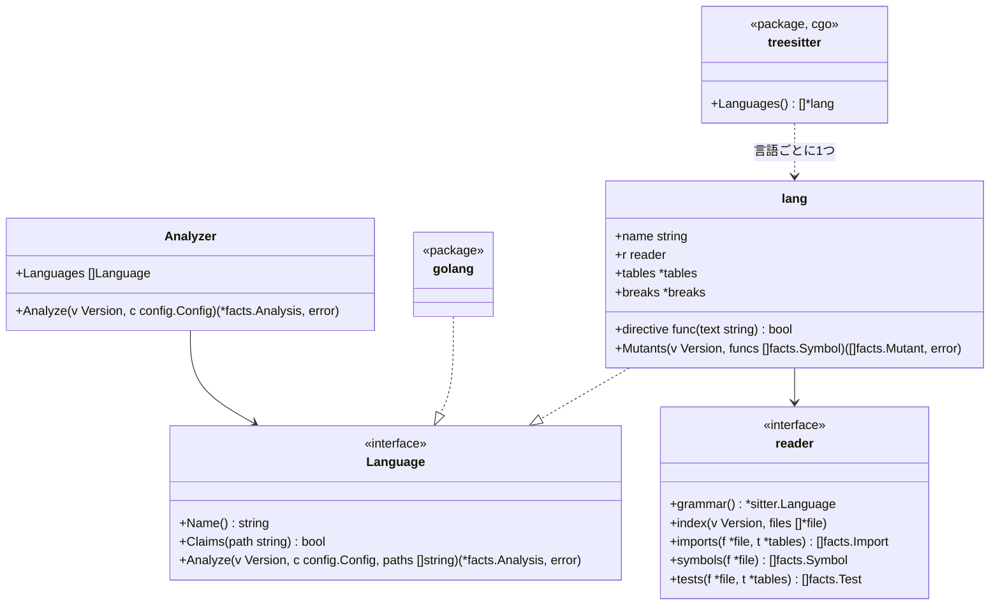

# TypeScript、Python、Rust、Java、Kotlin のアダプタ

この文書は [adapters.ja.md](adapters.ja.md) のうち、言語ごとの部分を書く。tree-sitter で読む5言語のそれぞれが、Go のアダプタと同じ事実をどう埋めるかを書く。ルールからその違いは見えない。

## 形

- パッケージ `internal/adapter` は、エンジンが使う解析器だ。版を1回たどり、各ファイルを最初に受け持つと言った言語に渡し、言語たちの報告をまとめ、どの言語も受け持たないファイルを役割 `other` で一覧に載せる（[adapters.ja.md](adapters.ja.md) の不変条件4）
- 設定の `languages:` で、ファイルを受け持つ言語を絞れる。省くと全言語が受け持つ
- パッケージ `internal/adapter/treesitter` は cgo があるときだけビルドされる（`//go:build cgo`）。無いときの `Languages()` は5言語のファイルを受け持って `Unread` と印を付ける読み手を返す。こうして純粋な Go のビルド（[distribution.ja.md](distribution.ja.md)）がそれらを黙って無視することは無い
- tree-sitter の木をたどる汎用の読み手は1つだけだ。各言語は `lang` で表す。`lang` は言語の名前、危険と io の表、ノードの種類と少しの関数からなる読み手（`reader`。パスをユニットにどう対応させるか、import をどう解決するか、何でシンボルが公開になるか、テストをどう読むか）を持つ。ファイルを受け持つかどうかは拡張子で決める

## ユニット

ユニットは、import が名指す **ID** と、依存の図が名指すリポジトリ内のパスである**場所**（`File.UnitPath`）を持つ。

| 言語 | ユニット | ID | 場所 | シンボルの ID |
|---|---|---|---|---|
| Go | パッケージ | import のパス | ディレクトリ | `<import path>.<Name>` |
| TypeScript | ディレクトリ | そのディレクトリ | そのディレクトリ | `<directory>.<name>` |
| Python | パッケージ（ディレクトリ） | そのディレクトリ | そのディレクトリ | `<module path>.<name>`。モジュールのパスはファイルのパスから `.py` を除いたもの（`src/app/store.create_post`）で、1つのパッケージの2つのモジュールがぶつからないようにする |
| Rust | モジュール | その場所 | `src/a/b.rs` や `src/a/b/mod.rs` なら `src/a/b`。`lib.rs` と `main.rs` なら `src` | `<location>.<name>` |
| Java、Kotlin | パッケージ | `package` の宣言 | ディレクトリ | `<package>.<Class>.<member>`。Kotlin のトップレベルの関数は `<package>.<name>` |

どのシンボルの ID もユニットのパスの最後の要素と名前で終わる。だから `store.append` のように設定した対象は、どの言語でもそれを名指せる（[rules-tests.ja.md](rules-tests.ja.md)）。

## import

| 言語 | 内部になるとき | 解決 |
|---|---|---|
| TypeScript | 指定子が `.` か `/` で始まるか、ルートの `tsconfig.json` の `compilerOptions.paths` の別名に当たる | パスそのもの、次に `.ts`、`.tsx`、`.js`、`.jsx`、`.mjs`、次に `/index.*` を試してファイルに解決する。ユニットはそのディレクトリ。それ以外は外部のパッケージで、パスの最初の要素（`@scope/name` なら2つ）で名指す |
| Python | モジュールがリポジトリにある（ディレクトリか `.py` ファイルとして、ルートか `src/` から） | 相対 import はファイルのパッケージから解決する。ユニットはモジュールのパッケージ。`b` がモジュールである `from a import b` はモジュールを束縛する |
| Rust | パスが `crate`、`self`、`super`、またはそのファイルのクレートの名前（`Cargo.toml` の `[lib] name`、無ければ `[package] name` の `-` を `_` にしたもの）で始まる。クレートの名前は、`tests/` の結合テストやバイナリがライブラリを呼ぶときに使う | モジュールのファイルである最長の接頭辞に解決し、残りは項目を名指す |
| Java、Kotlin | リポジトリのどれかのファイルがそのパッケージを宣言している | `import a.b.C` はパッケージ `a.b`。`a.b.*` も同じ |

外部の import は名前をそのまま `ToUnit` に持ち、`io` の表と照らし合わせる。

## シンボル

| 言語 | 関数とメソッド | 型 | 公開 | doc コメント |
|---|---|---|---|---|
| TypeScript | 関数の宣言、メソッド、`const f = () =>` | クラス、インターフェース、型の別名、enum | 宣言に `export` がある | 直前の `/** */` コメント |
| Python | モジュールの直下とクラスの中の `def` | `class` | 名前が `_` で始まらない | docstring（本体の最初の文が文字列） |
| Rust | `fn` の項目と `impl` のメソッド | `struct`、`enum`、`trait`（インターフェースとして）、`type` | `pub` | 直前の `///` の行 |
| Java | メソッドとコンストラクタ | クラス、インターフェース、enum、record | `public` | 直前の `/** */` コメント |
| Kotlin | トップレベルとクラスの中の `fun` | クラス、インターフェース、object | `private`、`internal`、`protected` でない | 直前の `/** */` コメント |

テストだけの領域（Rust の `#[cfg(test)]` モジュール）の中のコードは、製品のコードではなくテストのコードだ。循環的複雑度は各言語の `if`、ループ、`case` や match の腕（既定の腕は除く）、`catch`、`&&`、`||`、三項演算子を数える。

## テスト

| 言語 | テストファイル | テストとは | スキップ | 理由 |
|---|---|---|---|---|
| TypeScript | `*.test.*`、`*.spec.*`、`__tests__/` の下 | 名前と関数を渡す `it` か `test` の呼び出し | `.skip`、`xit`、`xtest`、`.todo`、または `describe.skip`・`xdescribe` の中 | スキップの行かその前の行のコメント |
| Python | `test_*.py`、`*_test.py` | モジュールの直下か `Test*` クラスの中の、名前が `test` で始まる関数 | `@pytest.mark.skip`、`@unittest.skip`、`pytest.skip(...)` | `reason` 引数か最初の文字列の引数 |
| Rust | `tests/`・`benches/` の下のファイル。任意のファイル内の `#[cfg(test)]` モジュール | `#[test]`、`#[tokio::test]`、`#[async_std::test]`、`#[sqlx::test]`、`#[test_log::test]`、`#[rstest]` の付いた関数 | `#[ignore]` | `#[ignore = "…"]` |
| Java | `src/` の下の、名前に test を含むディレクトリ（`src/test/`、`src/integrationTest/` など） | `@Test`、`@ParameterizedTest`、`@RepeatedTest`、`@TestFactory`、`@TestTemplate` の付いたメソッド | `@Disabled`、`@Ignore` | アノテーションの文字列の引数 |
| Kotlin | Java と同じ | Java と同じアノテーションの付いた関数 | `@Disabled`、`@Ignore` | アノテーションの文字列の引数 |

- テストが何を呼ぶかは、import した名前と、テストの中で作ったオブジェクトから読む
- Java と Kotlin では、テストのクラスのフィールドも読む。コンストラクタで作ったフィールドはそのクラス、初期値の無いフィールド（`lateinit`、注入、コンストラクタのプロパティ）は宣言した型として読む。モックなど、ほかの方法で作ったフィールドは読まない。Kotlin の `companion object` の中のフィールドとヘルパーも、クラスのものと同じに読む
- 初期値で本体の値を使うフィールド（`private val sql = QUERY.trim()`）をテストが読むと、本体の値を読んだと数える（`Reads`）。本体の値が変われば、テストの結果も変わり得るからだ
- TypeScript では、テストが文字列で名指した `import('./x')` で読み込んだモジュールから取り出した名前も読む。ファイルの中の関数が1つのモジュールだけを読み込んで返すとき（モジュールを読み直すヘルパー）は、その関数の結果から取り出した名前も読む
- TypeScript のテストが呼ぶものには、JSX の要素（`<Page />`）で描いたリポジトリの部品も入る。ファイルの中のヘルパーは、`function` の宣言でも、`const` に入れた関数（`const renderPage = () => …`）でもたどる。`describe` の中で宣言したものも同じ。オブジェクトに入れた関数（`const helpers = { twice: (n) => … }` の `helpers.twice`）もたどる
- TypeScript のテストの外（`describe` の中など）で宣言した変数は、`new` で作ったクラス、型の注釈（`let store: Store`）、`beforeEach` などでの代入（`store = new Store()`）から型を読む。テストの中の同じ名前のローカルは外の変数を隠す。ファイルが同じ名前に2つのクラスを当てる変数は読まない
- Python のテストが受け取るものも読む。テストの引数と同じ名前の pytest の fixture（`@pytest.fixture` の付いた関数）が `return` か `yield` で返すクラス、クラスの `setUp`・`setup_method` などで `self` に入れたクラス（`self.store = Store()`）だ。ファイルの直下で名前に入れた lambda（`twice = lambda n: double(n)`）はヘルパーとしてたどる。テストの中で同じ名前に代入し直すと、fixture から受け取った型は消える。ほかのファイルの fixture（`conftest.py`）と、辞書などに入れた lambda は読まない
- HTTP のテストの道具の入口を呼ぶテストは、アプリを外から動かすテスト（`Test.Drives`）とする。道具は、ファイルがその道具を import していることで見分ける。Java と Kotlin は REST Assured の `given()`（`io.restassured`）、MockMvc の `perform()`（`org.springframework.test.web.servlet`）、WebTestClient の `exchange()`（`org.springframework.test.web.reactive.server`）。TypeScript は supertest の `request()`。Python と Rust の道具はまだ読まない

テストからの呼び出しは、Go のアダプタと同じように、各ファイルがリポジトリから import する名前と、import したクラスのコンストラクタで作った変数を通して対象に解決する。解決できない呼び出しは未解決として数える。

## 危険と io

| | TypeScript | Python | Rust | Java | Kotlin |
|---|---|---|---|---|---|
| `clock` | `Date.now`、`new Date()`、`performance.now` | `datetime.now`、`datetime.utcnow`、`date.today`、`time.time` | `SystemTime::now`、`Instant::now`、`Utc::now`、`Local::now` | `Instant.now`、`LocalDate(Time).now`、`System.currentTimeMillis`、`System.nanoTime` | Java と同じ、`Clock.System.now` |
| `sleep` | `setTimeout` | `time.sleep`、`asyncio.sleep` | `thread::sleep`、`tokio::time::sleep` | `Thread.sleep` | `Thread.sleep`、`delay` |
| `mock` | `jest.mock`、`vi.mock`、`mock.module`（bun）、`sinon` の import | `unittest.mock`、`mock` の import。`mocker` | `mock!`、`#[automock]` が作る `Mock<名前>` の型を使うこと、`mockall` の import | `org.mockito` の import | `io.mockk`、`org.mockito` の import |
| `always-true` | `expect(true).toBe(true)`、`expect(x).toBe(x)` | `assert True`、`assert x == x` | `assert!(true)`、`assert_eq!(x, x)` | `assertTrue(true)`、`assertEquals(x, x)` | Java と同じ |
| `io`（ユニット） | `fs`、`net`、`http`、`https`、`child_process`（`node:` の有無を問わない）、`axios`、`pg`、`mysql2`、`mongodb`、`redis` | `socket`、`os`、`subprocess`、`sqlite3`、`requests`、`httpx`、`urllib.request`、`psycopg`、`pymongo`、`redis` | `std::fs`、`std::net`、`std::process`、`tokio::fs`、`tokio::net`、`reqwest`、`sqlx`、`diesel` | `java.io`、`java.nio.file`、`java.net`、`java.sql`、`javax.sql` | Java と同じ、`io.ktor.client` |

設定での項目の足し方は Go と同じだ。`rules.tests.hazards` は各言語の書き方での `<unit>.<name>` を取り、`rules.tests.io` はユニットを取る。

## ミュータント

`lang` は `Mutants` を持ち、`hadome mutate` の Mutator になる（[mutation.ja.md](mutation.ja.md)）。壊し方は Go と同じ5つで、どの言語でも、同じ汎用の読み手が木をたどってミュータントを作る。言語ごとに違うのは、演算子の綴り、ゼロの値、消した呼び出しの文の代わりに置くものの3つだけだ。これらは `lang` が持つ壊し方の表（`breaks`）に書く。

| 壊し方 | TypeScript | Python | Rust | Java | Kotlin |
|---|---|---|---|---|---|
| 比較を逆にする | Go と同じ6つ、`===` ↔ `!==` | Go と同じ6つ | Go と同じ6つ | Go と同じ6つ | Go と同じ6つ、`===` ↔ `!==` |
| 真偽を反転する | `!x` → `x`、`true` ↔ `false` | `not x` → `x`、`True` ↔ `False` | `!x` → `x`、`true` ↔ `false` | `!x` → `x`、`true` ↔ `false` | `!x` → `x`、`true` ↔ `false` |
| 算術を入れ替える | `+` ↔ `-`、`*` ↔ `/`。片方が文字列のリテラルかテンプレート文字列なら作らない | `+` ↔ `-`、`*` ↔ `/`。片方が文字列のリテラル（f 文字列を含む）なら作らない | `+` ↔ `-`、`*` ↔ `/` | `+` ↔ `-`、`*` ↔ `/`。片方が文字列のリテラルなら作らない | `+` ↔ `-`、`*` ↔ `/`。片方が文字列のリテラルなら作らない |
| ゼロの値を返す | 下の表 | 下の表 | 下の表 | 下の表 | 下の表 |
| 呼び出しの文を消す | 文を `;` にする | 文を `pass` にする | `;` で終わる文を `;` にする | 文を `;` にする | 文を `Unit` にする |

Go と同じ6つとは、`<` → `>=`、`>=` → `<`、`<=` → `>`、`>` → `<=`、`==` ↔ `!=` である。

ゼロの値は宣言した戻り値の型から決める。

| 言語 | 型とゼロの値 |
|---|---|
| TypeScript | `number` → `0`、`string` → `""`、`boolean` → `false`、`null` か `undefined` を含む union → その値 |
| Python | `int` → `0`、`float` → `0.0`、`str` → `""`、`bool` → `False`、`None` を含む型（`Optional[…]`、`X \| None`）→ `None` |
| Rust | 整数の型 → `0`、`f32` と `f64` → `0.0`、`bool` → `false`、`&str` → `""`、`String` → `String::new()`、`Option<…>` → `None`、`Vec<…>` → `Vec::new()` |
| Java | 整数の型と `float`、`double` → `0`、`boolean` → `false`、`String` → `""`、ほかの参照の型 → `null` |
| Kotlin | `Int`、`Short`、`Byte` → `0`、`Long` → `0L`、`Double` → `0.0`、`Float` → `0f`、`Boolean` → `false`、`String` → `""`、`?` の付いた型 → `null` |

- 表に無い型の関数と、戻り値の型を書いていない関数（TypeScript で型を省いた関数、Python で注釈の無い関数、Kotlin の式の本体）では、この壊し方を作らない
- 置き換えるのは `return` の値である。Rust では関数の本体の最後の式（`;` の無い式）も置き換える。Rust では `return` を書かずに値を返すのがふつうだからだ
- Go と同じく、真偽のリテラルを返す文（真偽の反転が壊す）と、すでにゼロの値を返す文では作らない

ほかの決まりも Go と同じだ。

- アンカーは「関数 | 壊し方 | 行の字句 | 何番目か」でつくる。行の字句は、その行で始まる葉のノードの文字を、コメントを除いて空白1つでつないだものだ。行を整形し直しても、行にコメントを足しても、アンカーは変わらない
- 入れ子の関数（アロー関数、ラムダ、関数の中の `def`、クロージャ、無名クラス）の中は壊さない。Go の関数リテラルと同じ扱いだ。ただし、`const f = () =>` のアロー関数はそれ自体がシンボルなので、その本体を壊す
- 置き換えたあとのコードがコンパイルできるように、構文から分かる範囲で置き換えを選ぶ。それでもコンパイルできないミュータントは、テストのコマンドが失敗するので、捕まえたものとして扱われる。報告には出ない

## 文法

文法は tree-sitter の言語 ABI 14 向けにビルドされた版に固定する。Go のバインディングが読める最新の ABI だ。文法はバインディングと一緒に上げ、単独では上げない。

TypeScript は拡張子で文法を分ける。どちらの文法も、もう一方のファイルを読みきれないからだ。

| 拡張子 | 文法 | もう一方の文法で読めない書き方 |
|---|---|---|
| `.ts`、`.mts`、`.cts` | TypeScript | `<string>x` の型の指定（TSX では JSX の要素と区別できない） |
| `.tsx`、`.js`、`.jsx`、`.mjs`、`.cjs` | TSX | JSX の要素 |

文法には、正しいコードでも読めない書き方がある。tree-sitter はそこで読むのを止めず、誤りのノードを挟んで先を読む。そのため、ファイルの事実の多くは残るが、誤りの近くの関数やテストは拾えないことがある。手元のコードで見つかったものは次のとおりだ。

| 言語 | 読めない書き方 |
|---|---|
| TypeScript | 型引数の付いたタグ付きテンプレート（styled-components の ``styled.div<{ open: boolean }>`…` ``）、JSX の文字列や本文の裸の `&` |
| Rust | `raw` という名前の変数への参照（`&raw`）。`&raw const` の構文と取り違える |
| Kotlin | 注釈の引数の配列のリテラル（`[]`） |

こうしたファイルも読んだものとして扱い、`unknown/unread` には出さない（下の「意図して入れなかったもの」）。読めない書き方は文法を上げると減る。

## 読めなかったファイル

| ルール | 種類 | 後退になるとき |
|---|---|---|
| `unknown/unread` | 見つけるルール（人の確認） | この hadome のビルドが読めない、対応言語のファイル（純粋な Go のビルドが TypeScript に出会った場合など）が head で新しく現れた。終了コード `3` |

## 不変条件

1. どの言語も同じ事実を埋める。事実がどの言語から来たかを調べるルールは無い
2. 対応言語のファイルは、読むか、読めなかったと報告するかのどちらかで、無視されることは無い
3. 文字列とコメントの中の文字から、危険、import、シンボルは生まれない

## 意図して入れなかったもの

- 「コンストラクタで作った変数」を超える型の推定。それ以外のものへの呼び出しは未解決になる
- 各モジュールの仕組みの隅の場合（テストの中で文字列で名指した `import()` のほかの動的な import、Python のパスの操作、Rust の `#[path]`、TypeScript の project references）。外部か未解決として扱う
- 型を推定して決めるゼロの値（戻り値の型を書いていない関数や、利用者が定義した型）
- Rust のマクロの呼び出し（`println!` など）を消すこと。マクロは、宣言や制御の流れを含むことがある
- Python の `is` と `in` を反転すること
- 構文の誤りのあるファイルを、読めなかったと報告すること。誤りのほとんどは、文法が正しいコードを読めずに出るもので、利用者がコードを直しても消せない確認になる
