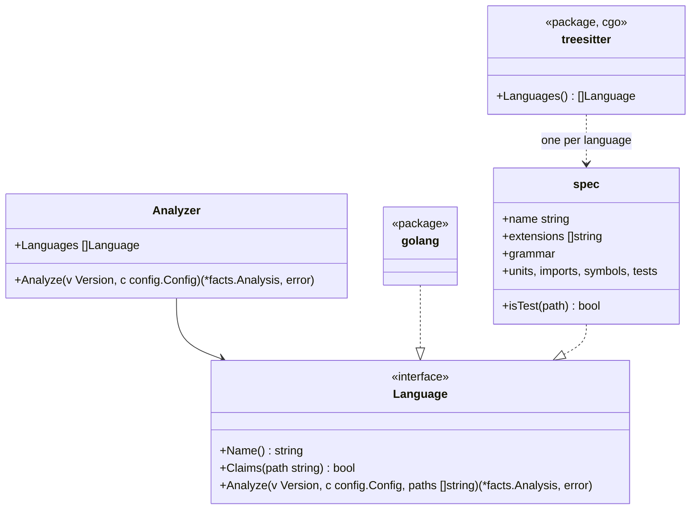

# Adapters for TypeScript, Python, Rust, Java and Kotlin

This document is the language-specific half of [adapters.md](adapters.md): how each of the five languages read with tree-sitter fills in the same facts the Go adapter does. Rules never see the difference.

## Shape

- Package `internal/adapter` is the analyzer the engine uses. It walks the version once, gives each file to the first language that claims it, merges what the languages report, and lists every unclaimed file with role `other` ([adapters.md](adapters.md), invariant 4)
- `languages:` in configuration limits which languages claim files; omitted, all of them do
- Package `internal/adapter/treesitter` builds only with cgo (`//go:build cgo`). Without it, `Languages()` returns readers that claim the five languages' files and mark them `Unread`, so the pure-Go build ([distribution.md](distribution.md)) never ignores them silently
- One generic reader walks tree-sitter trees; each language is a `spec` of node types and a few functions (how a path maps to a unit, how an import resolves, what makes a symbol exported, which calls are hazards)

## Units

A unit has an **ID**, which imports name, and a **location**, a path in the repository that dependency diagrams name (`File.UnitPath`).

| Language | Unit | ID | Location | Symbol IDs |
|---|---|---|---|---|
| Go | Package | Import path | Directory | `<import path>.<Name>` |
| TypeScript | Directory | The directory | The directory | `<directory>.<name>` |
| Python | Package (directory) | The directory | The directory | `<module path>.<name>`, the module path being the file's path without `.py` (`src/app/store.create_post`), so that two modules of one package never collide |
| Rust | Module | Its location | `src/a/b` for `src/a/b.rs` or `src/a/b/mod.rs`; `src` for `lib.rs` and `main.rs` | `<location>.<name>` |
| Java, Kotlin | Package | The `package` declaration | The directory | `<package>.<Class>.<member>`; Kotlin's top-level functions `<package>.<name>` |

Every symbol ID ends in the unit's last path element and the name, so a configured target such as `store.append` names it in every language ([rules-tests.md](rules-tests.md)).

## Imports

| Language | Internal when | Resolution |
|---|---|---|
| TypeScript | The specifier starts with `.` or `/`, or matches a `compilerOptions.paths` alias of the root `tsconfig.json` | To a file by trying the path, then `.ts`, `.tsx`, `.js`, `.jsx`, `.mjs`, then `/index.*`; the unit is its directory. Anything else is an external package, named by its first path element (two for `@scope/name`) |
| Python | The module exists in the repository (as a directory or a `.py` file, from the root or from `src/`) | Relative imports from the file's package. The unit is the module's package. `from a import b` where `b` is a module binds the module |
| Rust | The path starts with `crate`, `self` or `super` | To the longest prefix that is a module file; the rest names an item |
| Java, Kotlin | Some file of the repository declares the package | `import a.b.C` is the package `a.b`; `a.b.*` too |

External imports keep their name as `ToUnit` and are checked against the `io` table.

## Symbols

| Language | Functions and methods | Types | Exported | Doc comment |
|---|---|---|---|---|
| TypeScript | Function declarations, methods, `const f = () =>` | Classes, interfaces, type aliases, enums | `export` on the declaration | A `/** */` comment right before it |
| Python | `def` at module level and in classes | `class` | Name does not start with `_` | A docstring: the body's first statement is a string |
| Rust | `fn` items and `impl` methods | `struct`, `enum`, `trait` (as interface), `type` | `pub` | `///` lines right before it |
| Java | Methods and constructors | Classes, interfaces, enums, records | `public` | A `/** */` comment right before it |
| Kotlin | `fun` at top level and in classes | Classes, interfaces, objects | Not `private`, `internal` or `protected` | A `/** */` comment right before it |

Code inside test-only regions (Rust `#[cfg(test)]` modules) is test code, not product code. Cyclomatic complexity counts each language's `if`, loops, `case`/match arms (not the default one), `catch`, `&&`, `||`, and the ternary operator.

## Tests

| Language | Test files | A test is | Skipped | Reason |
|---|---|---|---|---|
| TypeScript | `*.test.*`, `*.spec.*`, under `__tests__/` | A call to `it` or `test` with a name and a function | `.skip`, `xit`, `xtest`, `.todo`, or inside `describe.skip` | A comment on the skip's line or the line before |
| Python | `test_*.py`, `*_test.py` | A `test_*` function at module level or in a `Test*` class | `@pytest.mark.skip`, `@unittest.skip`, `pytest.skip(...)` | The `reason` argument or the first string argument |
| Rust | Files under `tests/`; `#[cfg(test)]` modules in any file | A function with `#[test]` or `#[<crate>::test]` | `#[ignore]` | `#[ignore = "…"]` |
| Java | Under `src/test/` | A method annotated `@Test`, `@ParameterizedTest` or `@RepeatedTest` | `@Disabled`, `@Ignore` | The annotation's string argument |
| Kotlin | Under `src/test/` | A function annotated `@Test` | `@Disabled`, `@Ignore` | The annotation's string argument |

Calls from tests are resolved to targets through the names each file imports from the repository, and through variables built by constructors of imported classes, like the Go adapter does. A call that cannot be resolved counts as unresolved.

## Hazards and io

| | TypeScript | Python | Rust | Java | Kotlin |
|---|---|---|---|---|---|
| `clock` | `Date.now`, `new Date()`, `performance.now` | `datetime.now`, `datetime.utcnow`, `date.today`, `time.time` | `SystemTime::now`, `Instant::now`, `Utc::now`, `Local::now` | `Instant.now`, `LocalDate(Time).now`, `System.currentTimeMillis`, `System.nanoTime` | as Java, `Clock.System.now` |
| `sleep` | `setTimeout` | `time.sleep`, `asyncio.sleep` | `thread::sleep`, `tokio::time::sleep` | `Thread.sleep` | `Thread.sleep`, `delay` |
| `mock` | `jest.mock`, `vi.mock`, `mock.module` (bun), importing `sinon` | importing `unittest.mock`, `mock`; `mocker` | `mock!`, `#[automock]`, importing `mockall` | importing `org.mockito` | importing `io.mockk`, `org.mockito` |
| `always-true` | `expect(true).toBe(true)`, `expect(x).toBe(x)` | `assert True`, `assert x == x` | `assert!(true)`, `assert_eq!(x, x)` | `assertTrue(true)`, `assertEquals(x, x)` | as Java |
| `io` (units) | `fs`, `net`, `http`, `https`, `child_process` (with or without `node:`), `axios`, `pg`, `mysql2`, `mongodb`, `redis` | `socket`, `os`, `subprocess`, `sqlite3`, `requests`, `httpx`, `urllib.request`, `psycopg`, `pymongo`, `redis` | `std::fs`, `std::net`, `std::process`, `tokio::fs`, `tokio::net`, `reqwest`, `sqlx`, `diesel` | `java.io`, `java.nio.file`, `java.net`, `java.sql`, `javax.sql` | as Java, `io.ktor.client` |

Configuration adds entries as for Go: `rules.tests.hazards` takes `<unit>.<name>` in each language's own notation, and `rules.tests.io` takes units.

## Grammars

The grammars are pinned to versions built for tree-sitter's language ABI 14, the newest the Go binding loads. A grammar is upgraded together with the binding, never alone.

## Unread files

| Rule | Kind | Regression when |
|---|---|---|
| `unknown/unread` | finding (review) | A file of a supported language that this build of hadome cannot read (the pure-Go build meeting TypeScript, say) is new in head — exit code `3` |

## Invariants

1. Every language fills the same facts; no rule tests which language a fact came from
2. A file of a supported language is either read or reported as unread, never ignored
3. Text in strings and comments never yields a hazard, an import or a symbol

## Deliberately left out

- Type inference beyond "a variable built by a constructor". Calls on anything else are unresolved
- Every module system's corner cases: dynamic imports, Python path manipulation, Rust `#[path]`, TypeScript project references. They resolve as external or unresolved
