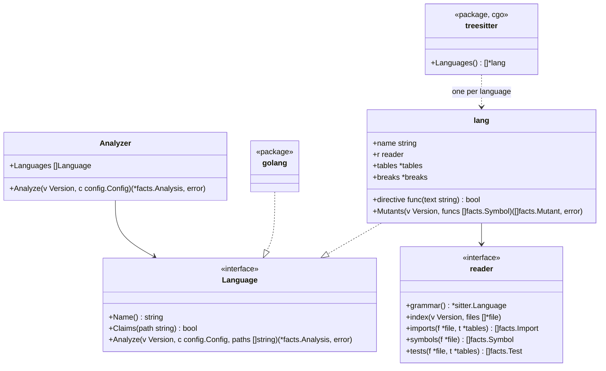

# Adapters for TypeScript, Python, Rust, Java and Kotlin

This document covers the language-specific part of [adapters.md](adapters.md). It describes how each of the five languages read with tree-sitter fills in the same facts the Go adapter does. Rules never see the difference.

## Shape

- Package `internal/adapter` is the analyzer the engine uses. It walks the version once, gives each file to the first language that claims it, merges what the languages report, and lists every unclaimed file with role `other` ([adapters.md](adapters.md), invariant 4)
- `languages:` in configuration limits which languages claim files; omitted, all of them do
- Package `internal/adapter/treesitter` builds only with cgo (`//go:build cgo`). Without it, `Languages()` returns readers that claim the five languages' files and mark them `Unread`, so the pure-Go build ([distribution.md](distribution.md)) never ignores them silently
- One generic reader walks tree-sitter trees; each language is a `lang`. A `lang` holds the language's name, its hazard and io tables, and a reader (`reader`) of node types and a few functions (how a path maps to a unit, how an import resolves, what makes a symbol exported, how tests are read). Whether a language claims a file is decided by its extension

## Units

A unit has an **ID**, which imports name, and a **location**, a path in the repository that dependency diagrams name (`File.UnitPath`).

| Language | Unit | ID | Location | Symbol IDs |
|---|---|---|---|---|
| Go | Package | Import path | Directory | `<import path>.<Name>` |
| TypeScript | Directory | The directory | The directory | `<directory>.<name>` |
| Python | Package (directory) | The directory | The directory | `<module path>.<name>`, the module path being the file's path without `.py` (`src/app/store.create_post`), so that two modules of one package never collide |
| Rust | Module | Its location | `src/a/b` for `src/a/b.rs` or `src/a/b/mod.rs`; `src` for `lib.rs` and `main.rs` | `<location>.<name>` |
| Java, Kotlin | Package | The `package` declaration | The directory | `<package>.<Class>.<member>`; Kotlin's top-level functions `<package>.<name>` |

Every symbol ID ends in the unit's last path element and the name, so a configured target such as `store.append` names it in every language ([rules-tests.md](rules-tests.md)).

## Imports

| Language | Internal when | Resolution |
|---|---|---|
| TypeScript | The specifier starts with `.` or `/`, or matches a `compilerOptions.paths` alias of the root `tsconfig.json` | To a file by trying the path, then `.ts`, `.tsx`, `.js`, `.jsx`, `.mjs`, then `/index.*`; the unit is its directory. Anything else is an external package, named by its first path element (two for `@scope/name`) |
| Python | The module exists in the repository (as a directory or a `.py` file, from the root or from `src/`) | Relative imports from the file's package. The unit is the module's package. `from a import b` where `b` is a module binds the module |
| Rust | The path starts with `crate`, `self` or `super` | To the longest prefix that is a module file; the rest names an item |
| Java, Kotlin | Some file of the repository declares the package | `import a.b.C` is the package `a.b`; `a.b.*` too |

External imports keep their name as `ToUnit` and are checked against the `io` table.

## Symbols

| Language | Functions and methods | Types | Exported | Doc comment |
|---|---|---|---|---|
| TypeScript | Function declarations, methods, `const f = () =>` | Classes, interfaces, type aliases, enums | `export` on the declaration | A `/** */` comment right before it |
| Python | `def` at module level and in classes | `class` | Name does not start with `_` | A docstring: the body's first statement is a string |
| Rust | `fn` items and `impl` methods | `struct`, `enum`, `trait` (as interface), `type` | `pub` | `///` lines right before it |
| Java | Methods and constructors | Classes, interfaces, enums, records | `public` | A `/** */` comment right before it |
| Kotlin | `fun` at top level and in classes | Classes, interfaces, objects | Not `private`, `internal` or `protected` | A `/** */` comment right before it |

Code inside test-only regions (Rust `#[cfg(test)]` modules) is test code, not product code. Cyclomatic complexity counts each language's `if`, loops, `case`/match arms (not the default one), `catch`, `&&`, `||`, and the ternary operator.

## Tests

| Language | Test files | A test is | Skipped | Reason |
|---|---|---|---|---|
| TypeScript | `*.test.*`, `*.spec.*`, under `__tests__/` | A call to `it` or `test` with a name and a function | `.skip`, `xit`, `xtest`, `.todo`, or inside `describe.skip` or `xdescribe` | A comment on the skip's line or the line before |
| Python | `test_*.py`, `*_test.py` | A function whose name starts with `test`, at module level or in a `Test*` class | `@pytest.mark.skip`, `@unittest.skip`, `pytest.skip(...)` | The `reason` argument or the first string argument |
| Rust | Files under `tests/` and `benches/`; `#[cfg(test)]` modules in any file | A function with `#[test]`, `#[tokio::test]`, `#[async_std::test]`, `#[sqlx::test]`, `#[test_log::test]` or `#[rstest]` | `#[ignore]` | `#[ignore = "…"]` |
| Java | Under a directory in `src/` whose name contains test (`src/test/`, `src/integrationTest/` and the like) | A method annotated `@Test`, `@ParameterizedTest`, `@RepeatedTest`, `@TestFactory` or `@TestTemplate` | `@Disabled`, `@Ignore` | The annotation's string argument |
| Kotlin | Same as Java | A function with the same annotations as Java | `@Disabled`, `@Ignore` | The annotation's string argument |

- What a test calls is read from the names it imports and the objects it builds
- In Java and Kotlin, the fields of the test class are read too. A field built by a constructor is of that class; a field without an initializer (`lateinit`, injected, a constructor property) is of its declared type. A field built any other way, such as a mock, is not read
- A test that reads a field whose initializer uses a product value (`private val sql = QUERY.trim()`) counts as reading the product (`Reads`): when the value changes, the test's result can change
- In TypeScript, the names a test takes from a module it loads with `import('./x')`, named by a string, are read too. When a function of the file loads one module only and returns it (a helper that reloads the module), the names taken from its result are read as well
- What a TypeScript test calls includes the repository's components it renders as JSX elements (`<Page />`). Helpers of the file are followed whether declared with `function` or held by a `const` (`const renderPage = () => …`), including those declared inside a `describe` block
- A test that calls the entry of an HTTP test client drives the application from outside (`Test.Drives`). The client is recognised by the file importing it. Java and Kotlin: REST Assured's `given()` (`io.restassured`), MockMvc's `perform()` (`org.springframework.test.web.servlet`), WebTestClient's `exchange()` (`org.springframework.test.web.reactive.server`). TypeScript: supertest's `request()`. Python's and Rust's clients are not read yet

Calls from tests are resolved to targets through the names each file imports from the repository, and through variables built by constructors of imported classes, like the Go adapter does. A call that cannot be resolved counts as unresolved.

## Hazards and io

| | TypeScript | Python | Rust | Java | Kotlin |
|---|---|---|---|---|---|
| `clock` | `Date.now`, `new Date()`, `performance.now` | `datetime.now`, `datetime.utcnow`, `date.today`, `time.time` | `SystemTime::now`, `Instant::now`, `Utc::now`, `Local::now` | `Instant.now`, `LocalDate(Time).now`, `System.currentTimeMillis`, `System.nanoTime` | as Java, `Clock.System.now` |
| `sleep` | `setTimeout` | `time.sleep`, `asyncio.sleep` | `thread::sleep`, `tokio::time::sleep` | `Thread.sleep` | `Thread.sleep`, `delay` |
| `mock` | `jest.mock`, `vi.mock`, `mock.module` (bun), importing `sinon` | importing `unittest.mock`, `mock`; `mocker` | `mock!`, using a `Mock<Name>` type that `#[automock]` generates, importing `mockall` | importing `org.mockito` | importing `io.mockk`, `org.mockito` |
| `always-true` | `expect(true).toBe(true)`, `expect(x).toBe(x)` | `assert True`, `assert x == x` | `assert!(true)`, `assert_eq!(x, x)` | `assertTrue(true)`, `assertEquals(x, x)` | as Java |
| `io` (units) | `fs`, `net`, `http`, `https`, `child_process` (with or without `node:`), `axios`, `pg`, `mysql2`, `mongodb`, `redis` | `socket`, `os`, `subprocess`, `sqlite3`, `requests`, `httpx`, `urllib.request`, `psycopg`, `pymongo`, `redis` | `std::fs`, `std::net`, `std::process`, `tokio::fs`, `tokio::net`, `reqwest`, `sqlx`, `diesel` | `java.io`, `java.nio.file`, `java.net`, `java.sql`, `javax.sql` | as Java, `io.ktor.client` |

Configuration adds entries as for Go: `rules.tests.hazards` takes `<unit>.<name>` in each language's own notation, and `rules.tests.io` takes units.

## Mutants

A `lang` has `Mutants`, which makes it the Mutator of `hadome mutate` ([mutation.md](mutation.md)). The breaks are the same five as Go's, and in every language the same generic reader walks the tree to make the mutants. Only three things differ by language: how the operators are spelled, the zero values, and what takes the place of a removed call statement. These live in the `lang`'s table of breaks (`breaks`).

| Break | TypeScript | Python | Rust | Java | Kotlin |
|---|---|---|---|---|---|
| Flip a comparison | Go's six, `===` ↔ `!==` | Go's six | Go's six | Go's six | Go's six, `===` ↔ `!==` |
| Negate a boolean | `!x` → `x`, `true` ↔ `false` | `not x` → `x`, `True` ↔ `False` | `!x` → `x`, `true` ↔ `false` | `!x` → `x`, `true` ↔ `false` | `!x` → `x`, `true` ↔ `false` |
| Swap arithmetic | `+` ↔ `-`, `*` ↔ `/`. Not made when either side is a string literal or a template string | `+` ↔ `-`, `*` ↔ `/`. Not made when either side is a string literal (f-strings included) | `+` ↔ `-`, `*` ↔ `/` | `+` ↔ `-`, `*` ↔ `/`. Not made when either side is a string literal | `+` ↔ `-`, `*` ↔ `/`. Not made when either side is a string literal |
| Return the zero value | The table below | The table below | The table below | The table below | The table below |
| Remove a call statement | The statement becomes `;` | The statement becomes `pass` | A statement ending in `;` becomes `;` | The statement becomes `;` | The statement becomes `Unit` |

Go's six are `<` → `>=`, `>=` → `<`, `<=` → `>`, `>` → `<=`, and `==` ↔ `!=`.

The zero value comes from the declared result type.

| Language | Types and zero values |
|---|---|
| TypeScript | `number` → `0`, `string` → `""`, `boolean` → `false`, a union with `null` or `undefined` → that value |
| Python | `int` → `0`, `float` → `0.0`, `str` → `""`, `bool` → `False`, a type with `None` (`Optional[…]`, `X \| None`) → `None` |
| Rust | integer types → `0`, `f32` and `f64` → `0.0`, `bool` → `false`, `&str` → `""`, `String` → `String::new()`, `Option<…>` → `None`, `Vec<…>` → `Vec::new()` |
| Java | integer types, `float` and `double` → `0`, `boolean` → `false`, `String` → `""`, other reference types → `null` |
| Kotlin | `Int`, `Short`, `Byte` → `0`, `Long` → `0L`, `Double` → `0.0`, `Float` → `0f`, `Boolean` → `false`, `String` → `""`, a type with `?` → `null` |

- Functions whose result type is not in the table, or is not written (TypeScript functions without one, Python functions without an annotation, Kotlin expression bodies), get no mutant of this kind
- What is replaced is the value of a `return`. In Rust, the last expression of a function's body (one without `;`) is replaced too, since Rust usually returns a value without writing `return`
- As in Go, a statement that returns a boolean literal (negating a boolean breaks it) or already returns the zero value gets none

The other rules are Go's too.

- The anchor is "function | break | the line's tokens | which one". The line's tokens are the text of the leaf nodes that start on that line, comments left out, joined by one space. Reformatting the line, or adding a comment to it, leaves the anchor the same
- Nothing inside a nested function (an arrow function, a lambda, a `def` inside a function, a closure, an anonymous class) is broken, as with Go's function literals. The arrow function of `const f = () =>` is a symbol itself, though, so its body is broken
- Replacements are chosen, as far as the syntax shows, so that the code still compiles. A mutant that does not compile fails the test command, so it counts as caught and is never reported

## Grammars

The grammars are pinned to versions built for tree-sitter's language ABI 14, the newest the Go binding loads. A grammar is upgraded together with the binding, never alone.

TypeScript picks the grammar by extension, because neither grammar reads all of the other's files.

| Extensions | Grammar | What the other grammar cannot read |
|---|---|---|
| `.ts`, `.mts`, `.cts` | TypeScript | The `<string>x` type assertion (TSX cannot tell it from a JSX element) |
| `.tsx`, `.js`, `.jsx`, `.mjs`, `.cjs` | TSX | JSX elements |

A grammar cannot read some correct code. tree-sitter does not stop there: it puts in an error node and reads on. Most facts of the file survive, but a function or test next to the error may be missed. These turned up in local code:

| Language | What the grammar cannot read |
|---|---|
| TypeScript | A tagged template with type arguments (styled-components' ``styled.div<{ open: boolean }>`…` ``), and a bare `&` in a JSX string or text |
| Rust | A reference to a variable named `raw` (`&raw`), taken for the `&raw const` syntax |
| Kotlin | An array literal in an annotation argument (`[]`) |

Such files count as read and are not listed under `unknown/unread` (see "Deliberately left out"). Upgrading the grammars makes them fewer.

## Unread files

| Rule | Kind | Regression when |
|---|---|---|
| `unknown/unread` | finding (review) | A file of a supported language that this build of hadome cannot read (the pure-Go build meeting TypeScript, say) is new in head — exit code `3` |

## Invariants

1. Every language fills the same facts; no rule tests which language a fact came from
2. A file of a supported language is either read or reported as unread, never ignored
3. Text in strings and comments never yields a hazard, an import or a symbol

## Deliberately left out

- Type inference beyond "a variable built by a constructor". Calls on anything else are unresolved
- Every module system's corner cases: dynamic imports other than a test's `import()` named by a string, Python path manipulation, Rust `#[path]`, TypeScript project references. They resolve as external or unresolved
- Zero values that need type inference (functions without a written result type, and user-defined types)
- Removing Rust macro calls (`println!` and the like). A macro may hold declarations or control flow
- Flipping Python's `is` and `in`
- Reporting a file with a syntax error as unread. Almost every such error comes from a grammar failing on correct code, so it would ask for a review that changing the code cannot clear
