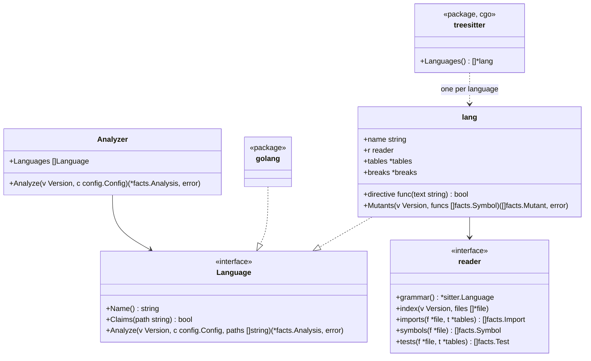

# Adapters for TypeScript, Python, Rust, Java and Kotlin

This document covers the language-specific part of [adapters.md](adapters.md). It describes how each of the five languages read with tree-sitter fills in the same facts the Go adapter does. Rules never see the difference.

## Shape

- Package `internal/adapter` is the analyzer the engine uses. It walks the version once, gives each file to the first language that claims it, merges what the languages report, and lists every unclaimed file with role `other` ([adapters.md](adapters.md), invariant 4)
- `languages:` in configuration limits which languages claim files; omitted, all of them do
- Package `internal/adapter/treesitter` builds only with cgo (`//go:build cgo`). Without it, `Languages()` returns readers that claim the five languages' files and mark them `Unread`, so the pure-Go build ([distribution.md](distribution.md)) never ignores them silently
- One generic reader walks tree-sitter trees; each language is a `lang`. A `lang` holds the language's name, its hazard and io tables, and a reader (`reader`) of node types and a few functions (how a path maps to a unit, how an import resolves, what makes a symbol exported, how tests are read). Whether a language claims a file is decided by its extension

## Units

A unit has an **ID**, which imports name, and a **location**, a path in the repository that dependency diagrams name (`File.UnitPath`).

| Language | Unit | ID | Location | Symbol IDs |
|---|---|---|---|---|
| Go | Package | Import path | Directory | `<import path>.<Name>` |
| TypeScript | Directory | The directory | The directory | `<directory>.<name>`; when two or more files of one directory declare the same name at top level, `<file path without extension>.<name>` (`src/store/a.append`) |
| Python | Package (directory) | The directory | The directory | `<module path>.<name>`, the module path being the file's path without `.py` (`src/app/store.create_post`), so that two modules of one package never collide |
| Rust | Module | Its location | `src/a/b` for `src/a/b.rs` or `src/a/b/mod.rs`; `src` for `lib.rs` and `main.rs` | `<location>.<name>` |
| Java, Kotlin | Package | The `package` declaration | The directory | `<package>.<Class>.<member>`; Kotlin's top-level functions `<package>.<name>` |

Every symbol ID ends in the unit's last path element and the name, so a configured target such as `store.append` names it in every language ([rules-tests.md](rules-tests.md)).

TypeScript alone uses the file's path in the ID of a name that collides.

- **Why**: a TypeScript unit is a directory. When two files of one directory declare the same name, an ID made of the directory alone folds them into one target, and deleting the tests of one does not report `tests/scope-shrunk`
- **Scope**: only colliding names use the file's path. Every other name keeps `<directory>.<name>`, and the unit the dependency rules see stays the directory
- **Naming from tests**: a name a test imports is looked up from the file the import resolves to, to the file that declares it, and takes that file's ID. `export { x } from './a'` and `export * from './a'` are followed. `export default` takes the declaration's name (`Page` for `export default function Page`)
- **When an ID changes**: when a file declaring the same name is added later, the older one's ID changes. The base target is then gone from head, so `tests/scope-shrunk` treats it as a legitimate removal and does not fail

## Imports

| Language | Internal when | Resolution |
|---|---|---|
| TypeScript | The specifier starts with `.` or `/`; or an alias or the `baseUrl` of the `tsconfig.json` nearest the file resolves it to a file of the repository; or it starts with the name of a package of the repository | See "Resolving TypeScript" below. Anything else is an external package, named by its first path element (two for `@scope/name`) |
| Python | The module exists in the repository (as a directory or a `.py` file, from a package root) | The package roots are the root, `src/`, each directory holding a `pyproject.toml`, `setup.cfg` or `setup.py`, and that directory's `src/`. The roots of the directories holding the importing file (with their `src/`) are searched first, deepest directory first, then the others in path order. Relative imports from the file's package. The unit is the module's package. `from a import b` where `b` is a module binds the module |
| Rust | A path starting with `crate`, `self`, `super`, or the name of the file's crate (`[lib] name` in `Cargo.toml`, else `[package] name` with `-` read as `_`). The crate's name is how integration tests under `tests/` and binaries call the library | To the longest prefix that is a module file; the rest names an item |
| Java, Kotlin | Some file of the repository declares the package | `import a.b.C` is the package `a.b`; `a.b.*` too |

External imports keep their name as `ToUnit` and are checked against the `io` table.

TypeScript imports and exports that bring in types only are not in the list of imports: `import type …`, `export type { … } from …`, and `import { type A, type B } from …` where every name is marked `type`. They disappear when compiled, so they are no dependency of the running code. One that brings in any value is in the list. Examples: `import { type A, b } from …`, `import d, { type A } from …`.

### Resolving TypeScript

A specifier is tried in this order.

1. A specifier starting with `.` or `/` is resolved as a file path
2. When it matches a `paths` alias of the `tsconfig.json` nearest the file, it is resolved to the alias's destinations, tried in order. When two aliases match, the one with the longer prefix is used
3. When that `tsconfig.json` has a `baseUrl` and the specifier resolves to a file under it, that file
4. When it starts with the `name` of any `package.json` of the repository, it is resolved to that package's source. `package.json` files under `node_modules` are not read
5. Otherwise it is an external package

A path becomes a file by trying, in order:

- the path itself
- the path with an extension added (`.ts`, `.tsx`, `.js` and the like)
- `/index.*`
- for a path ending in `.js`, `.mjs` or `.cjs`, the path with the extension replaced by `.ts`, `.tsx`, `.mts` or `.cts`. ESM TypeScript writes `./a.js` to load `a.ts`

The unit is the directory of the resolved file.

`tsconfig.json` is read as follows.

- `extends` is followed: relative paths, and files inside a package of the repository (`@acme/tsconfig/base.json`). When `extends` is an array, later entries override earlier ones
- `baseUrl` is resolved from the location of the config file that sets it
- `paths` are resolved from `baseUrl`; without a `baseUrl`, from the location of the config file that sets `paths`
- When the nearest `tsconfig.json` has no `paths` but has `references`, the aliases of the first referenced config with `paths` are used. Example: Vite's `tsconfig.app.json`
- Comments and trailing commas are skipped

An import of a repository package by its name alone (`@acme/shared`) resolves to the first of these files in the package's directory.

1. `src/index.*`
2. `index.*`
3. The file `exports["."]`, `module`, `main` or `types` names. When it is under `dist/`, `lib/`, `build/` or `out/`, the source of the same name under `src/` is tried too

When a path follows the name, as in `@acme/shared/sub`, the path is resolved in the package's directory and in its `src/`.

### Imports that cannot be resolved

Some imports look like the repository's own but resolve to no file.

| Language | Imports that look like the repository's |
|---|---|
| TypeScript | Starts with `.` or `/`; matches a `paths` alias; starts with the name of a package of the repository |
| Python | Relative imports; imports whose first element is a package under a package root (`app.missing` when `app` exists) |

- When a test file calls a name taken from such an import, the call counts as unresolved (`Test.Unresolved`)
- Treating it as an external package and counting nothing would fail a test that may well call the product with `tests/guards-nothing`. What cannot be identified goes to a person's review through `tests/target-unknown`
- Imports of non-test files are treated as before: in TypeScript, an internal import whose unit is the directory of the named path; in Python, an external import
- An import that names something inside a directory hadome does not read (`dist/`, `build/`, `.generated/` and so on) is an exception: it is an import whose destination is unknown (`Import.Unknown` and `Import.Unread`), whether the file exists or not. In a test file, a call of a name taken from it counts as unresolved ("Imports whose destination is unknown" in [adapters.md](adapters.md))

## Symbols

| Language | Functions and methods | Types | Exported | Doc comment |
|---|---|---|---|---|
| TypeScript | Function declarations, methods, `const f = () =>` | Classes, interfaces, type aliases, enums | `export` on the declaration | A `/** */` comment right before it |
| Python | `def` at module level and in classes | `class` | Name does not start with `_` | A docstring: the body's first statement is a string |
| Rust | `fn` items and `impl` methods | `struct`, `enum`, `trait` (as interface), `type` | `pub` | `///` lines right before it |
| Java | Methods and constructors | Classes, interfaces, enums, records | `public` | A `/** */` comment right before it |
| Kotlin | `fun` at top level and in classes | Classes, interfaces, objects | Not `private`, `internal` or `protected` | A `/** */` comment right before it, also when lines with annotations with arguments (`@Suppress("x")`) stand between them, however many |

Code inside test-only regions (Rust `#[cfg(test)]` modules) is test code, not product code. Cyclomatic complexity counts each language's `if`, loops, `case`/match arms (not the default one), `catch`, `&&`, `||`, and the ternary operator.

## Tests

| Language | Test files | A test is | Skipped | Reason |
|---|---|---|---|---|
| TypeScript | `*.test.*`, `*.spec.*`, under `__tests__/`, test support files | A call to `it` or `test` with a name and a function (see the notes below) | `.skip`, `xit`, `xtest`, `.todo`, `.fixme`, or inside `describe.skip` or `xdescribe`. Skipped only in some cases: `.skipIf(cond)`, `.runIf(cond)`, and Playwright's `test.skip(cond, description)` and `test.fixme(cond, description)` | A comment on the skip's line or the line before. For Playwright's `test.skip`, the description after the condition |
| Python | `test_*.py`, `*_test.py` | A function whose name starts with `test`, at module level or in a `Test*` class | `@pytest.mark.skip`, `@unittest.skip`, `pytest.skip(...)` | The `reason` argument or the first string argument |
| Rust | Files under `tests/` and `benches/`; `#[cfg(test)]` modules in any file | A function with `#[test]`, `#[tokio::test]`, `#[async_std::test]`, `#[sqlx::test]`, `#[test_log::test]` or `#[rstest]` | `#[ignore]` | `#[ignore = "…"]` |
| Java | Under a directory in `src/` whose name contains test (`src/test/`, `src/integrationTest/` and the like) | A method annotated `@Test`, `@ParameterizedTest`, `@RepeatedTest`, `@TestFactory` or `@TestTemplate` | `@Disabled`, `@Ignore` | The annotation's string argument |
| Kotlin | Same as Java | A function with the same annotations as Java | `@Disabled`, `@Ignore` | The annotation's string argument |

TypeScript test declarations are read as follows.

- **Forms that take a table or a condition first**: `it.each(table)(name, fn)`, `` test.each`table`(name, fn) ``, `test.concurrent.each`, `describe.each`, `it.skipIf(cond)(name, fn)` and `it.runIf(cond)(name, fn)` are tests or `describe` blocks too
  - The name of a `describe.each` goes into the names of the tests inside it
  - The table runs with the test, so the calls in the table count as the test's calls
- **Where the function is**: a test's function is its last argument that is a function, because vitest takes options between the name and the function (`it(name, { retry: 2 }, fn)`) and jest takes a timeout after it. When the name string is followed by the name of a function (`it('adds', checkAdd)`), that function of the file is followed
- **Playwright's conditional skips**: `test.skip(cond, description)` and `test.fixme(cond, description)` without a function are not tests. Called in a test, they skip that test only in some cases; called directly in a `describe` block, they skip the tests in it only in some cases. `test.skip()` without arguments in a test always skips it

- What a test calls is read from the names it imports and the objects it builds
- In Java and Kotlin, the fields of the test class are read too. A field built by a constructor is of that class; a field without an initializer (`lateinit`, injected, a constructor property) is of its declared type. A field built any other way, such as a mock, is not read. In Kotlin, the fields and helpers of a `companion object` are read as the class's own
- The tests of an inner class (`@Nested` and the like) use the fields and helpers of the class around it too
- When a Kotlin test class extends another class of the test files (`class StoreTest : StoreTestSupport()`), the fields, helpers, mock fields and the code run before each test of the class it extends are read as its own, and so are those of the class that one extends in turn. The class it extends is found by name: one of the same package first, otherwise the only class of that name. Names in an inherited helper are read through the imports of the helper's own file
- In Kotlin, a variable or field built with `apply` or `also` (`Queue().apply { limit = 3 }`) is of the class of the object built, since these two return the object they receive. One that holds an enum constant (`val kind = Kind.DAILY`) is of that enum class. A call chained right on a built object (`Store().append(1)`) calls that class's method
- In Java and Kotlin, a call of the form `Class.member.method()` is read as follows. When the member is an enum constant, it calls the enum class's method (`Kind.ORDERS.toTable()` calls `Kind.toTable`). When the member is an inner class, it calls that class's method (`Outer.Inner.build()`). Any other member (a property of an `object` and the like) holds a value whose class is unknown, so the test counts as reading product code (`Reads`)
- In Java and Kotlin, reading a property of a variable read as a product class (`cache.ttl`) counts as reading product code. Calling a method on it (`cache.clear()`) is a call, not a read
- In Kotlin, `assertThrows<E> { … }` and `assertThrows<E>({ … })` are parsed by the grammar as two comparisons in a row (`(assertThrows < E) > { … }`). They are read as calls, and so are `mockk<T> { … }` and product functions written the same way. The type argument is not read as a value
- A test that reads a field whose initializer uses a product value (`private val sql = QUERY.trim()`) counts as reading the product (`Reads`): when the value changes, the test's result can change. In Kotlin, so does a field of the class the test class extends
- In Kotlin, a product value put into a string template (`"IN ($COUNTED)"`, `"${Kind.ORDERS.table}"`) counts as read too. One that starts with `\$` is not put in. A field whose initializer is such a string counts like the fields above
- In TypeScript, the names a test takes from a module it loads with `import('./x')`, named by a string, are read too. When a function of the file loads one module only and returns it (a helper that reloads the module), the names taken from its result are read as well
- In TypeScript, `require('./x')` named by a string is read like an import, at the top of the file, in a `describe` block and inside a test: `const { send } = require('./mail')`, `const mail = require('./mail')`
- What a TypeScript test calls includes the repository's components it renders as JSX elements (`<Page />`). Helpers of the file are followed whether declared with `function` or held by a `const` (`const renderPage = () => …`), including those declared inside a `describe` block. Functions an object holds (`helpers.twice` in `const helpers = { twice: (n) => … }`) are followed too. A component the test file declares (`function Harness() { return <Field /> }`, `const Wrapper = () => <Field />`) and renders as an element is followed like a helper. Calling a helper runs the default values of its parameters (`function make(store = createStore())`), so they count too
- Variables declared outside a TypeScript test (in a `describe` block and the like) are typed by the class built with `new`, a type annotation (`let store: Store`), or an assignment such as one in `beforeEach` (`store = new Store()`). A local of the same name inside the test hides the outer variable. A variable the file gives two classes is not read
- A TypeScript test also counts as its own the calls and reads of what runs before it:
  - The bodies of `beforeEach` and `beforeAll` in the `describe` blocks around it and at the top of the file (`beforeEach(() => render(<Page />))`)
  - What sets up the outer variables the test uses: the initializer of a variable declared at the top of the file or directly in a `describe` block (`const shared = createStore()`, `const KEYS = Object.keys(words)`), an assignment there or in a hook (`store = createStore()`), and the statements there that use the variable (`register(app)`). Only the tests inside the `describe` block that declares the variable count them
  - The same holds when a helper of a test support file uses a value set up at the top of that file
  - The getters of outer objects the test reads. Other functions an object holds count only when called
  - The names taken by `const { add } = await import('./m')` at the top of the file, or by `mod = await import('./m')` in `beforeAll` (also `(await import('./m')) as T`), are read as the module's
  - In a file that only runs `await import('./m')` without using the value, every test counts as calling that module (the unit), because the module does its work when loaded
  - A value set up once counts once, however often the test uses it
- What a Python test receives is read too: the class a pytest fixture (a function decorated with `@pytest.fixture`) named like a test parameter returns or yields, and the class a test class's `setUp`, `setup_method` and the like store on `self` (`self.store = Store()`). A lambda held by a name at the top of the file (`twice = lambda n: double(n)`) is followed as a helper. Reassigning the name inside the test drops the type the fixture gave. Fixtures of other files (`conftest.py`) and lambdas held in a dict or the like are not read
- A test that calls the entry of an HTTP test client drives the application from outside (`Test.Drives`). The client is recognised by the file importing it. Java and Kotlin: REST Assured's `given()` (`io.restassured`), MockMvc's `perform()` (`org.springframework.test.web.servlet`), WebTestClient's `exchange()` (`org.springframework.test.web.reactive.server`). TypeScript: supertest's `request()`. Python's and Rust's clients are not read yet

Calls from tests are resolved to targets through the names each file imports from the repository, and through variables built by constructors of imported classes, like the Go adapter does. A call that cannot be resolved counts as unresolved.

### Test support files

Some files are not test files but exist only for the tests: `test/helpers.ts`, `e2e/fixtures.ts`, `conftest.py`. They are not product code, so they are treated as test support files.

| Language | Test support files |
|---|---|
| TypeScript | Files under one of these directories: `test/`, `tests/`, `e2e/`, `__mocks__/`, `__fixtures__/`, `testutil/`, `testutils/`, `test-utils/`, `test_utils/`, `testhelper/`, `testhelpers/`. Files whose name ends in test joined to helper(s) (`test_helpers.ts`, `test-helpers.ts`, `testHelpers.ts`). `setupTests.*`, `jest.setup.*`, `vitest.setup.*` |
| Python | Files under the same directories as TypeScript; `conftest.py`; files whose name ends in test joined to helper(s) (`test_helpers.py`) |

- **Role**: `test`. They are therefore not targets, `comments/missing-doc` asks nothing of them, and they are not in the dependency diagram
- **Tests inside**: in TypeScript, `it` and `test` in a support file are read as tests, since mocha runs the files under `test/` as tests. In Python, only files named like test files (`test_*.py`, `*_test.py`) are read for tests, since that is what pytest collects
- **Following**: when a test calls a function of a support file, the function is followed. The calls inside are resolved through the support file's own imports, so a test that calls the product through a helper guards that product code
  - Example: when `createApp()` in `test/helpers.ts` calls `buildApp()` of `src/app.ts`, a test that calls `createApp()` guards `buildApp`
  - Calling a name the support file does not hold as a function (a value, say) counts as unresolved
- **Other role settings**: files matching the `files.tests` globs are test files, as before. Files matching the `files.product` globs are not support files; they are read as product code ([adapters.md](adapters.md))
- **The list of directories**: the list is `walk.SupportDir`. The Go adapter uses it without `test/`, `tests/` and `e2e/` ([adapters.md](adapters.md))

## Hazards and io

| | TypeScript | Python | Rust | Java | Kotlin |
|---|---|---|---|---|---|
| `clock` | `Date.now`, `new Date()`, `performance.now` | `datetime.now`, `datetime.utcnow`, `date.today`, `time.time` | `SystemTime::now`, `Instant::now`, `Utc::now`, `Local::now` | `Instant.now`, `LocalDate(Time).now`, `System.currentTimeMillis`, `System.nanoTime` | as Java, `Clock.System.now`, `measureTimeMillis`, `measureNanoTime`, `measureTime`, `measureTimedValue`, `TimeSource.Monotonic.markNow` |
| `sleep` | `setTimeout` | `time.sleep`, `asyncio.sleep` | `thread::sleep`, `tokio::time::sleep` | `Thread.sleep` | `Thread.sleep`, `delay` |
| `mock` | `jest.mock`, `vi.mock`, `mock.module` (bun), `vi.spyOn`, `jest.spyOn`, `vi.stubGlobal`, importing `sinon` | importing `unittest.mock`, `mock`; `mocker`; `monkeypatch.setattr`, `monkeypatch.delattr` | `mock!`, using a `Mock<Name>` type that `#[automock]` generates, importing `mockall` | importing `org.mockito`; fields annotated `@Mock`, `@Spy`, `@MockBean`, Quarkus's `@InjectMock`, `@InjectSpy` | importing `io.mockk`, `org.mockito`; the Java annotations, `@MockK`, `@SpyK` |
| `always-true` | `expect(true).toBe(true)`, `expect(x).toBe(x)` | `assert True`, `assert x == x` | `assert!(true)`, `assert_eq!(x, x)` | `assertTrue(true)`, `assertEquals(x, x)` | as Java |
| `io` (units) | `fs`, `net`, `http`, `https`, `child_process` (with or without `node:`), `axios`, `undici`, `pg`, `mysql2`, `mongodb`, `redis`, `@prisma/client`, `@aws-sdk`, `@google-cloud` | `socket`, `os`, `subprocess`, `sqlite3`, `requests`, `httpx`, `urllib.request`, `psycopg`, `pymongo`, `redis`, `boto3`, `sqlalchemy`, `google.cloud` | `std::fs`, `std::net`, `std::process`, `tokio::fs`, `tokio::net`, `reqwest`, `sqlx`, `diesel` | `java.io`, `java.nio.file`, `java.net`, `java.sql`, `javax.sql`, `jakarta.persistence`, `javax.persistence`, `org.hibernate`, `io.quarkus.hibernate`, `com.google.cloud`, `jakarta.ws.rs.client`, `javax.ws.rs.client`, `software.amazon.awssdk` | as Java, `io.ktor.client` |
| `io` (global APIs) | `fetch`, `navigator.sendBeacon`, `new WebSocket`, `new XMLHttpRequest`, `new EventSource`, members of `localStorage`, `sessionStorage`, `indexedDB`; the same with `window.`, `globalThis.` or `self.` in front | none | none | none | none |

The entries in the table are a selection. All of them are in the code's tables.

Global APIs are recognised by name only: calling a local variable of the same name counts too. Counting one makes the unit impure, so when a name is mistaken, `tests/no-mock` errs by not reporting. Each API found is in the list of imports as an import with `Global` true ([adapters.md](adapters.md)), once per file.

After a TypeScript test switches to a fake clock, `Date.now`, `new Date()` and `setTimeout` do not count as `clock` or `sleep`. The fake clock is switched on by `vi.useFakeTimers()`, `jest.useFakeTimers()`, `vi.setSystemTime()`, `jest.setSystemTime()` and `sinon.useFakeTimers()`. Called in a test, it applies from that point on; called in `beforeEach` or directly in a `describe` block, it applies everywhere in the tests inside. After `vi.useRealTimers()` or `jest.useRealTimers()` they count again.

The `clock` and `sleep` hazards of the code that runs before each test are hazards of every test it runs before. Reading the time or waiting there makes the result of each of those tests depend on time.

| Language | Code that runs before each test |
|---|---|
| Java, Kotlin | Methods annotated `@BeforeEach`, `@BeforeAll`, `@Before` or `@BeforeClass`, and Kotlin `init` blocks. Those of the enclosing classes and of the class extended count too |
| TypeScript | The bodies of `beforeEach` and `beforeAll` in the `describe` blocks around the test and at the top of the file. What comes after switching to fake timers does not count (previous paragraph) |
| Python | pytest fixtures marked `autouse=True`: in the same file, in the `conftest.py` of the test's directory and the directories above, and inside the test's class. The class's `setUp`, `setUpClass`, `asyncSetUp`, `setup_method` and `setup_class`. The file's `setup_module`. For a test outside a class, `setup_function` too |

- The hazard is placed on the line of that code, in another file when it is there, such as a class extended or a `conftest.py`
- In Java, Kotlin and Python, the calls and checks in that code are not counted as the test's: what a test guards is decided by its own body
- In TypeScript, the calls in a hook count as the test's (see "A TypeScript test also counts as its own the calls and reads of what runs before it" above)
- A fixture a Python test receives as a parameter is followed into its body as before. The calls and hazards in it are the test's

Configuration adds entries as for Go: `rules.tests.hazards` takes `<unit>.<name>` in each language's own notation, and `rules.tests.io` takes units.

## Mutants

A `lang` has `Mutants`, which makes it the Mutator of `hadome mutate` ([mutation.md](mutation.md)). The breaks are the same five as Go's, and in every language the same generic reader walks the tree to make the mutants. Only three things differ by language: how the operators are spelled, the zero values, and what takes the place of a removed call statement. These live in the `lang`'s table of breaks (`breaks`).

| Break | TypeScript | Python | Rust | Java | Kotlin |
|---|---|---|---|---|---|
| Flip a comparison | Go's six, `===` ↔ `!==` | Go's six | Go's six | Go's six | Go's six, `===` ↔ `!==` |
| Negate a boolean | `!x` → `x`, `true` ↔ `false` | `not x` → `x`, `True` ↔ `False` | `!x` → `x`, `true` ↔ `false` | `!x` → `x`, `true` ↔ `false` | `!x` → `x`, `true` ↔ `false` |
| Swap arithmetic | `+` ↔ `-`, `*` ↔ `/`. Not made when either side is a string literal or a template string | `+` ↔ `-`, `*` ↔ `/`. Not made when either side is a string literal (f-strings included) | `+` ↔ `-`, `*` ↔ `/` | `+` ↔ `-`, `*` ↔ `/`. Not made when either side is a string literal | `+` ↔ `-`, `*` ↔ `/`. Not made when either side is a string literal |
| Return the zero value | The table below | The table below | The table below | The table below | The table below |
| Remove a call statement | The statement becomes `;` | The statement becomes `pass` | A statement ending in `;` becomes `;` | The statement becomes `;` | The statement becomes `Unit` |

Go's six are `<` → `>=`, `>=` → `<`, `<=` → `>`, `>` → `<=`, and `==` ↔ `!=`.

The zero value comes from the declared result type.

| Language | Types and zero values |
|---|---|
| TypeScript | `number` → `0`, `string` → `""`, `boolean` → `false`, a union with `null` or `undefined` → that value |
| Python | `int` → `0`, `float` → `0.0`, `str` → `""`, `bool` → `False`, a type with `None` (`Optional[…]`, `X \| None`) → `None` |
| Rust | integer types → `0`, `f32` and `f64` → `0.0`, `bool` → `false`, `&str` → `""`, `String` → `String::new()`, `Option<…>` → `None`, `Vec<…>` → `Vec::new()` |
| Java | integer types, `float` and `double` → `0`, `boolean` → `false`, `String` → `""`, other reference types → `null` |
| Kotlin | `Int`, `Short`, `Byte` → `0`, `Long` → `0L`, `Double` → `0.0`, `Float` → `0f`, `Boolean` → `false`, `String` → `""`, a type with `?` → `null` |

- Functions whose result type is not in the table, or is not written (TypeScript functions without one, Python functions without an annotation, Kotlin expression bodies), get no mutant of this kind
- What is replaced is the value of a `return`. In Rust, the last expression of a function's body (one without `;`) is replaced too, since Rust usually returns a value without writing `return`
- As in Go, a statement that returns a boolean literal (negating a boolean breaks it) or already returns the zero value gets none

The other rules are Go's too.

- The anchor is "function | break | the line's tokens | which one". The line's tokens are the text of the leaf nodes that start on that line, comments left out, joined by one space. Reformatting the line, or adding a comment to it, leaves the anchor the same
- Nothing inside a nested function (an arrow function, a lambda, a `def` inside a function, a closure, an anonymous class) is broken, as with Go's function literals. The arrow function of `const f = () =>` is a symbol itself, though, so its body is broken
- Replacements are chosen, as far as the syntax shows, so that the code still compiles. A mutant that does not compile fails the test command, so it counts as caught and is never reported

## Grammars

The grammars are pinned to versions built for tree-sitter's language ABI 14, the newest the Go binding loads. A grammar is upgraded together with the binding, never alone.

TypeScript picks the grammar by extension, because neither grammar reads all of the other's files.

| Extensions | Grammar | What the other grammar cannot read |
|---|---|---|
| `.ts`, `.mts`, `.cts` | TypeScript | The `<string>x` type assertion (TSX cannot tell it from a JSX element) |
| `.tsx`, `.js`, `.jsx`, `.mjs`, `.cjs` | TSX | JSX elements |

A grammar cannot read some correct code. tree-sitter does not stop there: it puts in an error node and reads on. Most facts of the file survive, but a function or test next to the error may be missed. These turned up in local code:

| Language | What the grammar cannot read |
|---|---|
| TypeScript | A tagged template with type arguments (styled-components' ``styled.div<{ open: boolean }>`…` ``), and a bare `&` in a JSX string or text |
| Rust | A reference to a variable named `raw` (`&raw`), taken for the `&raw const` syntax |
| Kotlin | An array literal in an annotation argument (`[]`) |

Such files count as read and are not listed under `unknown/unread` (see "Deliberately left out"). Upgrading the grammars makes them fewer.

At the top level of a file, the Kotlin grammar may read annotations with arguments (`@Suppress("x")`) on the lines before a declaration as an expression. With two or more of them, it takes the declaration after them into that expression, and the declaration and its tests are missed. So hadome replaces such annotations with spaces and reads the file again.

- The replacement keeps the number of bytes and the line breaks, so line numbers and positions stay those of the file
- The replaced annotations are kept aside and read as the next declaration's. Example: `@Disabled("reason")` on a test class skips its tests
- A `/** */` comment above the annotations is the declaration's doc comment

## Unread files

| Rule | Kind | Regression when |
|---|---|---|
| `unknown/unread` | finding (review) | A file of a supported language that this build of hadome cannot read (the pure-Go build meeting TypeScript, say) is new in head — exit code `3` |

## Invariants

1. Every language fills the same facts; no rule tests which language a fact came from
2. A file of a supported language is either read or reported as unread, never ignored
3. Text in strings and comments never yields a hazard, an import or a symbol

## Deliberately left out

- Type inference beyond "a variable built by a constructor". Calls on anything else are unresolved
- Every module system's corner cases: dynamic imports other than a test's `import()` named by a string, Python path manipulation, Rust `#[path]`, the parts of TypeScript project references other than aliases. They resolve as external or unresolved
- A TypeScript `extends` naming a package in `node_modules` (`@tsconfig/node20/tsconfig.json`), and the subpath table of `exports` in `package.json`. Both rarely decide an alias or a package's source
- Treating a file imported only from test files as a test support file. A file's role is decided before its imports are read, and changing roles after reading the imports would split each language's reading in two
- Zero values that need type inference (functions without a written result type, and user-defined types)
- Removing Rust macro calls (`println!` and the like). A macro may hold declarations or control flow
- Flipping Python's `is` and `in`
- Reporting a file with a syntax error as unread. Almost every such error comes from a grammar failing on correct code, so it would ask for a review that changing the code cannot clear
