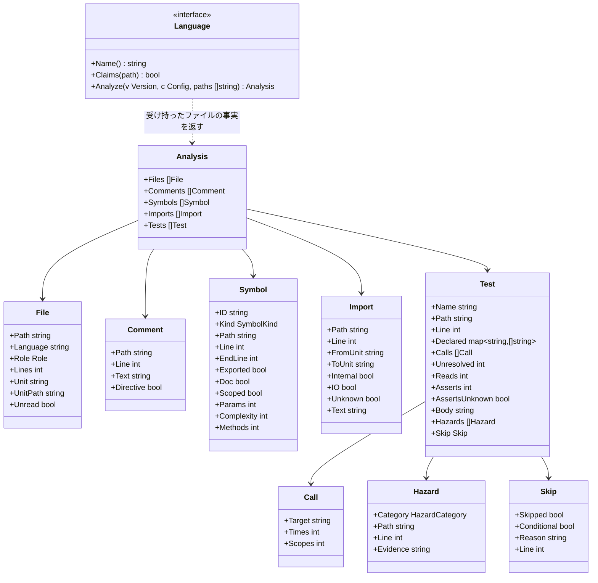

# 言語のアダプタ

## 責務

言語のアダプタは1つの版のファイルを、ルールが言語を知らずに使える**事実**に変える。ルールは「どのテストが時刻を読んでいるか」を尋ねる。それが Go では `time.Now()`、Python では `datetime.now()`、Kotlin では `Instant.now()` であることは、アダプタが知っている。

すること:

- どのファイルが自分の言語のものか、各ファイルがどの役割（ソース、テスト、生成物）かを見分ける
- コメント、シンボル、import、テストを、言語に依らない事実として取り出す
- 言語ごとの API を、言語に依らない**危険の分類**（時刻、sleep、モック、常に真の assert）に置き換える
- テストのスキップを、理由と条件と一緒に取り出す
- 何かを特定できなかったときは、推測せずにそう言う

しないこと:

- 判定すること。違反かどうかはルールが決める
- コードを実行すること、プロジェクトをビルドすること、言語のツールチェーン（`go`、`node`、`python`、`cargo`、`javac`、`kotlinc`）を呼ぶこと。hadome を、それらが無くても動く1つのバイナリにしておくためだ
- 例外の印を読み取ること。アダプタはコメントを渡すだけで、その中の `gate:allow` はエンジンが見つける。実装は全言語で1つだ

## 事実



### ファイルと役割

| 役割 | 意味 | 決め方 |
|---|---|---|
| `source` | 製品のコード | 既定 |
| `test` | テストのコード | 言語の慣習（下表）、または設定の `files.tests` の glob |
| `generated` | 生成されたコード。大きさとコメントのルールは飛ばす | 標準のヘッダ（Go の `Code generated … DO NOT EDIT.` など）、または設定の `files.generated` の glob |
| `other` | hadome が知らない言語、またはコードでないもの | それでも一覧には載せ、ファイル単位のルールから見えるようにする |

テストファイルの慣習:

| 言語 | テストファイル |
|---|---|
| Go | `*_test.go` |
| TypeScript | `*.test.ts(x)`、`*.spec.ts(x)`、`__tests__/` の下のファイル |
| Python | `test_*.py`、`*_test.py` |
| Rust | 任意のファイル内の `#[cfg(test)]` モジュール、`tests/`・`benches/` の下のファイル |
| Java | `src/` の下の、名前に test を含むディレクトリ（`src/test/` など）のファイル |
| Kotlin | Java と同じ |
| Terraform | `*.tftest.hcl`（[adapters-iac.ja.md](adapters-iac.ja.md)） |
| Ansible | `molecule/<シナリオ>/` の下のファイル（[adapters-iac.ja.md](adapters-iac.ja.md)） |

慣習から外れた配置のリポジトリのために、設定で役割を足せる。

- `files.tests` の glob に合うファイルは、言語の慣習に合わなくてもテストのファイルとして読む。Go のファイルには当てない。Go のテストかどうかはコンパイラが `_test.go` で決めるので、hadome が変えると実際のビルドと食い違う。Terraform と Ansible のファイルにも当てない（[adapters-iac.ja.md](adapters-iac.ja.md)）
- `files.generated` の glob に合うファイルは、ヘッダが無くても生成されたコードとして扱う
- 両方に合うファイルは生成されたコードになる
- glob の書き方は門番の `paths` と同じ（`**` は任意の深さのディレクトリ）
- glob は役割を足すだけで、慣習やヘッダで決まった役割を外すことはできない
- 役割を決めてから、言語がファイルを読む。テストのファイルかどうかで、読み取る事実（テストか、シンボルか）が変わるからだ

### ユニット（依存のルール向け）

**ユニット**は、依存の図が箱を描く単位だ。言語ごとに自然なユニットがあり、設定でまとめられる。

| 言語 | ユニット |
|---|---|
| Go | パッケージ（ディレクトリ） |
| TypeScript | `tsconfig` のパスの別名を解決した後のディレクトリ |
| Python | パッケージ（モジュールを含むディレクトリ） |
| Rust | クレート内のモジュールのパス |
| Java / Kotlin | パッケージ |
| Terraform | モジュール（ディレクトリ） |
| Ansible | ロール。プレイブックはそのディレクトリ |

`Internal` は、import がリポジトリの中を指すときに真になる。`IO` は、import したユニットが入出力を行うときに真になる。判断はアダプタの `io` の表と、設定が足す項目（`rules.tests.io`）による。一覧に載るのはテストでないファイルの import だけだ。それがユニット自身の依存だからだ。

### 行き先の分からない import

実行するまで行き先の決まらない import がある。こうした import は `Unknown` を真にし、`ToUnit` を空にして一覧に載せる。外部の import として扱って何も言わずに外すと、依存のルールからも純粋さの判断からも見えなくなるからだ。

| 言語 | 行き先の分からない import |
|---|---|
| TypeScript | 引数が文字列でない `import(…)`、`require(…)` |
| Python | 引数が文字列でない `importlib.import_module(…)`、`__import__(…)` |
| Java / Kotlin | 引数が文字列でない `Class.forName(…)` |
| Go、Rust | 無い。import はいつも文字列で書く |

引数が文字列なら、ふつうの import と同じく行き先を解決する。

`unknown/import` は、変更で増えた行き先の分からない import を人の確認（終了コード `3`）に回す。落とさないのは、行き先を確かめられないものでチェックを落とすことはしないからだ。アンカーはファイルと、正規化した呼び出しの文字列なので、import を動かしても新しいものにはならない。

| ルール | 事例 |
|---|---|
| `unknown/import` | 新しい行き先の分からない import は `3` を返す · base にあるものは返さない · 引数が文字列の動的な import はふつうの import になる · テストのファイルの中のものは返さない · `{{ }}` で名指す Ansible のロールは `3` を返す · 名前で書いたロールは返さない |

base にある行き先の分からない import を持つユニットは、純粋さが `unknown` になる。`unknown` は純粋ではない（[rules-tests.ja.md](rules-tests.ja.md) の「純粋なユニット」）。

### 危険の分類

テストの書き方のルールは API の名前ではなく分類を扱う。各アダプタが自分の言語の API を分類に対応させる。

| 分類 | Go | Python | TypeScript | Java / Kotlin | Rust |
|---|---|---|---|---|---|
| `clock` | `time.Now`、`time.Since` | `datetime.now`、`time.time` | `Date.now`、`new Date()` | `Instant.now`、`LocalDateTime.now`、`System.currentTimeMillis` | `SystemTime::now`、`Instant::now` |
| `sleep` | `time.Sleep` | `time.sleep`、`asyncio.sleep` | `setTimeout` | `Thread.sleep`、`delay` | `thread::sleep` |
| `mock` | モックのライブラリの import | `unittest.mock`、`pytest-mock` | `jest.mock`、`vi.mock`、`mock.module` | Mockito、MockK | `mockall` |
| `always-true` | testify の `True(t, true)`、`Equal(t, x, x)` | `assert True` | `expect(true).toBe(true)` | `assertTrue(true)` | `assert!(true)` |

スキップ（`t.Skip`、`pytest.skip`、`@Disabled`、`#[ignore]` など）は危険の分類に入れず、`Skip` として理由と条件と一緒に取り出す。`tests/skip-without-reason` は、理由の無いスキップだけを落とす。

これらは例で、表の全体ではない。全体の表は各アダプタにあり、設定で項目を足せる（テストが迂回してはいけない製品独自の時刻のラッパー、hadome が知らないモックのライブラリなど）。組み込みの項目を設定で消すことはできない。設定で消せると、設定を書き換えるだけで、人の確認を経ずにルールを効かなくできるからだ。組み込みの項目が本当に当てはまらない場所には理由つきの例外を書き、それは人の確認（終了コード `3`）に回る。

### 確かめる呼び出し

`tests/no-assertion`（[rules-tests.ja.md](rules-tests.ja.md)）のために、アダプタはテストごとに確かめる呼び出し（assert）を数えて `Test.Asserts` に入れる。テストのファイルの中のヘルパーを通したものも数える。

| 言語 | assert とみなすもの（例） |
|---|---|
| Go | テストの道具の `Error`・`Errorf`・`Fatal`・`Fatalf`・`Fail`・`FailNow`、testify の `assert` と `require`、testify の suite の確かめ（`s.Equal(…)`、`s.Require().…`） |
| Python | `assert` 文、`self.assert…`、`pytest.raises`、`pytest.fail` |
| TypeScript | `expect(…)`、`assert` と `assert.…` |
| Java / Kotlin | JUnit の `assert…`・`fail`、AssertJ と Hamcrest の `assertThat`、Mockito の `verify`、kotest の `should…`、REST Assured の `then()` に続く確かめ（`statusCode`・`body` など）、Spring MockMvc の `andExpect` |
| Rust | `assert!`・`assert_eq!`・`assert_ne!`・`panic!`、`#[should_panic]` の付いたテスト |

危険の分類と同じく、これは例で、全体の表は各アダプタにある。Go 以外の言語では、名前が `assert`・`expect`・`verify` で始まる関数も assert とみなす（`assertEquals`、`assert_called_once`、`expectValid`）。ほかのファイルにある確かめるためのヘルパーは、アダプタが中を読めないが、名前から確かめていると分かるからだ。

設定の `rules.tests.assertions` で項目を足せるが、組み込みの項目は消せない。項目は、テストが呼ぶとおりに書く（`acme.MustEqual`）。Go では `<import path>.<Name>` と書く。

テストの道具（Go の `*testing.T`、Python の `self` など）を、アダプタが中を読めない関数に渡したときは、その中で確かめているかもしれないので `Test.AssertsUnknown` を真にする。次のときも同じにする。

- Go: `t.Run` に、関数リテラルでもテストのファイルのヘルパーでもない関数を渡す
- Python: テストのクラス自身のメソッド（`self.check(…)`）を呼ぶ

### 本体の値を読む

`tests/guards-nothing` のために、アダプタは、テストが本体の値を呼び出さずに読んだ回数を `Test.Reads` に入れる。テストのファイルの中のヘルパーを通したものも数える。値が変わればテストの結果も変わり得るので、関数を1つも呼ばないテストでも、本体を確かめていることがある（例: 埋め込んだ文書が README と同じかを確かめるテスト）。

| 言語 | 本体の値とみなすもの（例） |
|---|---|
| Go | パッケージ変数と定数（`store.Limit`、同じパッケージの `limit`）と、呼ばずに値として渡す関数（`sort.Slice(rows, store.Less)`） |
| Python | 本体から import した名前を、呼ばずに式の中で使う（`MAX_ROWS` を比べる、`normalize` を `map` に渡す、`isinstance(x, Store)`） |
| TypeScript | 本体から import した名前を、呼ばずに式の中で使う |
| Java / Kotlin | クラスの静的フィールドと定数（`Store.LIMIT`）、メソッド参照（`Store::normalize`）、Kotlin のトップレベルの `val` |
| Rust | 本体の `const`・`static` と、呼ばずに値として渡す関数。マクロの引数に出てくる本体の名前も数える（パーサがマクロの引数を式として読まないので、呼び出しと見分けられない） |

型の位置（型注釈、TypeScript の `import type`、ジェネリクスの型引数）に出てくる名前は数えない。型は実行されないので、型にしか本体の名前が出てこないテストは、本体のコードを動かさない。

### 本体の指紋

`tests/duplicate` のために、アダプタはテストの本体の字句の並びから指紋を作り、`Test.Body` に入れる。テストの名前、コメント、空白は指紋に入れない。リテラルは値ごと入れるので、入力が1つでも違うテストは指紋も違う。

パラメタ化したテストは入力を本体の外に書く。そのため、引数と、テストに付いたデコレータや注釈も指紋に入れる。

| 言語 | 指紋に入れる範囲 |
|---|---|
| Go | 引数から閉じ括弧まで。Go の字句解析が行末に足すセミコロンは、改行の位置で変わるので入れない |
| Python | デコレータ（`@pytest.mark.parametrize`）から本体の終わりまで |
| TypeScript | `it("名前", …)` の呼び出しのうち、名前の文字列を除いたもの |
| Java / Kotlin | 注釈（`@ValueSource`）から本体の終わりまで |
| Rust | 関数の前の属性（`#[case(1)]`）から本体の終わりまで |

### テストが守るもの

人がテストを分類することはない。テストが守るものは大部分を機械が割り出し、宣言する少しの部分はテストを書く者（たいていはエージェント）が書く。

| 部分 | 誰が与えるか | どうやって |
|---|---|---|
| 対象（テストが動かす入口） | アダプタが推定する | テストの本体がテストでないコードで呼んでいる公開の関数とメソッド。それぞれを `Call` として、何回呼ばれるか、いくつの異なるスコープ（利用者やテナントが入る引数。どちらも [rules-tests.ja.md](rules-tests.ja.md) で定義）で呼ばれるかと一緒に持つ。呼び出し先を特定できないとき（型の分からない値のメソッド、関数を入れた変数、読めなかったパッケージの関数など）は `unknown` になる。宣言が推定を上書きするのは、推定が誤っているときだけだ |
| 観点 | 宣言しない | 推定が難しく、書く手間も大きい。推定した対象の集合が守る範囲になる |
| 不変条件との紐付け | 大部分はテストの呼び出しの形から推定する。製品固有の不変条件と、形を持たない型についてだけ、テストの作者が1行書く | doc コメントの `guards: <invariant>` |

```go
// guards: durable store.Save
func TestSavedRowsSurviveRestart(t *testing.T) {
```

アダプタは doc コメントから `key: value` の行（小文字のキー、コロン、値）を集めて `Declared` に入れるだけだ。1行で1項目とし、空白は正規化する。doc コメントとは、テストの直前の行で終わるコメントの並びである。Rust の属性、Java と Kotlin のアノテーション、Python のデコレータは、コメントとテストの間にあってよい。Python では docstring も doc コメントとして読む。空行で離れたコメントは読まない。アダプタはどんなキーがあるかを知らない。キーの意味は、そのキーを読むルールが決める（`guards` は [rules-tests.ja.md](rules-tests.ja.md)）。

### 特定できたかどうか

事実が止められるかどうかを決めるのは、どう読んだかではなく、アダプタがそれを特定できたかどうかだ。

| 状態 | 例 | 扱い |
|---|---|---|
| **特定できた** | コード中の（文字列やコメントの中でない）`Thread.sleep(` · 理由の無い `@Disabled` · 450行のファイル | どの言語でも止められる |
| **特定できない**（`unknown`） | 行き先を解決できない動的な import · 関数の終わりが見つからない珍しい書き方 | 黙って通すことはない。「特定できなかった」と報告する |

`unknown` も base と比べる。base に前からある unknown は通し、unknown を増やす変更は終了コード `3`（人の確認が要る）を返す。unknown でチェックを落とすことは無いので、推測でビルドが落ちることは無い。unknown を黙って通すことも無いので、特定できないものが増えたときは人が確かめる。

## 各言語の読み方

| 言語 | 読み方 |
|---|---|
| Go | 標準ライブラリのパーサ（`go/parser`、`go/ast`）。C への依存は無い |
| TypeScript、Python、Rust、Java、Kotlin | tree-sitter の文法 |
| Terraform | Terraform 自身が使う HCL のパーサ（`hashicorp/hcl/v2` の `hclsyntax`）。C への依存は無い |
| Ansible | 設定を読むのと同じ YAML のパーサ（`goccy/go-yaml`）。C への依存は無い |

Go のテストは、同じファイルのパッケージの変数（`var shared = store.New()`、`var shared *store.Store`）も型で読む。testify の suite では、`suite.Run(t, new(X))` を呼ぶテストが、`X` の `Setup…`・`BeforeTest`・`Test…` のメソッドをたどる。suite の構造体のフィールドは宣言した型で読む。

言語をまたいで共有するトークナイザは持たない。どの言語も、その言語のパーサで読む。

全言語で完全なパーサを使うのは、利用者が得るもの（正確な関数の範囲、テストの境界、アノテーションと import、少ない `unknown`）を、hadome のビルドのしやすさより優先するためだ。そのために増える手間（tree-sitter のための C への依存、OS とアーキテクチャごとのビルド）は、利用者ではなくリリースの手順で引き受ける。[distribution.ja.md](distribution.ja.md) を参照。

それでも `unknown` は残る。パーサがあっても特定できないもの（Rust のマクロの中身、動的な import）があるからだ。

## 不変条件

1. アダプタはコードを実行せず、プロセスを起動せず、ネットワークに触れない
2. 同じ内容のファイルからは、常に同じ事実が得られる
3. 文字列リテラルやコメントの中の文字は、コードとして報告しない（そこから危険、import、シンボルは生まれない）
4. どのアダプタも受け持たないファイルも、役割 `other` で一覧に載る
5. 設定は危険の項目を足せるが、組み込みの項目は消せない
6. テストの本体の指紋は、名前、コメント、空白を変えても変わらない。リテラルを1つでも変えると変わる

## 意図して入れなかったもの

- すべてのモジュールの仕組みを完全に解決すること（動的な import、Python のパスの操作）。解決できない import は `unknown` として報告する
- 型の情報（呼び出しがファイルをまたいで何に解決されるか）。ルールは構文だけを扱う
- ミューテーションの分析
- この文書と [adapters-iac.ja.md](adapters-iac.ja.md) に無い言語
