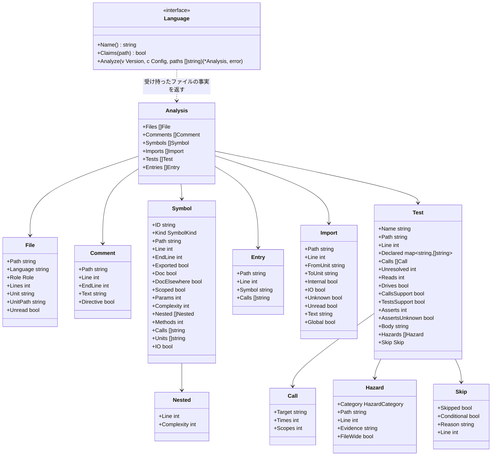

# 言語のアダプタ

## 責務

言語のアダプタは1つの版のファイルを**事実**に変えます。事実とは、ルールが言語を知らずに使える情報です。例: ルールが使うのは「どのテストが時刻を読んでいるか」という事実です。それが Go では `time.Now()`、Python では `datetime.now()`、Kotlin では `Instant.now()` であることは、アダプタが知っています。

すること:

- どのファイルが自分の言語のものかを見分けます。各ファイルの役割（ソース、テスト、生成物）も見分けます
- コメント、シンボル、import、テストを、言語に依らない事実として取り出します
- 言語ごとの API を、言語に依らない**危険の分類**（時刻、sleep、モック、常に真の assert）に置き換えます
- テストのスキップを、理由と条件と一緒に取り出します
- 何かを特定できなかったときは、推測せずに、特定できなかったと報告します

しないこと:

- 判定すること。違反かどうかはルールが決めます
- コードを実行すること、プロジェクトをビルドすること、言語のツールチェーン（`go`、`node`、`python`、`cargo`、`javac`、`kotlinc`）を呼ぶこと。hadome を、それらが無くても動く1つのバイナリにしておくためです
- 例外の印を読み取ること。アダプタはコメントを渡すだけで、その中の `gate:allow` はエンジンが見つけます。この実装は全言語で1つです。コメントには始まりの行と終わりの行（`EndLine`）を付けます。エンジンは終わりの行を使って、印がファイルの先頭にあるかを見分けます

## 事実



`Symbol.Calls`・`Units`・`IO` と `Analysis.Entries` は、関数が入出力に届くかと、やり直されうる入口から届くかを決めるための事実です。関数を持つ言語のアダプタはすべて、関数とメソッドについてこれを埋めます。`Calls` は本体から呼ぶリポジトリの関数の ID、`Units` は本体が値を使うリポジトリのユニット、`IO` は本体が入出力をするものを直接使うことです。読み方は [suggest.ja.md](suggest.ja.md) の「`idempotent` の条件」にあります。

### ファイルと役割

| 役割 | 意味 | 決め方 |
|---|---|---|
| `source` | 製品のコード | 既定 |
| `test` | テストのコード | 言語の慣習（下表）、または設定の `files.tests` の glob |
| `generated` | 生成されたコード。大きさとコメントのルールは飛ばします | 標準のヘッダ（Go の `Code generated … DO NOT EDIT.` など）、または設定の `files.generated` の glob |
| `other` | hadome が知らない言語、またはコードでないもの | それでも一覧には載せ、ファイル単位のルールから見えるようにします |

読まないディレクトリ:

- 次のディレクトリの下は、一覧に載せず、読みません。依存のコピー、ビルドの出力、ツールの作業場所で、製品のコードではないからです
  - `vendor`、`node_modules`、`testdata`、`target`、`build`、`dist`、`__pycache__`
  - `.` で始まるもの。例: `.git`
- 読まないディレクトリの中を名指す import は、行き先の分からない import として扱います（後述の「行き先の分からない import」）
- `_` で始まるディレクトリは読みます。フレームワークが製品のコードやテストを置く場所だからです。例: jest の `__tests__`、Next.js の `_components`、Python の `_internal`
- Go だけは、`_` で始まるディレクトリの下の `.go` ファイルを役割 `other` で載せます。go コマンドがそこをパッケージとして扱わず、テストも動かさないためです

テストのファイルの慣習:

| 言語 | テストのファイル |
|---|---|
| Go | `*_test.go`、テストの補助のパッケージ（下の注） |
| TypeScript | `*.test.ts(x)`、`*.spec.ts(x)`、`__tests__/` の下のファイル、テストの補助のファイル（`test/` の下など。[adapters-treesitter.ja.md](adapters-treesitter.ja.md)） |
| Python | `test_*.py`、`*_test.py`、テストの補助のファイル（`conftest.py`、`tests/` の下など。[adapters-treesitter.ja.md](adapters-treesitter.ja.md)） |
| Rust | 任意のファイル内の `#[cfg(test)]` モジュール、`tests/`・`benches/` の下のファイル |
| Java | `src/` の下の、名前に test を含むディレクトリ（`src/test/` など）のファイル |
| Kotlin | Java と同じ |
| Terraform | `*.tftest.hcl`（[adapters-iac.ja.md](adapters-iac.ja.md)） |
| Ansible | `molecule/<シナリオ>/` の下のファイル（[adapters-iac.ja.md](adapters-iac.ja.md)） |
| SQL（設計のみ） | テストの補助のディレクトリの下の `*.sql`（[adapters-sql.ja.md](adapters-sql.ja.md)） |

慣習から外れた配置のリポジトリのために、設定で役割を足せます。

- `files.tests` の glob に合うファイルは、言語の慣習に合わなくてもテストのファイルとして読みます
  - Go のファイルには当てません。Go のテストかどうかはコンパイラが `_test.go` で決めるので、hadome が変えると実際のビルドと食い違うためです
  - Terraform と Ansible のファイルにも当てません（[adapters-iac.ja.md](adapters-iac.ja.md)）
- `files.generated` の glob に合うファイルは、ヘッダが無くても生成されたコードとして扱います
- 両方に合うファイルは生成されたコードになります
- glob の書き方は設定の `gates` に書く門番の `paths` と同じです。例: `**` は任意の深さのディレクトリに合います
- `files.product` の glob に合うファイルは、テストの補助のファイルにしません。製品のコードとして読みます
  - 外すのは、ディレクトリや名前から既定で決まるテストの補助の役割だけです。例: `e2e/server/` の下に、テストの相手として動かす製品のサーバを置くリポジトリ
  - 慣習で決まるテストのファイル（`*_test.go`、`*.test.ts`、`__tests__/` の下、`test_*.py` など）と、`files.tests` に合うファイルは、テストのファイルのままです
  - 対象になるのは、テストの補助のファイルを持つ TypeScript・Python・Go のファイルです
- `files.product` を除き、glob は役割を足すだけです。慣習やヘッダで決まった役割を外すことはできません
- 役割を決めてから、言語がファイルを読みます。テストのファイルかどうかで、読み取る事実（テストか、シンボルか）が変わるからです

Go のテストの補助のパッケージ:

- 次のパッケージの `_test.go` でないファイルは、テストの補助のファイルとして役割 `test` にします。テストのためだけにあるコードで、製品のコードではないからです
  - 次のディレクトリの下にあるパッケージ: `test/`、`e2e/`、`testutil/`、`testutils/`、`test-utils/`、`test_utils/`、`testhelper/`、`testhelpers/`、`__mocks__/`、`__fixtures__/`。深さは問いません。例: `internal/testutil`、`test/helpers`、`e2e/client`、`worker/e2e/client`
  - `tests/` の下は補助にせず、製品のコードのままにします。TypeScript・Python では補助にするので、ここだけ違います
    - 理由: Go ではディレクトリの名前がパッケージの名前になるので、`tests` という名前の製品のパッケージがあるからです
    - 例: hadome 自身の `internal/rules/tests` は、テストについてのルールを持つ製品のパッケージです
  - `test/` や `e2e/` の下に製品のコードを置くリポジトリは、`files.product` で製品のコードに戻せます。例: テストの相手として動かす製品のサーバを `e2e/server/` に置くなら、`files.product: ["e2e/server/**"]` と書きます
  - 名前が `test` で終わり、`test` の前の部分と同じ名前のパッケージを import するか、その名前のディレクトリの中にあるパッケージ。例: `store` を import する `storetest`、`store/storetest`。標準ライブラリの `httptest`・`fstest` と同じ慣習です
  - `latest` のように、たまたま `test` で終わる名前のパッケージは、前の部分（`la`）のパッケージを import しないので、製品のコードのままです
- 補助のパッケージの関数は、対象にならず、`comments/missing-doc` も求めず、依存の図にも入りません
- テストが補助のパッケージの関数を呼ぶと、その関数の中までたどります。中の呼び出しは、補助のパッケージ自身の import で解決します。例: `storetest.New(t)` が `store.Open()` を呼ぶなら、`storetest.New(t)` を呼ぶテストは `store.Open` を守ります
  - 補助のパッケージの関数を呼んだテストは、`Test.CallsSupport` を真にします。TypeScript と Python の補助のファイルも同じです（[adapters-treesitter.ja.md](adapters-treesitter.ja.md)）
  - そのテストが補助のパッケージと同じディレクトリにあれば、そのパッケージ自身のテストとして `Test.TestsSupport` も真にします。例: `internal/testutil/zone_test.go` が `testutil.Zone()` を呼ぶとき
  - 補助のパッケージの関数の結果は、宣言した型で読みます。`s := storetest.New(t)` の結果が `*store.Store` なら、`s.Append()` は `store.Store.Append` を呼びます
  - 補助のパッケージで宣言した型のメソッドは、たどりません。呼ぶと未解決と数えます
  - 中の危険（時計、待ち、モック）は、そのテストのものとして、補助のパッケージのファイルの行で報告します

### ユニット（依存のルール向け）

**ユニット**は、依存の図が箱を描く単位です。言語ごとに自然なユニットがあり、設定でまとめられます。

| 言語 | ユニット |
|---|---|
| Go | パッケージ（ディレクトリ） |
| TypeScript | `tsconfig` のパスの別名を解決した後のディレクトリ |
| Python | パッケージ（モジュールを含むディレクトリ） |
| Rust | クレート内のモジュールのパス |
| Java / Kotlin | パッケージ |
| Terraform | モジュール（ディレクトリ） |
| Ansible | ロール。プレイブックはそのディレクトリ |

| フィールド | 真になるとき |
|---|---|
| `Internal` | import がリポジトリの中を指すとき |
| `IO` | import したユニットが入出力を行うとき。判断はアダプタの `io` の表と、設定が足す項目（`rules.tests.io`）によります |
| `Global` | import ではなく、import せずに使えるグローバルの API で入出力を行うとき。例: TypeScript の `fetch`。`ToUnit` は API の名前で、`IO` も真です。リポジトリのユニットではないので、`Internal` は偽です |

一覧に載るのは、テストでないファイルの import だけです。それがユニット自身の依存だからです。型だけを持ち込む import（TypeScript の `import type` など）は載せません。実行するコードの依存ではないからです。

### 行き先の分からない import

実行するまで行き先の決まらない import があります。こうした import は `Unknown` を真にし、`ToUnit` を空にして一覧に載せます。外部の import として扱って何も言わずに外すと、依存のルールからも純粋さの判断からも見えなくなるからです。

| 言語 | 行き先の分からない import |
|---|---|
| TypeScript | 引数が文字列でない `import(…)`、`require(…)` |
| Python | 引数が文字列でない `importlib.import_module(…)`、`__import__(…)` |
| Java / Kotlin | 引数が文字列でない `Class.forName(…)` |
| Go、Rust | 無い。import はいつも文字列で書く |

引数が文字列なら、ふつうの import と同じく行き先を解決します。

hadome が読まないディレクトリ（前述の「読まないディレクトリ」）の中を名指す import も、行き先の分からない import です。例: `import { client } from '../dist/client'`、`from .build import gen`。

- そのディレクトリのファイルを読まないので、どのユニットに当たるかを決められません
- `Unknown` と `Unread` を真にし、`ToUnit` を空にします。`Text` には指定子を書いたとおりに入れます
- 入出力をする import としては数えません。届く先を読んでいないので、入出力をするかどうかも分からないからです
- 対象は、TypeScript でパスとして解決する指定子（`.` か `/` で始まるもの、`paths` の別名）と、Python の相対 import です
- パスの `..` は `.` で始まりますが、読まないディレクトリに数えません。リポジトリの外を指す import は、解決できない import です

`unknown/import` は、変更で増えた行き先の分からない import を人の確認（終了コード `3`）に回します。チェックを落とさないのは、行き先を確かめられないものでチェックを落とすことはしないからです。アンカーはファイルと、正規化した呼び出しの文字列です。そのため、import を動かしても新しいものにはなりません。

| ルール | 事例 |
|---|---|
| `unknown/import` | 新しい行き先の分からない import は `3` を返す · base にあるものは返さない · 引数が文字列の動的な import はふつうの import になる · テストのファイルの中のものは返さない · `{{ }}` で名指す Ansible のロールは `3` を返す · 名前で書いたロールは返さない · 読まないディレクトリを名指す新しい import は `3` を返す · base にあるものは返さない · Python の相対 import でも `3` を返す |

行き先の分からない import を持つユニットは、純粋さが `unknown` になります。`unknown` は純粋ではありません（[rules-tests.ja.md](rules-tests.ja.md) の「純粋なユニット」）。そのため、純粋だったユニットに行き先の分からない import が増えると、`unknown/import` と `tests/purity-lost` の両方が人の確認を求めます。前者は import そのものを、後者はユニットが純粋でなくなったことを指します。

### 危険の分類

テストの書き方のルールは API の名前ではなく分類を扱います。各アダプタが自分の言語の API を分類に対応させます。

| 分類 | Go | Python | TypeScript | Java / Kotlin | Rust |
|---|---|---|---|---|---|
| `clock` | `time.Now`、`time.Since` | `datetime.now`、`time.time` | `Date.now`、`new Date()` | `Instant.now`、`LocalDateTime.now`、`System.currentTimeMillis` | `SystemTime::now`、`Instant::now` |
| `sleep` | `time.Sleep` | `time.sleep`、`asyncio.sleep` | `setTimeout` | `Thread.sleep`、`delay` | `thread::sleep` |
| `mock` | モックのライブラリの import | `unittest.mock`、`pytest-mock`、`monkeypatch.setattr` | `jest.mock`、`vi.mock`、`mock.module`、`vi.spyOn` | Mockito、MockK、Quarkus の `@InjectMock` | `mockall` |
| `always-true` | testify の `True(t, true)`、`Equal(t, x, x)` | `assert True` | `expect(true).toBe(true)` | `assertTrue(true)` | `assert!(true)` |

テストの外にあって、ファイルのすべてのテストに効く危険には `FileWide` を付けます。例: TypeScript のファイルの先頭の `vi.mock(…)`、Python・Java・Kotlin・Rust のモックのライブラリの import。`tests/no-mock` が、テストの中のモックと分けて扱うためです（[rules-tests.ja.md](rules-tests.ja.md)）。

スキップ（`t.Skip`、`pytest.skip`、`@Disabled`、`#[ignore]` など）は危険の分類に入れません。`Skip` として、理由と条件と一緒に取り出します。`tests/skip-without-reason` は、理由の無いスキップだけを落とします。

上の表は例で、全体ではありません。

- 全体の表は各アダプタにあります
- 設定で項目を足せます。例: テストが迂回してはいけない製品独自の時刻のラッパー、hadome が知らないモックのライブラリ
- 組み込みの項目を設定で消すことはできません。設定で消せると、設定を書き換えるだけで、人の確認を経ずにルールを効かなくできるからです
- 組み込みの項目が本当に当てはまらない場所には、理由つきの例外を書きます。その例外は人の確認（終了コード `3`）に回ります

### 確かめる呼び出し

`tests/no-assertion`（[rules-tests.ja.md](rules-tests.ja.md)）のために、アダプタはテストごとに確かめる呼び出し（assert）を数えて `Test.Asserts` に入れます。テストのファイルの中のヘルパーを通したものも数えます。

| 言語 | assert とみなすもの（例） |
|---|---|
| Go | テストの道具の `Error`・`Errorf`・`Fatal`・`Fatalf`・`Fail`・`FailNow`、testify の `assert` と `require`、testify の suite の確かめ（`s.Equal(…)`、`s.Require().…`） |
| Python | `assert` 文、`self.assert…`、`pytest.raises`、`pytest.fail` |
| TypeScript | matcher を呼ぶ `expect(…)`（`expect(x).toBe(1)`、`expect(x).not.toBe(1)`）、chai の `expect(x).to.…`、`assert` と `assert.…`。`expect(x)` だけのものと、matcher を呼ばないもの（`expect(x).toBeTruthy`）は数えません |
| Java / Kotlin | JUnit の `assert…`・`fail`、AssertJ と Hamcrest の `assertThat`、Mockito の `verify`、MockK の `verify…`・`coVerify…`・`confirmVerified`、kotest の `should…`、REST Assured の `then()` に続く確かめ（`statusCode`・`body` など。本体が `then()` で終わるヘルパーか、戻り値の型を `ValidatableResponse` と宣言したヘルパーに続くものも入る）、Spring MockMvc の `andExpect` |
| Rust | `assert!`・`assert_eq!`・`assert_ne!`・`panic!`、`#[should_panic]` の付いたテスト。`=>` の後の値を確かめる case（`#[test_case(1 => 2)]`）。case ごとに1つと数える |

危険の分類と同じく、この表は例で、全体の表は各アダプタにあります。Go 以外の言語では、名前が `assert`・`expect`・`verify` で始まる関数も assert とみなします。例: `assertEquals`、`assert_called_once`、`expectValid`。ほかのファイルにある確かめるためのヘルパーは、アダプタが中を読めませんが、名前から確かめていると分かるからです。

設定の `rules.tests.assertions` で項目を足せます。組み込みの項目は消せません。項目は、テストが呼ぶとおりに書きます（`acme.MustEqual`）。Go では `<import path>.<Name>` と書きます。

テストの道具（Go の `*testing.T`、Python の `self` など）を、アダプタが中を読めない関数に渡したときは、`Test.AssertsUnknown` を真にします。その関数の中で確かめているかもしれないからです。次のときも同じにします。

- Go: `t.Run` に、関数リテラルでもテストのファイルのヘルパーでもない関数を渡す
- Python: テストのクラス自身のメソッド（`self.check(…)`）を呼ぶ

### 製品のコードの値を読む

`tests/guards-nothing` のために、アダプタは、テストが製品のコードの値を呼び出さずに読んだ回数を `Test.Reads` に入れます。テストのファイルの中のヘルパーを通したものも数えます。値が変わればテストの結果も変わり得るので、関数を1つも呼ばないテストでも、製品のコードを確かめていることがあります。例: 埋め込んだ文書が README と同じかを確かめるテスト。

| 言語 | 製品のコードの値とみなすもの（例） |
|---|---|
| Go | パッケージ変数と定数（`store.Limit`、同じパッケージの `limit`）と、呼ばずに値として渡す関数（`sort.Slice(rows, store.Less)`） |
| Python | 製品のコードから import した名前を、呼ばずに式の中で使う（`MAX_ROWS` を比べる、`normalize` を `map` に渡す、`isinstance(x, Store)`） |
| TypeScript | 製品のコードから import した名前を、呼ばずに式の中で使う |
| Java / Kotlin | クラスの静的フィールドと定数（`Store.LIMIT`）、メソッド参照（`Store::normalize`）、Kotlin のトップレベルの `val`、製品のオブジェクトのプロパティ（`cache.ttl`） |
| Rust | 製品のコードの `const`・`static` と、呼ばずに値として渡す関数。マクロの引数に出てくる製品のコードの名前も数える（パーサがマクロの引数を式として読まないので、呼び出しと見分けられない） |

型の位置に出てくる名前は数えません。例: 型注釈、TypeScript の `import type`、ジェネリクスの型引数。型は実行されないので、型にしか製品のコードの名前が出てこないテストは、製品のコードを動かしません。

### 本体の指紋

`tests/duplicate` のために、アダプタはテストの本体の字句の並びから指紋を作り、`Test.Body` に入れます。

- テストの名前、コメント、空白は指紋に入れません
- リテラルは値ごと入れます。入力が1つでも違うテストは、指紋も違います

パラメタ化したテストは入力を本体の外に書きます。そのため、引数と、テストに付いたデコレータやアノテーションも指紋に入れます。パラメタ化したまとまり（`describe.each`、`@pytest.mark.parametrize` を付けたクラス、`@ParameterizedClass`）は、中のテストすべての入力をまとまりの側に書きます。そのため、テストを囲むまとまりの入力も指紋に入れます。

| 言語 | 指紋に入れる範囲 |
|---|---|
| Go | 引数から閉じ括弧まで。Go の字句解析が行末に足すセミコロンは、改行の位置で変わるので入れない |
| Python | デコレータ（`@pytest.mark.parametrize`）から本体の終わりまで。クラスのテストは、クラスのデコレータと、そのクラスで走る `setUp` などと `autouse=True` の fixture の本体も入れる |
| TypeScript | `it("名前", …)` の呼び出しのうち、名前の文字列を除いたもの。囲む `describe` の `beforeEach`・`beforeAll` の本体と `.each` の表、テストが使う外の変数を用意する文も入れる |
| Java / Kotlin | アノテーション（`@ValueSource`）から本体の終わりまで。テストを囲む `@ParameterizedClass` のクラスのアノテーションも入れる |
| Rust | 関数の前の属性（`#[case(1)]`、`#[test_case(1)]`）から本体の終わりまで |

テストの名前は、テストの本体の外の注釈や引数にも書けます。名前だけを付けるものは、テストの名前と同じく指紋に入れません。名前だけを付けるものとは、変えても、取り除いても、テストが動かすものと確かめるものが変わらないものです。テストを動かす回、入力、時間の上限、どの実行に含めるかを変えるものは、名前を付けるものではありません。

| 言語 | 指紋に入れない、名前だけを付けるもの |
|---|---|
| Java / Kotlin | `@DisplayName`。`@ParameterizedTest`・`@RepeatedTest`・`@ParameterizedClass` の `name` の要素（`@ParameterizedTest(name = "{0}")` は `@ParameterizedTest` と同じ） |
| Python | `@pytest.mark.parametrize` の `ids=` の引数。`pytest.param` の `id=` の引数 |
| Rust | rstest の case の説明（`#[case::small(1)]` の `::small`）。test-case の case の説明（`#[test_case(1 ; "small")]` の `; "small"`） |

次のものは、名前ではなくテストの動き方を変えるので、指紋に入れます。

- 入力（`@ValueSource`、`@pytest.mark.parametrize` の値、`#[case(1)]`、`#[test_case(1)]`）
- 回数（`@RepeatedTest` の `value`）
- 時間の上限（`@Timeout`、`@pytest.mark.timeout`）
- どの実行に含めるかを決めるタグ（`@Tag`、`@pytest.mark.slow`）

Python と TypeScript では、テストの前に走る準備も指紋に入れます。本体が同じでも、準備が違えば別のものを確かめているからです。例: 同じファイルの `TestA` と `TestB` が、同じ本体のテストを持ち、`setUp` で別のものを作るとき。別の `describe` の中で、同じ本体のテストが、それぞれの `describe` の `const KEYS = …` を使うとき。

### テストが守るもの

人がテストを分類することはありません。テストが守るものの大部分は、機械が割り出します。宣言する少しの部分は、テストを書く者（たいていはエージェント）が書きます。

| 部分 | 誰が与えるか | どうやって |
|---|---|---|
| 対象（テストが動かす入口） | アダプタが推定する | テストの本体がテストでないコードで呼んでいる関数とメソッド。公開していないものも、テストから呼べれば対象になる（例: Go の同じパッケージのテストが呼ぶ `limiter.batch`）。それぞれを `Call` として、何回呼ばれるか、いくつの異なるスコープ（利用者やテナントが入る引数。どちらも [rules-tests.ja.md](rules-tests.ja.md) で定義）で呼ばれるかと一緒に持つ。呼び出し先を特定できないとき（型の分からない値のメソッド、関数を入れた変数、読めなかったパッケージの関数など）は `unknown` になる。宣言が推定を上書きするのは、推定が誤っているときだけ |
| 観点 | 宣言しない | 推定が難しく、書く手間も大きい。推定した対象の集合が守る範囲になる |
| 不変条件との紐付け | 大部分はテストの呼び出しの形から推定する。製品固有の不変条件と、形を持たない型についてだけ、テストの作者が1行書く | doc コメントの `guards: <invariant>` |

```go
// guards: durable store.Save
func TestSavedRowsSurviveRestart(t *testing.T) {
```

アダプタは doc コメントから `key: value` の行（小文字のキー、コロン、値）を集めて `Declared` に入れるだけです。

- 1行で1項目とし、空白は正規化します
- doc コメントはテストの直前の行で終わるコメントの並びです
- Rust の属性、Java と Kotlin のアノテーション、Python のデコレータは、コメントとテストの間にあってかまいません
- Python では docstring も doc コメントとして読みます
- 空行で離れたコメントは読みません

アダプタは、どんなキーがあるかを知りません。キーの意味は、そのキーを読むルールが決めます（`guards` は [rules-tests.ja.md](rules-tests.ja.md)）。

### 特定できたかどうか

事実が止められるかどうかを決めるのは、どう読んだかではなく、アダプタがそれを特定できたかどうかです。

| 状態 | 例 | 扱い |
|---|---|---|
| **特定できた** | コード中の（文字列やコメントの中でない）`Thread.sleep(` · 理由の無い `@Disabled` · 450行のファイル | どの言語でも止められる |
| **特定できない**（`unknown`） | 行き先を解決できない動的な import · 関数の終わりが見つからない珍しい書き方 | 黙って通すことはない。「特定できなかった」と報告する |

`unknown` も base と比べます。

- base に前からある unknown は通します
- unknown を増やす変更は、終了コード `3`（人の確認が要る）を返します
- unknown でチェックを落とすことは無いので、推測でビルドが落ちることはありません
- unknown を黙って通すことも無いので、特定できないものが増えたときは人が確かめます

## 各言語の読み方

| 言語 | 読み方 |
|---|---|
| Go | 標準ライブラリのパーサ（`go/parser`、`go/ast`）。C への依存は無い |
| TypeScript、Python、Rust、Java、Kotlin | tree-sitter の文法 |
| Terraform | Terraform 自身が使う HCL のパーサ（`hashicorp/hcl/v2` の `hclsyntax`）。C への依存は無い |
| Ansible | 設定を読むのと同じ YAML のパーサ（`goccy/go-yaml`）。C への依存は無い |
| SQL（設計のみ） | 方言ごとの完全な文法。純粋な Go。依存は持ち主が決める（[adapters-sql.ja.md](adapters-sql.ja.md)） |

Go のテストでは、メソッドを呼んだ値の型を宣言から読みます。型の検査はせず、ほかのモジュールも読みません。次の値の型が分かります。

- コードのパッケージの変数（`store.Default.Validate()`）と、テストのパッケージの変数（`var shared = store.New()`、`var shared *store.Store`）。テストのパッケージの変数は、同じパッケージのほかの `_test.go` で宣言したものも読みます
- 括弧で囲んだ複合リテラル（`(Config{}).Validate()`）
- 関数、メソッド、テストのヘルパーの結果。宣言した結果の型で読みます（`newStore(t).Append()`）。複数の値を返す呼び出しでは、どの変数もそれぞれの結果の型で読みます（`s, q := store.Pair()`）
- range の要素（`for _, s := range stores`）と、宣言した構造体のフィールド（`tc.store.Append()`、`f.w.Drain()`）
- `var c Config` と `:=` で作った変数
- ヘルパーと関数リテラルの引数。宣言した引数の型で読みます（`func check(t *testing.T, s *store.Store)`）
- ヘルパーの引数のうち、インターフェースか、読めない型（`http.Handler` など、ほかのモジュールの型）で宣言したもの。呼んだ側が渡した値の型で読みます。例: `func add(t *testing.T, a Appender)` を `add(t, &store.Store{})` で呼ぶと、`a.Append()` は `Store.Append` の呼び出しです。渡した値の型も分からないときは `unknown` です。インターフェースのメソッドの呼び出しにはしません。インターフェースのメソッドは、それ自体のコードを持たないためです

メソッド値を入れた変数（`f := s.Append`）を呼ぶと、そのメソッドの呼び出しとして数えます。

変数は関数ごとに読みます。ヘルパーと関数リテラルの中で宣言した変数と引数は、その外の同じ名前の変数を隠します。関数リテラルの中では、外の関数の変数も読めます（`t.Run("x", func(t *testing.T) { tc.store.Append() })`）。ヘルパーの中では、呼んだテストの変数は読めません。ヘルパーの中の呼び出しは、ヘルパーのファイルの import で読みます。

型が分からない値のメソッドは `unknown` になります。

ほかのモジュールの具体的な型（インターフェースでない型）の値のメソッドは、そのモジュールのコードの呼び出しです。対象にも `unknown` にもしません。標準ライブラリの関数（`strings.ToUpper`）の呼び出しと同じ扱いです。ほかのモジュールは読まないので、次の値だけを具体的な型の値として扱います。

- ポインタの型で宣言した値（`db *sql.DB`、`func open(t *testing.T) *sql.DB`）。インターフェースへのポインタはメソッドを持たないので、メソッドを呼べるポインタの型は具体的な型です
- 複合リテラルで作った値（`&bytes.Buffer{}`）。インターフェースは複合リテラルで作れないためです
- 結果の型を hadome が知っている、データベースのライブラリの関数とメソッドの結果
  - `database/sql`: `sql.Open` の `*sql.DB`、`Begin` の `*sql.Tx`、`Conn` の `*sql.Conn`、`Prepare` の `*sql.Stmt`、`Query` の `*sql.Rows`、`QueryRow` の `*sql.Row` など
  - `sqlx`: `sqlx.Connect` の `*sqlx.DB`、`Beginx` の `*sqlx.Tx` など
  - `pgx`: `pgx.Connect` の `*pgx.Conn`、`pgxpool.New` の `*pgxpool.Pool`、`Acquire` の `*pgxpool.Conn` など

ポインタでない型で宣言した、ほかのモジュールの型の値（`var r io.Reader`）は、インターフェースかもしれないので `unknown` のままです。インターフェースを返す結果（pgx の `conn.Begin` が返す `pgx.Tx` など）も同じです。インターフェースのメソッドは、製品のコードの値が持つメソッドを動かすことがあるためです。

testify の suite では、`suite.Run(t, new(X))` を呼ぶテストが、`X` の `Setup…`・`BeforeTest`・`Test…` のメソッドをたどります。suite の構造体のフィールドは宣言した型で読みます。

パッケージの `TestMain`（`func TestMain(m *testing.M)`）は、そのパッケージのどのテストよりも前に走ります。そのため、`TestMain` が呼ぶ製品のコードは、同じディレクトリのどのテストも呼ぶものと数えます。

- 例: `TestMain` が `db.Open` を呼び、テストが `dbtest.Pool()` だけを使うとき、そのテストの対象には `db.Open` が入ります
- `TestMain` から呼ぶヘルパーと、テストの補助のパッケージの関数も、テストのときと同じにたどります
- `TestMain` の中の `clock` と `sleep` も、各テストの危険とします。時刻を読んだり待ったりすると、どのテストの結果も時刻に左右されるからです
- `TestMain` の中の確かめ、`unknown`、スキップは、テストのものと数えません。テストが何を確かめるかは、テストの本体で決まるからです
- 外部のテストのパッケージ（`package store_test`）の `TestMain` も、同じディレクトリのテストすべてに効きます。どちらのパッケージのテストも、1つのテストのバイナリになるからです

言語をまたいで共有するトークナイザは持ちません。どの言語もその言語のパーサで読みます。

全言語で完全なパーサを使うのは、利用者が得るものを、hadome のビルドのしやすさより優先するためです。利用者が得るものは、正確な関数の範囲、テストの境界、アノテーションと import、少ない `unknown` です。そのために増える手間（tree-sitter のための C への依存、OS とアーキテクチャごとのビルド）は、利用者ではなくリリースの手順で引き受けます。[distribution.ja.md](distribution.ja.md) を参照してください。

それでも `unknown` は残ります。パーサがあっても特定できないもの（Rust のマクロの中身、動的な import）があるからです。

## 不変条件

1. アダプタはコードを実行せず、プロセスを起動せず、ネットワークに触れない
2. 同じ内容のファイルからは、常に同じ事実が得られる
3. 文字列リテラルやコメントの中の文字は、コードとして報告しない（そこから危険、import、シンボルは生まれない）
4. どのアダプタも受け持たないファイルも、役割 `other` で一覧に載る
5. 設定は危険の項目を足せるが、組み込みの項目は消せない
6. テストの本体の指紋は、名前、名前だけを付ける注釈と引数、コメント、空白を変えても変わらない。リテラルを1つでも変えると変わる

## 意図して入れなかったもの

- すべてのモジュールの仕組みを完全に解決すること（動的な import、Python のパスの操作）。解決できない import は `unknown` として報告する
- 型の情報（呼び出しがファイルをまたいで何に解決されるか）。ルールは構文だけを扱う
- ミューテーションの分析
- この文書と [adapters-iac.ja.md](adapters-iac.ja.md)、[adapters-sql.ja.md](adapters-sql.ja.md) に無い言語
