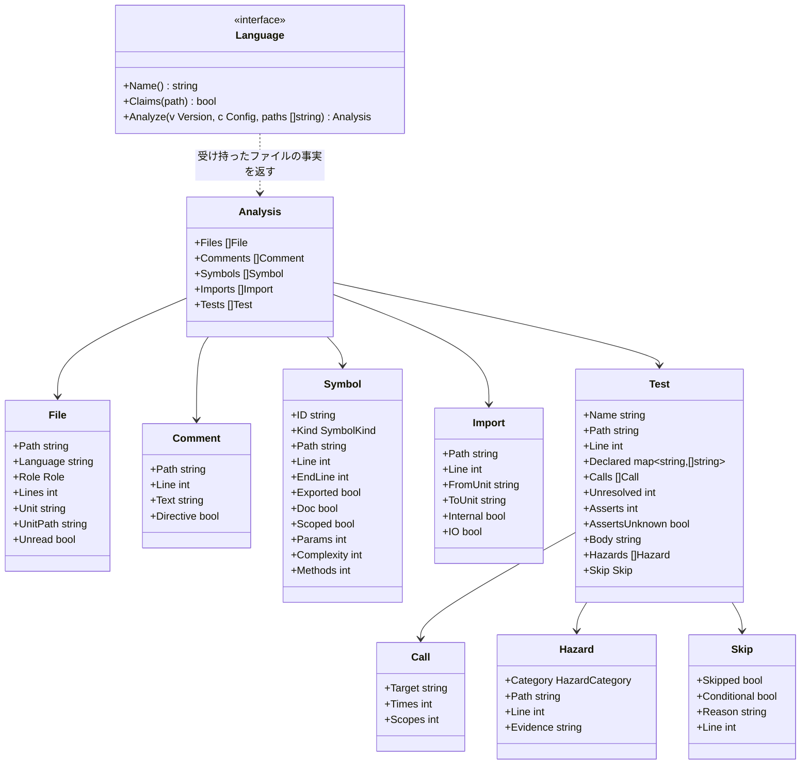

# 言語のアダプタ

## 責務

言語のアダプタは1つの版のファイルを、ルールが言語を知らずに使える**事実**に変える。ルールは「どのテストが時刻を読んでいるか」を尋ねる。それが Go では `time.Now()`、Python では `datetime.now()`、Kotlin では `Instant.now()` であることは、アダプタが知っている。

すること:

- どのファイルが自分の言語のものか、各ファイルがどの役割（ソース、テスト、生成物）かを見分ける
- コメント、シンボル、import、テストを、言語に依らない事実として取り出す
- 言語ごとの API を、言語に依らない**危険の分類**（時刻、sleep、モック、常に真の assert）に置き換える
- テストのスキップを、理由と条件と一緒に取り出す
- 何かを特定できなかったときは、推測せずにそう言う

しないこと:

- 判定すること。違反かどうかはルールが決める
- コードを実行すること、プロジェクトをビルドすること、言語のツールチェーン（`go`、`node`、`python`、`cargo`、`javac`、`kotlinc`）を呼ぶこと。hadome を、それらが無くても動く1つのバイナリにしておくためだ
- 例外の印を読み取ること。アダプタはコメントを渡すだけで、その中の `gate:allow` はエンジンが見つける。実装は全言語で1つだ

## 事実



### ファイルと役割

| 役割 | 意味 | 決め方 |
|---|---|---|
| `source` | 製品のコード | 既定 |
| `test` | テストのコード | 言語の慣習（下表）、次に設定による上書き |
| `generated` | 生成されたコード。大きさとコメントのルールは飛ばす | 標準のヘッダ（Go の `Code generated … DO NOT EDIT.` など）、次に設定の glob |
| `other` | hadome が知らない言語、またはコードでないもの | それでも一覧には載せ、ファイル単位のルールから見えるようにする |

テストファイルの慣習:

| 言語 | テストファイル |
|---|---|
| Go | `*_test.go` |
| TypeScript | `*.test.ts(x)`、`*.spec.ts(x)`、`__tests__/` の下のファイル |
| Python | `test_*.py`、`*_test.py` |
| Rust | 任意のファイル内の `#[cfg(test)]` モジュール、`tests/` の下のファイル |
| Java | `src/test/` の下のファイル、`@Test` メソッドを持つクラス |
| Kotlin | `src/test/` の下のファイル、`@Test` メソッドを持つクラス |

### ユニット（依存のルール向け）

**ユニット**は、依存の図が箱を描く単位だ。言語ごとに自然なユニットがあり、設定でまとめられる。

| 言語 | ユニット |
|---|---|
| Go | パッケージ（ディレクトリ） |
| TypeScript | `tsconfig` のパスの別名を解決した後のディレクトリ |
| Python | パッケージ（モジュールを含むディレクトリ） |
| Rust | クレート内のモジュールのパス |
| Java / Kotlin | パッケージ |

`Internal` は、import がリポジトリの中を指すときに真になる。`IO` は、import したユニットが入出力を行うときに真になる。判断はアダプタの `io` の表と、設定が足す項目（`rules.tests.io`）による。一覧に載るのはテストでないファイルの import だけだ。それがユニット自身の依存だからだ。

### 危険の分類

テストの書き方のルールは API の名前ではなく分類を扱う。各アダプタが自分の言語の API を分類に対応させる。

| 分類 | Go | Python | TypeScript | Java / Kotlin | Rust |
|---|---|---|---|---|---|
| `clock` | `time.Now`、`time.Since` | `datetime.now`、`time.time` | `Date.now`、`new Date()` | `Instant.now`、`LocalDateTime.now`、`System.currentTimeMillis` | `SystemTime::now`、`Instant::now` |
| `sleep` | `time.Sleep` | `time.sleep`、`asyncio.sleep` | 待つために使う `setTimeout` | `Thread.sleep`、`delay` | `thread::sleep` |
| `mock` | モックのライブラリの import | `unittest.mock`、`pytest-mock` | `jest.mock`、`vi.mock`、`mock.module` | Mockito、MockK | `mockall` |
| `always-true` | `if true`、値をそれ自身と比べること | `assert True` | `expect(true).toBe(true)` | `assertTrue(true)` | `assert!(true)` |

スキップ（`t.Skip`、`pytest.skip`、`@Disabled`、`#[ignore]` など）は危険の分類に入れず、`Skip` として理由と条件と一緒に取り出す。`tests/skip-without-reason` は、理由の無いスキップだけを落とす。

これらは例で、表の全体ではない。全体の表は各アダプタにあり、設定で項目を足せる（テストが迂回してはいけない製品独自の時刻のラッパー、hadome が知らないモックのライブラリなど）。組み込みの項目を設定で消すことはできない。

### 確かめる呼び出し

`tests/no-assertion`（[rules-tests.ja.md](rules-tests.ja.md)）のために、アダプタはテストごとに確かめる呼び出し（assert）を数えて `Test.Asserts` に入れる。テストのファイルの中のヘルパーを通したものも数える。

| 言語 | assert とみなすもの（例） |
|---|---|
| Go | テストの道具の `Error`・`Errorf`・`Fatal`・`Fatalf`・`Fail`・`FailNow`、testify の `assert` と `require` |
| Python | `assert` 文、`self.assert…`、`pytest.raises`、`pytest.fail` |
| TypeScript | `expect(…)`、`assert` と `assert.…` |
| Java / Kotlin | JUnit の `assert…`・`fail`、AssertJ と Hamcrest の `assertThat`、Mockito の `verify`、kotest の `should…` |
| Rust | `assert!`・`assert_eq!`・`assert_ne!`・`panic!`、`#[should_panic]` の付いたテスト |

危険の分類と同じく、これは例で、全体の表は各アダプタにある。設定の `rules.tests.assertions` で項目を足せるが、組み込みの項目は消せない。

テストの道具（Go の `*testing.T`、Python の `self` など）を、アダプタが中を読めない関数に渡したときは、その中で確かめているかもしれないので `Test.AssertsUnknown` を真にする。

### 本体の指紋

`tests/duplicate` のために、アダプタはテストの本体の字句の並びから指紋を作り、`Test.Body` に入れる。テストの名前、コメント、空白は指紋に入れない。リテラルは値ごと入れるので、入力が1つでも違うテストは指紋も違う。

### テストが守るもの

人がテストを分類することはない。テストが守るものは大部分を機械が割り出し、宣言する少しの部分はテストを書く者（たいていはエージェント）が書く。

| 部分 | 誰が与えるか | どうやって |
|---|---|---|
| 対象（テストが動かす入口） | アダプタが推定する | テストの本体がテストでないコードで呼んでいる公開の関数とメソッド。それぞれを `Call` として、何回呼ばれるか、いくつの異なるスコープ（利用者やテナントが入る引数。どちらも [rules-tests.ja.md](rules-tests.ja.md) で定義）で呼ばれるかと一緒に持つ。呼び出し先を特定できないとき（型の分からない値のメソッドなど）は `unknown` になる。宣言が推定を上書きするのは、推定が誤っているときだけだ |
| 観点 | 宣言しない | 推定が難しく、書く手間も大きい。ミューテーションの分析に置き換わるまでは、推定した対象の集合が守る範囲になる |
| 不変条件との紐付け | 大部分はテストの呼び出しの形から推定する。製品固有の不変条件と、形を持たない型についてだけ、テストの作者が1行書く | doc コメントの `guards: <invariant>` |

```go
// guards: durable store.Save
func TestSavedRowsSurviveRestart(t *testing.T) {
```

アダプタは doc コメントから `key: value` の行（小文字のキー、コロン、値）を集めて `Declared` に入れるだけだ。1行で1項目とし、空白は正規化する。アダプタはどんなキーがあるかを知らない。キーの意味は、そのキーを読むルールが決める（`guards` は [rules-tests.ja.md](rules-tests.ja.md)）。

### 特定できたかどうか

事実が止められるかどうかを決めるのは、どう読んだかではなく、アダプタがそれを特定できたかどうかだ。

| 状態 | 例 | 扱い |
|---|---|---|
| **特定できた** | コード中の（文字列やコメントの中でない）`Thread.sleep(` · 理由の無い `@Disabled` · 450行のファイル | どの言語でも止められる |
| **特定できない**（`unknown`） | 行き先を解決できない動的な import · 関数の終わりが見つからない珍しい書き方 | 黙って通すことはない。「特定できなかった」と報告する |

`unknown` も base と比べる。base に前からある unknown は通し、unknown を増やす変更は終了コード `3`（人の確認が要る）を返す。unknown でチェックを落とすことは無いので、推測でビルドが落ちることは無い。unknown を黙って通すことも無いので、特定できないものが増えたときは人が確かめる。

各事実はどう読んだかも記録する。これは診断のためだけで、事実が止めるかどうかは変えない。

| 読んだもの | 意味 |
|---|---|
| `go/parser` | Go の標準ライブラリのパーサ |
| `tree-sitter` | tree-sitter の文法 |

## 各言語の読み方

| 言語 | 読み方 |
|---|---|
| Go | 標準ライブラリのパーサ（`go/parser`、`go/ast`）。C への依存は無い |
| TypeScript、Python、Rust、Java、Kotlin | tree-sitter の文法 |

全言語で完全なパーサを使うのは、利用者が得るもの（正確な関数の範囲、テストの境界、アノテーションと import、少ない `unknown`）を、hadome のビルドのしやすさより優先したからだ。そのために増える手間（tree-sitter のための C への依存、OS とアーキテクチャごとのビルド）は、利用者ではなくリリースの手順で引き受ける。[distribution.ja.md](distribution.ja.md) を参照。

それでも `unknown` は残る。パーサがあっても特定できないもの（Rust のマクロの中身、動的な import）があるからだ。

## 不変条件

1. アダプタはコードを実行せず、プロセスを起動せず、ネットワークに触れない
2. 同じ内容のファイルからは、常に同じ事実が得られる
3. 文字列リテラルやコメントの中の文字は、コードとして報告しない（そこから危険、import、シンボルは生まれない）
4. どのアダプタも受け持たないファイルも、役割 `other` で一覧に載る
5. 設定は危険の項目を足せるが、組み込みの項目は消せない
6. テストの本体の指紋は、名前、コメント、空白を変えても変わらない。リテラルを1つでも変えると変わる

## 意図して入れなかったもの

- すべてのモジュールの仕組みを完全に解決すること（動的な import、Python のパスの操作）。解決できない import は `unknown` として報告する
- 型の情報（呼び出しがファイルをまたいで何に解決されるか）。ルールは構文だけを扱う
- ミューテーションの分析
- 6つ以外の言語

## 決めたこと

1. 事実が止められるかどうかは、どう読んだかではなく、特定できたかどうかで決まる。特定できない事実は報告し、それを増やす変更は終了コード `3` を返す
2. Go は標準ライブラリのパーサで読み、ほかの5言語は tree-sitter で読む。共有のトークナイザは持たない
3. 対象は推定し、観点は宣言しない。宣言（`guards:`）を持つのは、製品固有の不変条件か、形を持たない型のどれかを守るテストだけだ
4. 設定は危険の項目を足せるが、組み込みの項目は消せない。組み込みの項目が本当に当てはまらない場所には理由つきの例外を書き、それは人の確認に回る（終了コード `3`）。設定で消せると、設定を書き換えるだけで、人の確認を経ずにルールを効かなくできるからだ
