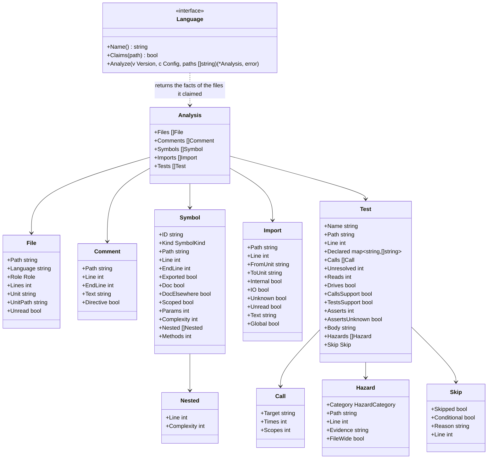

# Language adapters

## Responsibility

A language adapter turns the files of one version into **facts** that rules can use without knowing any language. Rules ask "which tests read the clock?". The adapter knows that in Go this is `time.Now()`, in Python `datetime.now()`, and in Kotlin `Instant.now()`.

It does:

- Recognise which files belong to its language, and what role each file plays (source, test, generated)
- Extract comments, symbols, imports and tests as language-neutral facts
- Translate language-specific APIs into neutral **hazard categories** (clock, sleep, mock, always-true assertion)
- Extract test skips, with their reason and condition
- Say when it could not identify something, instead of guessing

It does not:

- Judge anything. Whether something is a violation is decided by the rules
- Run code, build the project, or call the language's toolchain (no `go`, `node`, `python`, `cargo`, `javac`, `kotlinc`), so that hadome stays one binary that works without them
- Parse exception markers. Adapters hand over comments; the engine finds `gate:allow` in them, with one implementation for every language. A comment carries its first line and its last line (`EndLine`). The engine uses the last line to tell whether a marker is at the top of its file

## The facts



### Files and roles

| Role | Meaning | How it is decided |
|---|---|---|
| `source` | Product code | Default |
| `test` | Test code | The language's conventions (below), or a `files.tests` glob in configuration |
| `generated` | Generated code; size and comment rules skip it | Standard headers (e.g. Go's `Code generated … DO NOT EDIT.`), or a `files.generated` glob in configuration |
| `other` | A language hadome does not know, or not code | Still listed, so file-level rules can see it |

Directories that are not read:

- Nothing under these directories is listed or read. They hold copies of dependencies, build outputs and tools' working files, not the product's code
  - `vendor`, `node_modules`, `testdata`, `target`, `build`, `dist`, `__pycache__`
  - Anything starting with `.`. Example: `.git`
- An import that names something inside a directory that is not read is treated as an import whose destination is unknown ("Imports whose destination is unknown" below)
- Directories starting with `_` are read. Frameworks keep the product's code and tests there. Examples: jest's `__tests__`, Next.js's `_components`, Python's `_internal`
- Only Go lists the `.go` files under a directory starting with `_` with role `other`. The go command does not treat it as a package and does not run its tests

Test file conventions:

| Language | Test files |
|---|---|
| Go | `*_test.go`, test support packages (note below) |
| TypeScript | `*.test.ts(x)`, `*.spec.ts(x)`, files under `__tests__/`, test support files (under `test/` and the like; [adapters-treesitter.md](adapters-treesitter.md)) |
| Python | `test_*.py`, `*_test.py`, test support files (`conftest.py`, under `tests/` and the like; [adapters-treesitter.md](adapters-treesitter.md)) |
| Rust | `#[cfg(test)]` modules in any file, and files under `tests/` and `benches/` |
| Java | Files under a directory in `src/` whose name contains test (`src/test/` and the like) |
| Kotlin | Same as Java |
| Terraform | `*.tftest.hcl` ([adapters-iac.md](adapters-iac.md)) |
| Ansible | Files under `molecule/<scenario>/` ([adapters-iac.md](adapters-iac.md)) |

For repositories laid out against the conventions, configuration can add roles.

- A file matching a `files.tests` glob is read as a test file even when the language's conventions say otherwise. Go files are left out: whether a Go file is a test is decided by the compiler (`_test.go`), and hadome changing it would disagree with the real build. Terraform and Ansible files are left out too ([adapters-iac.md](adapters-iac.md))
- A file matching a `files.generated` glob is treated as generated code even without a header
- A file matching both is generated code
- Globs are written as in a gate's `paths` (`**` is directories at any depth)
- A file matching a `files.product` glob is not a test support file. It is read as product code
  - It takes away only the test support role that directories and names give by default. Example: a repository that keeps, under `e2e/server/`, the product's server the tests run against
  - Test files by convention (`*_test.go`, `*.test.ts`, under `__tests__/`, `test_*.py` and the like) and files matching `files.tests` stay test files
  - It applies to TypeScript, Python and Go files, the languages with test support files
- Except for `files.product`, globs only add roles; they never take away a role the conventions or a header gave
- The role is decided before the language reads the file, because whether a file is a test changes which facts are read from it (tests, or symbols)

Go test support packages:

- The files that are not `_test.go` in the following packages are test support files with role `test`. They exist only for the tests and are not product code
  - A package under one of these directories: `test/`, `e2e/`, `testutil/`, `testutils/`, `test-utils/`, `test_utils/`, `testhelper/`, `testhelpers/`, `__mocks__/`, `__fixtures__/`. At any depth. Examples: `internal/testutil`, `test/helpers`, `e2e/client`, `worker/e2e/client`
  - Packages under `tests/` are not support and stay product code. TypeScript and Python make them support, so this is the one difference
    - Why: in Go a directory's name is its package's name, so product packages called `tests` exist
    - Example: hadome's own `internal/rules/tests` is a product package holding the rules about tests
  - A repository that keeps product code under `test/` or `e2e/` can make it product code again with `files.product`. Example: if the product's server the tests run against is under `e2e/server/`, write `files.product: ["e2e/server/**"]`
  - A package whose name ends in `test` and that imports a package named like the part before `test`, or sits in a directory of that name. Examples: `storetest` importing `store`, `store/storetest`. It is the convention of the standard library's `httptest` and `fstest`
  - A package whose name happens to end in `test`, such as `latest`, imports no package named like the part before it (`la`), so it stays product code
- The functions of a support package are not targets, need no doc comment for `comments/missing-doc`, and are not in the dependency diagram
- When a test calls a function of a support package, the walk follows into it. Its calls resolve through the support package's own imports. For example, if `storetest.New(t)` calls `store.Open()`, a test calling `storetest.New(t)` guards `store.Open`
  - A test that calls a function of a support package has `Test.CallsSupport` set. So do TypeScript's and Python's support files ([adapters-treesitter.md](adapters-treesitter.md))
  - When the test is in the support package's own directory, it is that package's own test, and `Test.TestsSupport` is set too. For example, `internal/testutil/zone_test.go` calling `testutil.Zone()`
  - A support function's result is read by its declared type. If `s := storetest.New(t)` gives a `*store.Store`, `s.Append()` calls `store.Store.Append`
  - Methods of types declared in a support package are not followed. A call of one counts as unresolved
  - Hazards inside (clock, sleep, mock) are the test's, reported at the lines of the support package's file

### Units (for dependency rules)

A **unit** is what a dependency diagram draws a box for. Each language has its natural unit; configuration can group them.

| Language | Unit |
|---|---|
| Go | Package (directory) |
| TypeScript | Directory, after resolving `tsconfig` path aliases |
| Python | Package (directory with modules) |
| Rust | Module path within a crate |
| Java / Kotlin | Package |
| Terraform | Module (a directory) |
| Ansible | Role; a playbook's is its directory |

`Internal` is true when the import points inside the repository. `IO` is true when the imported unit performs input or output, according to the adapter's `io` table and the entries configuration adds (`rules.tests.io`). `Global` is true when the unit performs input or output not through an import but through a global API it uses without one, such as TypeScript's `fetch`; `ToUnit` is then the API's name, `IO` is true too, and `Internal` is false because it is no unit of the repository. Only imports of non-test files are listed: they are what the unit itself depends on. Imports that bring in types only (TypeScript's `import type` and the like) are not listed: they are no dependency of the running code.

### Imports whose destination is unknown

Some imports do not have a destination until the code runs. Such an import is listed with `Unknown` true and an empty `ToUnit`. Treating it as external and dropping it without a word would hide it from the dependency rules and from the judgement of purity.

| Language | Imports whose destination is unknown |
|---|---|
| TypeScript | `import(…)`, `require(…)` whose argument is not a string |
| Python | `importlib.import_module(…)`, `__import__(…)` whose argument is not a string |
| Java / Kotlin | `Class.forName(…)` whose argument is not a string |
| Go, Rust | None. Imports are always written as strings |

When the argument is a string, the destination is resolved like any other import.

An import that names something inside a directory hadome does not read ("Directories that are not read" above) is an import whose destination is unknown too. Examples: `import { client } from '../dist/client'`, `from .build import gen`.

- hadome does not read the files of that directory, so it cannot tell which unit the import reaches
- `Unknown` and `Unread` are true and `ToUnit` is empty. `Text` holds the specifier as written
- It does not count as an import that performs input or output. What it reaches was not read, so whether it performs input or output is unknown too
- This covers the TypeScript specifiers resolved as paths (those starting with `.` or `/`, and `paths` aliases) and Python's relative imports
- A `..` in the path starts with `.` but is not a directory that is not read. An import that points outside the repository is an import that cannot be resolved

`unknown/import` sends imports whose destination is unknown, added by a change, to a person's review (exit code `3`). It does not fail the check, because a check never fails on what cannot be confirmed. The anchor is the file and the normalised call text, so moving the import does not make it new.

| Rule | Cases |
|---|---|
| `unknown/import` | a new import whose destination is unknown returns `3` · one already in base does not · a dynamic import with a string argument is an ordinary import · one inside a test file does not · an Ansible role named with `{{ }}` returns `3` · a role named outright does not · a new import naming a directory that is not read returns `3` · one already in base does not · a Python relative import returns `3` too |

A unit with an import whose destination is unknown has `unknown` purity, and `unknown` is never pure ("Pure units" in [rules-tests.md](rules-tests.md)). So when such an import is added to a unit that was pure, both `unknown/import` and `tests/purity-lost` ask for review: the first points at the import itself, the second at the unit that is no longer pure.

### Hazard categories

Rules about how tests are written work on categories, not API names. Each adapter maps its language's APIs to them.

| Category | Go | Python | TypeScript | Java / Kotlin | Rust |
|---|---|---|---|---|---|
| `clock` | `time.Now`, `time.Since` | `datetime.now`, `time.time` | `Date.now`, `new Date()` | `Instant.now`, `LocalDateTime.now`, `System.currentTimeMillis` | `SystemTime::now`, `Instant::now` |
| `sleep` | `time.Sleep` | `time.sleep`, `asyncio.sleep` | `setTimeout` | `Thread.sleep`, `delay` | `thread::sleep` |
| `mock` | imports of mocking libraries | `unittest.mock`, `pytest-mock`, `monkeypatch.setattr` | `jest.mock`, `vi.mock`, `mock.module`, `vi.spyOn` | Mockito, MockK, Quarkus's `@InjectMock` | `mockall` |
| `always-true` | testify's `True(t, true)`, `Equal(t, x, x)` | `assert True` | `expect(true).toBe(true)` | `assertTrue(true)` | `assert!(true)` |

A hazard that is outside the tests and applies to every test of the file is marked `FileWide`. Examples: `vi.mock(…)` at the top of a TypeScript file, an import of a mocking library in Python, Java, Kotlin and Rust. `tests/no-mock` treats it apart from a mock inside a test ([rules-tests.md](rules-tests.md)).

Skips (`t.Skip`, `pytest.skip`, `@Disabled`, `#[ignore]` and so on) are not a hazard category. They are extracted as `Skip`, with their reason and condition. `tests/skip-without-reason` fails only skips without a reason.

These lists are examples, not the full tables. The full tables live in each adapter, and configuration can add entries (a product's own clock wrapper that tests must not bypass, a mocking library hadome does not know). Configuration cannot remove built-in entries. If it could, editing configuration alone could switch a rule off without any review by a person. A place where a built-in entry truly does not apply gets a reasoned exception, which goes to a person for review (exit code `3`).

### Assertions

For `tests/no-assertion` ([rules-tests.md](rules-tests.md)), the adapter counts each test's calls that check something (assertions) into `Test.Asserts`, including those made through helpers in test files.

| Language | Counted as an assertion (examples) |
|---|---|
| Go | the testing handle's `Error`, `Errorf`, `Fatal`, `Fatalf`, `Fail`, `FailNow`; testify's `assert` and `require`, testify suite checks (`s.Equal(…)`, `s.Require().…`) |
| Python | the `assert` statement, `self.assert…`, `pytest.raises`, `pytest.fail` |
| TypeScript | `expect(…)` with a matcher called (`expect(x).toBe(1)`, `expect(x).not.toBe(1)`), chai's `expect(x).to.…`, `assert` and `assert.…`. `expect(x)` alone, and a matcher not called (`expect(x).toBeTruthy`), do not count |
| Java / Kotlin | JUnit's `assert…` and `fail`, AssertJ's and Hamcrest's `assertThat`, Mockito's `verify`, MockK's `verify…`, `coVerify…` and `confirmVerified`, kotest's `should…`, the checks after REST Assured's `then()` (`statusCode`, `body` and the like, including those after a helper whose body ends in `then()` or that is declared to return `ValidatableResponse`), Spring MockMvc's `andExpect` |
| Rust | `assert!`, `assert_eq!`, `assert_ne!`, `panic!`; a test marked `#[should_panic]` |

As with hazard categories, these are examples; each adapter holds the full table. In languages other than Go, a function whose name starts with `assert`, `expect` or `verify` counts too (`assertEquals`, `assert_called_once`, `expectValid`). A checking helper in another file cannot be read by the adapter, but its name says that it checks.

Configuration can add entries under `rules.tests.assertions`, but never remove built-in ones. An entry is written as the test calls it (`acme.MustEqual`). In Go, it is written as `<import path>.<Name>`.

When a test passes its testing handle (Go's `*testing.T`, Python's `self` and so on) to a function the adapter cannot read, it may check there, so the adapter sets `Test.AssertsUnknown`. It does the same in these cases:

- Go: `t.Run` is given a function that is neither a function literal nor a helper in the test files
- Python: the test calls a method of its own class (`self.check(…)`)

### Reading product values

For `tests/guards-nothing`, the adapter stores in `Test.Reads` how many product values a test reads without calling them, including through helpers in test files. When a value changes, the test's result can change too, so a test that calls no function may still check product code (for example, a test that checks an embedded document matches the README).

| Language | What counts as a product value (examples) |
|---|---|
| Go | Package variables and constants (`store.Limit`, or `limit` in the same package), and functions passed as values without being called (`sort.Slice(rows, store.Less)`) |
| Python | A name imported from product code and used in an expression without being called (comparing with `MAX_ROWS`, passing `normalize` to `map`, `isinstance(x, Store)`) |
| TypeScript | A name imported from product code and used in an expression without being called |
| Java / Kotlin | Static fields and constants of a class (`Store.LIMIT`), method references (`Store::normalize`), Kotlin top-level `val`s, properties of a product object (`cache.ttl`) |
| Rust | Product `const`s and `static`s, and functions passed as values without being called. A product name inside a macro's arguments also counts (the parser does not read macro arguments as expressions, so a call there cannot be told from a read) |

Names in type positions (type annotations, TypeScript's `import type`, generic type arguments) do not count. Types do not run, so a test whose only mention of product code is in types runs no product code.

### The body's fingerprint

For `tests/duplicate`, the adapter makes a fingerprint of the sequence of tokens in each test's body and stores it in `Test.Body`. The test's name, comments and whitespace are not part of it. Literals are, with their values, so tests that differ in even one input have different fingerprints.

A parameterised test writes its inputs outside its body. So the parameters, and the decorators or annotations on the test, are part of the fingerprint too. A parameterised suite (`describe.each`, a class with `@pytest.mark.parametrize`, `@ParameterizedClass`) writes the inputs of every test in it on the suite. So the inputs of the suites around a test are part of its fingerprint too.

| Language | What the fingerprint covers |
|---|---|
| Go | From the parameters to the closing brace. The semicolons Go's scanner adds at line ends are left out, because they depend on where the lines break |
| Python | From the decorators (`@pytest.mark.parametrize`) to the end of the body. For a test in a class, also the class's decorators and the bodies of the `setUp` and the like and the `autouse=True` fixtures that run for that class |
| TypeScript | The `it("name", …)` call, without the name's string. Also the bodies of `beforeEach` and `beforeAll` in the enclosing `describe` blocks, the tables of `.each`, and the statements that set up the outer variables the test uses |
| Java / Kotlin | From the annotations (`@ValueSource`) to the end of the body. The annotations of the `@ParameterizedClass` classes around the test too |
| Rust | From the attributes before the function (`#[case(1)]`) to the end of the body |

In Python and TypeScript, the setup that runs before a test is part of the fingerprint too. Tests with the same body under different setup check different things. For example, `TestA` and `TestB` in one file hold tests with the same body and build different things in `setUp`. Or tests with the same body in different `describe` blocks each use their own block's `const KEYS = …`.

### What a test guards

People never classify tests. What a test guards is mostly worked out by machine, and the little that is declared is written by whoever writes the test (usually an agent).

| Piece | Who provides it | How |
|---|---|---|
| Target (the entry point the test exercises) | Inferred by the adapter | The functions and methods the test body calls in non-test code. Unexported ones are targets too when a test can call them (for example `limiter.batch`, called by a Go test in the same package). Each is a `Call` with how many times it is called and with how many distinct scopes (the argument where the user or tenant goes; [rules-tests.md](rules-tests.md) defines both). When the call target cannot be identified (a method on a value whose type is unknown, a variable holding a function, a function of a package that could not be read), it is `unknown`. A declaration overrides the inference only when it is wrong |
| Viewpoint | Not declared | Hard to infer and costly to write. The guarded scope is the set of inferred targets |
| Invariant link | Mostly inferred from the shape of the test's calls. The test's author writes one line only for product-specific invariants and for types without a shape | `guards: <invariant>` in the doc comment |

```go
// guards: durable store.Save
func TestSavedRowsSurviveRestart(t *testing.T) {
```

The adapter only collects `key: value` lines (a lower-case key, a colon, a value) from the doc comment into `Declared`, one entry per line, with whitespace normalised. The doc comment is the run of comments that ends on the line right before the test. Rust attributes, Java and Kotlin annotations and Python decorators may sit between the comment and the test. In Python the docstring is read as a doc comment too. A comment set apart by a blank line is not read. The adapter does not know which keys exist. What a key means is decided by the rule that reads it ([rules-tests.md](rules-tests.md) for `guards`).

### Identified or not

What decides whether a fact can block is whether the adapter identified it, not how it was read.

| State | Example | Treatment |
|---|---|---|
| **Identified** | `Thread.sleep(` in code (not in a string or comment) · `@Disabled` without a reason · a 450-line file | Can block, in every language |
| **Unidentified** (`unknown`) | A dynamic import whose destination cannot be resolved · an unusual construct where a function's end cannot be found | Never passed silently. Reported as "could not identify" |

`unknown` is compared with base too: unknowns already in base pass, and a change that adds unknowns returns exit code `3` (needs review). An unknown never fails the check, so a guess never fails a build. An unknown is never passed silently either, so when unidentified facts increase, a person checks them.

## How each language is read

| Language | How it is read |
|---|---|
| Go | The standard library's parser (`go/parser`, `go/ast`). No C dependency |
| TypeScript, Python, Rust, Java, Kotlin | tree-sitter grammars |
| Terraform | The HCL parser Terraform itself uses (`hclsyntax` of `hashicorp/hcl/v2`). No dependency on C |
| Ansible | The YAML parser that reads the configuration (`goccy/go-yaml`). No dependency on C |

A Go test reads the type of a value it calls a method on from declarations. It runs no type checker and reads no other module. These values have a known type:

- package-level variables of the code (`store.Default.Validate()`) and of the test package (`var shared = store.New()`, `var shared *store.Store`). Those of the test package are read from every `_test.go` file of the same package
- a composite literal in parentheses (`(Config{}).Validate()`)
- the result of a function, a method or a test helper, read by its declared result type (`newStore(t).Append()`). With a call that returns several values, each variable is read by the type of its own result (`s, q := store.Pair()`)
- range elements (`for _, s := range stores`) and fields of a declared struct (`tc.store.Append()`, `f.w.Drain()`)
- variables made by `var c Config` or `:=`
- parameters of helpers and function literals, read by their declared types (`func check(t *testing.T, s *store.Store)`)
- helper parameters declared with an interface or with a type that cannot be read (another module's type, such as `http.Handler`), read by the type of the value the caller passed. For example, when `func add(t *testing.T, a Appender)` is called as `add(t, &store.Store{})`, `a.Append()` is a call of `Store.Append`. When the passed value's type is not known either, the call is `unknown`. It is never a call of the interface's method, because an interface's method has no code of its own

Calling a variable that holds a method value (`f := s.Append`) counts as a call of that method.

Variables are read per function. A variable or parameter declared in a helper or a function literal hides one of the same name outside it. A function literal also sees the variables of the function around it (`t.Run("x", func(t *testing.T) { tc.store.Append() })`). A helper does not see the variables of the test that calls it. Calls inside a helper are read with the imports of the helper's file.

A method of a value whose type is unknown is `unknown`.

For a testify suite, the test that calls `suite.Run(t, new(X))` follows `X`'s `Setup…`, `BeforeTest` and `Test…` methods. The suite struct's fields are read by their declared types.

There is no tokenizer shared across languages. Each language is read with its own parser.

Full parsers are used for every language because what users get (accurate function spans, test boundaries, annotations and imports, and few `unknown` facts) comes ahead of how easy hadome is to build. The extra work this brings (a C dependency for tree-sitter, and builds per operating system and architecture) is taken on by the release process, not by users. See [distribution.md](distribution.md).

`unknown` still exists: some things cannot be identified even with a parser (the contents of Rust macros, dynamic imports).

## Invariants

1. Adapters never execute code, start a process, or touch the network
2. The same file content always yields the same facts
3. Text inside a string literal or a comment is never reported as code (no hazard, import or symbol comes from it)
4. A file no adapter claims is still listed with role `other`
5. Configuration can add hazard entries but never remove built-in ones
6. A test body's fingerprint does not change when the name, comments or whitespace change. It changes when any literal changes

## Deliberately left out

- Resolving every module system completely (dynamic imports, Python path manipulation). Unresolvable imports are reported as `unknown`
- Type information (what a call resolves to across files). Rules work on syntax only
- Mutation analysis
- Languages not in this document or [adapters-iac.md](adapters-iac.md)
