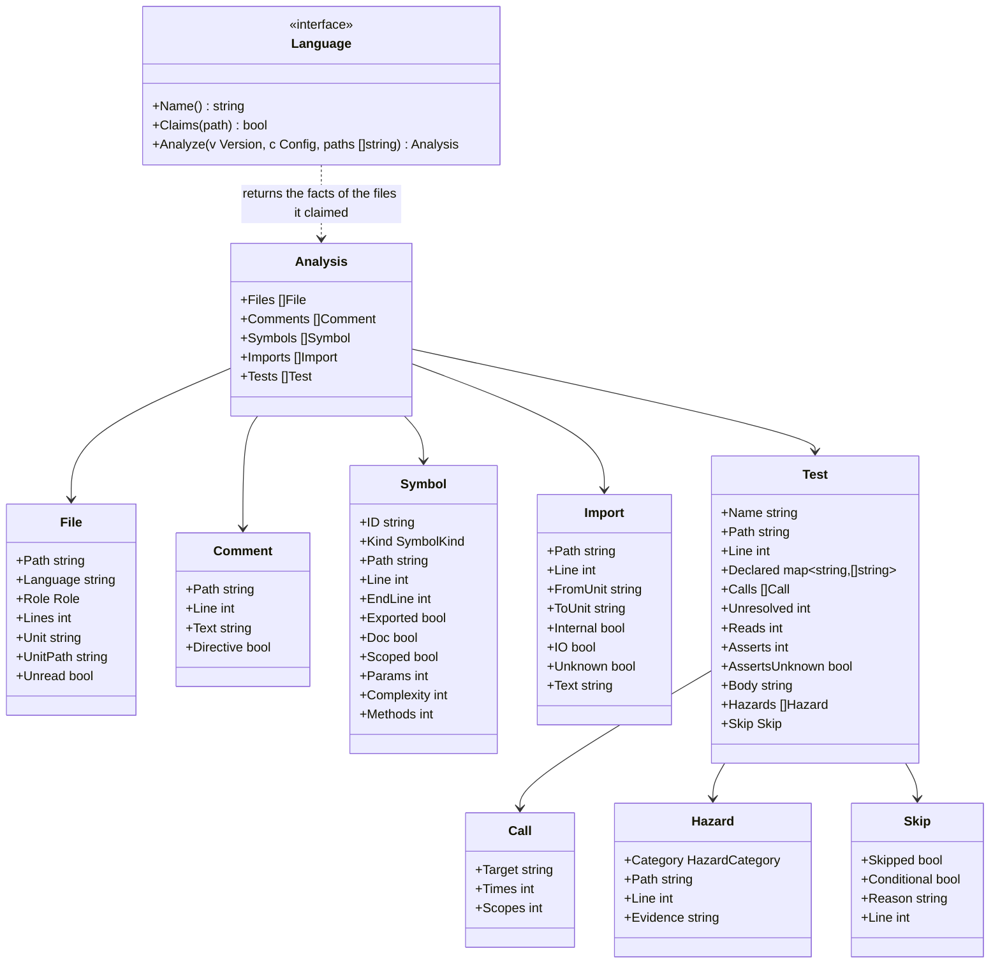

# Language adapters

## Responsibility

A language adapter turns the files of one version into **facts** that rules can use without knowing any language. Rules ask "which tests read the clock?". The adapter knows that in Go this is `time.Now()`, in Python `datetime.now()`, and in Kotlin `Instant.now()`.

It does:

- Recognise which files belong to its language, and what role each file plays (source, test, generated)
- Extract comments, symbols, imports and tests as language-neutral facts
- Translate language-specific APIs into neutral **hazard categories** (clock, sleep, mock, always-true assertion)
- Extract test skips, with their reason and condition
- Say when it could not identify something, instead of guessing

It does not:

- Judge anything. Whether something is a violation is decided by the rules
- Run code, build the project, or call the language's toolchain (no `go`, `node`, `python`, `cargo`, `javac`, `kotlinc`), so that hadome stays one binary that works without them
- Parse exception markers. Adapters hand over comments; the engine finds `gate:allow` in them, with one implementation for every language

## The facts



### Files and roles

| Role | Meaning | How it is decided |
|---|---|---|
| `source` | Product code | Default |
| `test` | Test code | The language's conventions (below), or a `files.tests` glob in configuration |
| `generated` | Generated code; size and comment rules skip it | Standard headers (e.g. Go's `Code generated … DO NOT EDIT.`), or a `files.generated` glob in configuration |
| `other` | A language hadome does not know, or not code | Still listed, so file-level rules can see it |

Test file conventions:

| Language | Test files |
|---|---|
| Go | `*_test.go` |
| TypeScript | `*.test.ts(x)`, `*.spec.ts(x)`, files under `__tests__/` |
| Python | `test_*.py`, `*_test.py` |
| Rust | `#[cfg(test)]` modules in any file, and files under `tests/` and `benches/` |
| Java | Files under a directory in `src/` whose name contains test (`src/test/` and the like) |
| Kotlin | Same as Java |
| Terraform | `*.tftest.hcl` ([adapters-iac.md](adapters-iac.md)) |
| Ansible | Files under `molecule/<scenario>/` ([adapters-iac.md](adapters-iac.md)) |

For repositories laid out against the conventions, configuration can add roles.

- A file matching a `files.tests` glob is read as a test file even when the language's conventions say otherwise. Go files are left out: whether a Go file is a test is decided by the compiler (`_test.go`), and hadome changing it would disagree with the real build. Terraform and Ansible files are left out too ([adapters-iac.md](adapters-iac.md))
- A file matching a `files.generated` glob is treated as generated code even without a header
- A file matching both is generated code
- Globs are written as in a gate's `paths` (`**` is directories at any depth)
- Globs only add roles; they never take away a role the conventions or a header gave
- The role is decided before the language reads the file, because whether a file is a test changes which facts are read from it (tests, or symbols)

### Units (for dependency rules)

A **unit** is what a dependency diagram draws a box for. Each language has its natural unit; configuration can group them.

| Language | Unit |
|---|---|
| Go | Package (directory) |
| TypeScript | Directory, after resolving `tsconfig` path aliases |
| Python | Package (directory with modules) |
| Rust | Module path within a crate |
| Java / Kotlin | Package |
| Terraform | Module (a directory) |
| Ansible | Role; a playbook's is its directory |

`Internal` is true when the import points inside the repository. `IO` is true when the imported unit performs input or output, according to the adapter's `io` table and the entries configuration adds (`rules.tests.io`). Only imports of non-test files are listed: they are what the unit itself depends on.

### Imports whose destination is unknown

Some imports do not have a destination until the code runs. Such an import is listed with `Unknown` true and an empty `ToUnit`. Treating it as external and dropping it without a word would hide it from the dependency rules and from the judgement of purity.

| Language | Imports whose destination is unknown |
|---|---|
| TypeScript | `import(…)`, `require(…)` whose argument is not a string |
| Python | `importlib.import_module(…)`, `__import__(…)` whose argument is not a string |
| Java / Kotlin | `Class.forName(…)` whose argument is not a string |
| Go, Rust | None. Imports are always written as strings |

When the argument is a string, the destination is resolved like any other import.

`unknown/import` sends imports whose destination is unknown, added by a change, to a person's review (exit code `3`). It does not fail the check, because a check never fails on what cannot be confirmed. The anchor is the file and the normalised call text, so moving the import does not make it new.

| Rule | Cases |
|---|---|
| `unknown/import` | a new import whose destination is unknown returns `3` · one already in base does not · a dynamic import with a string argument is an ordinary import · one inside a test file does not · an Ansible role named with `{{ }}` returns `3` · a role named outright does not |

A unit with an import whose destination is unknown has `unknown` purity, and `unknown` is never pure ("Pure units" in [rules-tests.md](rules-tests.md)).

### Hazard categories

Rules about how tests are written work on categories, not API names. Each adapter maps its language's APIs to them.

| Category | Go | Python | TypeScript | Java / Kotlin | Rust |
|---|---|---|---|---|---|
| `clock` | `time.Now`, `time.Since` | `datetime.now`, `time.time` | `Date.now`, `new Date()` | `Instant.now`, `LocalDateTime.now`, `System.currentTimeMillis` | `SystemTime::now`, `Instant::now` |
| `sleep` | `time.Sleep` | `time.sleep`, `asyncio.sleep` | `setTimeout` | `Thread.sleep`, `delay` | `thread::sleep` |
| `mock` | imports of mocking libraries | `unittest.mock`, `pytest-mock` | `jest.mock`, `vi.mock`, `mock.module` | Mockito, MockK | `mockall` |
| `always-true` | testify's `True(t, true)`, `Equal(t, x, x)` | `assert True` | `expect(true).toBe(true)` | `assertTrue(true)` | `assert!(true)` |

Skips (`t.Skip`, `pytest.skip`, `@Disabled`, `#[ignore]` and so on) are not a hazard category. They are extracted as `Skip`, with their reason and condition. `tests/skip-without-reason` fails only skips without a reason.

These lists are examples, not the full tables. The full tables live in each adapter, and configuration can add entries (a product's own clock wrapper that tests must not bypass, a mocking library hadome does not know). Configuration cannot remove built-in entries. If it could, editing configuration alone could switch a rule off without any review by a person. A place where a built-in entry truly does not apply gets a reasoned exception, which goes to a person for review (exit code `3`).

### Assertions

For `tests/no-assertion` ([rules-tests.md](rules-tests.md)), the adapter counts each test's calls that check something (assertions) into `Test.Asserts`, including those made through helpers in test files.

| Language | Counted as an assertion (examples) |
|---|---|
| Go | the testing handle's `Error`, `Errorf`, `Fatal`, `Fatalf`, `Fail`, `FailNow`; testify's `assert` and `require` |
| Python | the `assert` statement, `self.assert…`, `pytest.raises`, `pytest.fail` |
| TypeScript | `expect(…)`, `assert` and `assert.…` |
| Java / Kotlin | JUnit's `assert…` and `fail`, AssertJ's and Hamcrest's `assertThat`, Mockito's `verify`, kotest's `should…`, the checks after REST Assured's `then()` (`statusCode`, `body` and the like), Spring MockMvc's `andExpect` |
| Rust | `assert!`, `assert_eq!`, `assert_ne!`, `panic!`; a test marked `#[should_panic]` |

As with hazard categories, these are examples; each adapter holds the full table. In languages other than Go, a function whose name starts with `assert`, `expect` or `verify` counts too (`assertEquals`, `assert_called_once`, `expectValid`). A checking helper in another file cannot be read by the adapter, but its name says that it checks.

Configuration can add entries under `rules.tests.assertions`, but never remove built-in ones. An entry is written as the test calls it (`acme.MustEqual`). In Go, it is written as `<import path>.<Name>`.

When a test passes its testing handle (Go's `*testing.T`, Python's `self` and so on) to a function the adapter cannot read, it may check there, so the adapter sets `Test.AssertsUnknown`. It does the same in these cases:

- Go: `t.Run` is given a function that is neither a function literal nor a helper in the test files
- Python: the test calls a method of its own class (`self.check(…)`)

### Reading product values

For `tests/guards-nothing`, the adapter stores in `Test.Reads` how many product values a test reads without calling them, including through helpers in test files. When a value changes, the test's result can change too, so a test that calls no function may still check product code (for example, a test that checks an embedded document matches the README).

| Language | What counts as a product value (examples) |
|---|---|
| Go | Package variables and constants (`store.Limit`, or `limit` in the same package), and functions passed as values without being called (`sort.Slice(rows, store.Less)`) |
| Python | A name imported from product code and used in an expression without being called (comparing with `MAX_ROWS`, passing `normalize` to `map`, `isinstance(x, Store)`) |
| TypeScript | A name imported from product code and used in an expression without being called |
| Java / Kotlin | Static fields and constants of a class (`Store.LIMIT`), method references (`Store::normalize`), Kotlin top-level `val`s |
| Rust | Product `const`s and `static`s, and functions passed as values without being called. A product name inside a macro's arguments also counts (the parser does not read macro arguments as expressions, so a call there cannot be told from a read) |

Names in type positions (type annotations, TypeScript's `import type`, generic type arguments) do not count. Types do not run, so a test whose only mention of product code is in types runs no product code.

### The body's fingerprint

For `tests/duplicate`, the adapter makes a fingerprint of the sequence of tokens in each test's body and stores it in `Test.Body`. The test's name, comments and whitespace are not part of it. Literals are, with their values, so tests that differ in even one input have different fingerprints.

A parameterised test writes its inputs outside its body. So the parameters, and the decorators or annotations on the test, are part of the fingerprint too.

| Language | What the fingerprint covers |
|---|---|
| Go | From the parameters to the closing brace. The semicolons Go's scanner adds at line ends are left out, because they depend on where the lines break |
| Python | From the decorators (`@pytest.mark.parametrize`) to the end of the body |
| TypeScript | The `it("name", …)` call, without the name's string |
| Java / Kotlin | From the annotations (`@ValueSource`) to the end of the body |
| Rust | From the attributes before the function (`#[case(1)]`) to the end of the body |

### What a test guards

People never classify tests. What a test guards is mostly worked out by machine, and the little that is declared is written by whoever writes the test (usually an agent).

| Piece | Who provides it | How |
|---|---|---|
| Target (the entry point the test exercises) | Inferred by the adapter | The public functions and methods the test body calls in non-test code, each as a `Call` with how many times it is called and with how many distinct scopes (the argument where the user or tenant goes; [rules-tests.md](rules-tests.md) defines both). When the call target cannot be identified (a method on a value whose type is unknown, a variable holding a function, a function of a package that could not be read), it is `unknown`. A declaration overrides the inference only when it is wrong |
| Viewpoint | Not declared | Hard to infer and costly to write. The guarded scope is the set of inferred targets |
| Invariant link | Mostly inferred from the shape of the test's calls. The test's author writes one line only for product-specific invariants and for types without a shape | `guards: <invariant>` in the doc comment |

```go
// guards: durable store.Save
func TestSavedRowsSurviveRestart(t *testing.T) {
```

The adapter only collects `key: value` lines (a lower-case key, a colon, a value) from the doc comment into `Declared`, one entry per line, with whitespace normalised. The doc comment is the run of comments that ends on the line right before the test. Rust attributes, Java and Kotlin annotations and Python decorators may sit between the comment and the test. In Python the docstring is read as a doc comment too. A comment set apart by a blank line is not read. The adapter does not know which keys exist. What a key means is decided by the rule that reads it ([rules-tests.md](rules-tests.md) for `guards`).

### Identified or not

What decides whether a fact can block is whether the adapter identified it, not how it was read.

| State | Example | Treatment |
|---|---|---|
| **Identified** | `Thread.sleep(` in code (not in a string or comment) · `@Disabled` without a reason · a 450-line file | Can block, in every language |
| **Unidentified** (`unknown`) | A dynamic import whose destination cannot be resolved · an unusual construct where a function's end cannot be found | Never passed silently. Reported as "could not identify" |

`unknown` is compared with base too: unknowns already in base pass, and a change that adds unknowns returns exit code `3` (needs review). An unknown never fails the check, so a guess never fails a build. An unknown is never passed silently either, so when unidentified facts increase, a person checks them.

## How each language is read

| Language | How it is read |
|---|---|
| Go | The standard library's parser (`go/parser`, `go/ast`). No C dependency |
| TypeScript, Python, Rust, Java, Kotlin | tree-sitter grammars |
| Terraform | The HCL parser Terraform itself uses (`hclsyntax` of `hashicorp/hcl/v2`). No dependency on C |
| Ansible | The YAML parser that reads the configuration (`goccy/go-yaml`). No dependency on C |

There is no tokenizer shared across languages. Each language is read with its own parser.

Full parsers are used for every language because what users get (accurate function spans, test boundaries, annotations and imports, and few `unknown` facts) comes ahead of how easy hadome is to build. The extra work this brings (a C dependency for tree-sitter, and builds per operating system and architecture) is taken on by the release process, not by users. See [distribution.md](distribution.md).

`unknown` still exists: some things cannot be identified even with a parser (the contents of Rust macros, dynamic imports).

## Invariants

1. Adapters never execute code, start a process, or touch the network
2. The same file content always yields the same facts
3. Text inside a string literal or a comment is never reported as code (no hazard, import or symbol comes from it)
4. A file no adapter claims is still listed with role `other`
5. Configuration can add hazard entries but never remove built-in ones
6. A test body's fingerprint does not change when the name, comments or whitespace change. It changes when any literal changes

## Deliberately left out

- Resolving every module system completely (dynamic imports, Python path manipulation). Unresolvable imports are reported as `unknown`
- Type information (what a call resolves to across files). Rules work on syntax only
- Mutation analysis
- Languages not in this document or [adapters-iac.md](adapters-iac.md)
