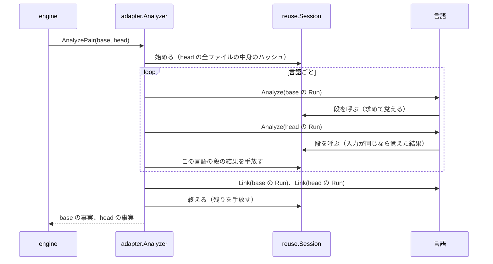
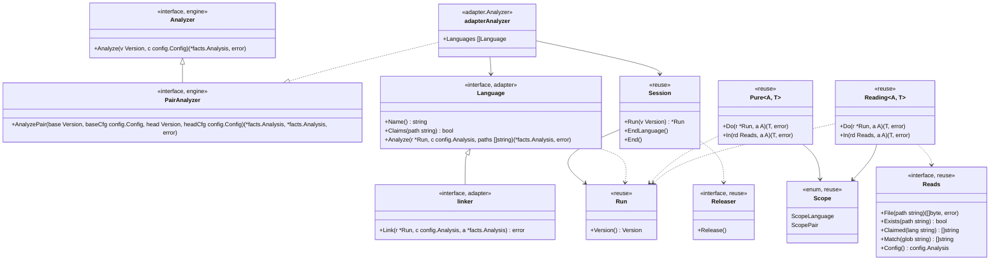

# 版をまたいだ解析の再利用

## 責務

`hadome check` は base と head の2つの版を解析します。2つの版のファイルはほとんどが同じ中身です。解析の再利用は base で求めた結果のうち head でも同じになると確かめられたものを、head で求め直さずに使う仕組みです。

**すること**

- アダプタの仕事を**段**に分けて、段の結果を1回の実行の間だけ覚えます
- head で同じ段を呼んだとき、入力が同じだと確かめられれば、覚えた結果を返します
- head で当たりえない結果を、早めに手放します

**しないこと**

- 結果をディスクに書くこと。実行をまたいで覚えることはしません
- ネットワークに出ること
- ルール、門番、不変条件の候補の結果を再利用すること。再利用するのは、アダプタの段の結果だけです
- 事実を変えること。再利用してもしなくても、アダプタが返す事実は同じです

## 再利用してよい条件

中心の不変条件は次のとおりです。

- **再利用してもしなくても、レポートはバイト単位で同じです**

この条件はより強い次の条件から導きます。

- **再利用してもしなくても、各版の事実（`facts.Analysis`）は同じです**

レポートは事実と設定と版のファイルから作ります。再利用が変えうるのは事実だけなので、事実が同じならレポートも同じです。

再利用してよいのは、段の結果がその入力だけで決まり、入力が両方の版で同じだと確かめられたときだけです。入力とは段が見たものすべてです。

| 入力 | 例 |
|---|---|
| 段に渡した引数 | ファイルのパスと中身、設定 |
| 段が版から読んだもの | ほかのファイルの中身、ファイルがあるかどうか、ファイルの一覧 |
| 段が使ったほかの段の結果 | 各ファイルの宣言の要約 |

## 段

段は名前の付いた関数で、結果を覚えて使い回す単位です。例: 「1つの Kotlin のファイルを構文木にする」「`.sql` のファイルからデータベースのカタログを作る」

段は見られるものの違いで2種類に分けます。見られるものが違うと、入力が同じだと確かめる方法も違うからです。

| 種類 | 見られるもの | 入力が同じだと確かめる方法 | 例 |
|---|---|---|---|
| **純粋な段** | 渡された引数だけ | 段の名前と引数の全体から作った鍵が同じ | 1つのファイルを構文木にする。1つのファイルのコメントを取り出す |
| **読む段** | 引数と、`Reads` を通して読んだ版とほかの段の結果 | 記録したすべての読み取りが、head でも同じ答えを返す | TypeScript の import を解決する表を作る。SQL のカタログを作る。テストのヘルパーをファイルをまたいでたどる |

段に分けていない仕事は版ごとに毎回走ります。毎回走る仕事が、事実を変えることはありません。そのため、アダプタは段を1つずつ増やせます。

### 純粋な段

- 純粋な段の関数は引数を1つだけ受け取ります。版もファイルシステムも受け取りません
- 鍵は段の名前と引数の全体から作ります。段の作者は鍵を書きません。鍵に入れ忘れる項目が生まれないようにするためです
- 引数は値だけからなる型にします
  - 使えるもの: 真偽、数、文字列、バイト列、それらのスライス・配列・マップ、それらを持つ構造体
  - 使えないもの: ポインタ、インターフェース、関数、チャネル
  - 段を登録するときに型を確かめます。使えない型があれば、hadome は起動したところで止まります
- バイト列（ファイルの中身など）は、SHA-256 のハッシュで鍵に入れます
- マップはキーを並べてから鍵に入れます。マップを走査する順で鍵が変わらないようにするためです
- 例: 構文木にする段の引数は `{Path, Src}` です。パスを入れるのは、拡張子で文法が変わるからです

### 読む段

- 読む段の関数は引数と `Reads` を受け取ります。版を読むのは `Reads` を通してだけです
- 引数の決まりと鍵の作り方は純粋な段と同じです
- `Reads` は読み取りの一つひとつを、問いと答えの組で記録します
- head で同じ段を同じ引数で呼ぶと、セッションは記録した問いを head に順に問い直します
  - 答えがすべて同じなら、覚えた結果を返します
  - 1つでも違えば、段を head で走らせ直します

| 読み取り | 問い | 記録する答え | 例 |
|---|---|---|---|
| `File(path)` | ファイルの中身 | 中身のハッシュ。無ければ「無い」 | `tsconfig.json`、ヘルパーのファイル |
| `Exists(path)` | ファイルがあるか | ある、または無い | 上のディレクトリの `dbt_project.yml` |
| `Claimed(lang)` | 言語が受け持つファイルの一覧 | 並べた一覧のハッシュ | すべての `.sql` のファイル |
| `Match(glob)` | パターンに合うファイルの一覧 | 並べた一覧のハッシュ | すべての `go.mod` |
| `Config()` | アダプタが読める設定（`config.Analysis`） | 設定のハッシュ | `files.generated`、`sql.databases` |
| `stage.In(reads, arg)` | ほかの段の結果 | その結果の指紋 | 各ファイルの宣言の要約 |

- 「無い」も答えとして記録します。base で無かったファイルが head で現れると、結果が変わりうるからです
- 一覧は粗い読み取りです。一覧を読んだ段はファイルが1つ増えても減っても走り直します。粗く読むほど再利用は減りますが、事実は変わりません
- 問い直しで読むほかの段の結果は head で先にその段を呼んで得ます。その段も、覚えた結果が使えるかを同じように確かめます

### 結果の指紋

ほかの段の結果を読んだときは、その結果の指紋を記録します。指紋の作り方は結果の型で決まります。

| 結果の型 | 指紋 |
|---|---|
| 値だけからなる型 | 結果の全体から作ったハッシュ。作り方は引数の鍵と同じです |
| それ以外（構文木など） | 純粋な段なら段の鍵。読む段なら、記録した読み取りの全体のハッシュ |

値だけからなる結果は入力が変わっても結果が同じなら、同じ指紋になります。そのため、それを読んだ段は走り直さずに済みます。

- 例: 関数の本体の1行を変えても、そのファイルの宣言の要約は変わりません
- 要約だけを読む索引の段は head でも同じ指紋の要約を読みます。そのため、索引を作り直しません
- 索引を読むテストの段も、索引の指紋が同じなので、ほかの読み取りが同じなら走り直しません

## 鍵

再利用の判断に使うものをまとめて示します。

| 鍵の部分 | 何のためか | 純粋な段 | 読む段 |
|---|---|---|---|
| 段の名前 | 段ごとに結果を分けます。名前は hadome の中で一意です | 入れる | 入れる |
| 引数の全体 | 段に渡した入力です | 入れる（バイト列はハッシュで） | 入れる（バイト列はハッシュで） |
| 設定 | 事実を変える設定です | 引数に入れた分 | `Config()` の答えとして |
| 読んだファイルの集合 | 段が見たほかのファイルです | 見られない | 記録した読み取りとして |
| アダプタの版 | 実行の中では1つです | 入れない | 入れない |

アダプタの版を入れないのは、覚えるのが1回の実行の中だけだからです。1回の実行の中では、hadome のバイナリは1つです。

ハッシュには SHA-256 を使います。ハッシュがぶつかって別の入力を同じとみなすことは、起きないものとして扱います。

### アダプタが読める設定

アダプタは設定の全体（`config.Config`）ではなく、その一部の `config.Analysis` だけを受け取ります。`config.Analysis` が持つのは、事実を変えうる設定だけです。

| 設定のキー | `config.Analysis` のフィールド |
|---|---|
| `languages` | `Languages` |
| `rules.tests.hazards`、`rules.tests.io`、`rules.tests.assertions` | `Hazards`、`IO`、`Assertions` |
| `rules.tests.sql-sinks` | `SQLSinks` |
| `files.tests`、`files.generated`、`files.product`、`files.ansible` | `TestFiles`、`GeneratedFiles`、`ProductFiles`、`AnsibleFiles` |
| `sql.databases` | `Databases` |

- 型で分けるので、アダプタはこれ以外の設定を読めません。読めない設定が、事実を変えることはありません
- base の設定は `config.ForBase` で作ります。`config.ForBase` が base 自身のものにするのは、不変条件と自分自身の依存の図だけです。どちらも `config.Analysis` にありません
- そのため、2つの版の `config.Analysis` は常に同じです。設定を変える変更でも、どちらの版も head の設定値で解析します

## 2つの版を一度に解析する

エンジンは、解析器が `PairAnalyzer` なら、2つの版を1回の呼び出し（`AnalyzePair`）で解析させます。`internal/adapter` の解析器は `PairAnalyzer` です。解析は次の順に進みます。



- 言語ごとに、base と head を続けて解析します。言語の結果を次の言語に進む前に手放すためです
- `Link` はすべての言語を読んだ後に、base、head の順で走らせます
- エンジンは受け取った事実でルールを走らせます。ルールの当て方と比べ方は [engine.ja.md](engine.ja.md) にあります
- `PairAnalyzer` でない解析器では、エンジンは版ごとに `Analyze` を呼びます
- `Analyze` で1つの版だけを解析するときも、同じ段を通ります。そのときのセッションはその版の中でだけ覚えます。例: SQL のカタログを `Analyze` と `Link` で1回だけ作ります

### 手放す時期

段は結果を覚えておく範囲（`Scope`）を持ちます。

| 範囲 | 手放す時期 | 例 |
|---|---|---|
| `ScopeLanguage` | その言語の head の解析が終わったとき | 構文木、ファイルごとの事実 |
| `ScopePair` | 2つの版の解析が終わったとき | `Link` が使う SQL のカタログ |

- Go の外のメモリを持つ結果は `Release` を持ちます。例: tree-sitter の構文木
- セッションは結果を手放すときに `Release` を1回だけ呼びます
- 再利用しないときも、同じ時期に手放します

### 覚える結果を絞る

base で求めた結果のうち、覚えておくのは head で当たりうるものだけです。

- セッションは解析を始める前に、head の全ファイルの中身のハッシュを1回求めます
- base の結果を覚えるのは、それを求めるのに使ったファイルの中身のハッシュが、すべて head にあるときだけです。使った中身とは引数のバイト列と、`File` の答えです
- 覚えなかった結果はその言語の base の解析が終わったら手放します

覚えた構文木は head で作り直さずに使います。そのため、1つの言語を解析している間に持つ構文木は、どの時点でもおおよそ1つの版の分です。ほとんどのファイルを変える変更でも、base の構文木と head の構文木を両方抱えることはありません。

## 実行の範囲

- 覚えるのは、1回の `AnalyzePair`（または `Analyze`）の中だけです。セッションはその呼び出しの初めに作り、終わりに捨てます
- 自己テストの事例ごと、`Check` ごとに、新しいセッションになります
- アダプタの値（`Language`）は、版をまたいだ状態を持ちません
  - 版ごとの状態は `Run` に置きます。例: TypeScript の、パスからファイルを引く表
  - 版をまたいで使い回すものは、段の結果としてセッションに置きます。例: SQL のカタログ

### ディスクに残さない理由

- 古い結果や壊れた結果が、黙ってレポートを変えます。hadome は走れなかったチェックを通過にしません。黙って違う結果を出しうる仕組みは、この考えに合いません
- 実行をまたぐ鍵には、hadome のバイナリの同一性が要ります
- CI は毎回新しい環境で走ることが多く、ディスクに残した結果はそこでは当たりません
- 同じ解析を2回する無駄の大部分は、1回の実行の中の、base と head の重なりです。これは1回の実行の中で覚えれば取り除けます

## 並行

- 2つの版と言語は1つずつ順に解析します
- セッションは同時に呼ばれても安全です。同じ鍵の段が同時に呼ばれたら、1回だけ走らせて、結果を分け合います
- 段の結果は渡した後に誰も書き換えません
- 後から埋める情報は結果ではなく `Run` の側に置きます。例: tree-sitter のアダプタが、テストが初めて名前を読んだときに作る、文字列の定数の表

## アダプタが段を宣言する

段はパッケージの変数として宣言します。段の関数はパッケージの最上位の関数にします。版を閉じ込めた関数リテラルにすると、`Reads` を通らない読み取りが生まれるからです。

```go
var parseStage = reuse.NewPure("kotlin/parse", reuse.ScopeLanguage, parse)

type parseInput struct {
	Path string
	Src  []byte
}

func parse(in parseInput) (*tree, error) { ... }

var catalogStage = reuse.NewReading("sql/catalog", reuse.ScopePair, buildCatalog)

func buildCatalog(r reuse.Reads, _ struct{}) (*catalog, error) { ... }
```

- 段の名前は `<アダプタ>/<段>` の形にします。名前は hadome の中で一意にします。同じ名前を2回登録すると、hadome は起動したところで止まります
- 言語の `Analyze` と `Link` は段を `stage.Do(run, arg)` で呼びます
- 読む段の中からほかの段を呼ぶときは、`stage.In(reads, arg)` を使います。呼んだことが読み取りとして記録されます

### 各アダプタの段

段の境目はその仕事が何を見て決まるかで決めます。

- ファイルの中身とパスと設定だけで決まる仕事は、純粋な段にします
- ほかのファイルを見る仕事は読む段にします

| アダプタ | 純粋な段 | 読む段 |
|---|---|---|
| Go | ファイルの構文木、コメント、行数、生成物の印 | モジュールの一覧（`go.mod`）、テストの補助の判定、呼び出しの索引、テストの抽出 |
| TypeScript、Python、Rust、Java、Kotlin | ファイルの構文木（文法の誤読を直した読み直しを含む）、コメント、行数 | 索引（TypeScript のプロジェクトの設定、Python と Rust のモジュール）、ファイルをまたぐたどり、テストの抽出 |
| Terraform、Ansible | ファイルの構文と、そこから取り出す事実 | モジュールの `required_providers`（Terraform）、ロールの一覧（Ansible） |
| SQL | 方言を決めた後の、ファイルの文の読み取り | 方言の決定、カタログ、テストの文字列の解決（`Link`） |

- Go の構文木はそのファイルだけの `token.FileSet` と一緒に持ちます。版で共有する `token.FileSet` に入れると、位置が解析の順に左右され、ほかの版で読めなくなるからです
- テストの抽出はテストのファイルごとの読む段にします。読み取りはそのファイルの中身、索引の指紋、たどったヘルパーのファイルの結果です。変更が触れないテストのファイルは、たどった先も変わらなければ、head で走り直しません

## SQL のカタログ

カタログは読む段 `sql/catalog` で作ります。引数はありません。カタログはすべてのデータベースを1つに持つからです。カタログを作るときに記録する読み取りは次のとおりです。

| 読み取り | 何のためか |
|---|---|
| `Claimed("sql")` | `.sql` のファイルの集合 |
| 各ファイルの `File` | 中身 |
| 各ファイルの上のディレクトリの `Exists("dbt_project.yml")` と `Exists("sqitch.plan")` | ファイルの役割（役割 `other` になるか） |
| `Config()` | `files.generated` と `files.tests`（役割）、`sql.databases`（データベース、方言、ファイルの割り当て） |

- head では、これらの答えがすべて同じときだけ、カタログを使い回します
- 役割はパスの形（`down/`、`revert/` など）と、上の読み取りで決まります。役割を変える入力が変われば、カタログは作り直されます
- 各ファイルの文の読み取りは純粋な段 `sql/statements` です。引数はパス、中身、決まった方言です。カタログはこの段を `In` で読みます
- `Analyze` と `Link` は同じ版で同じカタログの段を呼びます。2回目の呼び出しは当たります
- カタログは `ScopePair` です。`Link` が、すべての言語を読んだ後で使うからです
- テストの文字列の解決は読む段 `sql/resolve` です。引数はデータベースの名前と文字列です。カタログは `In` で読みます

## 型とインターフェース



- `internal/adapter/reuse` は、セッションと段の仕組みのパッケージです。言語のパッケージ（`golang`、`treesitter`、`sql`、`terraform`、`ansible`）と `internal/adapter` が import します
- `reuse` が import する hadome のパッケージは、`config`（`config.Analysis`）だけです。版は `fs.FS` として受け取ります
- エンジンは `reuse` を知りません。エンジンが知るのは `PairAnalyzer` だけです

## テスト

再利用しないときは、何も覚えないセッションで解析します。アダプタのコードは同じ道を通ります。違うのは、覚えた結果が返るかどうかだけです。どのテストも、この2つを比べます。

| テスト | 何を確かめるか | どこで |
|---|---|---|
| 自己テストでの突き合わせ | 全ルールの全事例で、再利用するときとしないときのレポートが同じ | `hadome self-test`、エンジンのテスト |
| 事実の突き合わせ | アダプタのテストの木（`testdata`）の各組で、再利用するときとしないときの base と head の事実が同じ | `internal/adapter` のテスト |
| 揺さぶり | 入力を1つだけ変えた head で、再利用するときとしないときの事実が同じ | `internal/adapter` のテスト |
| 3回の解析 | 同じセッションで base、head、base の順に解析し、1回目と3回目の事実が同じ | `internal/adapter` のテスト |
| 段の登録 | 段の名前が一意で、引数の型が値だけからなる | `internal/adapter/reuse` のテスト |
| 手放す時期 | head で当たりえない結果を覚えない。範囲の終わりに結果をすべて手放し、`Release` を1回ずつ呼ぶ | `internal/adapter/reuse` のテスト |

**自己テストでの突き合わせ**

- `hadome self-test` は、事例ごとに、再利用するときとしないときの2回チェックを走らせます
- 2つのレポートが違えば、その事例は失敗です。失敗の文には再利用で結果が変わったことを書きます
- 組み込みのルールの事例はすべて、再利用のテストにもなります

**揺さぶり**

揺さぶりは2通りです。

- 記録した読み取りを1つずつ裏返します。例: 読んだファイルの中身を変える、消す。「無い」と答えたファイルを作る。一覧にファイルを足す
- 記録に依らずに入力を変えます。例: 木の各ファイルを、変える、消す、別のパスに写す。`config.Analysis` の各フィールドを変える
- 記録に依らない揺さぶりは `Reads` を通らない読み取りを見つけるためのものです

**3回の解析**

- 1回目の base と3回目の base の事実が違えば、段の結果が使われた後に書き換えられています

## 不変条件

1. 再利用してもしなくても、各版の事実は同じで、レポートはバイト単位で同じです
2. 純粋な段は引数だけを見ます。鍵は段の名前と引数の全体です
3. 読む段は版を `Reads` を通してだけ読みます。覚えた結果を head で返すのは、記録したすべての読み取りが head で同じ答えを返すときだけです
4. 段の結果は渡した後に誰も書き換えません
5. 覚えるのは1回の解析の呼び出しの中だけです。ディスクに書かず、ネットワークに触れません
6. 再利用するときもしないときも、アダプタは同じコードを通ります
7. head で当たりえない結果は、その言語の base の解析が終わったら手放します
8. アダプタの値は版をまたいだ状態を持ちません

## 意図して入れなかったもの

- **ディスクに残すキャッシュ**: 理由は「ディスクに残さない理由」にあります
- **ルール、門番、不変条件の候補の結果の再利用**: どれも版ごとに走らせます。再利用するには、ルールや門番ごとに、何を見たかの宣言が要ります
- **改名したファイルの再利用**: 鍵にパスを入れるので、改名したファイルは head で求め直します。パスで文法や役割が変わるからです
- **2つの版や言語を並行に解析すること**: 並行に読むには、tree-sitter の構文木のような結果を同時に読んで安全かどうかを、結果ごとに決める必要があります
- **`hadome mutate` の中の、解析の呼び出しをまたぐ再利用**: `hadome mutate` は、ミュータントを選ぶための解析と、最後のチェックの解析を別に呼びます。それぞれの呼び出しの中でだけ覚えます
- **再利用を止める設定**: レポートが変わらないので、止めても時間のほかは何も変わりません
