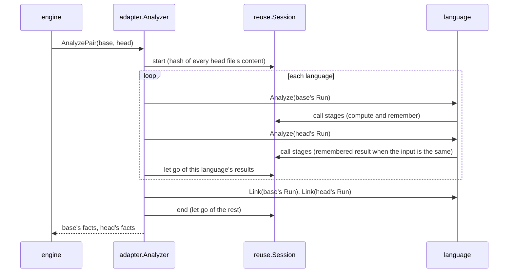
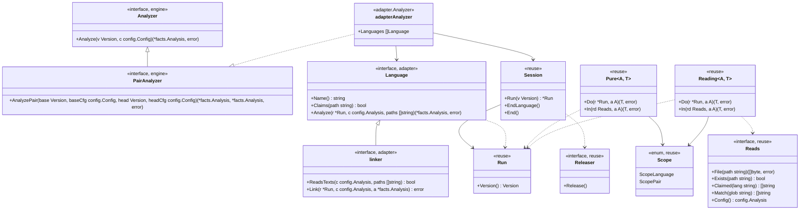

# Reusing analysis across versions

## Responsibility

`hadome check` analyses two versions, base and head. Most files of the two versions have the same content. Analysis reuse takes the results computed for base that are confirmed to be the same for head, and uses them in head without computing them again.

**Does**

- Splits the adapters' work into **stages** and remembers the stages' results for the duration of one run
- When head calls the same stage and its input is confirmed to be the same, returns the remembered result
- Lets go early of results head can never hit

**Does not**

- Write results to disk. Nothing is remembered across runs
- Touch the network
- Reuse the results of rules, gates or invariant candidates. Only the results of adapter stages are reused
- Change facts. With or without reuse, the adapters return the same facts

## When a result may be reused

The central invariant:

- **With or without reuse, the report is the same, byte for byte**

It follows from a stronger condition:

- **With or without reuse, each version's facts (`facts.Analysis`) are the same**

The report is made from the facts, the configuration and the version's files. Reuse can change only the facts, so equal facts mean an equal report.

A result may be reused only when the stage's result is determined by its input alone, and that input is confirmed to be the same in both versions. The input is everything the stage looked at.

| Input | Example |
|---|---|
| The argument given to the stage | A file's path and content, configuration |
| What the stage read from the version | Other files' contents, whether a file exists, a list of files |
| The results of other stages the stage used | Each file's summary of declarations |

## Stages

A stage is a named function: the unit whose result is remembered and reused. Examples: "parse one Kotlin file into a syntax tree", "build the database catalog from the `.sql` files"

Stages come in two kinds, by what they can see. What a stage can see decides how the sameness of its input is confirmed.

| Kind | What it can see | How the input is confirmed the same | Example |
|---|---|---|---|
| **Pure stage** | Its argument only | The key built from the stage's name and its whole argument is the same | Parse one file into a syntax tree. Take one file's comments |
| **Reading stage** | Its argument, and the version and other stages' results read through `Reads` | Every recorded read gives the same answer in head | Build TypeScript's import resolution table. Build the SQL catalog. Follow test helpers across files |

Work not split into stages runs on every version, every time. Work that runs every time never changes the facts. Adapters can therefore add stages one at a time.

### Pure stages

- A pure stage's function takes exactly one argument. It receives neither the version nor a file system
- The key is built from the stage's name and its whole argument. The stage's author never writes the key, so no part of the input can be left out of it
- The argument is of a type made of values only
  - Allowed: booleans, numbers, strings, byte slices, and slices, arrays and maps of them, and structs holding them
  - Not allowed: pointers, interfaces, functions, channels
  - The type is checked when the stage is registered. A type that is not allowed stops hadome as it starts
- Byte slices (such as file contents) enter the key as their SHA-256 hash
- Maps enter the key with their keys sorted, so that the order of iterating a map never changes the key
- Example: the argument of the parse stage is `{Path, Src}`. The path is part of it because the extension decides the grammar

### Reading stages

- A reading stage's function takes an argument and `Reads`. It reads the version only through `Reads`
- The rules for the argument and the way the key is built are the same as for pure stages
- `Reads` records every read as a pair of question and answer
- When head calls the same stage with the same argument, the session asks head every recorded question again, in order
  - If every answer is the same, it returns the remembered result
  - If any answer differs, it runs the stage again on head

| Read | Question | Recorded answer | Example |
|---|---|---|---|
| `File(path)` | The file's content | The content's hash, or "absent" | `tsconfig.json`, a helper's file |
| `Exists(path)` | Whether the file exists | Present or absent | `dbt_project.yml` in a directory above |
| `Claimed(lang)` | The files a language claims | The hash of the sorted list | Every `.sql` file |
| `Match(glob)` | The files matching a pattern | The hash of the sorted list | Every `go.mod` |
| `Config()` | The configuration adapters may read (`config.Analysis`) | The configuration's hash | `files.generated`, `sql.databases` |
| `stage.In(reads, arg)` | Another stage's result | That result's fingerprint | Each file's summary of declarations |

- "Absent" is recorded as an answer too. A file absent in base that appears in head may change the result
- A list is a coarse read. A stage that read a list runs again when a single file is added or removed. The coarser the reads, the less is reused, but the facts never change
- Another stage's result read while asking again is obtained by first calling that stage on head. That stage confirms in the same way whether its remembered result can be used

### Fingerprints of results

When a stage reads another stage's result, it records that result's fingerprint. How the fingerprint is made depends on the result's type.

| Result type | Fingerprint |
|---|---|
| Made of values only | A hash of the whole result, made the same way as an argument's key |
| Anything else (such as a syntax tree) | For a pure stage, the stage's key. For a reading stage, the hash of all its recorded reads |

A result made of values only keeps its fingerprint when its input changes but the result does not. A stage that read it then does not run again.

- Example: changing one line in a function's body does not change that file's summary of declarations
- An index stage that reads only the summaries reads summaries with the same fingerprints in head. It therefore does not rebuild the index
- A test stage that reads the index sees the same fingerprint for the index, so it does not run again when its other reads are the same

## Keys

Everything used to decide a reuse:

| Part of the key | What it is for | Pure stage | Reading stage |
|---|---|---|---|
| The stage's name | Keeps stages' results apart. Names are unique within hadome | Included | Included |
| The whole argument | The input given to the stage | Included (byte slices as hashes) | Included (byte slices as hashes) |
| Configuration | Settings that change facts | As far as it is in the argument | As the answer to `Config()` |
| The set of files read | Other files the stage looked at | Cannot see any | As the recorded reads |
| The adapter's version | There is only one within a run | Not included | Not included |

The adapter's version is not included because results are remembered only within one run. Within one run there is one hadome binary.

Hashes are SHA-256. A collision that makes two different inputs look the same is treated as something that does not happen.

### The configuration adapters may read

Adapters receive not the whole configuration (`config.Config`) but only its part `config.Analysis`. `config.Analysis` holds only the settings that can change facts.

| Configuration key | Field of `config.Analysis` |
|---|---|
| `languages` | `Languages` |
| `rules.tests.hazards`, `rules.tests.io`, `rules.tests.assertions` | `Hazards`, `IO`, `Assertions` |
| `rules.tests.sql-sinks` | `SQLSinks` |
| `files.tests`, `files.generated`, `files.product`, `files.ansible` | `TestFiles`, `GeneratedFiles`, `ProductFiles`, `AnsibleFiles` |
| `sql.databases` | `Databases` |

- The type keeps adapters from reading any other setting. A setting they cannot read cannot change facts
- Base's configuration is made by `config.ForBase`. The only things `config.ForBase` takes from base itself are the invariants and hadome's own dependency diagram. Neither is in `config.Analysis`
- The two versions' `config.Analysis` are therefore always the same. Even in a change to the configuration, both versions are analysed with head's settings

## Analysing both versions at once

When the analyzer is a `PairAnalyzer`, the engine has it analyse both versions in one call (`AnalyzePair`). The analyzer of `internal/adapter` is a `PairAnalyzer`. The analysis goes in this order.



- Each language analyses base and then head in a row, so that the language's results are let go before the next language starts
- `Link` runs after every language has been read, base first, then head
- The engine runs the rules on the facts it receives. How rules are applied and compared is in [engine.md](engine.md)
- With an analyzer that is not a `PairAnalyzer`, the engine calls `Analyze` for each version
- Analysing a single version with `Analyze` goes through the same stages. The session then remembers within that version only. Example: the SQL catalog is built once for `Analyze` and `Link`

### When results are let go

Every stage has a scope (`Scope`) for how long its results are remembered.

| Scope | Let go when | Example |
|---|---|---|
| `ScopeLanguage` | head's analysis of that language ends | Syntax trees, per-file facts |
| `ScopePair` | the analysis of both versions ends | The SQL catalog `Link` uses |

- Results that hold memory outside Go have `Release`. Example: tree-sitter's syntax trees
- The session calls `Release` exactly once when it lets go of a result
- Without reuse, results are let go at the same times

### Remembering only what head can hit

Of the results computed for base, only those head can hit are remembered.

- Before the analysis starts, the session hashes the content of every head file once
- A base result is remembered only when the hashes of every file content used to compute it are all present in head. The contents used are the byte slices of the argument and the answers of `File`
- A result not remembered is let go when base's analysis of that language ends

Remembered syntax trees are used in head without being rebuilt. At any moment while one language is analysed, the syntax trees held are therefore roughly those of one version. Even a change to most files never holds base's and head's syntax trees together.

## The extent of a run

- Results are remembered only within one `AnalyzePair` (or `Analyze`) call. The session is made at the start of that call and discarded at its end
- Every self-test case and every `Check` gets a new session
- Adapter values (`Language`) hold no state across versions
  - State of one version lives in `Run`. Example: TypeScript's table from path to file
  - What is reused across versions lives in the session, as a stage's result. Example: the SQL catalog

### Why nothing is kept on disk

- A stale or broken result would change the report silently. hadome never lets a check that could not run pass. A mechanism that can silently give a different result does not fit that
- A key across runs would need the identity of the hadome binary
- CI often runs in a fresh environment each time, where results kept on disk never hit
- Most of the waste of analysing twice is the overlap of base and head within one run. Remembering within one run removes it

## Concurrency

- The two versions and the languages are analysed one at a time
- The session is safe to call concurrently. When stages with the same key are called at once, it runs one and shares its result
- No one changes a stage's result after it has been handed out
- Information filled in later lives on the `Run` side, not in a result. Example: the table of string constants the tree-sitter adapter builds the first time a test reads a name

## How adapters declare stages

A stage is declared as a package variable. Its function is a top-level function of the package. A function literal closing over a version would make reads that bypass `Reads`.

```go
var parseStage = reuse.NewPure("kotlin/parse", reuse.ScopeLanguage, parse)

type parseInput struct {
	Path string
	Src  []byte
}

func parse(in parseInput) (*tree, error) { ... }

var catalogStage = reuse.NewReading("sql/catalog", reuse.ScopePair, buildCatalog)

func buildCatalog(r reuse.Reads, _ struct{}) (*catalog, error) { ... }
```

- A stage's name has the form `<adapter>/<stage>`. Names are unique within hadome. Registering the same name twice stops hadome as it starts
- A language's `Analyze` and `Link` call stages with `stage.Do(run, arg)`
- A reading stage calls another stage with `stage.In(reads, arg)`. The call is recorded as a read

### Each adapter's stages

Where a stage boundary lies is decided by what the work looks at.

- Work decided by a file's content, path and configuration alone is a pure stage
- Work that looks at other files is a reading stage

| Adapter | Pure stages | Reading stages |
|---|---|---|
| Go | A file's syntax tree, comments, line count, generated marker | The module list (`go.mod`), deciding test support, the call index, extracting tests |
| TypeScript, Python, Rust, Java, Kotlin | A file's syntax tree (including the re-reading that repairs a grammar's misreading), comments, line count | The index (TypeScript's project settings, Python's and Rust's modules), following calls across files, extracting tests |
| Terraform, Ansible | A file's syntax and the facts taken from it | A module's `required_providers` (Terraform), the list of roles (Ansible) |
| SQL | Reading a file's statements once the dialect is decided | Deciding the dialect, the catalog, resolving the strings of tests (`Link`) |

- A Go syntax tree is kept together with a `token.FileSet` of its own file. In a `token.FileSet` shared by a version, positions would depend on the order of analysis and could not be read in the other version
- Extracting tests is a reading stage per test file. Its reads are the file's content, the index's fingerprint and the results for the helper files it followed. A test file the change does not touch does not run again in head, as long as what it followed is unchanged too

## The SQL catalog

The catalog is built by the reading stage `sql/catalog`. It has no argument, because the catalog holds every database together. The reads it records while being built are these.

| Read | What it is for |
|---|---|
| `Claimed("sql")` | The set of `.sql` files |
| `File` of each file | The content |
| `Exists("dbt_project.yml")` and `Exists("sqitch.plan")` in each directory above each file | The file's role (whether it becomes role `other`) |
| `Config()` | `files.generated` and `files.tests` (roles), `sql.databases` (databases, dialects, which files go where) |

- Head reuses the catalog only when every one of these answers is the same
- A role is decided by the path's shape (`down/`, `revert/` and so on) and by the reads above. When an input that changes a role changes, the catalog is built again
- Reading each file's statements is the pure stage `sql/statements`. Its argument is the path, the content and the decided dialect. The catalog reads this stage with `In`
- `Analyze` and `Link` call the same catalog stage on the same version. The second call hits
- The catalog is `ScopePair`, because `Link` uses it after every language has been read
- Resolving the strings of tests is the reading stage `sql/resolve`. Its argument is the database's name and the string. It reads the catalog with `In`

## Types and interfaces



- `internal/adapter/reuse` is the package of sessions and stages. The language packages (`golang`, `treesitter`, `sql`, `terraform`, `ansible`) and `internal/adapter` import it
- The only hadome package `reuse` imports is `config` (`config.Analysis`). It receives versions as `fs.FS`
- The engine does not know `reuse`. All the engine knows is `PairAnalyzer`

## Tests

Without reuse, the analysis runs with a session that remembers nothing. The adapters' code takes the same path. The only difference is whether a remembered result is returned. Every test compares the two.

| Test | What it confirms | Where |
|---|---|---|
| Comparison in the self-test | For every case of every rule, the report with reuse equals the report without | `hadome self-test`, the engine's tests |
| Comparison of facts | For every pair of the adapters' test trees (`testdata`), base's and head's facts with reuse equal those without | The tests of `internal/adapter` |
| Perturbation | In a head with exactly one input changed, the facts with reuse equal those without | The tests of `internal/adapter` |
| Three analyses | Analysing base, head, then base again in one session, the first and third facts are equal | The tests of `internal/adapter` |
| Stage registration | Stage names are unique and argument types are made of values only | The tests of `internal/adapter/reuse` |
| When results are let go | Results head cannot hit are not remembered. At the end of a scope every result is let go and `Release` is called once for each | The tests of `internal/adapter/reuse` |

**Comparison in the self-test**

- `hadome self-test` runs the check twice for every case, with reuse and without
- If the two reports differ, the case fails. The failure says that reuse changed the result
- Every case of every built-in rule is thereby also a test of reuse

**Perturbation**

There are two kinds of perturbation.

- Flip the recorded reads one at a time. Examples: change or remove a file that was read. Create a file that was answered "absent". Add a file to a list
- Change inputs regardless of the record. Examples: change, remove, or copy to another path each file of the tree. Change each field of `config.Analysis`
- Perturbation regardless of the record is there to find reads that bypass `Reads`

**Three analyses**

- If base's facts from the first and the third analysis differ, a stage's result was changed after it was used

## Invariants

1. With or without reuse, each version's facts are the same, and the report is the same byte for byte
2. A pure stage looks at its argument only. Its key is the stage's name and its whole argument
3. A reading stage reads the version only through `Reads`. A remembered result is returned in head only when every recorded read gives the same answer in head
4. No one changes a stage's result after it has been handed out
5. Results are remembered only within one analysis call. Nothing is written to disk and the network is never touched
6. With or without reuse, the adapters run the same code
7. A result head cannot hit is let go when base's analysis of its language ends
8. Adapter values hold no state across versions

## Deliberately left out

- **A cache kept on disk**: the reasons are in "Why nothing is kept on disk"
- **Reusing the results of rules, gates and invariant candidates**: they all run on every version. Reusing them would need each rule and gate to declare what it looked at
- **Reusing renamed files**: the path is part of the key, so a renamed file is computed again in head. The path changes the grammar and the role
- **Analysing the two versions or the languages concurrently**: reading concurrently needs a decision, for each kind of result, on whether results such as tree-sitter's syntax trees are safe to read at once
- **Reuse across analysis calls within `hadome mutate`**: `hadome mutate` calls the analysis for choosing mutants and the analysis of its final check separately. Each call remembers within itself only
- **A setting to turn reuse off**: the report does not change, so turning it off changes nothing but the time taken
