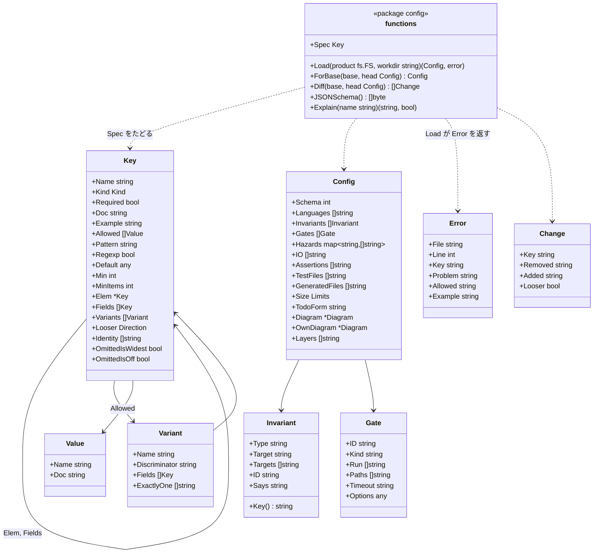

# 設定

## 2種類の書き手、2つの約束

設定には2種類の書き手がいて、それぞれに別の約束をする。

| 書き手 | 期待すること | 約束 |
|---|---|---|
| **人** | 何も設定しないこと。調整を求めるツールなら使うのをやめる | 設定なしで動く。入力が要るときは hadome が提案し、人は受け入れるだけ |
| 「うちの製品の条件を足して」と頼まれた**エージェント** | 書く相手となる、正確で曖昧さの無い契約 | 形式を厳密に定め、公開し、検証する。仕様に無いものはすべて誤りで、直し方を示すメッセージを出す |

## 人には：設定させず、案内する

| 段階 | 人がすること | hadome がすること |
|---|---|---|
| 何もしない | `hadome check` を実行する | 言語を検出し、組み込みのルールを既定の上限で当て、main と比べる |
| 始める（任意） | `hadome init` を実行する | 検出したものを書いた最小の `.hadome.yml` を、各行を説明するコメント付きで書き出す |
| 不変条件 | `hadome suggest` を実行する | 不変条件を持つことが多い場所を探して提案する（何かを作るハンドラ → `idempotent`、書き出しと読み込みの組 → `round-trip`、削除の操作 → `erasable`、利用者やテナントで絞った読み出し → `isolated`）。人かエージェントが1つずつ受け入れるか断る |
| それ以外 | エージェントに頼む | エージェントが下の仕様に沿って書く |

人が仕様を開く必要はない。

## エージェントには：契約

### 仕様は JSON Schema

- `hadome schema` は、入っている版の `.hadome.yml` の JSON Schema を出力する
- 同じスキーマをこのリポジトリで公開し（`schema/hadome.schema.json`）、hadome と一緒に版を付ける
- エディタはこれを補完と検証に使える
- `hadome explain` が出すキーの説明は、スキーマと同じキーの表（`config.Spec`）から作る。説明を別に書かないので、両者はずれない

### 厳密な検証

- 知らないキー、型の誤り、知らない不変条件の種類は誤り（終了コード `2`）
- どの誤りも、キー、ファイルと行、許される値、正しい値の例を示す
- `hadome config check` はルールを1つも走らせずに検証する

### 必要なときに説明する

`hadome explain <thing>` は、1つのルール・1つのキー・1つの不変条件の種類の仕様を、例とともに出力する。エージェントは全部を読まずに、要るものだけを正確に知ることができる。

### hadome があることをエージェントに伝える

エージェントは指示に書かれたことにしか従わない。`hadome agents` は、エージェントが読むファイル（`CLAUDE.md`、`AGENTS.md` など）向けの短いブロックを出力する。頼まれない限りファイルは書き換えない。コマンドの形は [suggest.ja.md](suggest.ja.md) の「`hadome agents`」にある。

ブロックはエージェントに次を伝える。終える前に hadome を実行すること、各終了コードが何を意味するか（終了コード `3` は止まって人に聞くことで、「通るようにする」ことではない）、`3` で聞くときに何を書くか（挙がったもの、変更の理由、受け入れられないときの別のやり方。結論は書かない）、通すためだけに例外を足さないこと、不変条件のテストを `guards:` で結ぶこと、設定を変える前に `hadome explain` を読むこと。文面は README のはじめかたにある。`--lang ja` で日本語版を出力する。エージェントはどちらも同じように読めるので、既定は英語版にしている。

### エージェント向けに書いた手引き

`docs/for-agents.md` は正確な手順を書く。不変条件を足す、テストを `guards:` で結ぶ、製品固有の門番を足す、例外を書く。どの手順もうまくいったことを確かめるコマンドで終わる。

## ファイル

```yaml
# .hadome.yml
schema: 1                      # 必須。設定の形式の版

extends: [../shared/hadome.yml] # 任意。複数のリポジトリで共有する設定

languages: [go, typescript]    # 任意。省くと検出する

messages: ja                   # 任意。見つけたものの文言の言語。en か ja で、既定は en。コマンドの --lang が優先する（messages.ja.md）

invariants:
  - type: idempotent           # 組み込みの種類。名前を書き、対象を指す
    target: api.CreatePost
  - type: round-trip
    targets: [Export, Import]
  - id: billing-1              # 製品固有の不変条件。合う種類が無いときだけ
    says: "Billing countries are the same on the screen and in the API"

rules:                         # 任意。既定と違うものだけ
  tests:
    io: [example.com/acme/db]  # 組み込みの表に足す。表から項目を取り除くことはない
    assertions: [acme.MustEqual] # assert とみなす関数を足す（tests/no-assertion）。足すには人の確認が要る。組み込みの項目は消せない
  size:
    file-lines: 300            # 上限。上げるには人の確認が要る
  comments:
    todo: '^TODO\(stage[0-9]+\): \S' # TODO が取るべき形
  deps:
    diagram: docs/conventions/dependencies.md  # Mermaid の flowchart。矢印を足すには人の確認が要る

files:                         # 任意。言語の慣習から外れた配置のため
  tests: ["checks/**"]         # テストのファイルとして読む（Go、Terraform、Ansible のファイルには当てない）。変えるには人の確認が要る
  generated: ["gen/**"]        # 生成されたコードとして扱う。足すには人の確認が要る
  ansible: ["deploy/*.yml"]    # 配置から外れた Ansible のプレイブック。消すには人の確認が要る

mutation:                      # 任意。hadome mutate（mutation.ja.md）
  test: [go, test, ./...]      # 必須。テストのコマンド。推測はしない。変えるには人の確認が要る

gates:                         # 任意。製品固有の門番
  - id: acme/log-append-only
    kind: finding
    run: [scripts/gates/log-append-only]
```

### 層

設定は3つの層から合わせる。後の層は前の層に足すか、上書きする。

| 層 | どこにあるか | よくある中身 |
|---|---|---|
| 組み込み | hadome 自身 | 全ルール、既定の上限、不変条件の種類、危険の表 |
| 共有 | `extends` に並べたファイル（ローカルのパス。hadome の外に置く） | 1人または1つの組織の複数のリポジトリで共通の設定 |
| 製品 | `.hadome.yml` | その製品だけが持つもの |

共有のファイルはただのローカルのファイルである。hadome はネットワーク越しに設定を取りに行かない。

### 組み込みの不変条件の種類

| 種類 | 意味 | 指すもの |
|---|---|---|
| `idempotent` | 同じリクエストをもう一度送っても、1回送ったのと同じ効果になる | ハンドラまたは操作 |
| `isolated` | ある利用者やテナントのデータは、他から決して見えない | 読み出しの入口 |
| `round-trip` | 書き出して読み戻すと元に戻る | 操作の組 |
| `durable` | 保存に成功したものは、再起動後も読める | 保存の入口 |
| `erasable` | 削除したものはどこにも残らない | 削除の入口 |
| `append-only` | 書いた記録は書き換えられない | ストア |
| `fail-closed` | 壊れた設定や資格情報は、素通りさせずにシステムを止める | 起動、認可 |

有効な不変条件ごとに、hadome はそれを守る有効なテストが1本以上あること、そのテストが消されも無効にもされないことを確かめる。形が見分けられる組み込みの種類は、hadome が守っているテストを自分で見つける。製品固有の不変条件とそれ以外の種類は、テストの doc コメントの `guards:` の行で結ぶ（[rules-tests.ja.md](rules-tests.ja.md) を参照）。守るテストの無い不変条件は違反になる。

## どの設定を当てるか

チェックは2つの版を比べ、それぞれの版が自分の `.hadome.yml` を持つ。head のものだけを使うと、変更が自分を判定するルールを緩められてしまう。base のものだけを使うと、設定の変更はマージされるまで見えない。

| 何を | どこから読むか | なぜ |
|---|---|---|
| 不変条件 | それぞれの版自身のもの | 守るテストの無い新しい不変条件は後退でなければならないので、base は自分が持っていた不変条件を保つ |
| 依存の図の箱（`deps/diagram-stale` 用） | それぞれの版自身のもの | 変更で足した、何も指さない箱は後退でなければならない |
| ルールの設定、表に足した項目、門番、依存の図の矢印 | head のものを両方の版に当てる | 判定されるのは head である。base にも当てることで、設定を厳しくしても新しいコードだけを報告し、既にあったものは報告しない |
| 共有の層（`extends`） | 作業ツリー。両側で同じファイル | リポジトリの外にあるので、base は自分の写しを持たない |

両方の版のファイルは、比べられるようにそれぞれ全体を読んで検証する。

ルールを base より緩くする変更（上限を上げる、表に足した項目を消す、不変条件を取り除く）は `config/loosened` として報告し、終了コード `3` を返す。報告は、head でその変更がある場所を指す。`.hadome.yml` なら足した項目か変えたキーの行、依存の図なら足した矢印の行だ。確かめる人や PR の注釈が、その行にたどり着けるようにするためだ。厳しくするのに人の確認は要らない。仕様の各設定がどちらの向きが緩いかを書いているので、ルールごとのコードは要らない。効き方を hadome が判断できない門番は、既存の項目を変えることも緩めることとして数える（`LooserWhenChanged`）。assert とみなす関数（`rules.tests.assertions`）は、項目を足すと緩くなる。項目を足すと、何も確かめない関数でもテストを通せるからだ（`LooserWhenAdded`）。`files.generated` も、足すと緩くなる。合うファイルが大きさとコメントのルールから外れるからだ（`LooserWhenAdded`）。`files.tests` は、足すことも消すことも緩めることとして数える（`LooserAlways`）。どのファイルがテストかが変わると、ルールの当たる範囲がどちらの向きにも動き、hadome にはどちらが厳しいかを決められないからだ。`files.ansible` は項目を消すと緩くなる。合うファイルが読まれなくなり、すべてのルールから外れるからだ（`LooserWhenRemoved`）。

base の設定が不正なら、推測せずに `2` を返す。空として扱うと、取り除いた不変条件が隠れてしまう。hadome はこれまでに受け付けたすべての `schema:` の版を読むので、hadome を上げたことで正しい base が不正になることはない。

## パッケージの形

1つの表、**仕様**（`Spec`、`Key` の木）がすべてのキーを記述する。型、許される値、どちらの向きが緩いか、版をまたいでリストの項目をどう見分けるか、説明と例。他のものはすべてここから生成する。こうしてスキーマ、`explain`、検証のメッセージが食い違わない。



- YAML は（位置付きの）構文木に解析し、`Spec` に照らしてたどる。そのため、どの誤りもファイル、行、キー、許される値、例を持つ。知らないキー、型の誤り、知らない不変条件の種類は誤り
- 1つのファイルの誤りは最初の1つだけでなくまとめて報告する
- リポジトリの `schema/hadome.schema.json` は `JSONSchema()` の出力である。両者が違うとテストが落ちるので、公開したスキーマはずれない
- glob を取る値（`files.tests`、`files.generated`、`files.ansible`、門番の `paths`）は、glob として読めなければ誤りにする。読めない glob は何にも合わず、黙って効かなくなるからだ
- 綴りを誤ったキーには、2文字以内の編集で届く既知のキーがあれば候補を出し、例にはその候補のキーの書き方を出す（`did you mean invariants?`）。候補が無ければ、囲んでいる階層の書き方を出す。仕様のすべてのキーが例を持つことはテストで確かめる
- 層は仕様に沿って合わせる。mapping はキーごと、オブジェクトのリストは見分け方（identity）で（後の項目が同じ見分け方の前の項目を置き換える）、`OmittedIsWidest` の付いたリスト（`languages` など）は丸ごと、その他のリストは重複なしでつなぐ
- エンジンは版ごとに1つの `Config` を読み込み、base のものは `ForBase` で組み立て、それぞれをその版の事実と一緒にアダプタとルールに渡す。`facts` パッケージは設定を知らないままにする
- `Diff(base, head)` は変わった項目を並べる。エンジンはそのうち緩いものを `config/loosened` の人の確認にする。`OmittedIsWidest` の付いたキーを省くことは緩めることとして数えない。省けばすべてを覆うからである
- `OmittedIsOff` の付いたオブジェクト（`mutation`）は、省くとその機能が動かない。そのため、base に無いこのオブジェクトを head で足すのは、中身が何であっても緩めることとして数えない。ただし `Diff` の一覧には、変わった項目として並べる。base にあるものを消したり中身を緩めたりするのは、ほかのキーと同じく緩めることとして数える

## 不変条件

1. 設定ファイルが無くても hadome は動き、その結果には意味がある
2. スキーマに合わない設定ではチェックを走らせない（終了コード `2`）
3. スキーマと `hadome explain` のキーの説明は常に一致する。どちらも同じキーの表から作るからである
4. hadome はネットワークから設定を読まない
5. 変更は人の確認なしに自分を判定するルールを緩められない（終了コード `3`）

## 意図して入れなかったもの

- 設定の UI
- リモートの `extends`（URL）。共有のファイルは組織の好む方法でローカルにコピーするかチェックアウトする
