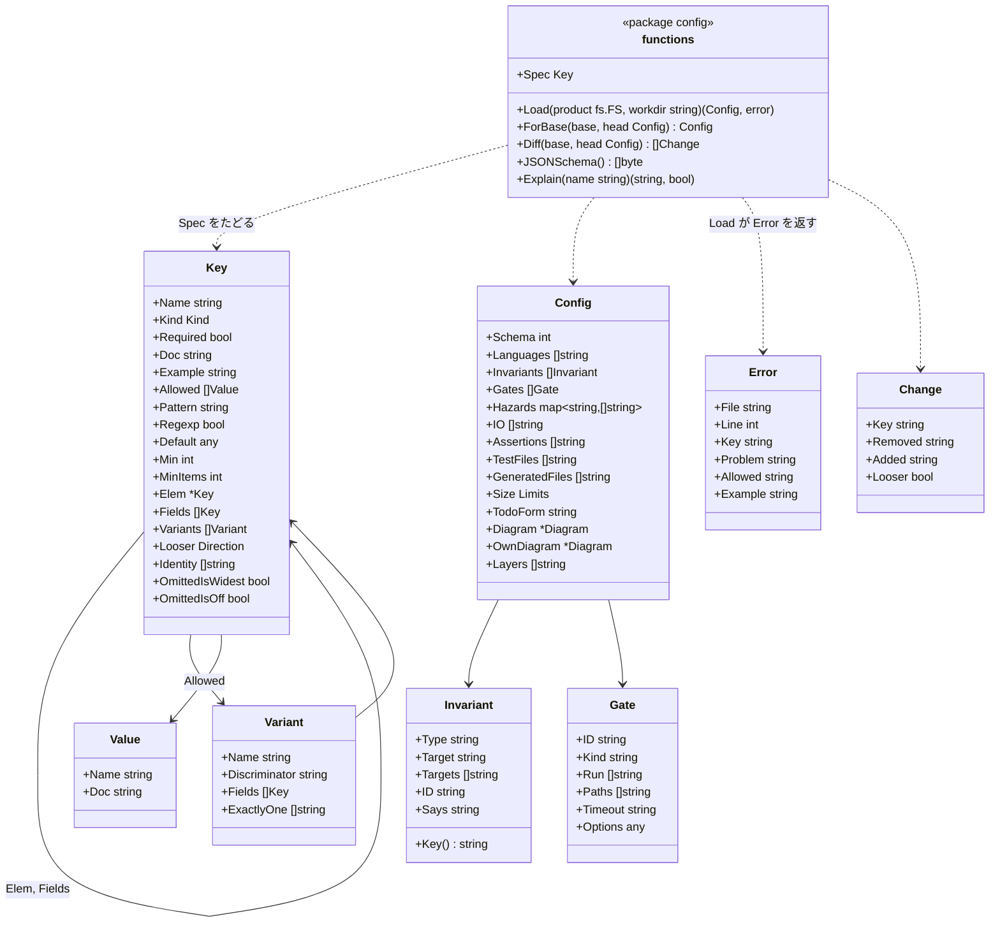

# 設定

## 2種類の書き手、2つの約束

設定を書くのは、人とエージェントの2種類です。期待することが違うので、それぞれに別の約束をします。

| 書き手 | 期待すること | 約束 |
|---|---|---|
| **人** | 何も設定しないこと。調整を求めるツールなら使うのをやめる | 設定なしで動く。入力が要るときは hadome が提案し、人は受け入れるだけ |
| 「うちの製品の条件を足して」と頼まれた**エージェント** | 書く相手となる、正確で曖昧さの無い契約 | 形式を厳密に定め、公開し、検証する。仕様に無いものはすべて誤りで、直し方を示すメッセージを出す |

## 人には：設定させず、案内する

| 段階 | 人がすること | hadome がすること |
|---|---|---|
| 何もしない | `hadome check` を実行する | 言語を検出し、組み込みのルールを既定の上限で当て、main と比べる |
| 始める（任意） | `hadome init` を実行する | 検出したものを書いた最小の `.hadome.yml` を書き出す。各行には説明のコメントが付く |
| 不変条件 | `hadome suggest` を実行する | 不変条件を持つことが多い場所を探して提案する。人かエージェントが1つずつ受け入れるか断る。探す場所は下の一覧 |
| それ以外 | エージェントに頼む | エージェントが下の仕様に沿って書く |

`hadome suggest` が探す場所:

- 何かを作るハンドラ → `idempotent`
- 書き出しと読み込みの組 → `round-trip`
- 削除の操作 → `erasable`
- 利用者やテナントで絞った読み出し → `isolated`

人が仕様を開く必要はありません。

## エージェントには：契約

### 仕様は JSON Schema

- `hadome schema` は、入っているバージョンの hadome が読む `.hadome.yml` の JSON Schema を出力します
- 同じスキーマを `schema/hadome.schema.json` としてこのリポジトリで公開し、hadome と同じバージョンを付けます
- エディタはこれを補完と検証に使えます
- `hadome explain` が出すキーの説明は、スキーマと同じキーの表（`config.Spec`）から作ります。説明を別に書かないので、両者はずれません

### 厳密な検証

- 知らないキー、型の誤り、知らない不変条件の種類は誤りです（終了コード `2`）
- どの誤りにも、キー、ファイルと行、許される値、正しい値の例が付きます
- `hadome config check` は、ルールを1つも走らせずに検証だけをします

### 必要なときに説明する

`hadome explain <thing>` は、1つのルール・1つのキー・1つの不変条件の種類について、仕様を例とともに出力します。エージェントは全部を読まずに、要るものだけを正確に知ることができます。

### hadome があることをエージェントに伝える

エージェントは指示に書かれたことにしか従いません。`hadome agents` は、エージェントが読むファイル（`CLAUDE.md`、`AGENTS.md` など）に入れる短いブロックを出力します。頼まれない限り、ファイルは書き換えません。コマンドの形は [suggest.ja.md](suggest.ja.md) の「`hadome agents`」にあります。

ブロックがエージェントに伝えること:

- 終える前に hadome を実行する
- 各終了コードが何を意味するか。終了コード `3` は止まって人に聞くことで、「通るようにする」ことではない
- `3` で聞くときに書くこと: 挙がったもの、変更の理由、受け入れられないときの別のやり方。結論は書かない
- 通すためだけに例外を足さない
- 不変条件のテストを `guards:` で結ぶ
- 設定を変える前に `hadome explain` を読む

文面は README のはじめかたにあります。`--lang ja` を付けると日本語で出力します。エージェントはどちらの言語も同じように読めるので、既定は英語にしています。

### エージェント向けに書いた手引き

[for-agents.ja.md](../for-agents.ja.md) は、次の作業の正確な手順を書いたものです。どの手順もうまくいったことを確かめるコマンドで終わります。

- 不変条件を足す
- テストを `guards:` で結ぶ
- 製品固有の門番を足す。門番は製品のリポジトリにある外部コマンドで動くチェックです
- 例外を書く

## ファイル

```yaml
# .hadome.yml
schema: 1                      # 必須。設定の形式の版

extends: [../shared/hadome.yml] # 任意。複数のリポジトリで共有する設定

languages: [go, typescript]    # 任意。省くと検出する

messages: ja                   # 任意。違反の文言の言語。en か ja で、既定は en。コマンドの --lang が優先する（messages.ja.md）

invariants:
  - type: idempotent           # 組み込みの種類。名前を書き、対象を指す
    target: api.CreatePost
  - type: round-trip
    targets: [Export, Import]
  - id: billing-1              # 製品固有の不変条件。合う種類が無いときだけ
    says: "Billing countries are the same on the screen and in the API"

rules:                         # 任意。既定と違うものだけ
  tests:
    io: [example.com/acme/db]  # 組み込みの表に足す。表から項目を取り除くことはない
    assertions: [acme.MustEqual] # assert とみなす関数を足す（tests/no-assertion）。足すには人の確認が要る。組み込みの項目は消せない
  size:
    file-lines: 300            # 上限。上げるには人の確認が要る
  comments:
    todo: '^TODO\(stage[0-9]+\): \S' # TODO が取るべき形
  deps:
    diagram: docs/conventions/dependencies.md  # Mermaid の flowchart。矢印を足すには人の確認が要る

files:                         # 任意。言語の慣習から外れた配置のため
  tests: ["checks/**"]         # テストのファイルとして読む（Go、Terraform、Ansible のファイルには当てない）。変えるには人の確認が要る
  generated: ["gen/**"]        # 生成されたコードとして扱う。足すには人の確認が要る
  ansible: ["deploy/*.yml"]    # 配置から外れた Ansible のプレイブック。消すには人の確認が要る

mutation:                      # 任意。hadome mutate（mutation.ja.md）
  test: [go, test, ./...]      # 必須。テストのコマンド。推測はしない。変えるには人の確認が要る

gates:                         # 任意。製品固有の門番
  - id: acme/log-append-only
    kind: finding
    run: [scripts/gates/log-append-only]
```

### 層

設定は3つの層を合わせたものです。後の層は前の層に足すか、前の層を上書きします。

| 層 | どこにあるか | よくある中身 |
|---|---|---|
| 組み込み | hadome 自身 | 全ルール、既定の上限、不変条件の種類、危険の表（[危険の分類](adapters.ja.md#危険の分類)ごとの呼び出しの一覧） |
| 共有 | `extends` に並べたファイル。ローカルのパスで、hadome の外に置く | 1人または1つの組織の複数のリポジトリで共通の設定 |
| 製品 | `.hadome.yml` | その製品だけが持つもの |

共有のファイルはただのローカルのファイルです。hadome はネットワーク越しに設定を取りに行きません。

### 組み込みの不変条件の種類

| 種類 | 意味 | 指すもの |
|---|---|---|
| `idempotent` | 同じリクエストをもう一度送っても、1回送ったのと同じ効果になる | ハンドラまたは操作 |
| `isolated` | ある利用者やテナントのデータは、他から決して見えない | 読み出しの入口 |
| `round-trip` | 書き出して読み戻すと元に戻る | 操作の組 |
| `durable` | 保存に成功したものは、再起動後も読める | 保存の入口 |
| `erasable` | 削除したものはどこにも残らない | 削除の入口 |
| `append-only` | 書いた記録は書き換えられない | ストア |
| `fail-closed` | 壊れた設定や資格情報は、素通りさせずにシステムを止める | 起動、認可 |

有効な不変条件ごとに、hadome は次の2つを確かめます。

- それを守る有効なテストが1本以上あること
- そのテストが消されも無効にもされないこと

守っているテストの見つけ方は、種類によって違います。

- **形が見分けられる組み込みの種類**: hadome が守っているテストを自分で見つけます
- **製品固有の不変条件と、それ以外の種類**: テストの doc コメントの `guards:` の行で結びます（[rules-tests.ja.md](rules-tests.ja.md) を参照）

守るテストの無い不変条件は違反になります。

## どの設定を当てるか

チェックは2つの版を比べ、それぞれの版が自分の `.hadome.yml` を持っています。どちらか一方だけを使うと、次の問題が出ます。

- **head のものだけを使う**: 変更が自分を判定するルールを緩められてしまいます
- **base のものだけを使う**: 設定の変更が、マージされるまで見えません

そこで、項目ごとに読む場所を決めています。

| 何を | どこから読むか | なぜ |
|---|---|---|
| 不変条件 | それぞれの版自身のもの | 守るテストの無い新しい不変条件は後退でなければならないので、base は自分が持っていた不変条件を保つ |
| 依存の図のノード（`deps/diagram-stale` 用） | それぞれの版自身のもの | 変更で足した、何も指さないノードは後退でなければならない |
| ルールの設定、表に足した項目、門番、依存の図の矢印 | head のものを両方の版に当てる | 判定されるのは head である。base にも当てることで、設定を厳しくしても新しいコードだけを報告し、既にあったものは報告しない |
| 共有の層（`extends`） | 作業ツリー。両側で同じファイル | リポジトリの外にあるので、base は自分の写しを持たない |

両方の版のファイルは、比べられるように、それぞれ全体を読んで検証します。

**緩める変更**: ルールを base より緩くする変更は、`config/loosened` として報告し、終了コード `3` を返します。例: 上限を上げる、表に足した項目を消す、不変条件を取り除く。

- 報告は、head でその変更がある行を指します。`.hadome.yml` なら足した項目か変えたキーの行、依存の図なら足した矢印の行です。確かめる人や PR の注釈が、その行にたどり着けるようにするためです
- 厳しくするのに人の確認は要りません
- どちらの向きが緩いかは、仕様が設定ごとに書いています。そのため、ルールごとのコードは要りません

緩い向きが特別な設定:

| 設定 | 緩くなる変更 | 仕様の印 | 理由 |
|---|---|---|---|
| 門番 | 既存の項目を変えること | `LooserWhenChanged` | 効き方を hadome が判断できない |
| assert とみなす関数（`rules.tests.assertions`） | 項目を足すこと | `LooserWhenAdded` | 何も確かめない関数でもテストを通せるようになる |
| `files.generated` | 項目を足すこと | `LooserWhenAdded` | 合うファイルが、大きさとコメントのルールから外れる |
| `files.tests` | 項目を足すことも消すことも | `LooserAlways` | どのファイルがテストかが変わると、ルールの当たる範囲がどちらの向きにも動く。hadome にはどちらが厳しいかを決められない |
| `files.ansible` | 項目を消すこと | `LooserWhenRemoved` | 合うファイルが読まれなくなり、すべてのルールから外れる |

**hadome を入れる変更**: base に `.hadome.yml` が無く head で足す変更は、hadome を入れる変更とみなします。この変更では `config/loosened` を出しません。

- 入れる前の base では hadome が動いていないことが多く、緩める元がありません
- 導入の手順どおりに設定を書いた最初の変更が `3` で止まると、利用者もエージェントも、手順に従っただけで止められることになります
- 代わりに、既定の値から変えた設定を `introduced` に並べます。この一覧は知らせるだけで、終了コードを変えません。導入の変更を確かめる人が、この一覧で設定を一度見ます

**base の設定が不正なとき**: 推測せずに `2` を返します。空として扱うと、取り除いた不変条件が隠れてしまうためです。hadome はこれまでに受け付けたすべての `schema:` のバージョンを読みます。そのため、hadome のバージョンを上げたことで、正しい base が不正になることはありません。

## パッケージの形

**仕様**（`Spec`、`Key` の木）は、すべてのキーを記述する1つの表です。キーごとに、次のことを持ちます。

- 型と、許される値
- どちらの向きが緩いか
- 版をまたいで、リストの項目をどう見分けるか
- 説明と例

ほかのものは、すべてこの表から生成します。そのため、スキーマ、`explain`、検証のメッセージは食い違いません。



- **読み込み**: YAML を位置付きの構文木に解析し、`Spec` に照らしてたどります。そのため、どの誤りもファイル、行、キー、許される値、例を持ちます。知らないキー、型の誤り、知らない不変条件の種類は誤りです
- **誤りの報告**: 1つのファイルの誤りは、最初の1つだけでなくまとめて報告します
- **公開したスキーマ**: リポジトリの `schema/hadome.schema.json` は `JSONSchema()` の出力です。両者が違うとテストが落ちるので、公開したスキーマはずれません
- **glob**: glob を取る値（`files.tests`、`files.generated`、`files.ansible`、門番の `paths`）は、glob として読めなければ誤りにします。読めない glob は何にも合わず、黙って効かなくなるためです
- **綴りの誤り**: 綴りを誤ったキーに、2文字以内の編集で届く既知のキーがあれば、その候補を出します。例には、候補のキーの書き方を出します（`did you mean invariants?`）。候補が無ければ、囲んでいる階層の書き方を出します。仕様のすべてのキーが例を持つことは、テストで確かめます
- **層の合わせ方**: 仕様に沿って、値の形ごとに次のように合わせます
  - mapping はキーごとに合わせる
  - オブジェクトのリストは見分け方（identity）で合わせる。後の項目が、同じ見分け方の前の項目を置き換える
  - `OmittedIsWidest` の付いたリスト（`languages` など）は丸ごと置き換える
  - その他のリストは、重複なしでつなぐ
- **版ごとの設定**: エンジンは版ごとに1つの `Config` を読み込みます。base のものは `ForBase` で組み立てます。それぞれを、その版の事実と一緒にアダプタとルールに渡します。`facts` パッケージは設定を知らないままにします
- **差分**: `Diff(base, head)` は変わった項目を並べます。エンジンは、そのうち緩いものを `config/loosened` の人の確認にします。`OmittedIsWidest` の付いたキーを省くことは、緩めることとして数えません。省けばすべてを覆うためです
- **省くと動かないオブジェクト**: `OmittedIsOff` の付いたオブジェクト（`mutation`）は、省くとその機能が動きません
  - base に無いこのオブジェクトを head で足すのは、中身が何であっても緩めることとして数えません。ただし `Diff` の一覧には、変わった項目として並べます
  - base にあるものを消したり、中身を緩めたりするのは、ほかのキーと同じく緩めることとして数えます

## 不変条件

1. 設定ファイルが無くても hadome は動き、その結果には意味がある
2. スキーマに合わない設定ではチェックを走らせない（終了コード `2`）
3. スキーマと `hadome explain` のキーの説明は常に一致する。どちらも同じキーの表から作るからである
4. hadome はネットワークから設定を読まない
5. 変更は人の確認なしに自分を判定するルールを緩められない（終了コード `3`）。ただし base に `.hadome.yml` が無い、hadome を入れる変更は除く

## 意図して入れなかったもの

- **設定の UI**
- **ファイル無しで回していたリポジトリが、あとから緩い `.hadome.yml` を足す変更を止めること**: base にファイルが無い変更は、すべて導入とみなします。そのため、この変更でも設定は `introduced` に並ぶだけになります。`hadome init` が設定ファイルを作るので、ファイル無しで回し続ける使い方はまれだとみなしました
- **リモートの `extends`（URL）**: 共有のファイルは、組織の好む方法でローカルにコピーするか、チェックアウトします
