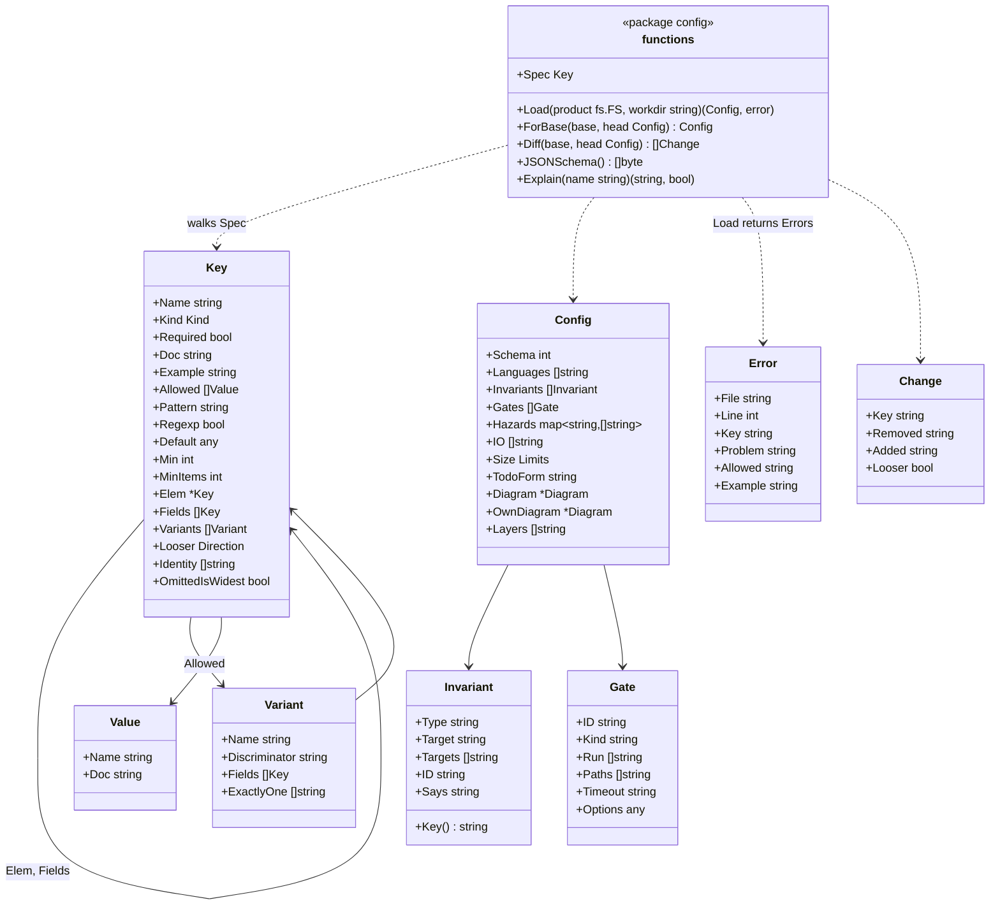

# Configuration

## Two readers, two promises

Configuration has two kinds of authors, and each gets a different promise.

| Author | What they expect | Promise |
|---|---|---|
| **A person** | Not to configure anything. If a tool demands tuning, they stop using it | It works with no configuration. When input is needed, hadome proposes it and the person only accepts |
| **An agent** asked to "add our product's conditions" | An exact, unambiguous contract to write against | The format is strictly specified, published and validated. Anything not in the specification is an error, with a message that says how to fix it |

## For people: guided, not configured

| Step | What the person does | What hadome does |
|---|---|---|
| Nothing | Runs `hadome check` | Detects languages, applies the built-in rules with default limits, compares with main |
| Start (optional) | Runs `hadome init` | Writes a minimal `.hadome.yml` with what it detected, and comments explaining each line |
| Invariants | Runs `hadome suggest` | Looks for places that usually carry an invariant (handlers that create things → `idempotent`; export/import pairs → `round-trip`; delete operations → `erasable`; reads scoped by a user or tenant → `isolated`) and proposes them. The person, or an agent, accepts or rejects each one |
| Anything else | Asks an agent | The agent writes against the specification below |

A person never has to open the specification.

## For agents: the contract

### The specification is a JSON Schema

- `hadome schema` prints the JSON Schema of `.hadome.yml` for the installed version
- The same schema is published in this repository (`schema/hadome.schema.json`) and versioned with hadome
- Editors pick it up for completion and validation
- The reference documentation is generated from the schema, never written separately, so the two cannot drift

### Strict validation

- Unknown keys, wrong types and unknown invariant types are errors (exit code `2`)
- Every error names the key, the file and line, what is allowed, and an example of a correct value
- `hadome config check` validates without running any rule

### Explanations on demand

`hadome explain <thing>` prints the specification of one rule, one key or one invariant type, with examples. An agent can learn exactly what it needs without reading everything.

### Telling agents that hadome exists

Agents only follow what their instructions mention. `hadome agents` prints a short block for the files agents read (`CLAUDE.md`, `AGENTS.md`, and similar). It never edits files unless asked. The command's forms are in the "`hadome agents`" section of [suggest.md](suggest.md).

The block tells the agent to run hadome before finishing, what each exit code means for it (exit code `3` means stop and ask a person, never "make it pass"), never to add an exception just to pass, to link invariant tests with `guards:`, and to read `hadome explain` before changing configuration. Its exact text is in the README's quick start. `--lang ja` prints a Japanese version; the English one is the default because agents read it equally well.

### A guide written for agents

`docs/for-agents.md` describes the exact procedures: adding an invariant, linking a test with `guards:`, adding a product-specific gate, writing an exception. Each procedure ends with the command that proves it worked.

## The file

```yaml
# .hadome.yml
schema: 1                      # required; the configuration format version

extends: [../shared/hadome.yml] # optional; shared settings for several repositories

languages: [go, typescript]    # optional; detected when omitted

invariants:
  - type: idempotent           # a built-in type: name it and point at the target
    target: api.CreatePost
  - type: round-trip
    targets: [Export, Import]
  - id: billing-1              # a product-specific invariant: only when no type fits
    says: "Billing countries are the same on the screen and in the API"

rules:                         # optional; only what differs from the defaults
  tests:
    io: [example.com/acme/db]  # adds to the built-in table; entries are never removed from it
    assertions: [acme.MustEqual] # adds functions that count as assertions (tests/no-assertion); built-in ones are never removed
  size:
    file-lines: 300            # limits; raising one needs a person's review
  comments:
    todo: '^TODO\(stage[0-9]+\): \S' # the form a TODO must have
  deps:
    diagram: docs/conventions/dependencies.md  # a Mermaid flowchart; adding an arrow needs review

gates:                         # optional; product-specific gates
  - id: acme/log-append-only
    kind: finding
    run: [scripts/gates/log-append-only]
```

### Layers

Settings are merged from three layers. A later layer adds to or overrides an earlier one.

| Layer | Where | Typical content |
|---|---|---|
| Built-in | hadome itself | All rules, default limits, invariant types, hazard tables |
| Shared | Files listed in `extends` (local paths; they live outside hadome) | Settings common to several repositories of one person or organisation |
| Product | `.hadome.yml` | What only this product has |

Shared files are plain local files. hadome never fetches configuration over the network.

### Built-in invariant types

| Type | Means | Points at |
|---|---|---|
| `idempotent` | Sending the same request again has the effect of sending it once | A handler or operation |
| `isolated` | One user's or tenant's data is never visible to another | A read entry point |
| `round-trip` | Writing out and reading back gives the original | A pair of operations |
| `durable` | Whatever was saved successfully can be read after a restart | A save entry point |
| `erasable` | Whatever was deleted remains nowhere | A delete entry point |
| `append-only` | Written records are never rewritten | A store |
| `fail-closed` | Broken configuration or credentials stop the system instead of letting things through | Start-up, authorisation |

For every enabled invariant, hadome checks that at least one active test guards it, and that such tests are never removed or disabled. For built-in types with a recognisable shape, hadome finds the guarding tests itself; product-specific invariants and the other types are linked with a `guards:` line in the test's doc comment (see [rules-tests.md](rules-tests.md)). An invariant with no guarding test is a finding.

## Which configuration applies

A check compares two versions, and each version has its own `.hadome.yml`. Using only head's would let a change loosen the rules that judge it; using only base's would make every configuration change invisible until merged.

| What | Read from | Why |
|---|---|---|
| Invariants | Each version's own | A new invariant without a guarding test must be a regression, so base keeps the invariants it had |
| The dependency diagram's boxes, for `deps/diagram-stale` | Each version's own | A box added in the change that names nothing must be a regression |
| Rule settings, added table entries, gates, the dependency diagram's arrows | Head's, applied to both versions | Head is what is being judged. Applying them to base too means tightening a setting reports only new code, never what was already there |
| Shared layers (`extends`) | The working tree, the same file for both sides | They live outside the repository, so base has no copy of its own |

Both versions' files are still read and validated in full, so that the two can be compared.

A change that makes a rule more permissive than base — a higher limit, a rule turned off, an invariant removed — is reported as `config/loosened` and returns exit code `3`. Tightening never needs review. Each setting in the specification states which direction is looser, so this needs no per-rule code. For gates, whose effect hadome cannot judge, changing an existing entry counts as loosening too (`LooserWhenChanged`). The functions that count as assertions (`rules.tests.assertions`) loosen when an entry is added, because an added function that checks nothing would let a test pass (`LooserWhenAdded`).

If base's configuration is invalid, the check returns `2` rather than guessing: treating it as empty would hide removed invariants. hadome reads every `schema:` version it has ever accepted, so a valid base never becomes invalid by upgrading hadome.

## Package shape

One table, the **specification** (`Spec`, a tree of `Key`), describes every key: its type, allowed values, which direction is looser, how list entries are identified across versions, a description and an example. Everything else is generated from it, which is how the schema, the reference documentation, `explain` and the validation messages stay in agreement.



- The YAML is parsed into a syntax tree (with positions) and walked against `Spec`, so every error carries the file, the line, the key, what is allowed and an example. Unknown keys, wrong types and unknown invariant types are errors
- All errors of a file are reported together, not only the first
- `schema/hadome.schema.json` in the repository is the output of `JSONSchema()`; a test fails when the two differ, so the published schema cannot drift
- A misspelt key gets a suggestion (`did you mean invariants?`) when a known key is within two edits
- Layers merge by the specification: mappings key by key; lists of objects by their identity (a later entry with the same identity replaces the earlier one); lists marked `OmittedIsWidest` (such as `languages`) as a whole; other lists are joined without duplicates
- The engine loads one `Config` per version, builds base's with `ForBase`, and hands each to the adapters and rules together with that version's facts. The `facts` package stays free of configuration
- `Diff(base, head)` lists changed entries; the engine turns the looser ones into `config/loosened` reviews. Omitting a key marked `OmittedIsWidest` never counts as loosening, because omitting it covers everything

## Decisions

1. People are guided, never required to configure: `hadome check` works with no file, `hadome init` is an optional shortcut, `hadome suggest` proposes invariants to accept
2. Agents get a strict contract: a published, versioned JSON Schema, generated reference docs, `hadome explain`, strict validation with fix-oriented errors, and a guide written for agents

## Invariants

1. With no configuration file, hadome runs and its result is meaningful
2. A configuration that does not match the schema never runs a check (exit code `2`)
3. The schema, the reference documentation and `hadome explain` always agree, because the latter two are generated from the first
4. hadome never reads configuration from the network
5. A change cannot loosen the rules that judge it without a person's review (exit code `3`)

## Deliberately left out

- A configuration UI
- Remote `extends` (URLs). Shared files are copied or checked out locally by whatever means the organisation prefers
