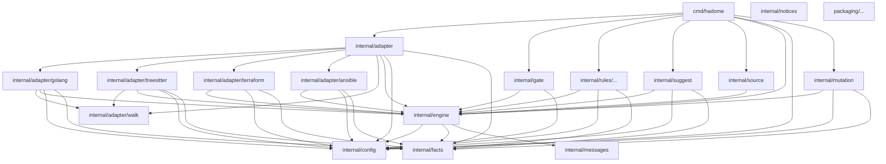

# 依存

hadome のどのユニットがどれを import してよいか。この図が正であり、hadome は自分自身をこれと照らして検査する（[.hadome.yml](../../.hadome.yml) の `rules.deps.diagram`）。図に描かれていない import は落ち、新しい矢印を描くには人の確認が要る。

- `facts`、`config`、`walk`、`messages` は hadome のものを何も import しない。他のすべてはこれらの上に作る
- エンジンは言語もルールもプロセスも知らない。アダプタ、ルール、門番がエンジンに依存し、逆はない
- ルールはアダプタを import しない。ルールが見るのは事実だけで、だからどのルールもどの言語でも動く
- 部品を組み合わせるのは `cmd/hadome` だけ
- `notices` を使うのは、`THIRD_PARTY_NOTICES` を作って確かめるテストだけである。`notices` は hadome のものを何も import せず、ほかのユニットからも import されない
- `packaging/` は配布物である。Go のコードを何も import せず、そのユニット（インストーラとプラグイン）は1つの箱にまとめる
