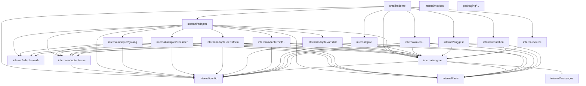

# 依存

hadome のどのユニットが、どのユニットを import してよいかを決めた図です。hadome は自分自身の import を、この図を正として検査します。この図を指す設定は、[.hadome.yml](../../.hadome.yml) の `rules.deps.diagram` です。

- 図に描かれていない import があると、チェックが落ちます。
- 新しい矢印を描くには、人の確認が要ります。

- `facts`、`config`、`walk`、`messages` は、hadome のものを何も import しません。ほかのユニットはすべて、これらの上に作ります。
- エンジンは言語もルールもプロセスも知りません。アダプタ・ルール・門番がエンジンに依存し、エンジンからそれらへの依存はありません。
- ルールはアダプタを import しません。ルールが見るのは事実だけです。そのため、どのルールもどの言語でも動きます。
- 部品を組み合わせるのは `cmd/hadome` だけです。
- `notices` を使うのは、`THIRD_PARTY_NOTICES` を作って確かめるテストだけです。`notices` は hadome のものを何も import せず、ほかのユニットからも import されません。
- `packaging/` は配布物です。Go のコードを何も import しません。`packaging/` のユニット（インストーラとプラグイン）は、図では1つの箱にまとめます。
- `internal/adapter/sql/...` は SQL のアダプタと、その下の方言ごとの生成したパーサ（`grammar/`）です（[adapters-sql.ja.md](adapters-sql.ja.md)）。
- `internal/adapter/reuse` は、アダプタの段の結果を、2つの版のあいだで使い回す仕組みです（[analysis-reuse.ja.md](analysis-reuse.ja.md)）。import するのは `config` だけです。エンジンは `reuse` を知りません。
