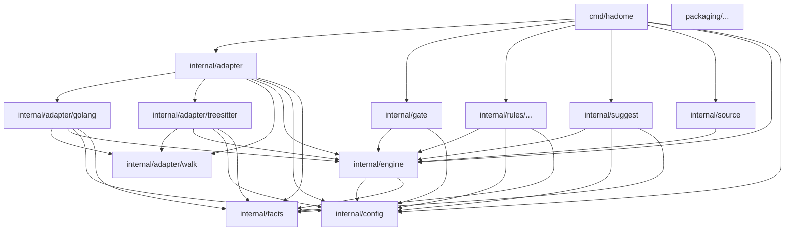

# Dependencies

Which of hadome's units may import which. This diagram is the source of truth: hadome checks itself against it (`rules.deps.diagram` in [.hadome.yml](../../.hadome.yml)), so an import it does not draw fails, and drawing a new arrow needs review.

- `facts`, `config` and `walk` import nothing of hadome's: everything else is built on them
- The engine knows no language, no rule and no process: adapters, rules and gates depend on it, never the reverse
- Rules never import adapters: they see facts only, which is why every rule works in every language
- `cmd/hadome` is the only place that puts the pieces together
- `packaging/` is the distribution: it imports nothing of the Go code, and its units (the installer and the plugins) are one box
