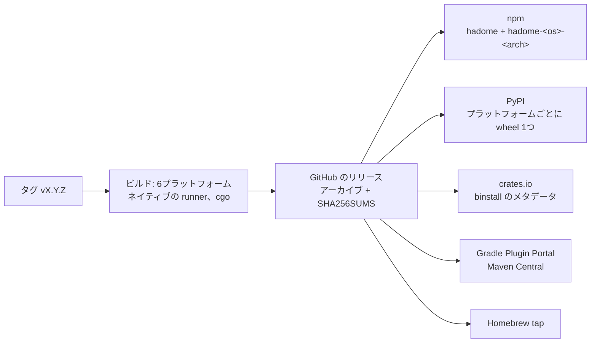
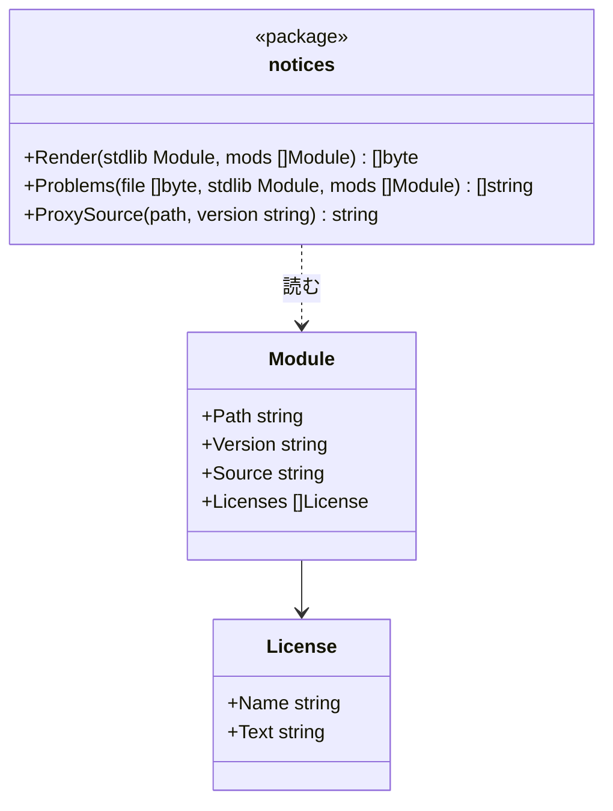

# 配布

## 目的

hadome は、ほかの開発用の依存と同じ手順で入れられるようにします。

- **宣言する場所**: プロジェクトにすでにあるファイルに、バージョンを固定して書きます。例: `package.json`、`pyproject.toml`、`go.mod`
- **動かし方**: そのエコシステムのコマンドで動かします。
- **要らないもの**: 手でのダウンロード、C コンパイラ、グローバルなインストールは要りません。

バージョンを固定するのは、hadome のバージョンが上がるとルールも変わるからです。

- バージョンが勝手に上がると、関係の無い変更が新しいルールで落ちることがあります。
- バージョンを上げるときは、プロジェクトの中の1つの変更として上げ、その変更で差を確かめます。

## 各エコシステムでの入れ方

hadome は広く使われている6言語と、Terraform、Ansible に対応しています。配布は6言語それぞれのエコシステムを通して行います。

| エコシステム | 宣言する場所 | 動かし方 | 入るもの |
|---|---|---|---|
| npm / pnpm / yarn | `package.json` の devDependencies: `"hadome": "1.2.0"` | `npx hadome check` | 今のプラットフォームのバイナリだけ。プラットフォームごとの optional なパッケージを通して入ります |
| Python（pip / uv / Poetry） | `pyproject.toml` の開発用の依存: `hadome==1.2.0` | `hadome check` | バイナリを含む、プラットフォームごとの wheel |
| Go | `go.mod` の tool ディレクティブ: `go get -tool github.com/rerorets/hadome/cmd/hadome` | `go tool hadome check` | ソースからビルドします（下の節を参照） |
| Gradle（Java、Kotlin） | `plugins { id("io.github.rerorets.hadome") version "1.2.0" }` | `./gradlew hadomeCheck` | プラグインが、今のプラットフォームのバイナリをダウンロードして検証します |
| Maven（Java、Kotlin） | `pom.xml` の `hadome-maven-plugin` | `mvn hadome:check` | Gradle と同じです |
| Rust（Cargo） | `cargo binstall hadome@1.2.0` | `hadome check` | リリースのビルド済みバイナリ |
| それ以外 | Homebrew: `brew install rerorets/tap/hadome`、またはリリースのアーカイブ | `hadome check` | ビルド済みバイナリ |

設定はどの場合も同じ `.hadome.yml` です。パッケージマネージャごとに違うのは、hadome の届け方だけです。

## C コンパイラの無い Go

`go tool` はソースからビルドします。tree-sitter は C のライブラリで、Go、Terraform、Ansible のアダプタは純粋な Go で書いてあります。

Go は、C コンパイラがあれば cgo ありで、無ければ cgo なしでビルドします。hadome もそれに従います。

| ビルド | 言語 | C が要るか |
|---|---|---|
| cgo あり（C コンパイラのある環境と、すべてのビルド済みバイナリ） | 8言語すべて | 要る（ビルド時） |
| cgo なし（`CGO_ENABLED=0`、または C コンパイラが無い） | Go、Terraform、Ansible | 要らない |

TypeScript や Python のファイルも持つ Go のプロジェクトは、C コンパイラがあれば8言語すべてを読めます。ビルド済みバイナリを使ってもかまいません。

純粋な Go のビルドがほかの言語のファイルに出会ったときは、無視せずに、読めなかったと報告します（`unknown/unread`、終了コード `3`）。読めなかったファイルがあれば、この報告で分かります。

## リリース

- **作るもの**: 1回のリリースで、対応するすべての OS とアーキテクチャのバイナリを作ります。OS は Linux、macOS、Windows、アーキテクチャは x86-64 と ARM64 です。それぞれ GitHub Actions 上で cgo ありでネイティブにビルドし、上のすべてのエコシステムに公開します。
- **始まり**: リリースはタグ `vX.Y.Z` から始まります。バージョンは、バイナリ（`hadome version`）とすべてのパッケージに刻みます。
- **`go get -tool` で入れたとき**: 利用者の手元でソースからビルドされるので、リリースのビルドで刻むバージョンは入りません。このときの `hadome version` は、Go がバイナリに埋め込むモジュールのバージョンを出します。例: `v1.2.0` なら `1.2.0`
- **検証**:
  - すべてのバイナリは、`SHA256SUMS` のチェックサムと一緒に公開します。
  - アーカイブには minisign の署名（`.sig`）も付けます。`cargo binstall` が確かめられるのは署名だけだからです。
  - バイナリをダウンロードするインストーラは、何かを実行する前に、チェックサムか署名を検証します。
- **公開先**: すべてのエコシステムが、同じバージョン番号を同時に受け取ります。どのエコシステムに公開するかは、リポジトリの変数 `PUBLISH_<エコシステム>` で決めます。手順は[リリース](../maintaining/releasing.ja.md)にあります。

## このリポジトリにあるパッケージ

リリースをパッケージにするものは、すべて `packaging/` の下に、エコシステムごとに1つのディレクトリで置いています。どのディレクトリにも、リリースのアーカイブからパッケージを作るスクリプトがあります。公開せずに、手元でパッケージを作って試せます。

| ディレクトリ | 作るもの | バイナリの届け方 |
|---|---|---|
| `packaging/npm` | `hadome` と、プラットフォームごとに1つの `hadome-<os>-<arch>` パッケージ | プラットフォームのパッケージは、`os` と `cpu` で絞った optional な依存です。npm は合うものだけを入れ、`hadome` の起動スクリプトがそれを動かします |
| `packaging/python` | プラットフォームごとに1つの wheel（`py3-none-<platform>`） | バイナリは、wheel のスクリプトとして `PATH` に入ります |
| `packaging/cargo` | `hadome` クレート | `cargo binstall` がクレートのメタデータを読み、リリースのアーカイブをダウンロードし、メタデータにある公開鍵で署名を確かめます。クレートをソースからビルドしても、入れ方を説明するだけです |
| `packaging/jvm` | Gradle のプラグインと Maven のプラグイン。インストーラを1つ共有します | 初めて使うときに、プラットフォームのアーカイブをリリースからダウンロードします。プラグインに組み込んだチェックサムと照らし合わせ、ビルドツールのキャッシュに置きます |
| `packaging/homebrew` | `rerorets/homebrew-tap` リポジトリの formula | Homebrew がアーカイブをダウンロードし、SHA-256 を確かめます |

エコシステムごとの、ネットワークへの触れ方と検証の仕方は次のとおりです。

- **npm と Python**: パッケージがバイナリそのものを含むので、入れるときにレジストリより先のネットワークには触れません。
- **JVM のプラグイン**: バイナリをダウンロードします。ビルドプラグインのレジストリが、プラットフォームでファイルを選ばないからです。
- **JVM のプラグインと Homebrew**: ダウンロードしたものを、リリースの時点で固定したチェックサムと照らし合わせます。
- **`cargo binstall`**: クレートに固定した公開鍵で署名を確かめます。

## 依存のライセンス

hadome にリンクするモジュールのライセンスは、MIT、BSD、Apache-2.0、MPL-2.0 です。

- どのライセンスも、バイナリと一緒に本文を配ることを求めます。
- MPL-2.0 は、ソースの在りかを示すことも求めます。

そのため、リポジトリの直下に `THIRD_PARTY_NOTICES` を置き、`LICENSE` と一緒に、バイナリを含むすべてのアーカイブとパッケージに入れます。置き場所と作り直し方は [releasing.ja.md](../maintaining/releasing.ja.md) にあります。

- **`internal/notices`**: モジュールの一覧からファイルを作ります（`Render`）。ファイルが一覧に追いついていないところを挙げます（`Problems`）。
- **`Problems` が挙げるもの**:
  - ライセンスのファイルが無いモジュール
  - 節の無いモジュールやバージョン
  - ソースやライセンスの本文が古い節
  - もうリンクしていないモジュールやバージョンの節
- **モジュールの一覧**: `internal/notices` の外で作ります。`cmd/hadome` のテストが、リリースのビルド（cgo あり。Linux、macOS、Windows）について `go list -deps` で一覧を取り、モジュールのキャッシュからライセンスのファイルを読みます。
- **ソースの在りか**: Go のモジュールプロキシの URL で示します。
- **Go の標準ライブラリのライセンス**: テストのデータに置いた写しを使います。GOROOT に `LICENSE` を置かない Go の入れ方があるからです。

## 不変条件

1. どのエコシステムでも、厳密なバージョンを固定できます。
2. 同じバージョンは、どう入れたかに依らず同じに振る舞います。
3. インストーラは、チェックサムか署名の合わないバイナリを実行しません。
4. hadome は自分を更新しません。
5. バイナリを含むアーカイブとパッケージは、どれも hadome のライセンスと、リンクしたすべてのモジュールのライセンスを含みます。

## 意図して入れなかったもの

- 自己更新のコマンド
- Homebrew 以外のシステムのパッケージマネージャ
