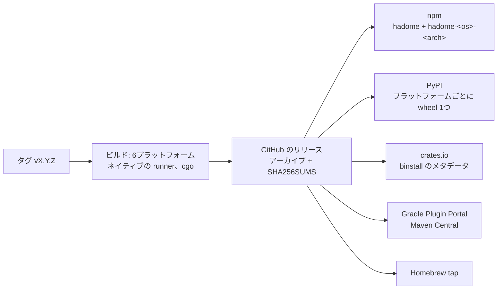

# 配布

## 目的

hadome を使うことは、ほかの開発用の依存を足すのと同じ感覚であるべきだ。**プロジェクトに既にあるファイルに版を固定して宣言し、動かす。**手でのダウンロードも、C コンパイラも、グローバルなインストールも要らない。

ラチェットにとって、版の固定は大事だ。hadome が自分で更新されると、プロジェクトの足元でルールが変わり、更新と無関係な変更を止めかねない。hadome の更新は、プロジェクトの中の普通の、確認できる変更だ。

## 各エコシステムでの入れ方

hadome は広く使われている6言語に対応し、それぞれのエコシステムを通して配布する。

| エコシステム | 宣言する場所 | 動かし方 | 入るもの |
|---|---|---|---|
| npm / pnpm / yarn | `package.json` の devDependencies: `"hadome": "1.2.0"` | `npx hadome check` | プラットフォームごとの optional なパッケージを通して、今のプラットフォームのバイナリだけ |
| Python（pip / uv / Poetry） | `pyproject.toml` の開発用の依存: `hadome==1.2.0` | `hadome check` | バイナリを含む、プラットフォームごとの wheel |
| Go | `go.mod` の tool ディレクティブ: `go get -tool github.com/rerorets/hadome/cmd/hadome` | `go tool hadome check` | ソースからビルドする（下を参照） |
| Gradle（Java、Kotlin） | `plugins { id("io.github.rerorets.hadome") version "1.2.0" }` | `./gradlew hadomeCheck` | プラグインが今のプラットフォームのバイナリをダウンロードして検証する |
| Maven（Java、Kotlin） | `pom.xml` の `hadome-maven-plugin` | `mvn hadome:check` | Gradle と同じ |
| Rust（Cargo） | `cargo binstall hadome@1.2.0` | `hadome check` | リリースのビルド済みバイナリ |
| それ以外 | Homebrew: `brew install rerorets/tap/hadome`、またはリリースのアーカイブ | `hadome check` | ビルド済みバイナリ |

設定はどの場合も同じ `.hadome.yml` だ。パッケージマネージャが違うのは、hadome の届け方だけだ。

## C コンパイラの無い Go

`go tool` はソースからビルドし、tree-sitter は C のライブラリだ。Go は C コンパイラがあれば cgo ありで、無ければ cgo なしでビルドし、hadome もそれに従う。

| ビルド | 言語 | C が要るか |
|---|---|---|
| cgo あり（C コンパイラのある環境と、すべてのビルド済みバイナリ） | 6言語すべて | 要る（ビルド時） |
| cgo なし（`CGO_ENABLED=0`、または C コンパイラが無い） | Go だけ | 要らない |

TypeScript や Python のファイルも持つ Go のプロジェクトは、C コンパイラがあれば6言語すべてを読めるし、ビルド済みバイナリを使ってもよい。純粋な Go のビルドがほかの言語のファイルに出会ったときは、無視せずに読めなかったと報告する（`unknown/unread`、終了コード `3`）。だから抜けは見える。

## リリース

- 1回のリリースで、対応するすべての OS とアーキテクチャ（Linux、macOS、Windows。x86-64 と ARM64）のバイナリを作る。それぞれ GitHub Actions 上で cgo ありでネイティブにビルドし、上のすべてのエコシステムに公開する
- リリースはタグ `vX.Y.Z` から始まる。版はバイナリ（`hadome version`）とすべてのパッケージに刻む
- すべてのバイナリは `SHA256SUMS` のチェックサムと一緒に公開する。バイナリをダウンロードするインストーラは、何かを実行する前にそれを検証する
- すべてのエコシステムが、同じ版番号を同時に受け取る。資格情報が設定されていないエコシステムは飛ばし、リリースがそう伝える

## このリポジトリにあるパッケージ

リリースをパッケージにするものはすべて `packaging/` の下に、エコシステムごとに1つのディレクトリで置く。それぞれに、リリースのアーカイブからパッケージを作るスクリプトがあり、公開せずに手元でパッケージを作って試せる。

| ディレクトリ | 作るもの | バイナリの届け方 |
|---|---|---|
| `packaging/npm` | `hadome` と、プラットフォームごとに1つの `hadome-<os>-<arch>` パッケージ | プラットフォームのパッケージは `os` と `cpu` で絞った optional な依存で、npm は合うものだけを入れる。`hadome` の起動スクリプトがそれを動かす |
| `packaging/python` | プラットフォームごとに1つの wheel（`py3-none-<platform>`） | バイナリは wheel のスクリプトとして `PATH` に入る |
| `packaging/cargo` | `hadome` クレート | `cargo binstall` がクレートのメタデータを読み、リリースのアーカイブをダウンロードする。クレートをソースからビルドしても、入れ方を説明するだけだ |
| `packaging/jvm` | Gradle のプラグインと Maven のプラグイン。インストーラを1つ共有する | 初めて使うときに、プラットフォームのアーカイブをリリースからダウンロードし、プラグインに組み込んだチェックサムと照らし合わせ、ビルドツールのキャッシュに置く |
| `packaging/homebrew` | `rerorets/homebrew-tap` リポジトリの formula | Homebrew がアーカイブをダウンロードし、SHA-256 を確かめる |

npm と Python のパッケージはバイナリそのものを含むので、入れるときにレジストリより先のネットワークには触れない。JVM のプラグインはダウンロードする。ビルドプラグインのレジストリが、プラットフォームでファイルを選ばないからだ。ダウンロードはすべて、リリースの時点で固定したチェックサムと照らし合わせる。

## 不変条件

1. どのエコシステムでも、厳密な版を固定できる
2. 同じ版は、どう入れたかに依らず同じに振る舞う
3. インストーラは、チェックサムの合わないバイナリを実行しない
4. hadome は自分を更新しない

## 意図して入れなかったもの

- 自己更新のコマンド
- Homebrew 以外のシステムのパッケージマネージャ（要望があれば足せる）
