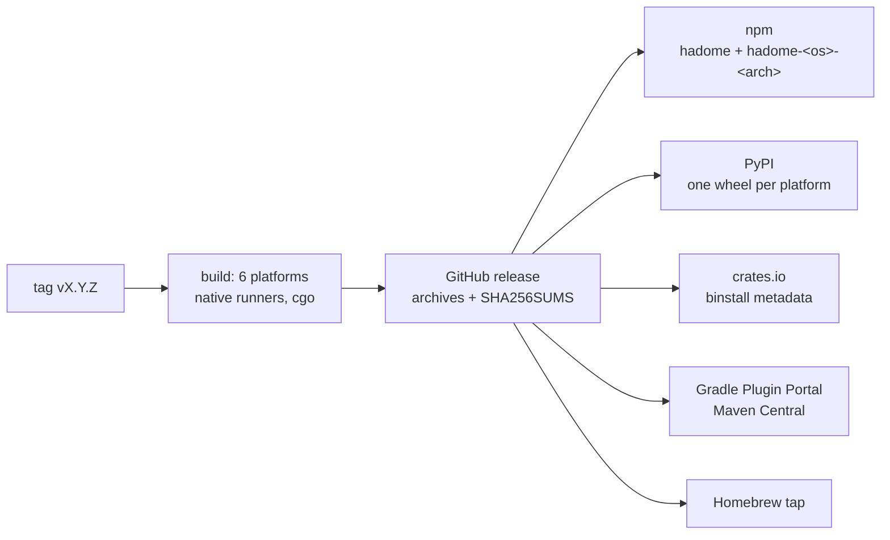
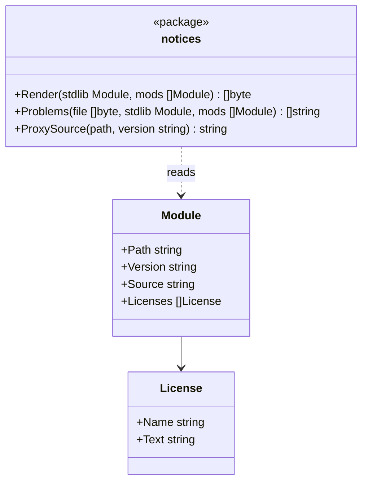

# Distribution

## Goal

hadome installs the same way as any other development dependency. You write it with a pinned version in a file your project already has (`package.json`, `pyproject.toml`, `go.mod` and so on), and run it with that ecosystem's command. No manual download, C compiler or global install is needed.

The version is pinned because a new version of hadome changes its rules. If the version went up on its own, unrelated changes could fail under the new rules. To upgrade, raise the version as one change in the project, and check the differences in that change.

## How each ecosystem gets it

hadome supports six widely used languages and Terraform, and is distributed through the ecosystem of each of the six.

| Ecosystem | Declared in | Run with | What is installed |
|---|---|---|---|
| npm / pnpm / yarn | `package.json` devDependencies: `"hadome": "1.2.0"` | `npx hadome check` | Only the binary for the current platform, through per-platform optional packages |
| Python (pip / uv / Poetry) | `pyproject.toml` dev dependencies: `hadome==1.2.0` | `hadome check` | A platform-specific wheel containing the binary |
| Go | `go.mod` tool directive: `go get -tool github.com/rerorets/hadome/cmd/hadome` | `go tool hadome check` | Built from source (see below) |
| Gradle (Java, Kotlin) | `plugins { id("io.github.rerorets.hadome") version "1.2.0" }` | `./gradlew hadomeCheck` | The plugin downloads and verifies the binary for the current platform |
| Maven (Java, Kotlin) | `hadome-maven-plugin` in `pom.xml` | `mvn hadome:check` | Same as Gradle |
| Rust (Cargo) | `cargo binstall hadome@1.2.0` | `hadome check` | The prebuilt binary from the release |
| Anything else | Homebrew: `brew install rerorets/tap/hadome`, or a release archive | `hadome check` | The prebuilt binary |

Configuration is the same `.hadome.yml` in every case. Package managers only differ in how hadome arrives.

## Go without a C compiler

`go tool` builds from source, and tree-sitter is a C library. The Go and Terraform adapters are pure Go. Go builds with cgo when a C compiler is installed and without it otherwise, and hadome follows:

| Build | Languages | Needs C |
|---|---|---|
| With cgo (any machine with a C compiler, and every prebuilt binary) | All seven | Yes, at build time |
| Without cgo (`CGO_ENABLED=0`, or no C compiler) | Go and Terraform | No |

A Go project that also has TypeScript or Python files gets all seven where a C compiler is installed, or uses a prebuilt binary. If the pure-Go build meets files of another language, it reports them as unread (`unknown/unread`, exit code `3`) rather than ignoring them. This report shows which files could not be read.

## Releases

- One release produces binaries for each supported operating system and architecture (Linux, macOS and Windows; x86-64 and ARM64), each built natively with cgo on GitHub Actions, then publishes them to every ecosystem above
- A release starts from a tag `vX.Y.Z`. The version is stamped into the binary (`hadome version`) and into every package
- Every binary is published with a checksum in `SHA256SUMS`. Archives also get a minisign signature (`.sig`), because a signature is all `cargo binstall` can check. Installers that download binaries verify a checksum or a signature before running anything
- All ecosystems receive the same version number at the same time. Which ecosystems it is published to is decided by the repository variables `PUBLISH_<ECOSYSTEM>` ([how to publish](../maintaining/releasing.md))

## Packages in this repository

Everything that turns a release into a package lives under `packaging/`, one directory per ecosystem. Each has a script that builds its packages from the release's archives, so a package can be built and tried locally without publishing.

| Directory | Builds | How the binary arrives |
|---|---|---|
| `packaging/npm` | `hadome` and one `hadome-<os>-<arch>` package per platform | The platform packages are optional dependencies limited by `os` and `cpu`; npm installs only the matching one. `hadome`'s launcher runs it |
| `packaging/python` | One wheel per platform (`py3-none-<platform>`) | The binary is a script of the wheel, installed onto `PATH` |
| `packaging/cargo` | The `hadome` crate | `cargo binstall` reads the crate's metadata, downloads the release archive, and checks its signature with the public key in the metadata. Building the crate from source only explains how to install |
| `packaging/jvm` | The Gradle plugin and the Maven plugin, sharing one installer | On first use, downloads the archive for the platform from the release, checks it against the checksums built into the plugin, and keeps it in the build tool's cache |
| `packaging/homebrew` | The formula for the `rerorets/homebrew-tap` repository | Homebrew downloads the archive and checks its SHA-256 |

The npm and Python packages carry the binary itself, so installing them never touches the network beyond the registry. The JVM plugins download, because the registries for build plugins do not select files by platform. The JVM plugins and Homebrew check each download against checksums fixed at release time. `cargo binstall` checks the signature with the public key fixed in the crate.

## Licenses of the dependencies

The licenses of the modules linked into hadome (MIT, BSD, Apache-2.0, MPL-2.0) all require their text to be distributed with the binary. MPL-2.0 also requires saying where the source is. So `THIRD_PARTY_NOTICES` sits at the root of the repository and goes, with `LICENSE`, into every archive and package that holds the binary. Where it goes and how to regenerate it are in [releasing.md](../maintaining/releasing.md).

- The package `internal/notices` writes the file from a list of modules (`Render`) and lists where the file has fallen behind the list (`Problems`)
- `Problems` lists a module with no license file, a module or version with no section, a section whose source or license text is out of date, and a section for a module or version no longer linked in
- The list of modules is made outside `internal/notices`. A test in `cmd/hadome` lists them with `go list -deps` for the release build (with cgo; Linux, macOS, Windows) and reads their license files from the module cache
- Where the source is, is given as the Go module proxy's URL
- The Go standard library's license comes from a copy in the test data, because some ways of installing Go keep no `LICENSE` in GOROOT

## Invariants

1. Every ecosystem can pin an exact version
2. The same version behaves the same regardless of how it was installed
3. Installers never execute a binary whose checksum or signature does not match
4. hadome never updates itself
5. Every archive and package that holds the binary holds the licenses of hadome and of every module linked into it

## Deliberately left out

- Self-update commands
- System package managers other than Homebrew
