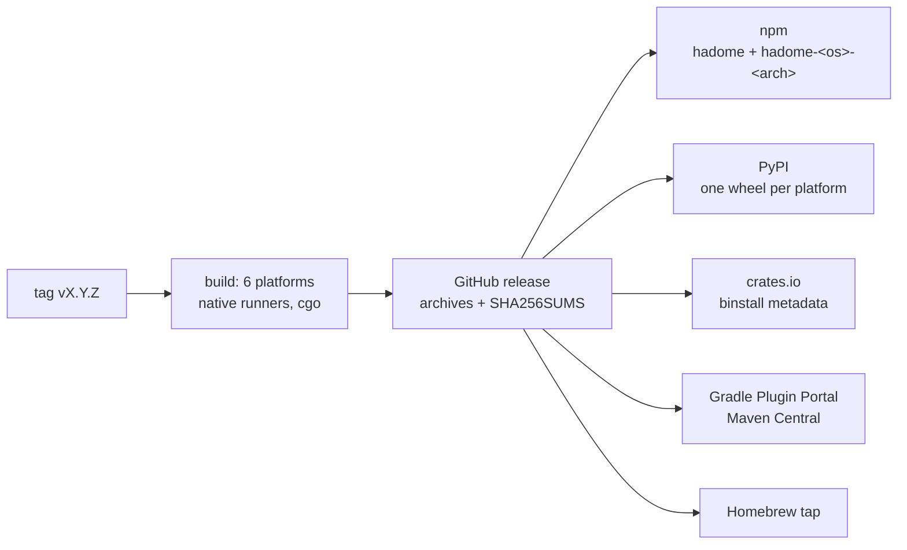

# Distribution

## Goal

Using hadome should feel like adding any other development dependency: **declare it with a pinned version in the file your project already has, then run it.** No manual download, no C compiler, no global install required.

Pinning matters for a ratchet. If hadome upgraded itself, its rules could change underneath a project and stop changes that have nothing to do with the upgrade. Upgrading hadome is an ordinary, reviewable change in the project.

## How each ecosystem gets it

hadome supports six widely used languages, and is distributed through each of their ecosystems.

| Ecosystem | Declared in | Run with | What is installed |
|---|---|---|---|
| npm / pnpm / yarn | `package.json` devDependencies: `"hadome": "1.2.0"` | `npx hadome check` | Only the binary for the current platform, through per-platform optional packages |
| Python (pip / uv / Poetry) | `pyproject.toml` dev dependencies: `hadome==1.2.0` | `hadome check` | A platform-specific wheel containing the binary |
| Go | `go.mod` tool directive: `go get -tool github.com/rerorets/hadome/cmd/hadome` | `go tool hadome check` | Built from source (see below) |
| Gradle (Java, Kotlin) | `plugins { id("io.github.rerorets.hadome") version "1.2.0" }` | `./gradlew hadomeCheck` | The plugin downloads and verifies the binary for the current platform |
| Maven (Java, Kotlin) | `hadome-maven-plugin` in `pom.xml` | `mvn hadome:check` | Same as Gradle |
| Rust (Cargo) | `cargo binstall hadome@1.2.0` | `hadome check` | The prebuilt binary from the release |
| Anything else | Homebrew: `brew install rerorets/tap/hadome`, or a release archive | `hadome check` | The prebuilt binary |

Configuration is the same `.hadome.yml` in every case. Package managers only differ in how hadome arrives.

## Go without a C compiler

`go tool` builds from source, and tree-sitter is a C library. Go builds with cgo when a C compiler is installed and without it otherwise, and hadome follows:

| Build | Languages | Needs C |
|---|---|---|
| With cgo (any machine with a C compiler, and every prebuilt binary) | All six | Yes, at build time |
| Without cgo (`CGO_ENABLED=0`, or no C compiler) | Go only | No |

A Go project that also has TypeScript or Python files gets all six where a C compiler is installed, or uses a prebuilt binary. If the pure-Go build meets files of another language, it reports them as unread (`unknown/unread`, exit code `3`) rather than ignoring them, so the gap is visible.

## Releases

- One release produces binaries for each supported operating system and architecture (Linux, macOS and Windows; x86-64 and ARM64), each built natively with cgo on GitHub Actions, then publishes them to every ecosystem above
- A release starts from a tag `vX.Y.Z`. The version is stamped into the binary (`hadome version`) and into every package
- Every binary is published with a checksum in `SHA256SUMS`; installers that download binaries verify it before running anything
- All ecosystems receive the same version number at the same time. An ecosystem whose credentials are not configured is skipped, and the release says so

## Packages in this repository

Everything that turns a release into a package lives under `packaging/`, one directory per ecosystem. Each has a script that builds its packages from the release's archives, so a package can be built and tried locally without publishing.

| Directory | Builds | How the binary arrives |
|---|---|---|
| `packaging/npm` | `hadome` and one `hadome-<os>-<arch>` package per platform | The platform packages are optional dependencies limited by `os` and `cpu`; npm installs only the matching one. `hadome`'s launcher runs it |
| `packaging/python` | One wheel per platform (`py3-none-<platform>`) | The binary is a script of the wheel, installed onto `PATH` |
| `packaging/cargo` | The `hadome` crate | `cargo binstall` reads the crate's metadata and downloads the release archive. Building the crate from source only explains how to install |
| `packaging/jvm` | The Gradle plugin and the Maven plugin, sharing one installer | On first use, downloads the archive for the platform from the release, checks it against the checksums built into the plugin, and keeps it in the build tool's cache |
| `packaging/homebrew` | The formula for the `rerorets/homebrew-tap` repository | Homebrew downloads the archive and checks its SHA-256 |

The npm and Python packages carry the binary itself, so installing them never touches the network beyond the registry. The JVM plugins download, because the registries for build plugins do not select files by platform; they check every download against checksums fixed at release time.

## Invariants

1. Every ecosystem can pin an exact version
2. The same version behaves the same regardless of how it was installed
3. Installers never execute a binary whose checksum does not match
4. hadome never updates itself

## Deliberately left out

- Self-update commands
- System package managers other than Homebrew (they can be added when requested)
