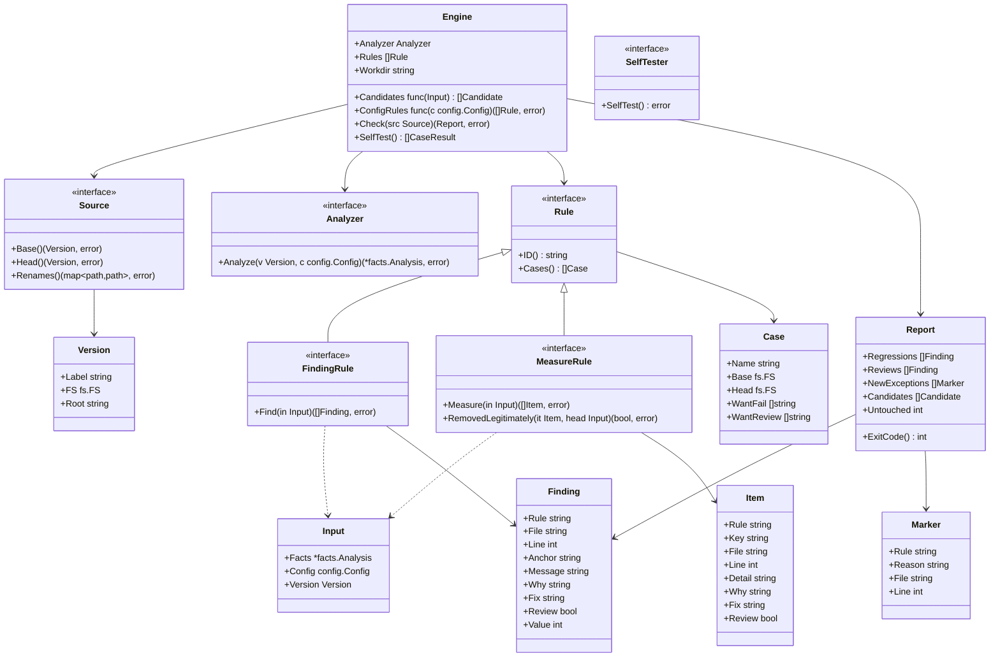

# エンジン

## 責務

エンジンは1つの変更で何かが悪くなったかを判定する。リポジトリの2つの版、*base*（ふつうは main ブランチ）と *head*（変更）にルールを当て、悪くなったものだけを報告する。

すること:

- ソースから base と head の版を得る
- 有効なルールを両方の版に当てる
- ルールごとに結果を比べ、後退だけを残す
- 理由が書かれた例外を当てる
- 決定的なレポートと終了コードを出す
- 全ルールの自己テストの事例を走らせる

しないこと:

- 言語を知ること。テストを見つける、import を読む、大きさを測るのは言語アダプタの仕事
- ルールの中身を知ること。結果を出すのはルールで、エンジンはそれを比べるだけ
- リポジトリを書き換える、ネットワークに出る、時計を読む
- コメントを投稿する、Issue を立てる、ホスティングサービスを呼ぶ。必要なら CI がレポートから行う

## 2種類のルール

違反を見つけるルールがある（「このテストは sleep している」）。何かを測るルールもある（「テストが守る（観点, 対象）の組の集合」）。後退の仕方が違うので、エンジンは2種類として扱う。

| 種類 | ルールが返すもの | 後退とは | 例 |
|---|---|---|---|
| **見つけるルール（finding ルール）** | 見つかったものの集合 | head にあって base に対応するものが無い違反 | `tests/no-sleep`、`deps/not-in-diagram`、`size/function-lines` |
| **測るルール（measure ルール）** | 守っている項目の集合 | base にあって head に無い項目。ただし正当に消えたとルールが認めたものは除く | `tests/scope-shrunk`、`tests/purity-lost` |

「正当に消えた」が何を指すかは測るルールが決める（`tests/scope-shrunk` なら、対象が head にもう無いこと）。エンジンは尋ねるだけ。`Review` の付いた項目が head に無いときは、`Review` の付いた違反と同じく、後退ではなく人の確認に回る。

## 版をまたいで違反を突き合わせる

行が動いても、base と head で「同じ違反」だと認められなければならない。行番号だけで見ると、違反より上を編集するたびに新しい違反に見えてしまう。

`Review` の付いた違反は後退にならない。head で新しく出たものはレポートの人の確認に回り、終了コードを `3` にする。ルールはこれを、確かでないものや人が決めるべきもの（たとえば対象を特定できなかったテスト）に使う。

違反は**指紋**を持つ:

- ルールの ID
- ファイルのパス（ソースが報告した改名をたどった後のもの）
- 関係のない編集では変わらない、ルールが選んだアンカー（たとえば囲んでいる関数の名前や、問題の行を正規化したテキスト）

指紋が同じ2つの違反は同じ違反である。1つのファイルの中で指紋がぶつかったとき（1つの関数に同じ違反を2回書いた）は数で突き合わせる。head は base と同じ数までなら後退にならない。

量（行数・引数の数）についての違反は、測った値も持つ。base と対応するのに値が大きくなった head の違反は後退で、違反が悪化したことを表す。値が同じか小さくなったものは後退ではない。

行番号は表示のためだけに持つ。

## 例外

例外は、それが当てはまる場所に書く:

```text
gate:allow <rule-id> reason: <text>
```

- その行に当てはまる。印だけの行なら次の行に当てはまる
- `reason:` とそれに続く文が無い印は効かず、それ自体が違反として報告される（`engine/marker-without-reason`）
- 知らないルールを名指しした印は違反として報告される（`engine/marker-unknown-rule`）
- 何も抑えていない印は違反として報告される（`engine/marker-unused`）。古い例外が積もらないようにするため
- 接頭辞は `gate:` で、ツールの名前にはしない。hadome の名前が変わっても、利用者がコードを直さずに済む
- 例外が新しいとは、head にあって base に対応するものが無いこと。突き合わせ方は違反と同じ（ルールの ID、改名後のファイル、アンカー）。理由の文が変わった例外も新しいものとして数える。人が確かめるのはその正当化だからである。base に既にあった例外は二度と報告しない
- 新しい例外はチェックを落とさないが、結果を人の確認が要るもの（終了コード `3`）にする。後退は無く、人が見るべき新しい例外が1つ以上ある状態である。誰が承認するかはワークフローが決める（ラベル、レビュアー、判断待ちの列）

コメントの中から印を見つけるのは言語アダプタの仕事。エンジンは印をデータとして受け取る。

## ソース

エンジンは git を前提にしない。2つの版は**ソース**が与える。

| ソース | base | head |
|---|---|---|
| `git`（既定） | リビジョン。例: `origin/main` | 作業ツリー、またはリビジョン |
| `dir` | ディレクトリ | ディレクトリ |

各版は読み取り専用のファイルシステムとして見せる。他のバージョン管理システムや、git でないものは、ソースを足してつなぐ。

### 改名

改名はソースではなくエンジンが見つける。どのソースでも同じ振る舞いにするためである:

- head に無いファイルと完全に同じ中身が、base に無いパスにあれば改名とする（中身のハッシュで突き合わせる）
- ソースは自分が知っている改名を追加で報告してよい（git は中身が少し変わったファイルも含めて報告する）。それは上に足される
- 改名して中身も変えたファイルは、見分けられないソースでは削除と追加に見える。類似度での検出は後の改善とする

## 決定性

- 同じ入力なら同じ出力。違反と項目は並べ替え、出力のために map を走査しない
- レポートに時計・ネットワーク・環境に依存するパスを入れない
- 走らなかったルールは設定の誤り（終了コード `2`）として扱い、通過にはしない。走らなかったルールは何も確かめていないからだ

## 出力

| 形式 | 誰のため | 中身 |
|---|---|---|
| `text` | 人 | ルールごとにまとめた後退、次に新しい例外、最後に1行の要約（手を付けずに残した既存の違反の数を含む） |
| `json` | エージェントと CI | 版付きのスキーマ。後退（ルール、指紋、ファイル、行、メッセージ、なぜ問題か、直し方）、理由付きの新しい例外、要約の数 |

JSON のスキーマは独自の版番号を持ち、フィールドを足す形でしか変わらない。

| 終了コード | 意味 |
|---|---|
| `0` | 後退なし |
| `1` | 後退が1つ以上ある |
| `2` | 設定の誤り、または走らなかったルールがある |
| `3` | 後退は無いが、人の確認が要るものがある。新しい例外、またはアダプタが特定できなかった事実が base より多い |

複数が当てはまるときは優先度の高いものになる。`2`、`1`、`3`、`0` の順。

終了コード `3` は確認すべきものを持ち込んだ変更で1回だけ出る。その変更が基準のブランチに入れば base の一部になり、後の変更では出ない。

## 自己テスト

どのルールも事例を持つ。小さな base のツリー、小さな head のツリー、期待する後退の組である。`hadome self-test` は製品固有の門番を含む全ルールの全事例を走らせ、事例の無いルールも失敗にする。組み込みのルールの事例は、hadome のテストでも走る。門番は利用者のリポジトリにしか無いので、`hadome check` も門番を使う前に、その自己テストを1回走らせる。落ちたら、門番の結果は使わずに終了コード `2` で止まる。

## 製品固有の門番

製品は自分の門番を、設定で宣言した**外部コマンド**として足す。エンジンはそれを版ごとに1回（base、次に head）、標準入力に JSON のリクエストを渡して走らせ、標準出力から JSON で違反か項目を読み、組み込みのルールとまったく同じように比べる。門番は版を自分で比べず、1つのツリーだけを見る。

プロトコルの全体は [external-gates.ja.md](../external-gates.ja.md) にある。どの言語でもこの形で門番を書け、製品の知識は製品のリポジトリに留まる。

エンジン自身はプロセスを起動しない。`Engine.ConfigRules` が head の設定から追加のルールを組み立てる。`cmd/hadome` はそこに門番のパッケージの組み立て関数を入れる（[gates.ja.md](gates.ja.md)）。エラーを返したルールは走らなかったものとして、チェックは終了コード `2` で止まる。`SelfTester` を実装したルールは事例を出す代わりに自分で自分をテストする。

## 型とインターフェース



`facts.Analysis` は言語アダプタが与えるもの（ファイル、コメント、シンボル、テスト）で、設計は [adapters.ja.md](adapters.ja.md) にある。`config.Config` は1つの版の設定（[configuration.ja.md](configuration.ja.md)）。ルールは `Input` を通して両方を見て、それ以外は見ない。

### チェックの中の設定

エンジンは何かを解析する前に、両方の版の設定を読み込む。どちらかの版の設定が不正なら、チェックは終了コード `2` で止まる。

- head は head の設定で解析し、判定する
- base は head の設定値と表で解析するが、不変条件は base 自身のものを使う（`config.ForBase`）。設定を厳しくしても既にあったコードで変更が落ちることはなく、守るテストの無い新しい不変条件はやはり落ちる
- 設定を緩める変更は `config/loosened` として人の確認に回る（終了コード `3`）。これはルールではなくエンジン自身の検査なので、例外の印では黙らせられない

## 不変条件

1. base にある違反はどこへ動いてもチェックを落とさない
2. 同じ base・head・設定からは、常にバイト単位で同じレポートが出る
3. 理由の無い印は何も抑えない
4. 走れないルールはチェックを終了コード `2` で落とし、通過にはしない
5. エンジンはリポジトリに書き込まず、ネットワーク接続を開かない
6. 組み込みのルールはどれも自己テストの事例を1つ以上持ち、リリースでは全事例が通る。門番は、自己テストが通ったときだけ `check` に使われる

## 意図して入れなかったもの

- 言語アダプタと `facts.Analysis` の中身（別の設計）
- 個々のルール（グループごとの別の設計）
- ミューテーションに基づく守る範囲（後で）
- キャッシュと並列実行（測って必要と分かったら足す）
- 違反の自動修正

## 決めたこと

1. ぶつかった指紋は数で突き合わせる。head は base と同じ数までなら後退にならない
2. 新しい例外は終了コード `3`（人の確認が要る）を返す。失敗でも、黙った通過でもない。報告するのはその変更で新しく入った例外だけで、base に既にあったものは報告しない
3. 外部コマンドの門番は版ごとに1回走るので、門番の作者は1つのツリーだけを解析すればよい
