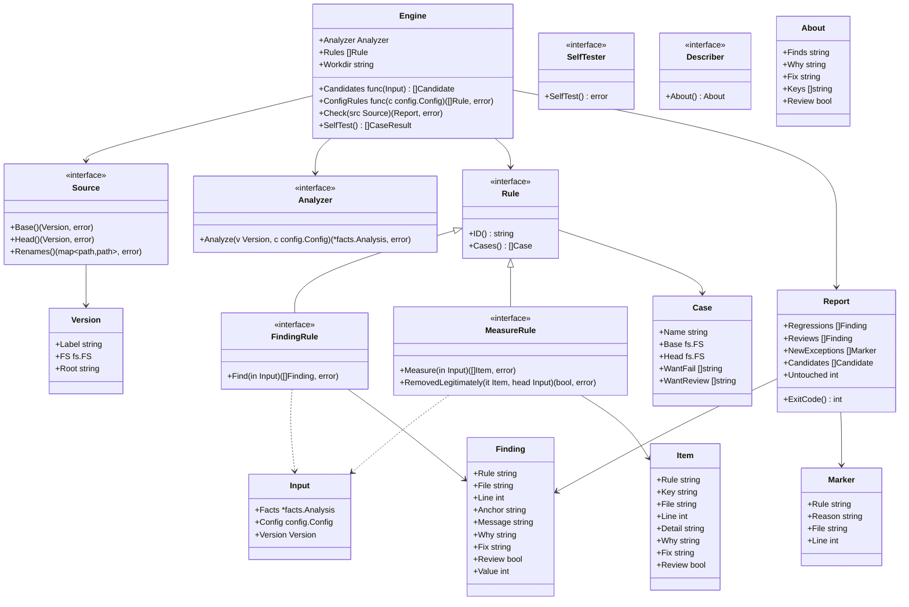

# エンジン

## 責務

エンジンは1つの変更で何かが悪くなったかを判定します。リポジトリの2つの版にルールを当て、悪くなったものだけを報告します。2つの版は次のとおりです。

- *base*: ふつうは main ブランチ
- *head*: 変更

**すること**

- ソースから base と head の版を得る
- 有効なルールを両方の版に当てる
- ルールごとに結果を比べ、後退だけを残す
- 理由が書かれた例外を当てる
- 決定的なレポートと終了コードを出す
- 全ルールの自己テストの事例を走らせる

**しないこと**

- 言語を知ること。テストを見つけること、import を読むこと、大きさを測ることは、言語アダプタの仕事です。
- ルールの中身を知ること。結果を出すのはルールで、エンジンはそれを比べるだけです。
- リポジトリを書き換えること、ネットワークに出ること、時計を読むこと
- コメントを投稿すること、Issue を立てること、ホスティングサービスを呼ぶこと。必要なら、CI がレポートを使って行います。

## 2種類のルール

エンジンはルールを「見つけるルール」と「測るルール」の2種類に分けて扱います。分けるのは、後退の仕方が違うからです。

- 見つけるルールは違反を見つけます。例: 「このテストは sleep している」
- 測るルールは何かを測ります。例: 「テストが守る（観点, 対象）の組の集合」

| 種類 | ルールが返すもの | 後退とは | 例 |
|---|---|---|---|
| **見つけるルール（finding ルール）** | 違反の集合 | head にあって base に対応するものが無い違反 | `tests/no-sleep`、`deps/not-in-diagram`、`size/function-lines` |
| **測るルール（measure ルール）** | 守っている項目の集合 | base にあって head に無い項目。ただし正当に消えたとルールが認めたものは除く | `tests/scope-shrunk`、`tests/purity-lost` |

「正当に消えた」が何を指すかは、測るルールが決めます。例: `tests/scope-shrunk` なら、対象が head にもう無いことです。エンジンはルールに尋ねるだけです。

`Review` の付いた項目が head に無いときは、後退ではなく人の確認に回ります。`Review` の付いた違反と同じ扱いです。

## 版をまたいで違反を突き合わせる

行が動いても、base と head の「同じ違反」は、同じ違反だと認められなければなりません。行番号だけで見ると、違反より上を編集するたびに、新しい違反に見えてしまうからです。

`Review` の付いた違反は後退になりません。head で新しく出たものは、レポートの人の確認に回り、終了コードを `3` にします。ルールは `Review` を、確かでないものや人が決めるべきものに使います。例: 対象を特定できなかったテスト。

違反は次の3つからなる**指紋**を持ちます。

- ルールの ID
- ファイルのパス。ソースが報告した改名をたどった後のパスです。
- ルールが選んだアンカー。関係のない編集では変わりません。例: 囲んでいる関数の名前、問題の行を正規化したテキスト

指紋が同じ2つの違反は同じ違反です。1つのファイルの中で指紋がぶつかったときは、数で突き合わせます。例: 1つの関数に同じ違反を2回書いたとき。head は base と同じ数までなら後退になりません。

量（行数・引数の数）についての違反は、測った値も持ちます。base と対応するのに値が大きくなった head の違反は後退で、違反が悪化したことを表します。値が同じか小さくなったものは後退ではありません。

行番号は表示のためだけに持ちます。

## 例外

例外は当てはまる場所に次の形で書きます。

```text
gate:allow <rule-id> reason: <text>
```

- 印のある行と、その次の行に当てはまります。
- `reason:` とそれに続く文が無い印は効きません。その印自体が、違反として報告されます（`engine/marker-without-reason`）。
- 知らないルールを名指しした印は、違反として報告されます（`engine/marker-unknown-rule`）。
- 何も抑えていない印は、違反として報告されます（`engine/marker-unused`）。古い例外が積もらないようにするためです。
- 接頭辞は `gate:` で、ツールの名前にはしません。hadome の名前が変わっても、利用者はコードを直さずに済みます。
- 新しい例外とは、head にあって base に対応するものが無い例外です。突き合わせは、ルールの ID・改名後のファイル・理由の文で行います。そのため、理由の文が変わった例外も、新しいものとして数えます。人が確かめるのは、その正当化だからです。base に既にあった例外は、二度と報告しません。
- 新しい例外はチェックを落としません。結果を人の確認が要るもの（終了コード `3`）にします。これは、後退は無く、人が見るべき新しい例外が1つ以上ある状態です。誰が承認するかは、ワークフローが決めます。例: ラベル、レビュアー、判断待ちの列

コメントの中から印を見つけるのは、言語アダプタの仕事です。エンジンは印をデータとして受け取ります。

## ソース

2つの版を与えるものを、**ソース**と呼びます。エンジンは git を前提にしません。

| ソース | base | head |
|---|---|---|
| `git`（既定） | リビジョン（`--base`）。省くと `origin/main`、無ければ `main` | リビジョン（`--head`）。省くと作業ツリー |
| `dir` | ディレクトリ（`--base-dir`） | ディレクトリ（`--head-dir`） |

リビジョンとディレクトリを両方渡すと、どちらで比べるか決まらないので、終了コード `2` で止まります。

各版は読み取り専用のファイルシステムとして見せます。ほかのバージョン管理システムや git でないものは、ソースを足してつなぎます。

### 改名

改名はソースではなくエンジンが見つけます。どのソースでも同じ振る舞いにするためです。

- head に無いファイルと完全に同じ中身が、base に無いパスにあれば、改名とします。突き合わせには中身のハッシュを使います。
- ソースは自分が知っている改名を追加で報告してかまいません。例: git は、中身が少し変わったファイルも含めて報告します。報告された改名は、上の改名に足されます。
- 改名して中身も変えたファイルは、見分けられないソースでは、削除と追加に見えます。類似度での検出はしません。

## 決定性

- 同じ入力なら、同じ出力を出します。違反と項目は並べ替え、出力のために map を走査しません。
- レポートには時計・ネットワーク・環境に依存するパスを入れません。
- 走らなかったルールは、設定の誤り（終了コード `2`）として扱い、通過にはしません。走らなかったルールは、何も確かめていないからです。

## 出力

| 形式 | 誰のため | 中身 |
|---|---|---|
| `text` | 人 | ルール順に並べた後退、次に人の確認と新しい例外、不変条件の候補、hadome を入れる変更なら既定から変えた設定、最後に1行の要約（手を付けずに残した既存の違反の数を含む） |
| `json` | エージェントと CI | バージョン付きのスキーマ。後退と人の確認（ルール、ファイル、行、メッセージ、なぜ問題か、直し方、値）、理由付きの新しい例外、不変条件の候補、hadome を入れる変更なら既定から変えた設定（`introduced`。キー、ファイル、行、既定の値、設定した値、緩める向きか）、既存の違反の数、終了コード |

JSON のスキーマは独自のバージョン番号を持ち、フィールドを足す形でしか変わりません。

| 終了コード | 意味 |
|---|---|
| `0` | 後退なし |
| `1` | 後退が1つ以上ある |
| `2` | 設定の誤り、または走らなかったルールがある |
| `3` | 後退は無いが、人の確認が要るものがある。新しい例外、設定を緩める変更、またはルールが人の確認に回したもの（特定できなかった事実が base より多い、など） |

複数が当てはまるときは、優先度の高いものになります。優先度は高い順に `2`、`1`、`3`、`0` です。

終了コード `3` は、確認すべきものを持ち込んだ変更で1回だけ出ます。その変更が基準のブランチに入れば、確認すべきものは base の一部になり、後の変更では出ません。

## 自己テスト

どのルールも事例を持ちます。事例は小さな base のツリー、小さな head のツリー、期待する後退の組です。

- `hadome self-test` は製品固有の門番を含む全ルールの全事例を走らせます。事例の無いルールも失敗にします。
- 組み込みのルールの事例は、hadome のテストでも走ります。
- 門番は利用者のリポジトリにしか無いので、`hadome check` も、門番を使う前にその自己テストを1回走らせます。自己テストが落ちたら、門番の結果は使わずに、終了コード `2` で止まります。

## 製品固有の門番

製品は自分の門番を、設定で宣言した**外部コマンド**として足します。

- エンジンは門番を、版ごとに1回、base、次に head の順で走らせます。標準入力に JSON のリクエストを渡し、標準出力から JSON で違反か項目を読みます。読んだ結果は、組み込みのルールとまったく同じように比べます。
- 門番は版を自分で比べず、1つのツリーだけを見ます。

プロトコルの全体は [external-gates.ja.md](../external-gates.ja.md) にあります。どの言語でも、この形で門番を書けます。製品の知識は製品のリポジトリに留まります。

エンジン自身はプロセスを起動しません。

- `Engine.ConfigRules` が head の設定から追加のルールを組み立てます。`cmd/hadome` はそこに門番のパッケージの組み立て関数を入れます（[gates.ja.md](gates.ja.md)）。
- エラーを返したルールは、走らなかったものとして扱います。このとき、チェックは終了コード `2` で止まります。
- `SelfTester` を実装したルールは、事例を出す代わりに、自分で自分をテストします。
- 組み込みのルールはどれも `Describer` を実装し、`About` で次のものを返します。何を見つけるか、なぜ困るか、直し方、調整する設定のキーです。`hadome explain <ルールの ID>` は、`About` の内容と自己テストの事例の名前を出します。
- 違反の `why` と `fix` は、見つけた中身によらない部分では `About` と同じ文を使います。そのため、説明と出力が食い違いません。

## 型とインターフェース



`facts.Analysis` は言語アダプタが与えるものです。中身はファイル・コメント・シンボル・テストです。設計は [adapters.ja.md](adapters.ja.md) にあります。`config.Config` は1つの版の設定です（[configuration.ja.md](configuration.ja.md)）。ルールは `Input` を通して両方を見て、それ以外は見ません。

### チェックの中の設定

エンジンは何かを解析する前に、両方の版の設定を読み込みます。どちらかの版の設定が不正なら、チェックは終了コード `2` で止まります。

- head は head の設定で解析し、判定します。
- base は head の設定値と、組み込みに設定で足した表（危険の表、入出力の import の表、assert の表）で解析します。ただし、不変条件と自分自身の依存の図は、base 自身のものを使います（`config.ForBase`）。設定を厳しくしても、既にあったコードで変更が落ちることはありません。守るテストの無い新しい不変条件は、やはり落ちます。
- 設定を緩める変更は、`config/loosened` として人の確認に回ります（終了コード `3`）。これはルールではなくエンジン自身の検査なので、例外の印では抑えられません。

## 不変条件

1. base にある違反は、どこへ動いてもチェックを落としません。
2. 同じ base・head・設定からは、常にバイト単位で同じレポートが出ます。
3. 理由の無い印は何も抑えません。
4. 走れないルールは、チェックを終了コード `2` で落とします。通過にはしません。
5. エンジンはリポジトリに書き込まず、ネットワーク接続を開きません。
6. 組み込みのルールはどれも、自己テストの事例を1つ以上持ちます。リリースでは全事例が通ります。門番は、自己テストが通ったときだけ `check` に使われます。

## 意図して入れなかったもの

- 言語アダプタと `facts.Analysis` の中身。別の設計にあります。
- 個々のルール。グループごとに別の設計があります。
- ミューテーションに基づく守る範囲。エンジンの外にあります。
- キャッシュと並列実行
- 違反の自動修正
