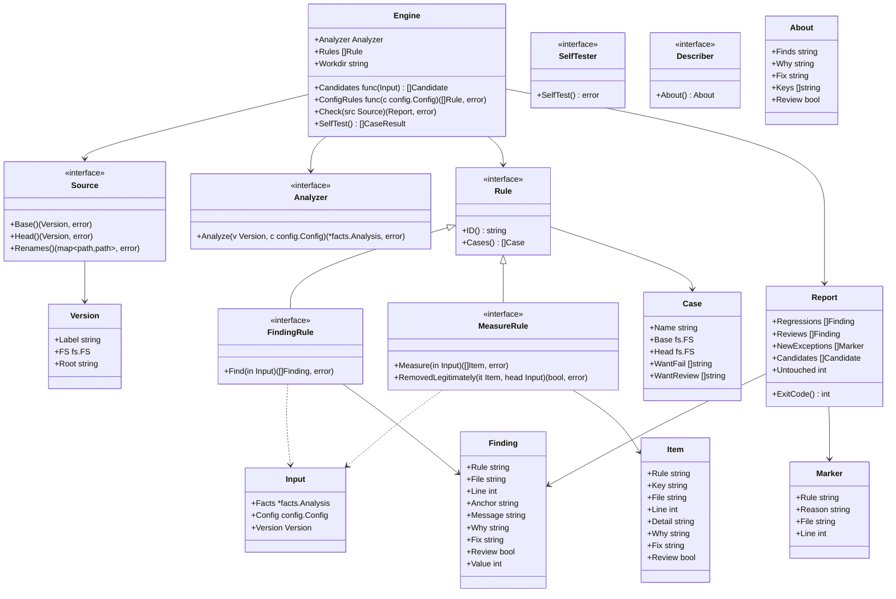

# Engine

## Responsibility

The engine decides whether a change made anything worse. It runs rules against two versions of a repository — the *base* (usually the main branch) and the *head* (the change) — and reports only what got worse.

It does:

- Obtain the base and head versions through a source
- Run the enabled rules on both versions
- Compare the results per rule and keep only regressions
- Apply exceptions that carry a written reason
- Produce a deterministic report and an exit code
- Run every rule's self-test cases

It does not:

- Know any language. Finding tests, reading imports and measuring size belong to language adapters
- Know any rule's logic. Rules produce results; the engine only compares them
- Modify the repository, talk to the network, or read the clock
- Post comments, open issues or call any hosting service. CI does that from the report if it wants to

## Two kinds of rules

Some rules find violations ("this test sleeps"). Others measure something ("the set of (viewpoint, target) pairs the tests guard"). They regress differently, so the engine treats them as two kinds.

| Kind | A rule returns | Regression means | Example |
|---|---|---|---|
| **Finding rule** | A set of findings | A finding in head that has no match in base | `tests/no-sleep`, `deps/not-in-diagram`, `size/function-lines` |
| **Measure rule** | A set of guarded items | An item in base that is missing from head, unless the rule confirms it was removed legitimately | `tests/scope-shrunk`, `tests/purity-lost` |

A measure rule decides what "removed legitimately" means (for `tests/scope-shrunk`: the target no longer exists in head). The engine only asks. An item marked `Review` that is missing from head goes to the reviews instead of the regressions, like a finding marked `Review`.

## Matching findings across versions

A finding must be recognised as "the same one" in base and head even when lines move. Line numbers alone would make every edit above a finding look like a new violation.

A finding marked `Review` is never a regression: when it is new in head it goes to the report's reviews and makes the result exit code `3`. Rules use it for things that are uncertain or that a person should decide (for example, a test whose target could not be identified).

A finding carries a **fingerprint**:

- the rule id
- the file path, after following renames reported by the source
- a rule-chosen anchor that survives unrelated edits (for example the enclosing function's name, or the normalised text of the offending line)

Two findings with the same fingerprint are the same finding. When fingerprints collide within one file (the same violation written twice in one function), they are matched by count: head may have as many as base without regressing.

A finding about an amount (lines, parameters) also carries the measured value. A head finding that matches base but has a larger value is a regression: the violation got worse. One whose value stayed or shrank is not.

Line numbers are kept for display only.

## Exceptions

An exception is written where it applies:

```text
gate:allow <rule-id> reason: <text>
```

- It applies to the line it is on and to the next line
- A marker without `reason:` followed by text has no effect, and is itself reported as a finding (`engine/marker-without-reason`)
- A marker naming an unknown rule is reported as a finding (`engine/marker-unknown-rule`)
- A marker that suppresses nothing is reported as a finding (`engine/marker-unused`), so stale exceptions do not pile up
- The prefix is `gate:`, never the tool's name, so renaming hadome never forces users to edit their code
- An exception is new when it is in head and has no match in base, matched by rule id, file after renames and reason text. So an exception whose reason text changed counts as new, because the justification is what a person must review. Exceptions that were already in base are never reported again
- New exceptions do not fail the check, but they make the result need review (exit code `3`): no regressions, and at least one new exception for a person to look at. Who approves it is up to the workflow (a label, a reviewer, a decision queue)

How the marker is found inside a comment is the language adapter's job. The engine receives markers as data.

## Sources

The engine never assumes git. A **source** provides the two versions.

| Source | Base | Head |
|---|---|---|
| `git` (default) | A revision, e.g. `origin/main` | The working tree, or a revision |
| `dir` | A directory | A directory |

Each version is exposed as a read-only file system. Other version-control systems, or systems that are not git at all, plug in as further sources.

### Renames

Renames are detected by the engine, not by the source, so every source behaves the same:

- A file missing from head whose exact content appears at a path missing from base is a rename (matched by content hash)
- A source may report more renames it knows about (git does, including files whose content changed slightly); those are added on top
- Files that were renamed and changed, with a source that cannot tell, look like a removal and an addition. There is no similarity-based detection

## Determinism

- Same input, same output: findings and items are sorted; maps are never iterated for output
- No clock, no network, no environment-dependent paths in the report
- A rule that fails to run is treated as a configuration error (exit code `2`), never a pass. A rule that did not run checked nothing

## Output

| Format | For | Content |
|---|---|---|
| `text` | People | Regressions sorted by rule, then reviews and new exceptions, then invariant candidates, then a one-line summary including how many existing findings were left untouched |
| `json` | Agents and CI | A versioned schema: regressions and reviews (rule, file, line, message, why it matters, how to fix, value), new exceptions with reasons, invariant candidates, the count of existing findings, the exit code |

The JSON schema has its own version number and changes only by adding fields.

| Exit code | Meaning |
|---|---|
| `0` | No regressions |
| `1` | At least one regression |
| `2` | Configuration error or a rule failed to run |
| `3` | No regressions, but something needs a person's review: a new exception, a change that loosens configuration, or something a rule sent for review (more unidentified facts than in base, and the like) |

When several apply, the highest-priority one wins: `2`, then `1`, then `3`, then `0`.

Exit code `3` is raised once, by the change that introduces the thing to review. Once that change reaches the base branch, it is part of the base, and later changes do not raise it again.

## Self-tests

Every rule ships with cases: a small base tree, a small head tree, and the expected regressions. `hadome self-test` runs all cases of all rules, including product-specific gates, and fails a rule without cases. The built-in rules' cases also run in hadome's own tests. Gates live only in the user's repository, so `hadome check` also runs a gate's self-test once before using it. If it fails, the check stops with exit code `2` without using the gate's results.

## Product-specific gates

A product adds its own gate as an **external command** declared in its configuration. The engine runs it once per version (base, then head) with a JSON request on standard input, reads findings or items as JSON on standard output, and compares them exactly like a built-in rule. The gate never compares versions itself; it only looks at one tree.

The full protocol is in [external-gates.md](../external-gates.md). Any language can implement a gate this way, and the product's knowledge stays in the product's repository.

The engine itself never starts a process. `Engine.ConfigRules` builds extra rules from head's configuration; `cmd/hadome` sets it to the gate package's builder ([gates.md](gates.md)). A rule that returns an error could not run, and the check stops with exit code `2`. A rule that implements `SelfTester` tests itself instead of providing cases. Every built-in rule implements `Describer`: `About` returns what it finds, why that matters, how to fix it, and the configuration keys that tune it. `hadome explain <rule id>` prints that with the names of the rule's self-test cases. A finding's `why` and `fix` use the same text as `About` wherever they do not depend on what was found, so the explanation and the output never disagree.

## Types and interfaces



`facts.Analysis` is what the language adapters provide (files, comments, symbols, tests); its design is in [adapters.md](adapters.md). `config.Config` is one version's configuration ([configuration.md](configuration.md)). A rule sees both through `Input` and nothing else.

### Configuration in a check

The engine loads the configuration of both versions before analysing anything. An invalid configuration in either version stops the check with exit code `2`.

- Head is analysed and judged with head's configuration
- Base is analysed with head's settings and tables but its own invariants and its own dependency diagram (`config.ForBase`), so tightening a setting never fails a change on code that was already there, while a new invariant without a guarding test still does
- Changes that loosen the configuration are reported as `config/loosened` reviews (exit code `3`). This is the engine's own check, not a rule, so no exception marker can silence it

## Invariants

1. A finding present in base never fails the check, wherever it moved
2. The same base, head and configuration always produce the same report, byte for byte
3. A marker without a reason never suppresses anything
4. A rule that cannot run makes the check fail with exit code `2`, never pass
5. The engine never writes to the repository and never opens a network connection
6. Every built-in rule has at least one self-test case, and all cases pass in a release. A gate is used by `check` only when its self-test passes

## Deliberately left out

- Language adapters and the contents of `facts.Analysis` (separate design)
- The individual rules (separate designs per group)
- Mutation-based scope (outside the engine)
- Caching and parallel execution
- Fixing findings automatically
