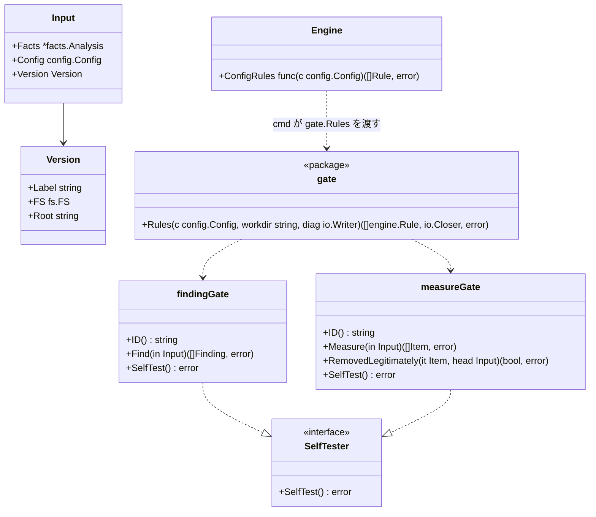

# 製品固有の門番

## 責務

パッケージ `internal/gate` は、設定の `gates` を、エンジンが組み込みのルールと同じように実行するルールに変えます。門番はそれぞれ製品のリポジトリにある外部コマンドです。やり取りの約束事は [external-gates.ja.md](../external-gates.ja.md) にあります。

すること:

- 設定した門番ごとに1つのルールを作り、門番の `id` をルール ID にする。これで、印、版をまたいだ照合、報告がそのまま使える
- 版ごとに1回、その版のツリーをディスク上に置いて作業ディレクトリにし、コマンドを実行して JSON の答えを読む
- measure の門番では、消えた項目のうちどれが正当に取り除かれたものかを、1回のチェックにつき1度コマンドに聞く
- `hadome check` で門番を使う前と、`hadome self-test` のときに、コマンドの `--self-test` を実行する

しないこと:

- 版を比べること。比べるのはエンジンで、組み込みのルールとまったく同じに扱う
- 違反を解釈すること。コマンドが報告したものが、そのまま門番の判定になる
- 何かを取ってくること。コマンドはリポジトリ内のファイルか `PATH` 上のプログラムである

## 形

- **ルールの作り方**: エンジンは1回のチェックにつき1度、head の設定で `ConfigRules` を呼びます。返ったルールは組み込みのルールと並べて両方の版で実行します。門番もほかの設定と同じく head から取ります（[configuration.ja.md](configuration.ja.md)）。そのため、変更で足した門番は base も判定し、その変更で増えたものだけを報告します
- **`Input` の `Version`**: `Input` は `Version` を持つので、ディスク上のファイルが要るルールはそこへ届きます。組み込みのルールは使いません
- **`Version.Root`**: 値があるかどうかは、版の渡され方で決まります。どちらの場合も、門番には常に実在するディレクトリが見えます

| 版の渡され方 | `Version.Root` | 門番に見えるディレクトリ |
|---|---|---|
| そのままの状態のもの（`--base-dir` や `--head-dir` で渡したディレクトリ） | その版のディスク上のディレクトリ | そのディレクトリ |
| 履歴のリビジョン、または作業ツリー。作業ツリーは、チェックが一貫した1つのスナップショットを見るためにメモリへ写す | 空 | gate パッケージが1回のチェックにつき1度、その版のファイルを一時ディレクトリに書き出したもの。終わったら消す |

- **プロセスとファイルの扱い**: エンジンは持ちません。コマンドの実行はこのパッケージの仕事で、両者をつなぐのは `cmd/hadome` です。`Rules` は写しを消す closer を返し、`cmd/hadome` がチェックの終わりに閉じます
- **自己テスト**: `SelfTester` を実装したルールは事例ではなく `SelfTest` を呼んで試します。`hadome self-test` は、門番のルールを作るために作業ツリーの設定を読みます

## コマンドの実行

| 段階 | 詳細 |
|---|---|
| コマンド | `run[0]` が `/` を含むなら、hadome を実行したディレクトリ（リポジトリの作業ツリー）からの相対パスとする。共有の設定の層と同じ扱い。含まなければ `PATH` から探す。これで、変更で足した門番も base で動き、コマンドは実行ビットを保つ（版の写しは実行ビットを保たない） |
| 作業ディレクトリ | その版のルート |
| 入力 | [external-gates.ja.md](../external-gates.ja.md) の要求を標準入力に渡す。`files` には、版のファイルのうち `paths` に合うものを並べる。`paths` を省くと全ファイル |
| 出力 | 標準出力が JSON の答え。標準エラーは利用者に渡す |
| 時間 | `timeout`（既定 60s）。その時点でまだ動いているコマンドは止める |
| 失敗 | 0 以外の終了、不正な JSON、知らない `schema`、時間切れのときは、終了コード `2` でチェックを止める。実行できなかったチェックは決して通らない |

`paths` は、スラッシュ区切りのパスに対する glob です。`*` は1つのパス要素の中で合い、`**` は任意の数の要素に合います。

## 設定

| キー | 意味 |
|---|---|
| `id`、`kind`、`run`、`timeout` | [external-gates.ja.md](../external-gates.ja.md) の設定のとおり |
| `paths` | 渡すファイルの glob。省くと全ファイル |
| `options` | 任意の値。手を加えずにコマンドへ渡す |

門番は版をまたいで `id` で照合します。消すことだけでなく、既存の門番への変更はすべて人の確認が要ります。`run`、`paths`、`options` を変えると、hadome が判断できない形で門番が緩くなりうるためです。仕様はこのためにこの一覧に `LooserWhenChanged` を付けています。

## 不変条件

1. 門番の違反は、組み込みのルールとまったく同じに版をまたいで比べる
2. 実行できない門番や、約束事に沿わない答えを返す門番は、決してチェックを通さない（終了コード `2`）
3. 門番を消す・変えるには人の確認が要る（終了コード `3`）
4. エンジン自身はプロセスを起動しない

## 意図して入れなかったもの

- **門番の並列実行**: 1度に1つのコマンドにすると、診断が読みやすくなります。約束事は並列実行を妨げません
- **サンドボックス**: 門番は、リポジトリ内のほかのスクリプトと同じ権限で動きます（[external-gates.ja.md](../external-gates.ja.md) の「信頼」）
