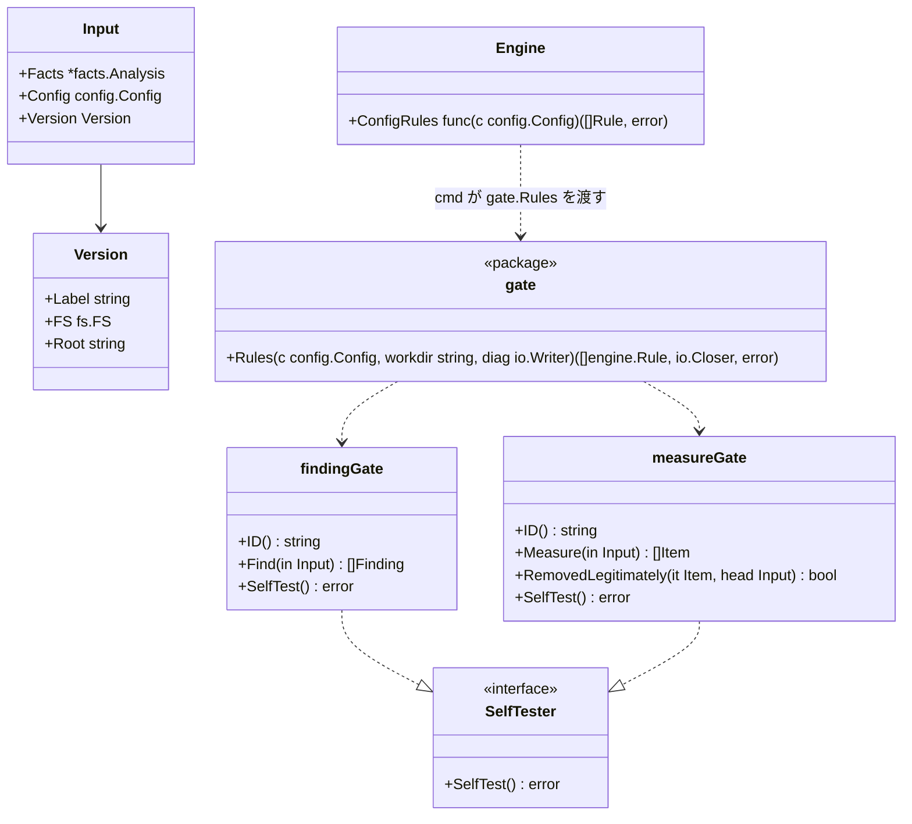

# 製品固有の門番

## 責務

パッケージ `internal/gate` は、設定の `gates` を、エンジンが組み込みのルールと同じように実行するルールに変える。門番はそれぞれ製品のリポジトリにある外部コマンドで、やり取りの約束事は [external-gates.ja.md](../external-gates.ja.md) にある。

すること:

- 設定した門番ごとに1つのルールを作り、門番の `id` をルール ID にする。これで印、版をまたいだ照合、報告がそのまま使える
- 版ごとに1回、その版のツリーをディスク上に置いて作業ディレクトリにし、コマンドを実行して JSON の答えを読む
- measure の門番では、消えた項目のうちどれが正当に取り除かれたものかを、1回のチェックにつき1度コマンドに聞く
- `hadome self-test` のために、コマンドの `--self-test` を実行する

しないこと:

- 版を比べること。比べるのはエンジンで、組み込みのルールとまったく同じに扱う
- 見つかったものを解釈すること。コマンドが報告したものがそのまま門番の判定になる
- 何かを取ってくること。コマンドはリポジトリ内のファイルか `PATH` 上のプログラムである

## 形

- エンジンは1回のチェックにつき1度、**head の**設定で `ConfigRules` を呼び、返ったルールを組み込みのルールと並べて両方の版で実行する。門番もほかの設定と同じく head から取る（[configuration.ja.md](configuration.ja.md)）ので、変更で足した門番は base も判定し、その変更で増えたものだけを報告する
- `Input` は `Version` を持つので、ディスク上のファイルが要るルールはそこへ届く。組み込みのルールは使わない
- `Version.Root` は、版がそのままの状態のもの（`--base-dir` や `--head-dir` で渡したディレクトリ）のとき、その版のディスク上のディレクトリになる。空のとき — 履歴のリビジョンか、作業ツリー（チェックは一貫した1つのスナップショットを見るためにメモリへ写す）— は、gate パッケージが1回のチェックにつき1度、その版のファイルを一時ディレクトリに書き出し、終わったら消す。門番には常に実在するディレクトリが見える
- エンジンはプロセスとファイルの扱いを持たない。コマンドの実行はこのパッケージの仕事で、両者をつなぐのは `cmd/hadome` である。`Rules` は写しを消す closer を返し、`cmd/hadome` がチェックの終わりに閉じる
- `SelfTester` を実装したルールは、事例ではなくそれを呼んで試す。`hadome self-test` は門番のルールを作るために作業ツリーの設定を読む

## コマンドの実行

| 段階 | 詳細 |
|---|---|
| コマンド | `run[0]` が `/` を含むなら、共有の設定の層と同じく、hadome を実行したディレクトリ（リポジトリの作業ツリー）からの相対パスとする。含まなければ `PATH` から探す。これで変更で足した門番も base で動き、コマンドは実行ビットを保つ（版の写しは保たない） |
| 作業ディレクトリ | その版のルート |
| 入力 | external-gates.md の要求を標準入力に渡す。`files` は版のファイルのうち `paths` に合うもの（`paths` を省くと全ファイル）を並べたもの |
| 出力 | 標準出力が JSON の答え。標準エラーは利用者に渡す |
| 時間 | `timeout`（既定 60s）。その時点でまだ動いているコマンドは止める |
| 失敗 | 0 以外の終了、不正な JSON、知らない `schema`、時間切れは、終了コード `2` でチェックを止める。実行できなかったチェックは決して通らない |

`paths` はスラッシュ区切りのパスに対する glob である。`*` は1つのパス要素の中で、`**` は任意の数の要素に合う。

## 設定

| キー | 意味 |
|---|---|
| `id`、`kind`、`run`、`timeout` | 前に述べたとおり |
| `paths` | 渡すファイルの glob。省くと全ファイル |
| `options` | 任意の値。手を加えずにコマンドへ渡す |

門番は版をまたいで `id` で照合する。消すことだけでなく、**既存の門番への変更はすべて人の確認が要る**。`run`、`paths`、`options` を変えると、hadome が判断できない形で門番が緩くなりうるからだ。仕様はこのためにこの一覧に `LooserWhenChanged` を付けている。

## 不変条件

1. 門番の見つかったものは、組み込みのルールとまったく同じに版をまたいで比べる
2. 実行できない門番や、約束事に沿わない答えを返す門番は、決してチェックを通さない（終了コード `2`）
3. 門番を消す・変えるには人の確認が要る（終了コード `3`）
4. エンジン自身はプロセスを起動しない

## 意図して入れなかったもの

- 門番の並列実行。1度に1つのコマンドにすると診断が読みやすい。約束事を変えずに後から足せる
- サンドボックス。門番はリポジトリ内のほかのスクリプトと同じ権限で動く（external-gates.md の「信頼」）
