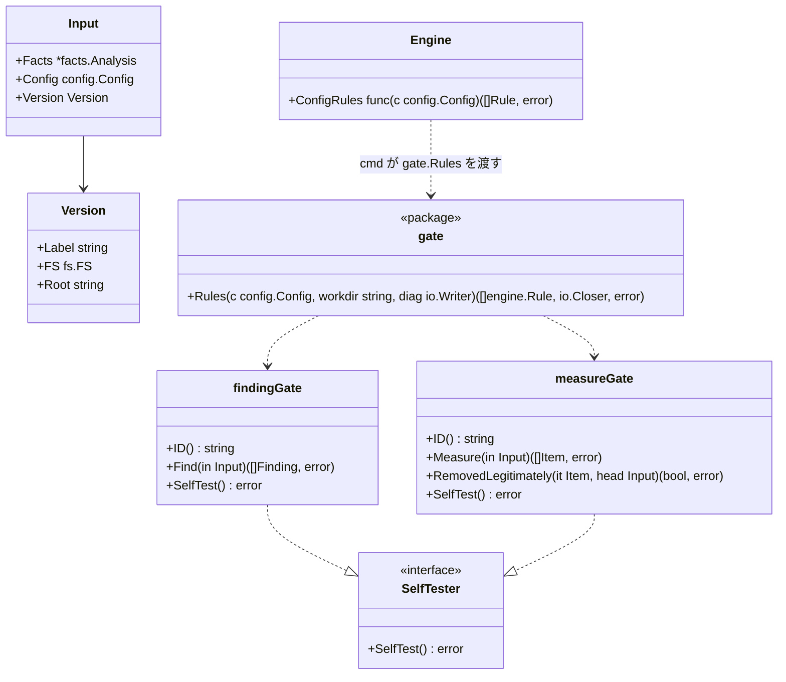

# 製品固有のゲート

## 責務

パッケージ `internal/gate` は、設定の `gates` を、エンジンが組み込みのルールと同じように実行するルールに変えます。ゲートはそれぞれ製品のリポジトリにある外部コマンドです。やり取りの約束事は [external-gates.ja.md](../external-gates.ja.md) にあります。

すること:

- 設定したゲートごとに1つのルールを作り、ゲートの `id` をルール ID にする。これで、例外コメント、バージョンをまたいだ照合、報告がそのまま使える
- バージョンごとに1回、そのバージョンのツリーをディスク上に置いて作業ディレクトリにし、コマンドを実行して JSON の答えを読む
- measure のゲートでは、消えた項目のうちどれが正当に取り除かれたものかを、1回のチェックにつき1度コマンドに聞く
- `hadome check` でゲートを使う前と、`hadome self-test` のときに、コマンドの `--self-test` を実行する
- `hadome check` では、base が同じコマンドで宣言しているゲートだけを実行する（[実行してよいゲート](#実行してよいゲート)）

しないこと:

- バージョンを比べること。比べるのはエンジンで、組み込みのルールとまったく同じに扱う
- 違反を解釈すること。コマンドが報告したものが、そのままゲートの判定になる
- 何かを取ってくること。コマンドはリポジトリ内のファイルか `PATH` 上のプログラムである

## 形

- **ルールの作り方**: エンジンは1回のチェックにつき1度、head の設定で `ConfigRules` を呼びます。渡すのは、head のゲートのうち base が同じコマンドで宣言しているものだけです。返ったルールは組み込みのルールと並べて両方のバージョンで実行します。ゲートの設定値（`paths`、`options`、`timeout`）は、ほかの設定と同じく head から取ります（[configuration.ja.md](configuration.ja.md)）
- **`Input` の `Version`**: `Input` は `Version` を持つので、ディスク上のファイルが要るルールはそこへ届きます。組み込みのルールは使いません
- **`Version.Root`**: 値があるかどうかは、バージョンの渡され方で決まります。どちらの場合も、ゲートには常に実在するディレクトリが見えます

| バージョンの渡され方 | `Version.Root` | ゲートに見えるディレクトリ |
|---|---|---|
| そのままの状態のもの（`--base-dir` や `--head-dir` で渡したディレクトリ） | そのバージョンのディスク上のディレクトリ | そのディレクトリ |
| 履歴のリビジョン、または作業ツリー。作業ツリーは、チェックが一貫した1つのスナップショットを見るためにメモリへ写す | 空 | gate パッケージが1回のチェックにつき1度、そのバージョンのファイルを一時ディレクトリに書き出したもの。終わったら消す |

- **プロセスとファイルの扱い**: エンジンは持ちません。コマンドの実行はこのパッケージの仕事で、両者をつなぐのは `cmd/hadome` です。`Rules` は写しを消す closer を返し、`cmd/hadome` がチェックの終わりに閉じます
- **自己テスト**: `SelfTester` を実装したルールは事例ではなく `SelfTest` を呼んで試します。`hadome self-test` は、ゲートのルールを作るために作業ツリーの設定を読みます

## コマンドの実行

| 段階 | 詳細 |
|---|---|
| コマンド | `run[0]` が `/` を含むなら、hadome を実行したディレクトリ（リポジトリの作業ツリー）からの相対パスとする。共有の設定の層と同じ扱い。含まなければ `PATH` から探す。これで、コマンドは実行ビットを保つ（バージョンの写しは実行ビットを保たない） |
| 作業ディレクトリ | そのバージョンのルート |
| 入力 | [external-gates.ja.md](../external-gates.ja.md) の要求を標準入力に渡す。`files` には、バージョンのファイルのうち `paths` に合うものを並べる。`paths` を省くと全ファイル |
| 出力 | 標準出力が JSON の答え。標準エラーは利用者に渡す |
| 時間 | `timeout`（既定 60s）。その時点でまだ動いているコマンドは止める |
| 失敗 | 0 以外の終了、不正な JSON、知らない `schema`、時間切れのときは、終了コード `2` でチェックを止める。実行できなかったチェックは決して通らない |

`paths` は、スラッシュ区切りのパスに対する glob です。`*` は1つのパス要素の中で合い、`**` は任意の数の要素に合います。

## 設定

| キー | 意味 |
|---|---|
| `id`、`kind`、`run`、`timeout` | [external-gates.ja.md](../external-gates.ja.md) の設定のとおり |
| `paths` | 渡すファイルの glob。省くと全ファイル |
| `options` | 任意の値。手を加えずにコマンドへ渡す |

ゲートはバージョンをまたいで `id` で照合します。消すことだけでなく、既存のゲートへの変更はすべて人の確認が要ります。`run`、`paths`、`options` を変えると、hadome が判断できない形でゲートが緩くなりうるためです。仕様はこのためにこの一覧に `LooserWhenChanged` を付けています。

## 実行してよいゲート

ゲートはコマンドを実行します。変更の中の設定だけで新しいコマンドを動かせると、`.hadome.yml` に1行足したプルリクエストが、人が見る前に CI で任意のコマンドを実行できてしまいます。そこで `hadome check` はコマンドを実行してよいかを base の設定で決めます。base は人が確かめてマージしたものだからです。

| head のゲート | `hadome check` での扱い |
|---|---|
| base に同じ `id` があり、`run` がまったく同じ | 自己テストを走らせ、両方のバージョンで実行する。`paths`、`options`、`timeout` が変わっていても実行する（変えたこと自体は `config/loosened` で確認に回る） |
| base に同じ `id` が無い（変更で足した） | 実行しない。自己テストも走らせない。`config/gate-not-run` として人の確認に回す（終了コード `3`） |
| base に同じ `id` があるが、`run` が違う | 同上 |
| base に `.hadome.yml` が無い（hadome を入れる変更） | 同上。すべてのゲートが足したものになる |

- **比べるもの**: 実行するものを決めるのは `run` だけです。コマンドの探し方（`run[0]` の扱い）と作業ディレクトリは、設定によらず決まります。`paths`、`options`、`timeout` はコマンドに渡す値で、実行するコマンドそのものは変えません
- **`config/gate-not-run`**: `why` に、ゲートを実行しなかったことと、その理由を書きます。`fix` には、人がコマンドを確かめれば、基準のブランチに入ったあとのチェックから実行されることを書きます。`config/loosened` と同じくエンジン自身の報告なので、例外コメントでは抑えられません
- **実行しなかったゲートの例外コメント**: そのゲートの `gate:allow` は、知らないルールの例外コメントとしても、何も抑えない例外コメントとしても報告しません。ゲートを足した変更が、同じ変更で例外を書けるようにするためです
- **hadome を入れる変更でも `3` にする理由**: `config/loosened` は、hadome を入れる変更では出しません（[configuration.ja.md](configuration.ja.md)）。緩める元が無いからです。ゲートは緩める・緩めないの話ではなく、まだ誰も確かめていないコマンドを動かすかどうかの話なので、入れる変更でも実行せずに確認に回します。導入の手順どおりの最初の設定にはゲートが無いので、手順に従っただけで `3` になることはありません
- **`hadome self-test`**: 作業ツリーの設定にあるすべてのゲートの自己テストを走らせます。手元で自分の変更を確かめるためのコマンドで、利用者が自分で実行するものだからです。ゲートを足したら、`hadome self-test` で動くことを確かめます

この仕組みでは、次のものは防げません。

- **base が実行するコマンドのファイルの中身**: `run[0]` は作業ツリーから探すので、base にあるゲートのスクリプトを変更が書き換えると、書き換えた中身が実行されます。リポジトリのほかのスクリプトと同じ信頼です（[external-gates.ja.md](../external-gates.ja.md) の「信頼」）
- **リポジトリの中に置いた共有の層**: 共有の層（`extends`）は、両方のバージョンで作業ツリーから読みます（[configuration.ja.md](configuration.ja.md)）。共有の層はリポジトリの外に置く決まりです。リポジトリの中に置くと、変更でその層に足したゲートが、base の設定にもあるものとして扱われます

## 不変条件

1. ゲートの違反は、組み込みのルールとまったく同じにバージョンをまたいで比べる
2. 実行できないゲートや、約束事に沿わない答えを返すゲートは、決してチェックを通さない（終了コード `2`）
3. ゲートを消す・変えるには人の確認が要る（終了コード `3`）
4. エンジン自身はプロセスを起動しない
5. `hadome check` は、base に同じ `id` と同じ `run` で宣言されたゲートだけを実行する。それ以外のゲートは、自己テストも含めて実行せず、人の確認に回す（終了コード `3`）

## 意図して入れなかったもの

- **ゲートの並列実行**: 1度に1つのコマンドにすると、診断が読みやすくなります。約束事は並列実行を妨げません
- **サンドボックス**: ゲートは、リポジトリ内のほかのスクリプトと同じ権限で動きます（[external-gates.ja.md](../external-gates.ja.md) の「信頼」）
