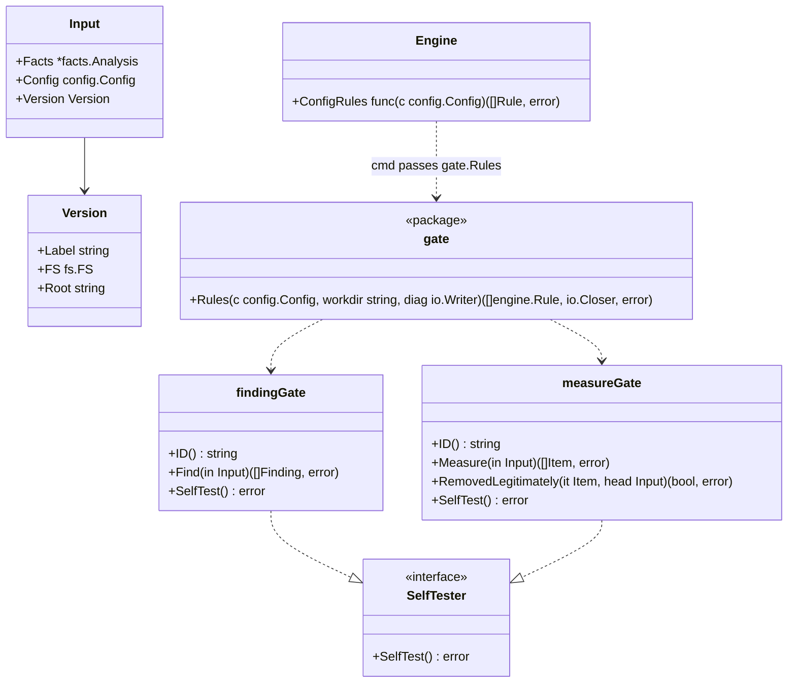

# Product-specific gates

## Responsibility

Package `internal/gate` turns the `gates` of a configuration into rules the engine runs like any built-in rule. Each gate is an external command in the product's repository; the protocol it speaks is in [external-gates.md](../external-gates.md).

It does:

- Build one rule per configured gate, with the gate's `id` as the rule ID, so markers, matching across versions and the report work unchanged
- Run the command once per version, with the version's tree on disk as the working directory, and read its JSON answer
- For measure gates, ask the command which missing items were removed legitimately, once per check
- Run the command's `--self-test` before `hadome check` uses the gate, and for `hadome self-test`

It does not:

- Compare versions. The engine does, exactly as for built-in rules
- Interpret findings. Whatever the command reports is the gate's verdict
- Fetch anything. Commands are files in the repository or programs on `PATH`

## Shape

- The engine calls `ConfigRules` once per check with head's configuration, and runs the rules it returns on both versions next to the built-in ones. Gates come from head like every other setting ([configuration.md](configuration.md)), so a gate added in a change judges base too and reports only what the change adds
- `Input` carries the `Version`, so a rule that needs files on disk can reach them. Built-in rules never use it
- `Version.Root` is the version's directory on disk when the version is one as it stands (a directory given with `--base-dir` or `--head-dir`). When it is empty — a revision from history, or the working tree, which a check copies into memory so that it sees one consistent snapshot — the gate package writes the version's files into a temporary directory once per check and removes it afterwards. Gates always see a real directory
- The engine stays free of process and file handling: running commands is this package's business, and `cmd/hadome` connects the two. `Rules` returns a closer that removes the copies; `cmd/hadome` closes it when the check is over
- A rule that implements `SelfTester` is tested by calling it, instead of by cases. `hadome self-test` loads the working tree's configuration to build the gate rules

## Running a command

| Step | Detail |
|---|---|
| Command | `run[0]` containing a `/` is a path relative to the directory hadome runs in (the repository's working tree), like shared configuration layers; otherwise it is looked up on `PATH`. So a gate added in the change also runs on base, and a command keeps its executable bit, which copies of a version do not |
| Working directory | The version's root |
| Input | The request of external-gates.md on standard input. `files` are the version's files matching `paths` (all files when `paths` is omitted), sorted |
| Output | Standard output is the JSON answer; standard error is passed to the user |
| Time | `timeout` (default 60s). A command still running then is stopped |
| Failure | A non-zero exit, invalid JSON, an unknown `schema`, or a timeout stops the check with exit code `2`: a check that could not run never passes |

`paths` are globs over slash-separated paths: `*` matches within one path element, `**` matches any number of elements.

## Configuration

| Key | Meaning |
|---|---|
| `id`, `kind`, `run`, `timeout` | As in the configuration of [external-gates.md](../external-gates.md) |
| `paths` | Globs of the files passed in. Omitted: every file |
| `options` | Any value; passed to the command untouched |

Gates are matched across versions by `id`. Any change to an existing gate needs review, not only removing it: a changed `run`, `paths` or `options` can make a gate more permissive in ways hadome cannot judge. The specification marks the list with `LooserWhenChanged` for this.

## Invariants

1. A gate's findings are compared across versions exactly like a built-in rule's
2. A gate that cannot run, or answers something that is not the protocol, never lets a check pass (exit code `2`)
3. Removing or changing a gate needs a person's review (exit code `3`)
4. The engine itself never starts a process

## Deliberately left out

- Running gates in parallel. One command at a time keeps diagnostics readable. The protocol does not stand in the way of running them in parallel
- Sandboxing. A gate runs with the permissions of any script in the repository (external-gates.md, "Trust")
