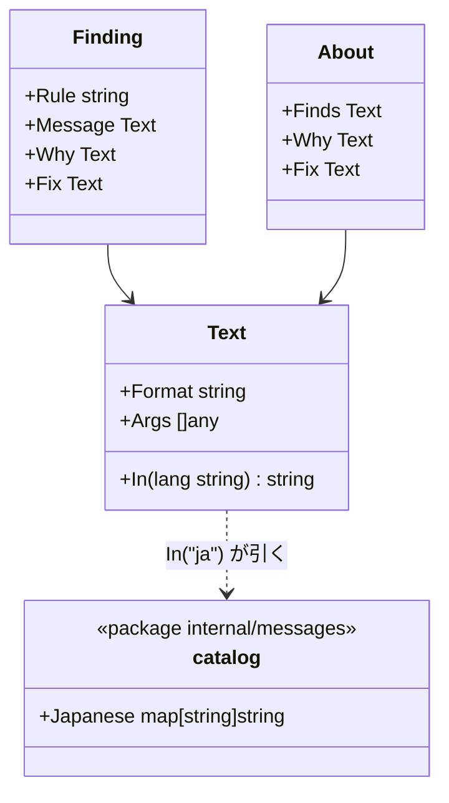

# メッセージの言語

hadome が人とエージェントに見せる文言を、英語か日本語で出します。比べ方・終了コード・JSON の形は、言語によって変わりません。

## 責務

- 違反の文言（`message`、`why`、`fix`）を、選んだ言語で出します。
- 次の文も同じ言語で出します。
  - `hadome explain <rule>` の文（`Finds`、`Why`、`Fix`）
  - テキストの出力のまとめの行（`2 regression(s). …`）
  - 一覧の前に置く説明の文（不変条件の候補、`introduced`）
- 日本語の文言が無いものは、英語で出します。

## しないこと

- 次のものは訳しません。エージェントとスクリプトが読む部分なので、言語によらず同じにします。
  - JSON のキー
  - ルールの ID
  - 終了コード
  - 例外の印（`gate:allow`）
  - 設定のキー
- 製品固有の門番が返す文言は訳さず、門番が書いたまま出します。
- 次のものも訳しません。理由は下の「意図して入れなかったもの」にあります。
  - 設定の誤り（`config.Error`）
  - コマンドの使い方
  - `hadome agents` 以外の文書

## 選び方

言語は次の表の優先の順に決めます。上の指定があれば、下の指定より先に使います。

| 優先 | 指定 | 例 |
|---|---|---|
| 1 | コマンドの `--lang` | `hadome check --lang ja` |
| 2 | `.hadome.yml` の `messages` | `messages: ja` |
| 3 | 既定 | `en` |

- 選べるのは `en` と `ja` だけです。`hadome agents --lang` と同じ値にそろえます。
- 環境変数やロケール（`LANG`）では選びません。手元と CI で文言が変わらないように、リポジトリの設定で決めます。
- `messages` を変えても、ルールは緩みません（`LooserNever`）。

## 形

- ルールは英語の書式で文言を作ります。`fmt.Sprintf` の代わりに `engine.T(format, args...)` を使い、書式と引数を `Text` に持たせます。
- 日本語の書式は、パッケージ `internal/messages` の目録に置きます。目録は英語の書式から日本語の書式への対応です。例: ``%s: changing `%s` to `%s` does not fail any test`` → ``%s: `%s` を `%s` に変えても、どのテストも落ちない``
- 文言を文字列にするのは、出力のときだけです。エンジンは選んだ言語で `Text.In` を呼びます。
- 依存の図には `internal/engine --> internal/messages` があります。`internal/messages` は hadome のものを何も import しません。

## 不変条件

1. 比べ方は文言に依りません。指紋は rule・file・anchor で作るので、言語を変えても後退の判定は変わりません。
2. 目録の日本語の書式は、英語の書式と同じ数・同じ種類の指定（`%s`、`%d`）を、同じ順に持ちます。
3. 組み込みのルールの自己テストで、全ケースが出す文言は、すべて目録にあります。これはテストで確かめ、目録に無い文言があればテストが落ちます。
4. 目録に無い文言は、英語で出します。空の文言は出しません。

## 意図して入れなかったもの

- **設定の誤りとコマンドの使い方の訳**: 設定のキーの名前が英語なので、誤りの文も英語のほうが照らし合わせやすいです。
- **英語と日本語のほかの言語**: 目録の形は言語を足せます。ただし、訳を保てる人がいない言語は足しません。
- **引数の中身の訳**: 関数の名前、パス、コードの断片がこれに当たります。
- **テキストの出力の見出しの訳**: 見出しは `why:`、`fix:`、`Finds:`、`new exception:` です。JSON のキーと同じ綴りにしておくと、テキストと JSON を照らし合わせやすくなります。一覧の前に置く説明の文は、照らし合わせるための綴りではなく読み手への説明なので、訳します。
