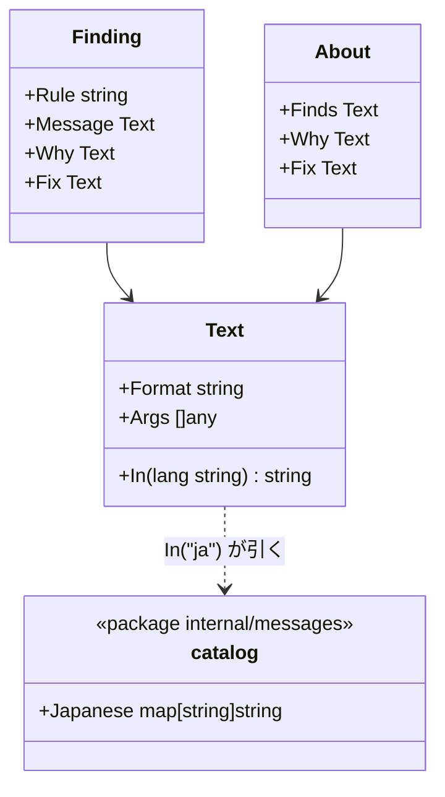

# メッセージの言語

hadome が人とエージェントに見せる文言を、英語か日本語で出す。比べ方、終了コード、JSON の形は、言語によって変わらない。

## 責務

- 見つけたものの文言（`message`、`why`、`fix`）を、選んだ言語で出す
- `hadome explain <rule>` の文（`Finds`、`Why`、`Fix`）と、テキストの出力のまとめの行（`2 regression(s). …`）を、同じ言語で出す
- 日本語が無い文言は英語で出す

## しないこと

- JSON の鍵、ルールの ID、終了コード、例外の印（`gate:allow`）、設定の鍵を訳さない。エージェントとスクリプトが読む部分なので、言語によらず同じにする
- 製品固有の門番が返す文言を訳さない。門番が書いたまま出す
- 設定の誤り（`config.Error`）、コマンドの使い方、`hadome agents` 以外の文書を訳さない（下の「意図して入れなかったもの」）

## 選び方

| 優先 | 指定 | 例 |
|---|---|---|
| 1 | コマンドの `--lang` | `hadome check --lang ja` |
| 2 | `.hadome.yml` の `messages` | `messages: ja` |
| 3 | 既定 | `en` |

- 選べるのは `en` と `ja` だけである。`hadome agents --lang` と同じ値にそろえる
- 環境変数やロケール（`LANG`）では選ばない。手元と CI で文言が変わらないように、リポジトリの設定で決める
- `messages` を変えても、ルールは緩まない（`LooserNever`）

## 形

- ルールは今と同じく英語の書式で文言を作る。`fmt.Sprintf` の代わりに `engine.T(format, args...)` を使い、書式と引数を `Text` に持たせる
- 日本語はパッケージ `internal/messages` の目録に置く。目録は英語の書式から日本語の書式への対応である（``%s: changing `%s` to `%s` does not fail any test`` → ``%s: `%s` を `%s` に変えても、どのテストも落ちない``）
- 文言を文字列にするのは出力のときだけである。エンジンは選んだ言語で `Text.In` を呼ぶ
- 依存の図には `internal/engine --> internal/messages` を足す。`internal/messages` は hadome のものを何も import しない

## 不変条件

1. 比べ方は文言に依らない。指紋は rule、file、anchor でつくるので、言語を変えても後退の判定は変わらない
2. 目録の日本語の書式は英語の書式と同じ数、同じ種類の指定（`%s`、`%d`）を、同じ順に持つ
3. 組み込みのルールの self-test の全ケースが出す文言は、すべて目録にある。テストで確かめ、無ければ落とす
4. 目録に無い文言は英語で出す。空の文言は出さない

## 意図して入れなかったもの

- 設定の誤りとコマンドの使い方の訳。設定の鍵の名前が英語なので、誤りの文も英語のほうが照らしやすい
- 英語と日本語のほかの言語。目録の形は言語を足せるが、訳を保てる人がいない言語は足さない
- 引数の中身（関数の名前、パス、コードの断片）の訳
- テキストの出力の見出し（`why:`、`fix:`、`Finds:`、`new exception:`）の訳。JSON の鍵と同じ綴りにしておくと、テキストと JSON を照らしやすい
