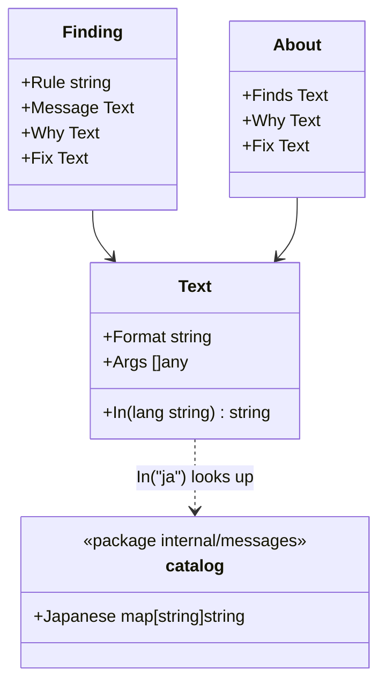

# The language of messages

hadome shows people and agents its wording in English or in Japanese. The comparison, the exit codes and the shape of the JSON do not change with the language.

## Responsibility

- The wording of findings (`message`, `why`, `fix`) comes out in the chosen language
- So do the text of `hadome explain <rule>` (`Finds`, `Why`, `Fix`) the summary line of the text output (`2 regression(s). …`), and the sentences that introduce a list (invariant candidates, `introduced`)
- Wording with no Japanese comes out in English

## What it does not do

- It translates no JSON keys, rule IDs, exit codes, exception markers (`gate:allow`) or configuration keys. Agents and scripts read these, so they stay the same in every language
- It does not translate what a product-specific gate returns. That comes out as the gate wrote it
- It does not translate configuration errors (`config.Error`), command usage, or documents other than `hadome agents` (see "Deliberately left out")

## How the language is chosen

| Precedence | Where | Example |
|---|---|---|
| 1 | The command's `--lang` | `hadome check --lang ja` |
| 2 | `messages` in `.hadome.yml` | `messages: ja` |
| 3 | Default | `en` |

- Only `en` and `ja` can be chosen, the same values as `hadome agents --lang`
- Environment variables and the locale (`LANG`) do not choose it. The repository's configuration decides, so the wording is the same locally and in CI
- Changing `messages` does not loosen any rule (`LooserNever`)

## Shape

- Rules write their wording in English formats, as now. Instead of `fmt.Sprintf` they call `engine.T(format, args...)`, which keeps the format and the arguments in a `Text`
- The Japanese lives in a catalog in package `internal/messages`. The catalog maps English formats to Japanese formats (``%s: changing `%s` to `%s` does not fail any test`` → ``%s: `%s` を `%s` に変えても、どのテストも落ちない``)
- Wording becomes a string only at output. The engine calls `Text.In` with the chosen language
- The dependency diagram has `internal/engine --> internal/messages`. `internal/messages` imports nothing of hadome's

## Invariants

1. The comparison does not depend on the wording. Fingerprints are rule, file and anchor, so changing the language never changes what is a regression
2. A Japanese format in the catalog holds the same number and kinds of verbs (`%s`, `%d`) as the English one, in the same order
3. Every wording the built-in rules' self-test cases produce is in the catalog. A test checks it and fails otherwise
4. Wording missing from the catalog comes out in English. Empty wording never comes out

## Deliberately left out

- Translating configuration errors and command usage. Configuration keys are English, so errors in English are easier to match against them
- Languages other than English and Japanese. The catalog can hold more, but a language nobody can keep translated is not added
- Translating what goes into the arguments (function names, paths, pieces of code)
- Translating the labels of the text output (`why:`, `fix:`, `Finds:`, `new exception:`). Spelled like the JSON keys, they make the text and the JSON easy to match against each other. The sentences that introduce a list are translated: they explain to the reader rather than match a key
