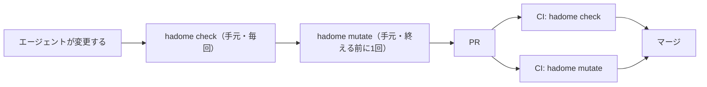
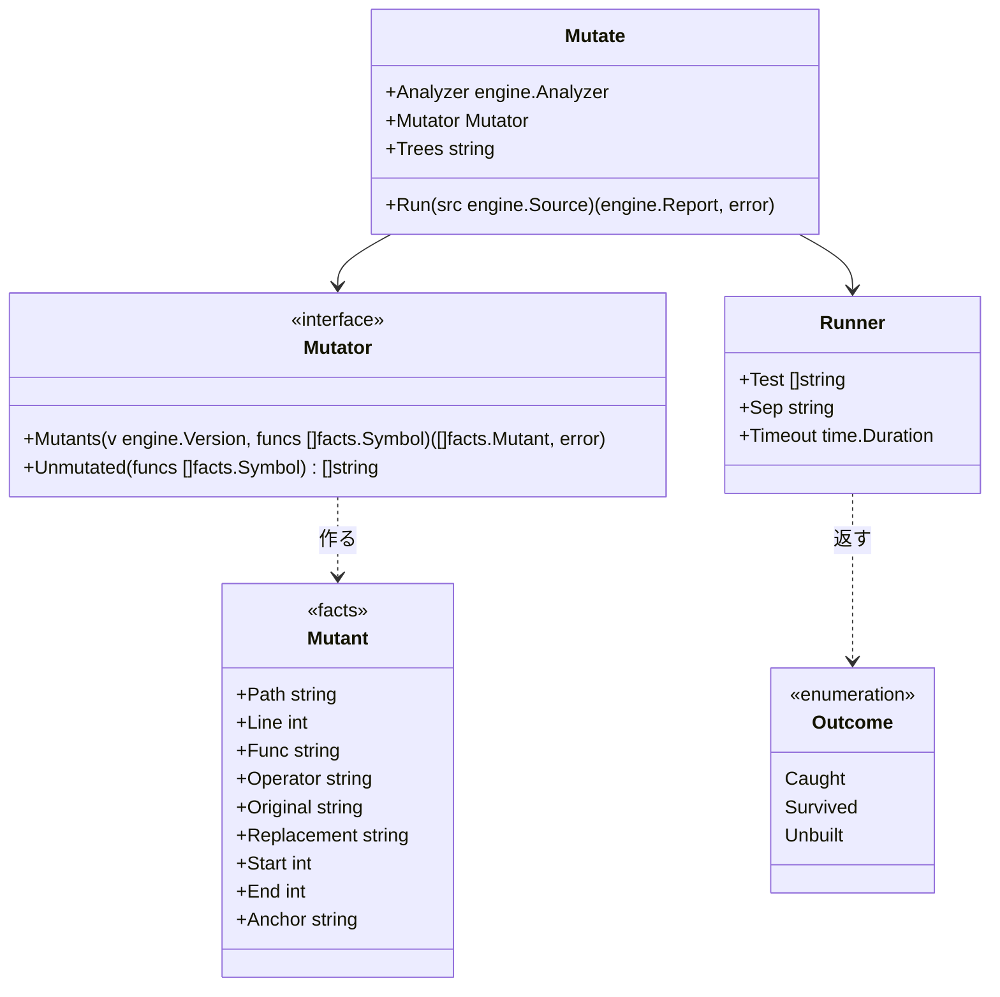
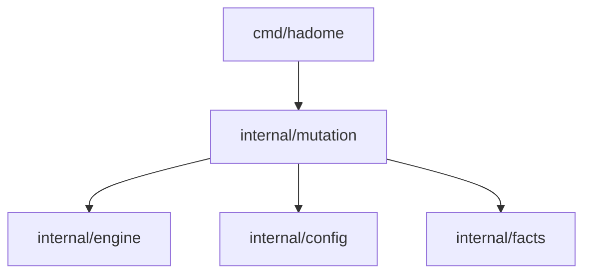
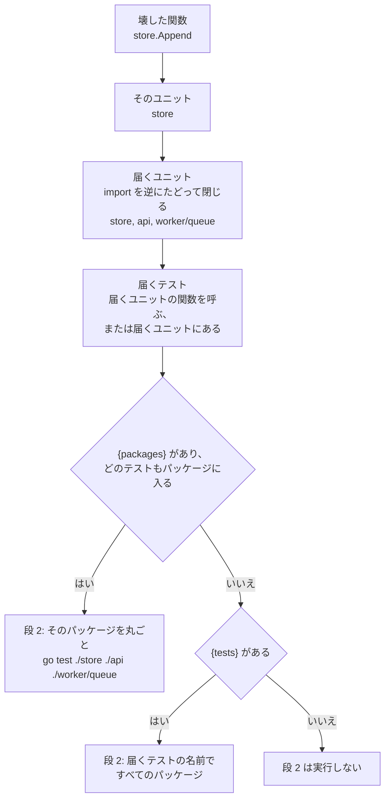

# ミューテーション

## 責務

パッケージ `internal/mutation` は変更で触ったコードをわざと少し壊し、テストがそれに気づくかを確かめます。

| 用語 | 意味 |
|---|---|
| **ミュータント** | 壊したコード |
| **捕まえた** | ミュータントを当てると、テストが落ちた |
| **生き残った** | ミュータントを当てても、テストが通った |
| **ビルドに入らない** | ミュータントのファイルを、設定のどのテストのコマンドのビルドもコンパイルしない。テストを流さず、生き残ったとも数えない |

`tests/` のルールは、テストが何を呼ぶかしか見ていません。呼んでいても、結果を確かめていなければ守っていません。ミューテーションは「製品のコードを壊したら、本当にテストが落ちるか」を見ます。そのため、守る範囲を `tests/` のルールより正しく測れます。

すること:

- 変更で触った関数を選び、アダプタに頼んでミュータントを作る
- 版のツリーを、リポジトリごとに決まった作業用のディレクトリに写し、ミュータントを1つずつ当てて、設定のテストのコマンドを実行する
- head で生き残ったミュータントのうち、変更で増えたものだけを後退として報告する

しないこと:

- **テストのコマンドを推測すること。** コマンドは必ず設定に書いてもらいます。`go`、`pytest`、`cargo` などを hadome が勝手に呼ぶことはありません
- **既存のミューテーションの道具（gremlins、mutmut、Stryker、PIT、cargo-mutants）を呼ぶこと。** 壊し方を持つ6言語（Go・TypeScript・Python・Rust・Java・Kotlin）で動きをそろえるためと、外の道具の入れ方や出力の形を追い続けないためです
- **変更で触っていないコードを壊すこと。** リポジトリ全体を毎回壊すと、時間が変更の大きさではなくリポジトリの大きさで決まってしまいます
- **`hadome check` の中で動くこと。** テストを何度も実行するので、別のコマンド `hadome mutate` にします

## 開発の流れ

`hadome check` と `hadome mutate` は、速さと確かめる深さが違います。そのため、流れの中で受け持つ場所を分けます。

| | `hadome check` | `hadome mutate` |
|---|---|---|
| 確かめること | 書き方と、テストが呼ぶもの | 製品のコードを壊したらテストが落ちるか |
| コードの実行 | しない | 設定のテストのコマンドを実行する |
| 時間 | 秒 | 分。ミュータントの数 × テストの時間 |
| 手元のエージェント | 変更を終える前に毎回 | 設定があれば、変更を終える前に1回 |
| CI | PR ごとに必須 | PR ごとに必須にすることを勧める |



### 使われ続けるようにする

hadome は利用者の CI の設定もブランチの保護も変えられません。PR で必須にするかは、リポジトリを持つ人が決めます。hadome は次の4つで `hadome mutate` が使われ続けるようにします。

1. **一度入れたら、外すには人の確認が要る。** 設定の `mutation` を消す・弱める変更は、ほかの設定と同じく `config/loosened` として人の確認（終了コード `3`）を求めます。エージェントが、遅いからと外すことはできません
2. **エージェントに伝える。** `hadome agents` のブロックに「`mutation` の設定があれば、変更を終える前に `hadome mutate` を実行する」と書いてあります
3. **CI への入れ方を示す。** [ci.ja.md](../ci.ja.md) に GitHub Actions の例があり、`check` と `mutate` を別のジョブにする形を示しています
4. **始めやすくする。** `hadome init` は、見つけた言語に合うテストのコマンドを、コメントにした `mutation` の設定として書きます。推測したコマンドを有効にはしません

### エージェント向けの手順

`docs/for-agents.ja.md` には次の節を置きます。

````markdown
## ミューテーションを試す

`.hadome.yml` に `mutation` があるときだけ。`hadome check` が `0` で終わったあと、変更を終える前に1回実行する。

```sh
hadome mutate --format json
```

| 終了コード | 意味 | すること |
|---|---|---|
| `0` | 変更で触ったコードを壊すと、どれもテストが落ちた | 終える |
| `1` | テストが気づかない壊し方がある | `regressions` の各エントリの `fix` に沿ってテストを足し、もう1度実行する |
| `2` | 何も壊していない状態でテストが落ちた、または設定が不正 | 先にテストを直す。`mutation` の設定は消さない |
| `3` | 人の確認が要る（上限を超えて試せなかった分がある、など） | 止まる。挙がったものを人に伝える |

- 製品のコードを変えてテストを通さない。`1` は、テストが足りないという知らせである
- 振る舞いを変えない置き換え（等価なミュータント）だと確かめたときだけ、`gate:allow mutation/survived reason: <理由>` を書く。理由には、なぜ結果が変わらないかを書く
- 遅いからと `mutation` の設定を消したり弱めたりしない。そうした変更は `3` になる

確かめ方: `hadome mutate` が `0` で終わる。
````

`hadome agents` が出す短い手順には「`mutation` の設定があれば、変更を終える前に `hadome mutate` を実行する」の1行を足します（上の 2）。

## 形



- **`Mutant`** は言語に依らない事実なので、`facts` に置きます。アダプタが `internal/mutation` に依存せずに作れるからです
- **`Mutator`** はアダプタが実装します。構文木を読めるのはアダプタだけだからです
  - 壊し方を持たない言語は、`Unmutated` が挙げます。その言語で触った関数は試せなかったものとして人の確認に回ります
  - ミュータントは「どこを、何に置き換えるか」という文字の範囲です。アダプタはコードを実行しません。アダプタの不変条件（コードを実行しない、プロセスを起動しない）はそのまま守られます
- **`Mutate.Trees`** は、版のツリーを写す作業用のディレクトリです（下の「作業用のディレクトリ」）。`hadome mutate` のコマンドが `TreesFor` で決めて渡します。テストは一時ディレクトリを渡します
- **`Runner`** はこのパッケージにあります。版のツリーを作業用のディレクトリに写し、ミュータントを当て、テストのコマンドを実行し、元に戻します。プロセスを起動するのはエンジンの外です。製品固有の門番（製品のリポジトリにある外部コマンド。`internal/gate`）と同じ置き方です
- **報告の形、例外の印、終了コード**は、エンジンのものをそのまま使います。`Mutate` はミュータントを試したあと、その結果を、版ごとに返す1つのルール（`mutation/survived`）として `engine.Check` に渡します。そのため、下の「比べ方」の決まりはエンジンの違反の比べ方とちょうど同じになります
- **ほかのコマンドが報告するルール**は、`engine.Engine.Elsewhere` で名指します。`hadome check` は `mutation/survived` を知らないので、名指さないと、その例外の印を「知らないルールの印」や「使われない印」として報告してしまいます。`check` は `mutation/survived` を、`mutate` はそれ以外のルールをほかに任せ、任せたルールの印には触りません

依存の図には次の矢印を足します。



## 壊す場所

壊すのは、次のどちらかに当たる関数だけです。

- 変更で本体を変えた関数（新しい関数を含む）
  - 同じ ID の関数が1つの版にいくつかあることがあります。例: ビルドタグで分けたファイルの同じ名前の関数（`*_unix.go` と `*_windows.go`）、Go の1つのパッケージの複数の `init`
  - そのため、関数を ID だけでなく本体で base と突き合わせます。base に同じ ID で本体も同じ関数が残っていれば、変えていない関数です。1つの base の関数は、head の関数1つとだけ組みます。例: `run_unix.go` の `run` だけを変えると、`run_windows.go` の `run` は選ばれません
- 変更で書き換えたテストが呼ぶ関数（`Test.Calls`）。製品のコードを変えずにテストだけを弱める変更も見逃さないためです

## 壊し方

壊し方は少数に絞ります。どれも1か所だけを変え、ほとんどのテストが気づけるものにします。

| 壊し方 | 例 |
|---|---|
| 比較を逆にする | `<` → `>=`、`==` → `!=` |
| 真偽を反転する | `ok` → `!ok`、`true` → `false` |
| 算術を入れ替える | `+` → `-`、`*` → `/` |
| ゼロの値を返す | `return total` → `return 0`（言語ごとのゼロの値） |
| 呼び出しの文を消す | `store.Append(row)` の行を消す |

元と同じ値になる壊し方は、ミュータントにしません。動きが変わらないので、どのテストでも捕まえられず、生き残りとして誤って報告されるためです。

- `return 0` は、ゼロの値を返す壊し方の対象にしません
- 値がゼロの定数を返す文も対象にしません。例: `ExitOK = 0` のとき、`return engine.ExitOK` は壊しません
- Go では、定数の値を、同じパッケージか同じモジュールのパッケージの宣言から、構文だけで読みます。値は定数の式として計算します。式に使えるのは、リテラル、`false`・`true`、`iota`、同じファイルでそれより前に宣言した定数、型変換、数・文字列・真偽値の演算です。例: `const Off Level = 1 - 1` は値がゼロの定数です
- TypeScript・Python・Rust・Java・Kotlin では、同じファイルの宣言だけを読みます（[adapters-treesitter.ja.md](adapters-treesitter.ja.md) の「ミュータント」）
- 値を読めない定数（ほかのモジュールの定数、読めないものを使った式の値、2つのファイルで違う値を宣言した定数）を返す文は、壊します

Go のゼロの値は、宣言した戻り値の型から決めます。

| 戻り値の型 | ゼロの値 |
|---|---|
| 数の型（`int`、`float64`、`byte` など） | `0` |
| `string` | `""` |
| `bool` | `false` |
| ポインタ、スライス、マップ、チャネル、関数、インタフェース（`error` と `any` を含む） | `nil` |
| 名前を付けた型（`type Code int` など） | 元の型のゼロの値。元の型が構造体なら、`status.Code{}` のように書いたとおりの型に `{}` を付けたもの |

- 名前を付けた型の元の型は、同じパッケージか同じモジュールのパッケージの宣言から、構文だけで読みます。例: `status` パッケージに `type Code int` があるとき、`func Parse(s string) status.Code` の `return code` は `return 0` にします
- 次の関数には、この壊し方を作りません
  - 結果が2つ以上ある関数
  - 戻り値の型が、要素の数が決まった配列、構造体の型そのもの（`struct{ … }`）、型パラメータ、型引数を付けた型（`Set[int]`）の関数
  - 元の型をたどれない型（ほかのモジュールの型、2つのファイルで宣言した型）を返す関数

ミュータントのアンカーは関数の名前、壊し方、正規化した元の行でつくります。行番号は入れません。そのため、変更で関数が動いても、同じミュータントとして照らし合わせられます。

1つ試すごとに、標準エラーに進み具合を1行書きます。行には、何個目か、ファイルと行、関数、壊し方、テストが気づいたかを書きます。言語はレポートと同じで、`--lang`、無ければ head の設定の `messages` に従います。例: `変異 1/2 calc/calc.go:5 calc.Sign、比較を逆にする: テストが気づいた`

## ビルドに入らないファイル

テストを流すビルドがコンパイルしないファイルを壊しても、テストはそのコードを1行も動かしません。テストが通るのは当然で、守られているかどうかは分かりません。例: `//go:build !cgo` のファイルは、cgo を有効にした `go test` ではコンパイルされません。これを生き残りとして報告すると、どのテストを足しても消えない後退になります。

そこで、設定の `builds` に、ほかのビルドでテストを流すコマンドを書けるようにします。ミュータントはそのファイルをコンパイルするコマンドで試します。どのコマンドもコンパイルしないファイルのミュータントは「ビルドに入らない」として分けます。

### ほかのビルドで試す

```yaml
mutation:
  test: [go, test, ./...]
  builds:
    - [env, CGO_ENABLED=0, go, test, ./...]
    - [go, test, -tags, integration, ./...]
```

- `builds` の要素はどれも `test` と同じ形のテストのコマンドです。`{tests}`・`{packages}` も `test` と同じ決まりで書けます
- コマンドがファイルをコンパイルするかは、コマンドごとに、下の「Go で見分けること」の決まりで決めます
- Go 以外のファイルはどのコマンドもコンパイルするものとして扱います。Go 以外ではビルドに入るかを見分けないためです（下の「意図して入れなかったもの」）

ミュータントはファイルをコンパイルするコマンドを、`test`、`builds` の順に使って試します。

| 結果 | すること |
|---|---|
| あるコマンドの段で、テストが落ちた | そこで「捕まえた」とします |
| あるコマンドの段 3 まで、テストが通った | ファイルをコンパイルする次のコマンドで、段 1 から試します |
| ファイルをコンパイルするコマンドを、すべて通った | 「生き残った」とします |

例: cgo によらない `store/store.go` は `test` も `CGO_ENABLED=0` のコマンドもコンパイルします。`test` で生き残ったら、`CGO_ENABLED=0` のコマンドでも試します。`//go:build !cgo` のファイルは `test` がコンパイルしません。そのため、はじめから `CGO_ENABLED=0` のコマンドで試します。

- **次のコマンドでも試す理由。** ビルドによって、コンパイルされるテストが違います。例: `//go:build !cgo` のテストのファイルは `test` では流れません。最初のコマンドだけで決めると、ほかのビルドのテストが捕まえるミュータントを、生き残りとして報告してしまいます
- **時間。** ほとんどのミュータントは最初のコマンドで捕まります。次のコマンドで試すのは生き残ったものだけです
- **段はコマンドごとに作ります。** 段 1〜3 はそのとき使うコマンドから作ります（上の「流すテストを絞る」）。段 2 のコマンドはテストのコマンドとユニットの組ごとに1つです
- **壊す前の1回。** `builds` のコマンドも `test` と同じく、壊す前に1回流します（下の「設定」）。流すのはそのコマンドで初めてミュータントを試すときです。段 3 が壊す前に落ちたら、結果を出さずに終了コード `2` を返します
- **base でも同じ。** base で試し直すミュータントも、同じ順にコマンドを使います。コンパイルするかは base のファイルで決めます。base でどのコマンドもコンパイルしないミュータントは base に無いものとして扱います（下の「比べ方」の 3）
- `builds` のコマンドで試したミュータントの進み具合の行には、そのコマンドを書きます

### ほかの OS とアーキテクチャ

`builds` のコマンドのうち、GOOS か GOARCH が hadome を実行している環境と違うものは、流しません。例: macOS では、`[env, GOOS=windows, go, test, ./...]` を流しません。

- **流さない理由。** ほかの OS やアーキテクチャのテストのプログラムは多くの場合この環境では起動できません。起動できるか（エミュレータが入っているか、など）で、結果が変わらないようにします
- **クロスコンパイルだけもしません。** コンパイルが通っても、テストは流れていません。テストが捕まえるかは分かりません
- そうしたファイル（例: macOS での `runner_windows.go`）は、下の「ビルドに入らない」になります。そのファイルをコンパイルする環境（例: Windows の CI のジョブ）で `hadome mutate` を流すと、そこで試せます

### ビルドに入らない

`test` も `builds` も、どのコマンドもコンパイルしないファイルのミュータントは、次のように扱います。

- **テストを流しません。** 進み具合の行には `ビルドに入らない` と書きます
- **生き残ったとも捕まえたとも数えません。** 後退（終了コード `1`）にはしません
- **人の確認に回します（終了コード `3`）。** ファイルごとに1件、`mutation/survived` の確認として挙げます。メッセージには、ファイルと、試さなかったミュータントの数を書きます。試していないものを黙って通さないためです（不変条件 5）
- **`max-mutants` の数には入れません。** 上限は、実際にテストを流すミュータントの数です

### Go で見分けること

Go のファイルがビルドに入るかは、構文だけで決めます。`go list` などのコマンドは実行しません。

| 見ること | 例 |
|---|---|
| `//go:build` の行 | `//go:build !cgo`、`//go:build ignore`、`//go:build linux && amd64` |
| ファイル名の `_GOOS`・`_GOARCH` | `poll_windows.go`、`asm_arm64_test.go` |
| `_` か `.` で始まるファイル名 | `_scratch.go` |

`go/build` の `MatchFile` と同じ決まりです。比べる環境は、テストのコマンド（`test` と `builds` の要素）ごとに、次のように決めます。

- 元にするのは、hadome を実行している環境です。GOOS、GOARCH、cgo は `go/build` の既定（`go/build.Default`）に従います。cgo は `CGO_ENABLED` を見て、無ければ C コンパイラが見つかるかで決まります
- コマンドに `CGO_ENABLED=0`・`GOOS=…`・`GOARCH=…` の要素があれば、それを使います。例: `[env, CGO_ENABLED=0, go, test, ./...]`
- コマンドに `-tags` があれば、そのタグも満たされるものとします。例: `[go, test, -tags, integration, ./...]` や `-tags=integration`

## 比べ方

ほかのルールと同じく、変更で増えたものだけを後退にします。

1. head で、壊す場所のミュータントをすべて実行します。捕まえたものはそこで終わりです。設定に `{tests}` や `{packages}` があれば、流すテストを絞ります（下の「流すテストを絞る」）
2. 生き残ったミュータントごとに、同じアンカーのミュータントが base にあるかを見ます
3. base に無い（新しい関数、新しい行、書き換えた行）なら、後退にします。新しいコードを足すなら、それを守るテストも足します
4. base にあれば、base でも実行します
   - base で捕まえていたなら、後退にします（テストが弱くなった）
   - base でも生き残っていたなら、前からある穴なので報告しません

base で実行するのは、head で生き残ったものだけです。そのため、時間のほとんどは head の1回分で済みます。

### 流すテストを絞る

ミュータントの数は変更の大きさで決まり、テストの数では決まりません。ただし、ミュータントを1つ試すたびにテストのコマンドを丸ごと実行するので、テストが多いリポジトリでは1回が長くなります。例: テスト全体に5分かかるなら、ミュータント15個で75分になります。

そこで、壊した関数を呼ぶテストだけを流せるようにします。どのテストがどの関数を呼ぶかは、アダプタが読んだ `Test.Calls` で分かります。テストの名前やパッケージを渡す書き方は言語ごとに違うので、hadome は推測しません。設定の `test` に、次の書き方を入れてもらいます。

| 書き方 | 入るもの | 例 |
|---|---|---|
| `{tests}` | 壊した関数を呼ぶテストの名前。名前はそのまま入れ、`tests-separator` でつなぐ | `-run, "^({tests})$"` |
| `{packages}` | そのテストがあるパッケージ。パッケージ1つにつき要素1つに広げる（下の「パッケージ」） | `go, test, "{packages}"` |
| `{module}` | Go のモジュールのディレクトリ。モジュールごとに分けて実行する（下の「モジュール」） | `go, -C, "{module}", test, "{packages}"` |

ミュータントごとに、次の段を狭いほうから順に実行します。どこかの段でテストが落ちたら、そこで「捕まえた」とします。最後の段まで通ったものだけを「生き残った」とします。

| 段 | 流すテスト | `{packages}` があるとき | `{packages}` が無く、`{tests}` があるとき |
|---|---|---|---|
| 1 | 壊した関数を呼ぶテスト | そのテストのパッケージで、名前を入れて流す | — |
| 2 | 壊した関数に届くテスト（下の「呼び出し側の段」） | そのテストのパッケージを、名前で絞らずに丸ごと流す | すべてのパッケージで、名前を入れて流す |
| 3 | テスト全部 | すべてのパッケージにし、名前で絞らない | 名前で絞らない |

- 設定に無い書き方を使う段は、前の段と同じコマンドになります。同じコマンドは1度だけ実行します。例: `{tests}` だけの設定では、段 2 と段 3 を実行します。どちらも無い設定では、段 3 だけを実行します
- 壊した関数を呼ぶテストが1つも見つからないミュータントは、段 1 を飛ばします。壊した関数に届くテストも見つからなければ、段 3 だけを実行します
- 段 2 が流すテストがテスト全部と同じになるときは、段 2 を実行しません。例: 届くテストのパッケージが、テストのあるパッケージのすべてになったとき
- 段のコマンドは、どれも壊す前に1度実行します（下の「壊す前の1回」）。壊す前に落ちる段は、そのミュータントの判定に使わず、次の段に回します。壊したせいで落ちたのか、もともと落ちるのかが分からないからです

段を重ねても、判定は段 3 だけで決めた場合と同じになります。

- **前の段で捕まえたもの。** 段 1・2 が流すテストはどれもテスト全部の一部です。前の段で落ちたテストは、段 3 でも流れて落ちます。そのため、前の段で捕まえたものは、段 3 でも捕まえます
- **前の段を通ったもの。** 次の段で確かめ直します。呼び出し側を求めるときに取りこぼしがあり、そのテストを外してしまっても、段 3 で流すので、誤った生き残りは報告に出ません
- **時間。** ほとんどのミュータントは狭い段で捕まります。テスト全部を流すのは、段 1・2 を通ったものだけです

**`{tests}` を外したコマンド**は、`{tests}` を含む要素を除いたものです。その直前の要素がフラグ（`-` で始まる）なら、それも除きます。例: `[go, test, "{packages}", -run, "^({tests})$"]` の段 3 は `[go, test, ./...]` になります。

#### 呼び出し側の段

段 2 は壊した関数を直接は呼ばないが、ほかの関数を通して届くテストを流す段です。例: テストが `api.Handle` を呼び、`api` が `store` を import していれば、そのテストは `store.Append` を壊したミュータントに届きます。段 1 はこのテストを流しません。テストの `Calls` に `store.Append` が無いからです。

**責務**

- 壊した関数に届くテストを版の事実だけから求めます
- そのテストを設定のテストのコマンドで流せる形（パッケージか名前）にして、段 2 のコマンドを作ります

**しないこと**

- コマンドを起動して、呼び出し側を調べること（`go list -deps` など）。モジュールの取得やキャッシュに左右されます。調べるのはアダプタがすでに読んだ事実だけです
- 判定を決めること。段 2 を通ったミュータントは、段 3 で確かめ直します。生き残りを決めるのはいつも段 3 です
- テストを計測付きで流すこと。どのテストが届くかはコードを動かさずに読みます

**届くテストの求め方**

単位は依存のルールと同じユニット（`facts.File.Unit`）です。Go ではパッケージ、TypeScript ではディレクトリ、Java と Kotlin ではパッケージです（[adapters.ja.md](adapters.ja.md)）。

1. 壊した関数のユニットを、その関数のファイルから求めます
2. 届くユニットの集まりを作ります。初めは壊した関数のユニットだけです。製品のコードの import（`facts.Import` の `Internal` が真のもの）を逆にたどり、届くユニットを import するユニットを足します。足すものが無くなるまで繰り返します
3. 届くテストはスキップされていないテストのうち、次のどちらかに当たるものです
   - `Calls` のどれかが、届くユニットの関数を呼ぶ
   - テストのファイルが、届くユニットにある
4. 段 2 のコマンドは届くテストから作ります
   - `{packages}` があり、届くテストがどれも段 1 と同じ決まりでパッケージに入るとき: そのテストのパッケージを `{packages}` に入れ、`{tests}` を外します
   - そうでなく、`{tests}` があるとき: 届くテストの名前を `{tests}` に入れ、`{packages}` はすべてのパッケージにします
   - どちらでもなければ、段 2 はテスト全部と同じコマンドになり、実行しません



- **閉じるまでたどる理由。** import の深さで打ち切ると、深いところの関数を壊したミュータントが段 3 まで落ちます。ユニットの数は関数の数よりずっと少ないので、閉じるまでたどっても手間はわずかです
- **ユニットでたどる理由。** 製品のコードの import は、どの言語のアダプタも同じ形で事実にしています。関数ごとの呼び出しの事実は言語によって揃っていません
- **ユニットごとに1つ。** 届くユニットは壊した関数のユニットだけで決まります。同じユニットの関数を壊したミュータントは、同じ段 2 のコマンドを使います。そのため、段 2 の壊す前の1回は、壊したユニットの数だけで済みます
- **base でも同じ。** base で試し直すミュータントの段 2 は、base の事実から求めます

#### パッケージ

パッケージを何の単位とするかは、言語ごとに違います。hadome が `{packages}` を決めているのは Go だけです。

| 言語 | パッケージ | 段 1・2 で `{packages}` に入るもの | 段 3 で `{packages}` に入るもの |
|---|---|---|---|
| Go | `_test.go` のファイルがあるディレクトリ | `./store`、`./worker/queue`。ルートのディレクトリは `.` | `./...` |
| TypeScript・Python・Rust・Java・Kotlin | 決めない | — | — |

- `{packages}` は、要素1つをまるごと占めるように書きます。例: `"{packages}"` は書けますが、`"./{packages}/..."` は書けません。パッケージ1つにつき要素1つに広げるためです。2回以上書くこともできません
- テストのコマンドに `-C <ディレクトリ>`（`-C=<ディレクトリ>` も）があれば、パスはそのディレクトリから見たものにします。そのディレクトリの外にあるテストと、そのディレクトリとは別のモジュールにあるテストは、パッケージに入れません
- `{module}` があれば、パスはそれぞれのモジュールのディレクトリから見たものにします（下の「モジュール」）
- 壊した関数を呼ぶテストに Go 以外のテストがあるときや、パッケージに入らないテストがあるときは、そのミュータントの段 1 を飛ばします。パッケージで絞ると、そのテストを外してしまうからです。段 2 も、届くテストに同じものがあれば、パッケージでは絞らず、名前で絞ります

Go 以外の言語では `{packages}` を使えません。黙って何もしない書き方を残さないため、次のときは設定の誤りとして止まります。

- `languages` に `go` が無い設定に `{packages}` がある。`hadome config check` と、設定を読むどのコマンドも、終了コード `2` で止まります
- `languages` を書かない設定で、head に Go のファイルが1つも無いのに `{packages}` がある。`hadome mutate` が終了コード `2` で止まります

`{module}` も Go だけで使えます。上の2つのときは、`{packages}` と同じく設定の誤りとして止まります。

#### モジュール

Go のリポジトリには、`go.mod` が2つ以上あることがあります。例: 入れ子のモジュール、`go.work` でまとめたワークスペース。`go test` が扱うのは、実行したディレクトリのモジュールのパッケージだけです。

| ルートで実行するコマンド | 流れるテスト |
|---|---|
| `go test ./...` | ルートのモジュールのテストだけ。入れ子のモジュール `tools/` のテストは流れません。`go.work` があっても同じです |
| `go test ./tools/lint` | `go.work` が無ければ、ルートのモジュールにそのパッケージが無いとして落ちます |

そのため、`tools/` のコードを壊したミュータントをルートの `./...` だけで試すと、`tools/` のテストは1つも流れません。生き残っても、テスト全部で生き残ったとは言えません。

- **モジュール**は `go.mod` のあるディレクトリです
- ファイルのモジュールはそのファイルを含むいちばん近いモジュールです。アダプタが import のパスを決めるときと同じ決まりです

**`{module}` があるとき**

`{module}` を含むコマンドはモジュールごとに1回ずつ実行します。`{module}` には、モジュールのディレクトリをルートから見たパスを入れます。ルートのモジュールは `.` です。`{module}` は要素の一部にも書けます。例: `-C={module}`。

| 段 | 実行するモジュール | `{packages}` に入るもの | `{tests}` に入るもの |
|---|---|---|---|
| 1 | 壊した関数を呼ぶテストがあるモジュール | そのモジュールにある、そのテストのパッケージ | そのモジュールにある、そのテストの名前 |
| 2 | 届くテストがあるモジュール | そのモジュールにある、届くテストのパッケージ | そのモジュールにある、届くテストの名前 |
| 3 | `_test.go` のファイルがあるモジュールすべて | `./...` | 外す |

例: `tools/lint/lint_test.go` のテストは、`tools` のモジュールで `{packages}` が `./lint` になります。

- **段の判定。** モジュールごとの実行をまとめて決めます。どれかの実行でテストが落ちたら、捕まえたとします。すべて通ったら、次の段に進みます
- **壊す前の1回と時間切れの上限。** モジュールごとの実行のそれぞれで決めます。壊す前に落ちる実行は判定に使いません。段 3 のどれかの実行が壊す前に落ちたら、結果を出さずに終了コード `2` を返します
- **段 2 のコマンド。** ユニットごとに1つであることは変わりません。モジュールごとの実行はその1つのコマンドを分けて実行したものです
- **テストの無いモジュール。** `_test.go` が1つも無いモジュールは段 3 で実行しません。流すテストが無いからです。ほかのモジュールのテストがそのモジュールのコードに届くときは、そのテストのモジュールの実行で流れます

**`{module}` が無いとき**

コマンドを実行するディレクトリ（ルートか、`-C` のディレクトリ）を含むモジュールを、コマンドのモジュールとします。モジュールが2つ以上ある版では、コマンドのモジュールの外にある Go のファイルのミュータントを、次のように扱います。

- **テストは流します。** 捕まえたら、捕まえたとします。流したテストはどれも、そのリポジトリのテストだからです
- **生き残っても、後退にはしません。** ファイルごとに1件、人の確認（終了コード `3`）に回します。メッセージには、ファイルと、テストを流さなかったモジュールを書きます。そのモジュールのテストを流していないので、テスト全部で生き残ったとは言えません（不変条件 5）
- **`{packages}` に入れるテストも、コマンドのモジュールのものだけです。** ほかのモジュールのテストはパッケージに入らないテストとして扱います（上の「パッケージ」）

テストのコマンドがシェルのスクリプトで、中でモジュールを順に回していても、hadome にはそれが見えません。そうしたリポジトリでは `{module}` を使います。

後退は `mutation/survived` として報告します。

```json
{
  "rule": "mutation/survived",
  "file": "store/store.go",
  "line": 21,
  "message": "store.Append: changing `<` to `>=` does not fail any test",
  "why": "the code can do the opposite of what it does now and the tests still pass",
  "fix": "add a test that checks the result of this comparison"
}
```

振る舞いを変えない置き換え（**等価なミュータント**）もありえます。例: `i < n` と `i != n` が同じ結果になるループ。そうしたものには理由つきの例外の印（`gate:allow mutation/survived reason: <理由>`）を書きます。

## 設定

```yaml
mutation:
  test: [go, test, ./...]   # 必須。ミュータントごとに、版の写しの直下で実行する
  timeout: 2m               # 任意。1回のテストの上限。既定は、同じコマンドの壊す前の1回の時間の3倍
  max-mutants: 100          # 任意。1回の実行で試すミュータントの上限。既定は 100
  builds:                   # 任意。test がコンパイルしないファイルのために、ほかのビルドでテストを流すコマンド
    - [env, CGO_ENABLED=0, go, test, ./...]
```

`max-mutants` の既定の 100 は、1回のテストが10秒なら、最大でおよそ17分になる数です。

テストを絞るときの例:

```yaml
mutation:
  test: [go, test, "{packages}", -run, "^({tests})$"]   # {packages} にテストのパッケージ、{tests} にテストの名前が入る
  tests-separator: "|"                                 # 任意。名前の区切り。既定は "|"
```

- **壊す前の1回。** 段のコマンドごとに、壊す前に1回実行します。版ごと（head と base）に、そのコマンドを初めて使うときに実行し、結果をその実行のあいだ覚えておきます
  - 段 3（テスト全部）は、ミュータントを試す前に実行します。落ちたら、何も壊さずに終了コード `2` を返します。もともと落ちるテストでは、ミュータントを捕まえたかが分からないからです
  - 段 1・2 のコマンドが落ちたら、その段を判定に使わず、次の段に回します（上の「流すテストを絞る」）。進み具合の行に、そのコマンドと、段を飛ばしたことを書きます
  - 段 2 のコマンドは、テストのコマンドと壊した関数のユニットの組ごとに1つです。壊す前の1回も、その組ごとに1回です
- **壊す前の1回で足すコメント。** 壊す前の1回では、ミュータントのあるファイルすべての末尾に、1行のコメントを足します。終わったら元に戻します
  - コメントには、その1回だけの印を入れます。例: `// hadome mutate baseline 9c1e04d2-3`
  - コメントの書き方は言語で決めます。Python は `#`、ほかの言語は `//` です
  - 足す理由: ビルドやテストの結果のキャッシュは、ファイルの中身で引きます。中身が前と同じだと、壊す前の1回だけがキャッシュに当たって短く測れます。すると上限が短くなりすぎ、時間切れで誤って捕まえたことになります。コメントを足すと、ミュータントを当てたときと同じファイルでキャッシュが外れます
- **時間切れの上限。** コマンドごとに、そのコマンドの壊す前の1回の時間の3倍に1秒を足したものです。例: 段 1 の上限は段 1 のコマンドの時間から、段 2 の上限はそのユニットの段 2 のコマンドの時間から、段 3 の上限はテスト全部の時間から決めます。`timeout` を書けば、すべての段にその値を使います
- **時間切れ。** 確かめた上限で時間切れになったら、捕まえたものとして扱います。壊したことで止まらなくなったのを、テストが通ったとは言えないからです
- **上限を確かめる。** 上限は壊す前の1回から決めるので、マシンが重くなると、壊していないテストも上限を超えます。そのまま捕まえたことにすると、生き残ったミュータントを見落とします。そこで、壊したあとの1回が上限を超えたら、次のようにします
  1. そのコマンドの壊す前の1回をやり直し、その時間から上限を決め直します
  2. 決め直した上限が前の上限より長ければ、マシンが重くなっています。上限を決め直したものに上げ、壊したあとの1回をやり直します
  3. 決め直した上限が前の上限より長くなければ、上限は確かです。時間切れを、捕まえたものとして扱います
  - やり直すのは、壊したあとの1回ごとに2回までです。2回やり直しても時間切れなら、捕まえたものとして扱います。そのため、本当に止まらなくなったミュータントも、壊したあとの1回を3回と壊す前の1回を2回流せば、必ず終わります
  - やり直した壊す前の1回が落ちたときは、上限を確かめられません。時間切れを、捕まえたものとして扱います
  - 上げた上限は、そのあとのミュータントでも、そのコマンドに使います
  - `timeout` を書いたときは、上限を確かめません。書いた値が上限です
- **緩める変更。** 次の変更は緩める変更として人の確認を求めます。`max-mutants` には、小さいほうが緩い向き（`LooserWhenLower`）を使います
  - `mutation` を消す
  - `max-mutants` を下げる
  - `test` を変える。`{tests}`、`{packages}`、`{module}` を足す・外すのもこれに入ります
  - `timeout` や `tests-separator` を変える
  - `builds` を変える。要素を足す・外す・書き換えるのも、これに入ります
- **base に無いとき。** base に `mutation` が無いときに足すのは、緩める変更にしません。base では `mutate` が動いていなかったからです（`OmittedIsOff`）

## 作業用のディレクトリ

版のツリーは、リポジトリごと、版の役割（head と base）ごとに決まったディレクトリに写します。パスが毎回同じなら、パスを含めて引くビルドのキャッシュが次の実行でも当たるからです。例: Go のテストのプログラムは、写した先のパスを中に持ちます。

| もの | パス |
|---|---|
| head の写し | `<キャッシュのディレクトリ>/hadome/mutate/<リポジトリの印>/head` |
| base の写し | `<キャッシュのディレクトリ>/hadome/mutate/<リポジトリの印>/base` |
| 鍵のファイル | `<キャッシュのディレクトリ>/hadome/mutate/<リポジトリの印>/lock` |

- **キャッシュのディレクトリ**は、Go の `os.UserCacheDir` が返すものです。例: macOS は `~/Library/Caches`、Linux は `$XDG_CACHE_HOME` か `~/.cache`、Windows は `%LocalAppData%`
- **リポジトリの印**は、リポジトリのルートの絶対パス（シンボリックリンクをたどったもの）の SHA-256 の、先頭16文字です。ルートは、リビジョンを比べるときは `hadome mutate` を実行したディレクトリ、`--head-dir` で比べるときは head のディレクトリです

### 中身をそろえる

実行のはじめに、写し先の中身を版とちょうど同じにします。前の実行の残りで結果が変わらないようにするためです。

| 写し先のファイル | すること |
|---|---|
| 版に無い | 消す。前の実行のビルドの出力や、途中で止まった実行が残した壊したファイルも消える。版に無いディレクトリも消す |
| 版と中身が違う | 書き直す |
| 版と中身が同じ | 触らない。更新の時刻で引くキャッシュも当たるようにするため |

- hadome は写し先を消しません。次の実行で使うためです。要らなくなったら、`<キャッシュのディレクトリ>/hadome/mutate` を手で消してかまいません

### 同時に2つ動かさない

同じリポジトリで `hadome mutate` を2つ同時に動かすと、写し先を取り合います。そこで、2つ目は待たずに止まります。

- 2つ目は終了コード `2` で止まります。メッセージには、動いているほうのプロセスの番号と、鍵のファイルのパスを書きます。待たせると、止まっている理由が利用者に見えないからです
- 鍵は、鍵のファイルに OS のファイルの鍵を掛けて作ります。Unix では `flock`、Windows ではほかから開けない形で開きます
- プロセスが終われば、落ちた場合も含めて OS が鍵を外します。そのため、古い鍵が残って止まることはありません。鍵のファイル自体は残りますが、鍵が掛かっていなければ次の実行が使えます

## テストのプロセス

テストのコマンドの1回は、1つのプロセスではなく、プロセスの木です。例: `go test` は、パッケージごとにテストのプログラム（`calc.test`）を作って起動します。作るときには `compile` や `link` も起動します。`go` だけを止めると、ほかは親を失ったまま動き続けます。止まらなくなったテストのプログラムがミュータントごとに残ると、マシンが重くなり、最後には止まります。

そこで hadome は、木をまとめて終わらせます。

| とき | すること |
|---|---|
| 時間切れ | 木をまとめて終わらせる。上限を確かめてから、ミュータントは捕まえたものとして扱う（上の「上限を確かめる」） |
| 中断（Ctrl-C、`SIGTERM`、`SIGHUP`） | 木をまとめて終わらせてから、hadome も同じシグナルで終わる |
| コマンドが終わった | 木に残ったプロセスを、何も言わずに終わらせる。結果はコマンドの終了コードで決める |

- **まとめ方。** Unix（macOS、Linux）では、コマンドを専用のプロセスグループで起動し、グループごと `SIGKILL` で終わらせます。Windows では、コマンドをジョブオブジェクトに入れ、ジョブごと終わらせます
  - Windows では、コマンドを止めた状態で起動し、ジョブに入れてから動かします。ジョブに入る前に子を起動させないためです
- **中断を hadome が受ける理由。** コマンドは端末のプロセスグループの外にいるので、端末の Ctrl-C が届きません。代わりに hadome が受けて、木を終わらせます。起動したときに無視していたシグナル（`nohup` の下の `SIGHUP` など）は、無視したままにします
- **残ったプロセスを黙って終わらせる理由。** テストのコマンドが残すプロセス（立てたサーバー、ビルドの道具のデーモンなど）は、次のミュータントの実行に入り込んで結果を揺らします。毎回残すコマンドでは、報告しても同じ行が並ぶだけです
- **Windows で hadome が落ちたとき。** ジョブは、最後のハンドルが閉じると中身を終わらせる設定（`JOB_OBJECT_LIMIT_KILL_ON_JOB_CLOSE`）で作ります。hadome がどう終わっても、木は残りません

## 不変条件

1. 何も壊していないツリーでテストが落ちるとき、`hadome mutate` は結果を出さずに終了コード `2` を返します
2. リポジトリの作業ツリーは書き換えません。壊すのは、作業用のディレクトリに写した版だけです
3. 同じ版の組と設定からは、いつも同じミュータントが同じ順に作られます
4. base で前から生き残っていたミュータントで、変更を落とすことはありません
5. 試せなかったミュータント（上限を超えた分、ビルドに入らないファイルの分、壊し方を持たない言語で触った関数）は、黙って通さずに報告し、終了コード `3`（人の確認）にします。試していないものを、捕まえたとも生き残ったとも言えないからです
6. テストを絞った実行だけで生き残ったミュータントは、報告しません。ファイルをコンパイルするどのコマンドのテスト全部でも生き残ったものだけを報告します
7. 段を重ねても、判定は、ファイルをコンパイルするコマンドそれぞれの段 3（テスト全部）だけで決めた場合と同じです。段 1・2 が流すテストはどれもテスト全部の一部です
8. 段 2 が流すテストは、版の事実だけから決まります。呼び出し側を求めるために、コマンドを起動することはありません
9. 段 2 のコマンドは、テストのコマンド（`test` か `builds` の要素）と壊した関数のユニットの組ごとに1つです
10. 壊す前に落ちるコマンドで、ミュータントを捕まえたとはしません
11. テストを流す前の写し先の中身は、いつも版とちょうど同じです
12. 同じリポジトリで2つの `hadome mutate` が同時にテストを流すことはありません
13. テストのコマンドが起動したプロセスは、その1回が終わったあと、どれも動いていません。時間切れ、中断、コマンドの終了のどれで終わっても同じです
14. 時間切れで捕まえたとするのは、次の3つのときだけです（上の「上限を確かめる」）
    - 壊す前の1回をやり直して確かめた上限を超えたとき
    - やり直した壊す前の1回が落ちて、上限を確かめられなかったとき
    - 上限を上げてやり直すことを2回続けても、上限を超えたとき
15. 1つのミュータントで流すテストの回数には上限があります。止まらなくなったミュータントも、必ず終わります
16. ミュータントは、そのファイルをコンパイルするコマンドでだけ試します。コンパイルしないコマンドの結果で、捕まえたとも生き残ったともしません
17. GOOS か GOARCH が hadome を実行している環境と違うコマンドは、流しません
18. Go のモジュールが2つ以上ある版で、ミュータントのファイルのモジュールのテストを流さずに、生き残ったと報告することはありません
19. `{module}` があるとき、段 3 は `_test.go` のファイルがあるモジュールすべてでテストを流します

## 意図して入れなかったもの

- **ミュータントの並列実行。** 1つずつのほうが、テストのコマンドが共有するもの（ポート、一時ファイル）で結果が揺れません
- **結果のキャッシュ。** 版の組が変われば結果も変わるので、使い回せる場面が少ないです
- **リポジトリ全体を壊すモード。** 時間が変更の大きさではなく、リポジトリの大きさで決まってしまいます
- **言語ごとのビルドの使い回し（既存の道具が速い理由）。** 6言語で同じ動きにそろえることを先にします
- **テストを計測付きで実行して、テストごとに通った行を測ること（PIT や Stryker の絞り方）。** 言語ごとのテストランナーに入り込む必要があり、外の道具を呼ばない決まりと合いません。代わりに、コードを動かさずに読んだ `Test.Calls` で絞ります
- **関数ごとの呼び出しで、届くテストを求めること。** 製品の関数から製品の関数への呼び出しは、どの言語でも同じ形の事実になっていません。届くテストはユニットの import を逆にたどって求めます
- **テストのファイルの import をたどること。** テストのファイルの import は事実に入りません。テストが何に届くかはテストの `Calls` と、テストのファイルのユニットから求めます
- **実行時に決まる呼び出し（リフレクション、プラグイン、テストがビルドして起動する別のプログラム）を、段 2 で拾うこと。** 拾えなかったものは段 3 で確かめます
- **モジュールごとにコマンドを推測して分けること（hadome が `-C` を足す、など）。** ディレクトリをコマンドのどこに書くかは、ランナーやスクリプトで違います。`{module}` で書いてもらいます
- **Go 以外の言語のパッケージで絞ること。** pytest はファイルのパスと `::` で、Jest はファイルのパスの正規表現で、cargo はクレートとテストのパスで絞ります。書き方がランナーごとに違い、1つの `{packages}` にまとめられません。Go 以外では `{tests}` で絞ります
- **Unix で、hadome 自身が `SIGKILL` で止められたときに木を終わらせること。** `SIGKILL` は受け取れないので、hadome は木を終わらせる前に止まります。macOS には、親が終わったら子を終わらせる仕組みがありません
- **鍵が外れるのを待つこと。** 待っているあいだ、なぜ進まないのかが利用者に見えません。2つ目は止めて、理由を書きます
- **Go 以外の言語でビルドに入らないファイルを見分けること。** TypeScript の `tsconfig.json` の `exclude`、Rust の `#[cfg(...)]`、Python の実行時の分岐などは、言語ごとに決まりが大きく違います。見分けるのは Go だけです。ほかの言語のミュータントは、`test` と `builds` のどのコマンドでも試します
- **`go list` で、ビルドに入るファイルを確かめること。** コマンドを起動すると、モジュールの取得やキャッシュに左右されます。構文で見分けられない場合（`mutation.test` がシェルのスクリプトを呼び、その中で環境を変える、など）は見分けません
- **ビルドの条件から、テストを流す環境を推測すること（`//go:build !cgo` を見て `CGO_ENABLED=0` を足す、など）。** どの環境でテストを流すかは、設定の `test` と `builds` が決めます。テストのコマンドがシェルのスクリプトなら、環境を足しても効くかが分かりません
- **クロスコンパイルだけで試すこと。** コンパイルが通っても、テストは流れていません。テストが捕まえるかは分かりません
- **ほかの OS やアーキテクチャのテストを流すこと（`go_windows_amd64_exec` のようなラッパーやエミュレータを使う、など）。** 起動できるかが、マシンに入っている道具で変わります。そうしたファイルは、それをコンパイルする環境で `hadome mutate` を流して試します
- **エージェントのフック（エージェントが作業を終える時点で `hadome mutate` を走らせる設定）。** 特定のエージェントの製品に頼ることになります。エージェントには `hadome agents` のブロックで伝え、CI で必須にします
