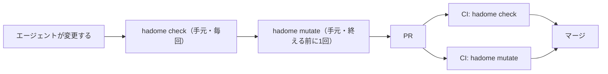
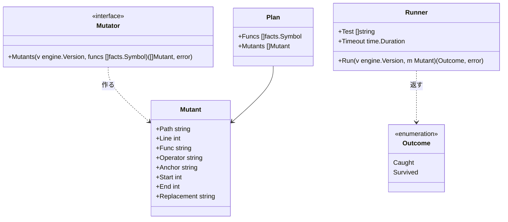
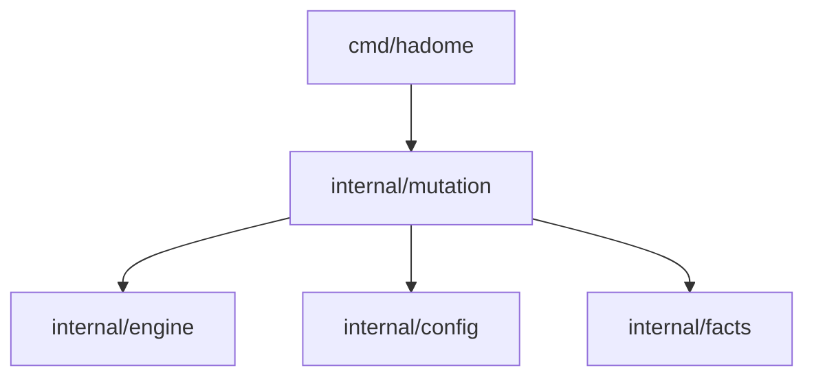

# ミューテーション

## 責務

パッケージ `internal/mutation` は変更で触ったコードをわざと少し壊し、テストがそれに気づくかを確かめる。壊したコードを**ミュータント**と呼ぶ。テストが落ちればミュータントを**捕まえた**、通れば**生き残った**と言う。

今の `tests/` のルールは、テストが何を呼ぶかしか見ていない。呼んでいても、結果を確かめていなければ守っていない。ミューテーションは「本体を壊したら、本当にテストが落ちるか」を見るので、守る範囲を今より正しく測れる。

すること:

- 変更で触った関数を選び、アダプタに頼んでミュータントを作る
- 版のツリーをディスク上に写し、ミュータントを1つずつ当てて、設定のテストのコマンドを実行する
- head で生き残ったミュータントのうち、変更で増えたものだけを後退として報告する

しないこと:

- テストのコマンドを推測すること。コマンドは必ず設定に書いてもらう。`go`、`pytest`、`cargo` などを hadome が勝手に呼ぶことはない
- 既存のミューテーションの道具（gremlins、mutmut、Stryker、PIT、cargo-mutants）を呼ぶこと。6言語で動きをそろえ、外の道具の入れ方や出力の形を追い続けないため
- 変更で触っていないコードを壊すこと。リポジトリ全体を毎回壊すと、時間が変更の大きさではなくリポジトリの大きさで決まってしまう
- `hadome check` の中で動くこと。テストを何度も実行するので、別のコマンド `hadome mutate` にする

## 開発の流れ

`hadome check` と `hadome mutate` は、速さと確かめる深さが違う。そのため、流れの中で受け持つ場所を分ける。

| | `hadome check` | `hadome mutate` |
|---|---|---|
| 確かめること | 書き方と、テストが呼ぶもの | 本体を壊したらテストが落ちるか |
| コードの実行 | しない | 設定のテストのコマンドを実行する |
| 時間 | 秒 | 分。ミュータントの数 × テストの時間 |
| 手元のエージェント | 変更を終える前に毎回 | 設定があれば、変更を終える前に1回 |
| CI | PR ごとに必須 | PR ごとに必須（推奨） |



### 使われ続けるようにする

hadome は利用者の CI の設定もブランチの保護も変えられない。PR で必須にするかを決めるのは、リポジトリを持つ人だ。そのうえで、次の4つで使われ続けるようにする。

1. 一度入れたら、人の確認なしには外せないようにする。設定の `mutation` を消す・弱める変更は、ほかの設定と同じく `config/loosened` として人の確認（終了コード `3`）を求める。エージェントが遅いからと外すことはできない
2. エージェントに伝えるため、`hadome agents` のブロックに「`mutation` の設定があれば、変更を終える前に `hadome mutate` を実行する」と足す
3. CI への入れ方を示すため、`docs/` に GitHub Actions の例を置き、`check` と `mutate` を別のジョブにする形を示す
4. 始めやすくするため、`hadome init` は見つけた言語に合うテストのコマンドを、コメントにした `mutation` の設定として書く。推測したコマンドを有効にはしない

## 形



- `Mutator` はアダプタが実装する。構文木を読めるのはアダプタだけだからだ。ミュータントは「どこを、何に置き換えるか」という文字の範囲で、アダプタはコードを実行しない。アダプタの不変条件（コードを実行しない、プロセスを起動しない）はそのまま守られる
- `Runner` はこのパッケージにある。版のツリーをディスク上に写し、ミュータントを当て、テストのコマンドを実行し、元に戻す。プロセスを起動するのは、門番（`internal/gate`）と同じく、エンジンの外である
- 報告の形、例外の印、終了コードは、エンジンのものをそのまま使う

依存の図には次の矢印を足す。



## 壊す場所

壊すのは、次のどちらかに当たる関数だけだ。

- 変更で本体を変えた関数（新しい関数を含む）
- 変更で書き換えたテストが呼ぶ関数（`Test.Calls`）。本体を変えずにテストだけを弱める変更も見逃さないため

## 壊し方

壊し方は少数に絞る。どれも1か所だけを変え、ほとんどのテストが気づけるものにする。

| 壊し方 | 例 |
|---|---|
| 比較を逆にする | `<` → `>=`、`==` → `!=` |
| 真偽を反転する | `ok` → `!ok`、`true` → `false` |
| 算術を入れ替える | `+` → `-`、`*` → `/` |
| ゼロの値を返す | `return total` → `return 0`（言語ごとのゼロの値） |
| 呼び出しの文を消す | `store.Append(row)` の行を消す |

ミュータントのアンカーは関数の名前、壊し方、正規化した元の行でつくる。行番号は入れない。変更で関数が動いても、同じミュータントとして照らせる。

## 比べ方

ほかのルールと同じく、変更で増えたものだけを後退にする。

1. head で、壊す場所のミュータントをすべて実行する。捕まえたものはそこで終わる
2. 生き残ったミュータントごとに、同じアンカーのミュータントが base にあるかを見る
3. base に無い（新しい行や書き換えた行）なら、後退にする。新しいコードを守るテストが無い
4. base にあれば、base でも実行する。base で捕まえていたなら後退にする（テストが弱くなった）。base でも生き残っていたなら、前からある穴なので報告しない

base で実行するのは、head で生き残ったものだけだ。時間のほとんどは head の1回分で済む。

後退は `mutation/survived` として報告する。

```json
{
  "rule": "mutation/survived",
  "file": "store/store.go",
  "line": 21,
  "message": "store.Append: changing `<` to `>=` does not fail any test",
  "why": "the code can do the opposite of what it does now and the tests still pass",
  "fix": "add a test that checks the result of this comparison"
}
```

振る舞いを変えない置き換え（**等価なミュータント**）もありうる。例えば、`i < n` と `i != n` が同じ結果になるループがある。そうしたものには理由つきの例外の印（`gate:allow mutation/survived reason: <理由>`）を書く。

## 設定

```yaml
mutation:
  test: [go, test, ./...]   # 必須。ミュータントごとに、版の写しの直下で実行する
  timeout: 2m               # 任意。1回のテストの上限。既定は、壊す前の1回の時間の3倍
  max-mutants: 100          # 任意。1回の実行で試すミュータントの上限。既定は 100
```

- 壊す前に、head でテストのコマンドを1回実行する。落ちたら、何も壊さずに終了コード `2` を返す。もともと落ちるテストでは、ミュータントを捕まえたかが分からないからだ
- 時間切れは捕まえたものとして扱う。壊したことで止まらなくなったのを、テストが通ったとは言えないからだ
- `mutation` を消す、`max-mutants` を下げる、`test` を変えるのは、緩める変更として人の確認を求める

## 不変条件

1. 何も壊していないツリーでテストが落ちるとき、`hadome mutate` は結果を出さずに終了コード `2` を返す
2. リポジトリの作業ツリーは書き換えない。壊すのは、一時ディレクトリに写した版だけである
3. 同じ版の組と設定からは、いつも同じミュータントが同じ順に作られる
4. base で前から生き残っていたミュータントで、変更を落とすことはない
5. 試せなかったミュータント（上限を超えた分）は、黙って通さずに報告する

## 意図して入れなかったもの

- ミュータントの並列実行。1つずつのほうが、テストのコマンドが共有するもの（ポート、一時ファイル）で揺れない。測って必要なら足す
- 結果のキャッシュ。版の組が変われば結果も変わるので、まず無しで始める
- リポジトリ全体を壊すモード。夜間の CI などで欲しくなったら足す
- 言語ごとのビルドの使い回し（既存の道具が速い理由）。自前で6言語にそろえることを優先した

## 決めること

1. 上限を超えて試せなかったミュータントを、終了コード `3`（人の確認）で報告するか、情報だけにするか。推奨は `3`。黙って通さない決まり（不変条件の5）と合う
2. 新しい関数で生き残ったミュータントを後退にするか。推奨は後退にする。新しいコードを足すなら、それを守るテストも足す、という決まりになる
3. `max-mutants` の既定を 100 にするか。1回のテストが10秒なら、最大でおよそ17分になる
