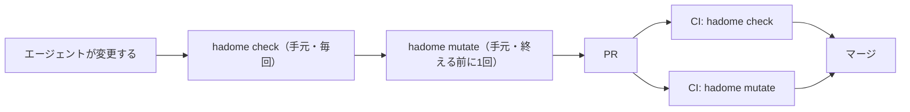
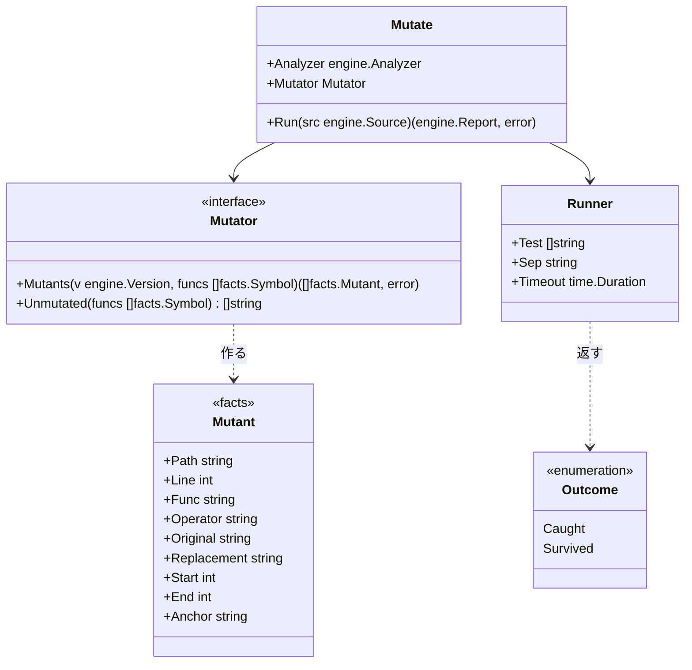
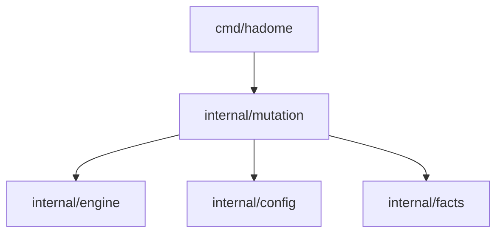

# ミューテーション

## 責務

パッケージ `internal/mutation` は変更で触ったコードをわざと少し壊し、テストがそれに気づくかを確かめる。壊したコードを**ミュータント**と呼ぶ。テストが落ちればミュータントを**捕まえた**、通れば**生き残った**と言う。

今の `tests/` のルールは、テストが何を呼ぶかしか見ていない。呼んでいても、結果を確かめていなければ守っていない。ミューテーションは「本体を壊したら、本当にテストが落ちるか」を見るので、守る範囲を今より正しく測れる。

すること:

- 変更で触った関数を選び、アダプタに頼んでミュータントを作る
- 版のツリーをディスク上に写し、ミュータントを1つずつ当てて、設定のテストのコマンドを実行する
- head で生き残ったミュータントのうち、変更で増えたものだけを後退として報告する

しないこと:

- テストのコマンドを推測すること。コマンドは必ず設定に書いてもらう。`go`、`pytest`、`cargo` などを hadome が勝手に呼ぶことはない
- 既存のミューテーションの道具（gremlins、mutmut、Stryker、PIT、cargo-mutants）を呼ぶこと。6言語で動きをそろえ、外の道具の入れ方や出力の形を追い続けないため
- 変更で触っていないコードを壊すこと。リポジトリ全体を毎回壊すと、時間が変更の大きさではなくリポジトリの大きさで決まってしまう
- `hadome check` の中で動くこと。テストを何度も実行するので、別のコマンド `hadome mutate` にする

## 開発の流れ

`hadome check` と `hadome mutate` は、速さと確かめる深さが違う。そのため、流れの中で受け持つ場所を分ける。

| | `hadome check` | `hadome mutate` |
|---|---|---|
| 確かめること | 書き方と、テストが呼ぶもの | 本体を壊したらテストが落ちるか |
| コードの実行 | しない | 設定のテストのコマンドを実行する |
| 時間 | 秒 | 分。ミュータントの数 × テストの時間 |
| 手元のエージェント | 変更を終える前に毎回 | 設定があれば、変更を終える前に1回 |
| CI | PR ごとに必須 | PR ごとに必須（推奨） |



### 使われ続けるようにする

hadome は利用者の CI の設定もブランチの保護も変えられない。PR で必須にするかを決めるのは、リポジトリを持つ人だ。そのうえで、次の4つで使われ続けるようにする。

1. 一度入れたら、人の確認なしには外せないようにする。設定の `mutation` を消す・弱める変更は、ほかの設定と同じく `config/loosened` として人の確認（終了コード `3`）を求める。エージェントが遅いからと外すことはできない
2. エージェントに伝えるため、`hadome agents` のブロックに「`mutation` の設定があれば、変更を終える前に `hadome mutate` を実行する」と足す
3. CI への入れ方を示すため、`docs/` に GitHub Actions の例を置き、`check` と `mutate` を別のジョブにする形を示す
4. 始めやすくするため、`hadome init` は見つけた言語に合うテストのコマンドを、コメントにした `mutation` の設定として書く。推測したコマンドを有効にはしない

### エージェント向けの手順

`docs/for-agents.ja.md` には、次の節を置く。

````markdown
## ミューテーションを試す

`.hadome.yml` に `mutation` があるときだけ。`hadome check` が `0` で終わったあと、変更を終える前に1回実行する。

```sh
hadome mutate --format json
```

| 終了コード | 意味 | すること |
|---|---|---|
| `0` | 変更で触ったコードを壊すと、どれもテストが落ちた | 終える |
| `1` | テストが気づかない壊し方がある | `regressions` の各エントリの `fix` に沿ってテストを足し、もう1度実行する |
| `2` | 何も壊していない状態でテストが落ちた、または設定が不正 | 先にテストを直す。`mutation` の設定は消さない |
| `3` | 人の確認が要る（上限を超えて試せなかった分がある、など） | 止まる。挙がったものを人に伝える |

- 本体を変えてテストを通さない。`1` は、テストが足りないという知らせである
- 振る舞いを変えない置き換え（等価なミュータント）だと確かめたときだけ、`gate:allow mutation/survived reason: <理由>` を書く。理由には、なぜ結果が変わらないかを書く
- 遅いからと `mutation` の設定を消したり弱めたりしない。そうした変更は `3` になる

確かめ方: `hadome mutate` が `0` で終わる。
````

`hadome agents` が出す短い版には、「`mutation` の設定があれば、変更を終える前に `hadome mutate` を実行する」の1行を足す（上の 2）。

## 形



- `Mutant` は言語に依らない事実なので `facts` に置く。アダプタが `internal/mutation` に依存せずに作れるからだ
- `Mutator` はアダプタが実装する。構文木を読めるのはアダプタだけだからだ。まだ壊し方を持たない言語は `Unmutated` が挙げ、その言語で触った関数は試せなかったものとして人の確認に回る。ミュータントは「どこを、何に置き換えるか」という文字の範囲で、アダプタはコードを実行しない。アダプタの不変条件（コードを実行しない、プロセスを起動しない）はそのまま守られる
- `Runner` はこのパッケージにある。版のツリーをディスク上に写し、ミュータントを当て、テストのコマンドを実行し、元に戻す。プロセスを起動するのは、門番（`internal/gate`）と同じく、エンジンの外である
- 報告の形、例外の印、終了コードは、エンジンのものをそのまま使う。`Mutate` はミュータントを試したあと、その結果を版ごとに返す1つのルール（`mutation/survived`）として `engine.Check` に渡す。下の「比べ方」の決まりは、エンジンの見つかったものの比べ方とちょうど同じになる
- `hadome check` は `mutation/survived` を知らないので、その例外の印を知らないルールや使われない印として報告してしまう。そこで `engine.Engine.Elsewhere` で、ほかのコマンドが報告するルールを名指す。`check` は `mutation/survived` を、`mutate` はそれ以外のルールをほかに任せ、任せたルールの印には触らない

依存の図には次の矢印を足す。



## 壊す場所

壊すのは、次のどちらかに当たる関数だけだ。

- 変更で本体を変えた関数（新しい関数を含む）
- 変更で書き換えたテストが呼ぶ関数（`Test.Calls`）。本体を変えずにテストだけを弱める変更も見逃さないため

## 壊し方

壊し方は少数に絞る。どれも1か所だけを変え、ほとんどのテストが気づけるものにする。

| 壊し方 | 例 |
|---|---|
| 比較を逆にする | `<` → `>=`、`==` → `!=` |
| 真偽を反転する | `ok` → `!ok`、`true` → `false` |
| 算術を入れ替える | `+` → `-`、`*` → `/` |
| ゼロの値を返す | `return total` → `return 0`（言語ごとのゼロの値） |
| 呼び出しの文を消す | `store.Append(row)` の行を消す |

ミュータントのアンカーは関数の名前、壊し方、正規化した元の行でつくる。行番号は入れない。変更で関数が動いても、同じミュータントとして照らせる。

## 比べ方

ほかのルールと同じく、変更で増えたものだけを後退にする。

1. head で、壊す場所のミュータントをすべて実行する。捕まえたものはそこで終わる。設定に `{tests}` があれば、流すテストを絞る（下の「流すテストを絞る」）
2. 生き残ったミュータントごとに、同じアンカーのミュータントが base にあるかを見る
3. base に無い（新しい関数、新しい行、書き換えた行）なら、後退にする。新しいコードを足すなら、それを守るテストも足す
4. base にあれば、base でも実行する。base で捕まえていたなら後退にする（テストが弱くなった）。base でも生き残っていたなら、前からある穴なので報告しない

base で実行するのは、head で生き残ったものだけだ。時間のほとんどは head の1回分で済む。

### 流すテストを絞る

ミュータントの数は変更の大きさで決まり、テストの数では決まらない。ただし、ミュータントを1つ試すたびにテストのコマンドを丸ごと実行するので、テストが多いリポジトリでは1回が長くなる。例えば、テスト全体に5分かかるなら、ミュータント15個で75分になる。

そこで、壊した関数を呼ぶテストだけを流せるようにする。どのテストがどの関数を呼ぶかは、アダプタが読んだ `Test.Calls` で分かる。

1. 設定の `test` に `{tests}` を書いてもらう（例: `[go, test, ./..., -run, "{tests}"]`）。テストの名前を渡す書き方は言語ごとに違うので、hadome は推測しない
2. ミュータントごとに、壊した関数を呼ぶテストの名前を `{tests}` に入れて実行する。名前はそのまま入れ、区切りは `tests-separator`（既定は `|`）で決める
3. 絞った実行で生き残ったミュータントは、`{tests}` を外したコマンド（テスト全部）でもう1度実行する。そこでも生き残ったものだけを、生き残ったとみなす
4. 壊した関数を呼ぶテストが1つも見つからないミュータントは、初めからテスト全部で実行する

3 があるのは、`Test.Calls` が呼び出しを取りこぼすことがあるからだ。間接に呼ぶテストを外してしまっても、全部で流し直すので、誤った生き残りは報告に出ない。全部で流すのは生き残ったものだけなので、時間のほとんどは絞った実行で済む。`{tests}` を書かない設定では、毎回テスト全部を実行する。

`{tests}` を外したコマンドとは、`{tests}` を含む要素と、その直前の要素がフラグ（`-` で始まる）ならそれも除いたものだ。上の例なら `[go, test, ./...]` になる。

後退は `mutation/survived` として報告する。

```json
{
  "rule": "mutation/survived",
  "file": "store/store.go",
  "line": 21,
  "message": "store.Append: changing `<` to `>=` does not fail any test",
  "why": "the code can do the opposite of what it does now and the tests still pass",
  "fix": "add a test that checks the result of this comparison"
}
```

振る舞いを変えない置き換え（**等価なミュータント**）もありうる。例えば、`i < n` と `i != n` が同じ結果になるループがある。そうしたものには理由つきの例外の印（`gate:allow mutation/survived reason: <理由>`）を書く。

## 設定

```yaml
mutation:
  test: [go, test, ./...]   # 必須。ミュータントごとに、版の写しの直下で実行する
  timeout: 2m               # 任意。1回のテストの上限。既定は、壊す前の1回の時間の3倍
  max-mutants: 100          # 任意。1回の実行で試すミュータントの上限。既定は 100
```

`max-mutants` の既定の 100 は、1回のテストが10秒なら、最大でおよそ17分になる数である。

テストを絞るときの例:

```yaml
mutation:
  test: [go, test, ./..., -run, "^({tests})$"]   # {tests} に、壊した関数を呼ぶテストの名前が入る
  tests-separator: "|"                          # 任意。名前の区切り。既定は "|"
```

- 壊す前に、head でテストのコマンドを1回実行する。落ちたら、何も壊さずに終了コード `2` を返す。もともと落ちるテストでは、ミュータントを捕まえたかが分からないからだ
- 時間切れは捕まえたものとして扱う。壊したことで止まらなくなったのを、テストが通ったとは言えないからだ
- `mutation` を消す、`max-mutants` を下げる、`test` を変えるのは、緩める変更として人の確認を求める。`{tests}` を足す・外すのも `test` を変えることに入る。`timeout` と `tests-separator` を変えるのも同じだ。`max-mutants` には、小さいほうが緩い向き（`LooserWhenLower`）を使う

## 不変条件

1. 何も壊していないツリーでテストが落ちるとき、`hadome mutate` は結果を出さずに終了コード `2` を返す
2. リポジトリの作業ツリーは書き換えない。壊すのは、一時ディレクトリに写した版だけである
3. 同じ版の組と設定からは、いつも同じミュータントが同じ順に作られる
4. base で前から生き残っていたミュータントで、変更を落とすことはない
5. 試せなかったミュータント（上限を超えた分）は、黙って通さずに報告し、終了コード `3`（人の確認）にする。試していないものを、捕まえたとも生き残ったとも言えないからだ
6. テストを絞った実行だけで生き残ったミュータントは、報告しない。テスト全部でも生き残ったものだけを報告する

## 意図して入れなかったもの

- ミュータントの並列実行。1つずつのほうが、テストのコマンドが共有するもの（ポート、一時ファイル）で揺れない
- 結果のキャッシュ。版の組が変われば結果も変わるので、使い回せる場面が少ない
- リポジトリ全体を壊すモード。時間が変更の大きさではなく、リポジトリの大きさで決まってしまう
- 言語ごとのビルドの使い回し（既存の道具が速い理由）。6言語で同じ動きにそろえることを先にする
- テストを計測付きで実行して、テストごとに通った行を測ること（PIT や Stryker の絞り方）。言語ごとのテストランナーに入り込む必要があり、外の道具を呼ばない決まりと合わない。代わりに、コードを動かさずに読んだ `Test.Calls` で絞る
- エージェントのフック（エージェントが作業を終える時点で `hadome mutate` を走らせる設定）。特定のエージェントの製品に頼ることになる。エージェントには `hadome agents` のブロックで伝え、CI で必須にする
