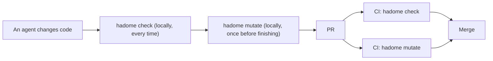
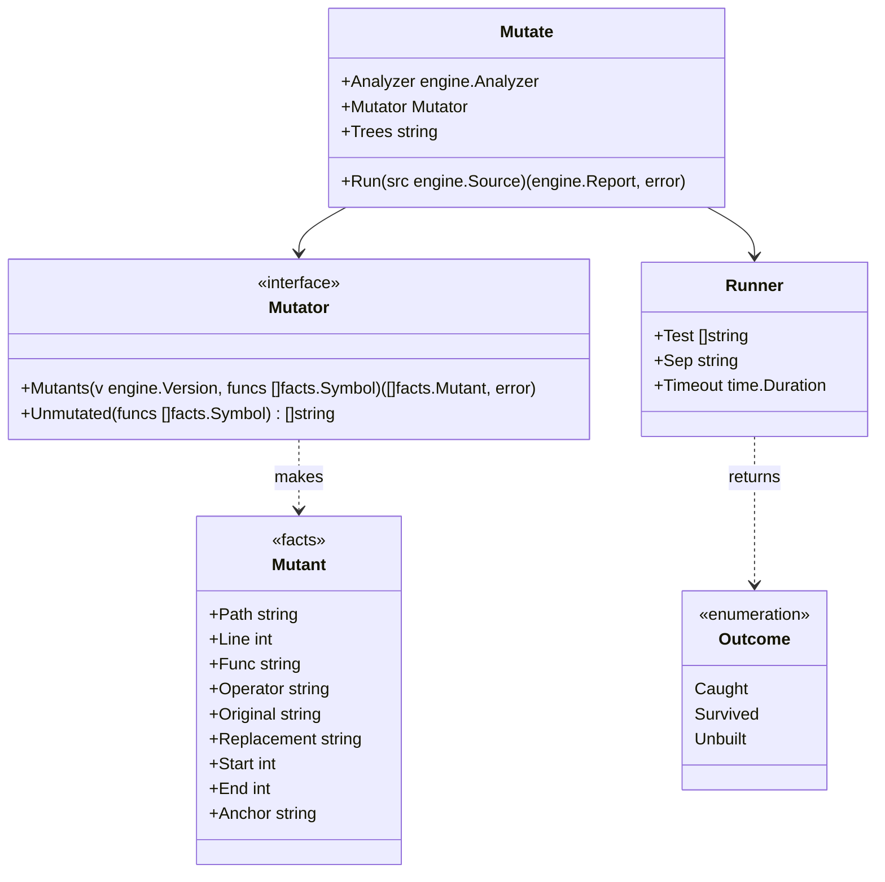
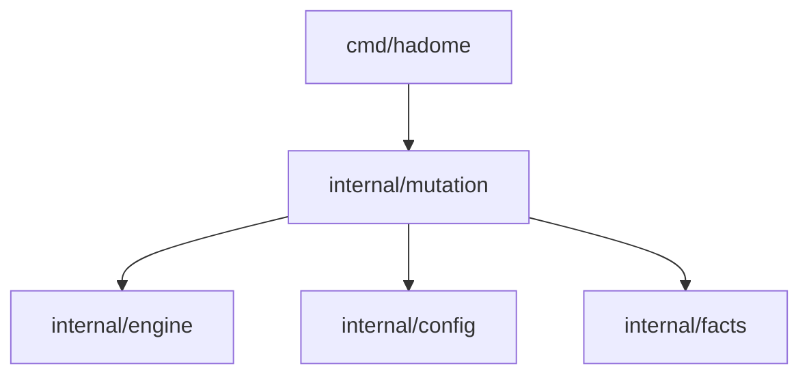

# Mutation

## Responsibility

Package `internal/mutation` breaks the code a change touched, a little and on purpose, and checks whether the tests notice. Broken code is called a **mutant**. When a test fails, the mutant is **caught**; when the tests pass, it **survived**. When the build that runs the tests does not compile the mutant's file, it is **not built**: no test is run for it, and it is not counted as survived.

The `tests/` rules only see what a test calls. A test can call code without checking its result, and then it guards nothing. Mutation asks "if the product code breaks, does a test really fail?", so it measures what the tests guard more truly than the `tests/` rules.

Does:

- Picks the functions the change touched, and asks the adapters to make mutants of them
- Copies the version's tree into a working directory fixed per repository, applies the mutants one at a time, and runs the test command from configuration
- Reports as regressions only the mutants that survive in head and that the change added

Does not:

- Guess the test command. Configuration always names it; hadome never calls `go`, `pytest`, `cargo` and the like on its own
- Call existing mutation tools (gremlins, mutmut, Stryker, PIT, cargo-mutants). This keeps the six languages that have mutators (Go, TypeScript, Python, Rust, Java, Kotlin) behaving the same, and keeps hadome from chasing how outside tools are installed and what they print
- Break code the change did not touch. Breaking the whole repository every time would make the time depend on the repository's size, not the change's
- Run inside `hadome check`. It runs the tests many times, so it is a separate command, `hadome mutate`

## The development flow

`hadome check` and `hadome mutate` differ in speed and in how deep they check. So they take different places in the flow.

| | `hadome check` | `hadome mutate` |
|---|---|---|
| Checks | How tests are written, and what they call | Whether breaking the code fails a test |
| Runs code | No | Runs the configured test command |
| Time | Seconds | Minutes: the number of mutants × the test time |
| Agent, locally | Before finishing every change | Once before finishing, when configured |
| CI | Required on every PR | Recommended as required on every PR |



### Keeping it in use

hadome cannot change a user's CI settings or branch protection. Whether it is required on PRs is for the repository's owner to decide. Within that, four things keep it in use.

1. Once in, it cannot be taken out without a person's review. A change that removes or weakens the `mutation` setting asks for review as `config/loosened` (exit code `3`), like other settings. An agent cannot drop it for being slow
2. To tell agents, the `hadome agents` block says "when `mutation` is configured, run `hadome mutate` before finishing a change"
3. To show how to add it to CI, [ci.md](../ci.md) has a GitHub Actions example with `check` and `mutate` as separate jobs
4. To make starting easy, `hadome init` writes a `mutation` setting with a test command for the languages it found, as a comment. It never turns a guessed command on

### Steps for agents

`docs/for-agents.md` holds the section below.

````markdown
## Trying mutations

Only when `.hadome.yml` has `mutation`. Run it once before finishing a change, after `hadome check` exits `0`.

```sh
hadome mutate --format json
```

| Exit code | Meaning | What to do |
|---|---|---|
| `0` | Every way of breaking the code the change touched failed a test | Finish |
| `1` | Some way of breaking it goes unnoticed by the tests | Add tests as each entry's `fix` in `regressions` says, and run it again |
| `2` | The tests failed with nothing broken, or the configuration is invalid | Fix the tests first. Do not remove the `mutation` setting |
| `3` | A person must review something (mutants beyond the limit went untried, and the like) | Stop. Tell the person what was listed |

- Do not change the code to make the tests pass. `1` says the tests are not enough
- Write `gate:allow mutation/survived reason: <reason>` only after confirming the replacement does not change behaviour (an equivalent mutant). The reason says why the result stays the same
- Do not remove or weaken the `mutation` setting for being slow. Such a change gives `3`

How to confirm: `hadome mutate` exits `0`.
````

The short version `hadome agents` prints gains one line: "when `mutation` is configured, run `hadome mutate` before finishing a change" (item 2 above).

## Shape



- `Mutant` is a language-neutral fact, so it lives in `facts`. That lets the adapters make mutants without depending on `internal/mutation`
- The adapters implement `Mutator`, because only they read syntax trees. `Unmutated` lists the languages that have no way of breaking code; functions touched in them go to a person's review as untried. A mutant is a range of text and what replaces it; the adapters run no code, so their invariants (no code run, no process started) still hold
- `Mutate.Trees` is the working directory the versions' trees are copied into (see "The working directory" below). The `hadome mutate` command works it out with `TreesFor` and passes it; tests pass a temporary directory
- `Runner` lives in this package. It copies the version's tree into the working directory, applies a mutant, runs the test command and restores the file. Like the gates (`internal/gate`), starting processes happens outside the engine
- The report's shape, exception markers and exit codes are the engine's, used as they are. After trying the mutants, `Mutate` hands the results to `engine.Check` as one rule (`mutation/survived`) that returns them per version. The rules of "How to compare" below are exactly the engine's comparison of findings
- `hadome check` does not know `mutation/survived`, so it would report that rule's exception markers as naming an unknown rule or as unused. `engine.Engine.Elsewhere` names the rules another command reports: `check` leaves `mutation/survived` to `mutate`, and `mutate` leaves every other rule to `check`. Markers of those rules are left alone

The dependency diagram gains these arrows.



## Where to break

Only functions that are one of these:

- A function whose code the change changed (new functions included)
- A function called (`Test.Calls`) by a test the change rewrote. This catches a change that weakens only a test and leaves the code alone

## How to break

A few kinds only. Each changes one place, and most tests can notice it.

| Kind | Example |
|---|---|
| Flip a comparison | `<` → `>=`, `==` → `!=` |
| Negate a boolean | `ok` → `!ok`, `true` → `false` |
| Swap arithmetic | `+` → `-`, `*` → `/` |
| Return the zero value | `return total` → `return 0` (each language's zero value) |
| Remove a call statement | remove the line `store.Append(row)` |

A break that gives back the same value is not made a mutant. It changes nothing, so no test can catch it, and it would be reported as a false survivor.

- `return 0` is not broken by returning the zero value
- A return of a constant whose value is the zero value is not broken either. For example, with `ExitOK = 0`, `return engine.ExitOK` is not broken
- In Go, the constant's value is read, from syntax only, from its declaration in the same package or in a package of the same module. The value is computed as a constant expression. The expression may use literals, `false` and `true`, `iota`, constants declared earlier in the same file, conversions, and operators on numbers, strings and booleans. For example, `const Off Level = 1 - 1` is a constant whose value is zero
- In TypeScript, Python, Rust, Java and Kotlin, only declarations in the same file are read ([adapters-treesitter.md](adapters-treesitter.md), "Mutants")
- A constant whose value cannot be read (one from another module, a value written as an expression that uses something that cannot be read, or one declared with different values in two files) is broken where it is returned

Go's zero value comes from the declared result type.

| Result type | Zero value |
|---|---|
| Number types (`int`, `float64`, `byte`, and so on) | `0` |
| `string` | `""` |
| `bool` | `false` |
| Pointers, slices, maps, channels, functions, interfaces (`error` and `any` included) | `nil` |
| A named type (`type Code int`, and so on) | The zero value of its underlying type. When that is a struct, the type as written followed by `{}`, such as `status.Code{}` |

- The underlying type of a named type is read, from syntax only, from its declaration in the same package or in a package of the same module. For example, when package `status` has `type Code int`, `return code` in `func Parse(s string) status.Code` becomes `return 0`
- These functions get no mutant of this kind:
  - functions with more than one result
  - functions whose result type is a fixed-size array, a struct type itself (`struct{ … }`), a type parameter, or a type with type arguments (`Set[int]`)
  - functions returning a type whose underlying type cannot be followed (a type of another module, or one declared in two files)

A mutant's anchor is the function's name, the kind, and the normalised original line, with no line number. When a change moves the function, the mutant still matches.

After each mutant it tries, it writes one progress line to standard error: which mutant it is, the file and line, the function, the kind of break, and whether a test noticed. The language is the report's: `--lang`, else `messages` in head's configuration. Example: `mutate 1/2 calc/calc.go:5 calc.Sign, flip a comparison: caught`

## Files outside the build

Breaking a file that the build running the tests does not compile makes the tests run none of its code. The tests pass as a matter of course, and whether the code is guarded is unknown. For example, a file with `//go:build !cgo` is not compiled by `go test` with cgo on. Reporting its mutants as survivors would make regressions that no added test could remove.

So the mutants of such a file are set apart as **not built**.

- **No test is run for them.** Their progress line says `not built`
- **They are counted neither as survived nor as caught.** They are never a regression (exit code `1`)
- **They go to a person's review (exit code `3`).** One review of `mutation/survived` per file names the file and how many mutants were not tried. Untried mutants are not passed silently (invariant 5)
- **They do not count toward `max-mutants`.** The limit is on the mutants whose tests are really run

### What Go decides

Whether a Go file is in the build is decided from syntax only. No command such as `go list` is run.

| What is read | Example |
|---|---|
| The `//go:build` line | `//go:build !cgo`, `//go:build ignore`, `//go:build linux && amd64` |
| `_GOOS` and `_GOARCH` in the file name | `poll_windows.go`, `asm_arm64_test.go` |
| A file name starting with `_` or `.` | `_scratch.go` |

These are the rules of `MatchFile` in `go/build`. The environment matched against is the one hadome runs in.

- GOOS, GOARCH and cgo follow `go/build`'s default (`go/build.Default`). cgo follows `CGO_ENABLED`, and without it, whether a C compiler is found
- When `mutation.test` has an element `CGO_ENABLED=0`, `GOOS=…` or `GOARCH=…`, that is used. For example, `[env, CGO_ENABLED=0, go, test, ./...]`
- When `mutation.test` has `-tags`, those tags are taken as satisfied. For example, `[go, test, -tags, integration, ./...]` or `-tags=integration`

## How to compare

Like the other rules, only what the change added is a regression.

1. In head, run every mutant in the places to break. A caught one is done. When the configuration has `{tests}` or `{packages}`, narrow the tests run (see "Narrowing the tests run" below)
2. For each surviving mutant, look for a mutant with the same anchor in base
3. If base has none (a new function, a new line or a rewritten line), it is a regression: adding code means adding a test that guards it
4. If base has one, run it in base too. If base caught it, it is a regression (the tests got weaker). If it survived in base as well, it is an old gap and is not reported

Base runs only what survived in head, so most of the time is one run of head.

### Narrowing the tests run

The number of mutants depends on the size of the change, not on the number of tests. But trying each mutant runs the whole test command, so in a repository with many tests each run is long. For example, if the whole suite takes 5 minutes, 15 mutants take 75 minutes.

So hadome can run only the tests that call the broken function. Which test calls which function is known from the `Test.Calls` the adapters read. How test names and packages are passed differs between languages, so hadome does not guess it. Configuration writes these into `test`:

| Placeholder | What goes in | Example |
|---|---|---|
| `{tests}` | The names of the tests that call the broken function, as they are, joined by `tests-separator` | `-run, "^({tests})$"` |
| `{packages}` | The packages those tests are in, spread into one element per package (see "Packages" below) | `go, test, "{packages}"` |

For each mutant, the stages below run from the narrowest. When the tests fail in a stage, the mutant is caught there. Only a mutant that passes every stage up to the last survived.

| Stage | Tests run | `{packages}` | `{tests}` |
|---|---|---|---|
| 1 | The tests that call the broken function, only in the packages they are in | the packages | the names |
| 2 | The tests that call the broken function, in every package | every package | the names |
| 3 | All the tests | every package | taken out |

- A stage that uses a placeholder the configuration does not have is the same command as the stage before. The same command runs only once. For example, with only `{tests}`, stages 2 and 3 run; with neither, only stage 3 runs
- A mutant with no test found calling the broken function runs only stage 3
- Every stage's command also runs once before anything is broken (see "One run before breaking" below). A stage whose command fails then is not used to judge the mutant, which goes to the next stage: whether it failed because of the break or would fail anyway cannot be told

Stacking the stages gives the same verdict as stage 3 alone.

- **Caught in an earlier stage.** The tests each stage runs are part of the tests the next stage runs. A test that failed in an earlier stage runs and fails in the next one as well. So a mutant caught in an earlier stage is caught in stage 3 too
- **Passed an earlier stage.** The next stage checks it again. When `Test.Calls` misses an indirect call and leaves that test out, stage 3 runs it, so no false survivor reaches the report
- **Time.** Most mutants are caught in a narrow stage. Only those that pass the narrow stages run all the tests

The command with `{tests}` taken out drops the element holding `{tests}`, and the element before it when that one is a flag (starts with `-`). For example, stage 3 of `[go, test, "{packages}", -run, "^({tests})$"]` is `[go, test, ./...]`.

#### Packages

What a package is differs between languages. hadome defines `{packages}` for Go only.

| Language | Package | `{packages}` in stage 1 | `{packages}` in stages 2 and 3 |
|---|---|---|---|
| Go | The directory of the `_test.go` file | `./store`, `./worker/queue`; the root directory is `.` | `./...` |
| TypeScript, Python, Rust, Java, Kotlin | Not defined | — | — |

- `{packages}` takes a whole element. For example, `"{packages}"` is accepted and `"./{packages}/..."` is not, because it spreads into one element per package. It cannot be written twice either
- When the test command has `-C <directory>` (or `-C=<directory>`), the paths are seen from that directory. A test outside it is not put into any package
- When a test that calls the broken function is not a Go test, or is not put into a package, the mutant skips stage 1: narrowing by package would leave that test out

`{packages}` cannot be used outside Go. So that no placeholder silently does nothing, these are configuration errors:

- `{packages}` in a configuration whose `languages` lacks `go`. `hadome config check` and every command that reads the configuration stop with exit code `2`
- `{packages}` in a configuration without `languages` when head has no Go file. `hadome mutate` stops with exit code `2`

A regression is reported as `mutation/survived`.

```json
{
  "rule": "mutation/survived",
  "file": "store/store.go",
  "line": 21,
  "message": "store.Append: changing `<` to `>=` does not fail any test",
  "why": "the code can do the opposite of what it does now and the tests still pass",
  "fix": "add a test that checks the result of this comparison"
}
```

A replacement may not change behaviour at all (an **equivalent mutant**), such as a loop where `i < n` and `i != n` give the same result. Such a mutant gets a reasoned exception marker (`gate:allow mutation/survived reason: <reason>`).

## Configuration

```yaml
mutation:
  test: [go, test, ./...]   # required; run in the root of the version's copy for each mutant
  timeout: 2m               # optional; the limit of one test run. Default: three times one run of the same command before breaking anything
  max-mutants: 100          # optional; how many mutants one run tries at most. Default: 100
```

The default `max-mutants` of 100 is about 17 minutes at most with a 10-second test run.

An example that narrows the tests:

```yaml
mutation:
  test: [go, test, "{packages}", -run, "^({tests})$"]   # {packages} gets the tests' packages, {tests} their names
  tests-separator: "|"                                 # optional; what joins the names. Default: "|"
```

- **One run before breaking.** Each stage's command runs once before anything is broken: per version (head and base), the first time the command is needed, and the result is kept for the rest of the run
  - Stage 3 (all the tests) runs before any mutant is tried. If it fails, nothing is broken and the exit code is `2`: with tests that already fail, whether a mutant was caught cannot be told
  - When the command of stage 1 or 2 fails, that stage is not used and the mutant goes to the next stage (see "Narrowing the tests run" above). A progress line names the command and says the stage was skipped
- **The comment added in the run before breaking.** In the run before breaking, a one-line comment is added at the end of every file that holds a mutant, and removed afterwards
  - The comment holds a mark used for that run only. For example: `// hadome mutate baseline 9c1e04d2-3`
  - The language decides how the comment is written: `#` in Python, `//` in the other languages
  - Why: build caches and test result caches are looked up by file contents. With the same contents as before, only the run before breaking hits the cache and is measured short. The limit then becomes too short, and a timeout wrongly catches a mutant. With the comment, the cache misses in the same files where a mutant makes it miss
- **The time limit.** Per command, three times that command's run before breaking, plus one second. For example, stage 1's limit comes from stage 1's command and stage 3's from all the tests. When `timeout` is written, every stage uses it
- **A timeout** against a confirmed limit counts as caught: a mutant that made the tests stop finishing did not let them pass
- **Confirming the limit.** The limit comes from the run before breaking, so when the machine gets loaded, tests with nothing broken go past it too. Counting that as caught would miss mutants that survived. So when a run with a mutant goes past its limit:
  1. The command's run before breaking runs again, and the limit is worked out again from its time
  2. When the new limit is longer than the old one, the machine is loaded. The limit is raised to the new one, and the run with the mutant runs again
  3. When the new limit is not longer, the limit is confirmed. The timeout counts as caught
  - A run with a mutant runs again at most twice. If it still times out after that, it counts as caught. So a mutant that truly made the tests stop finishing still ends, after at most three runs with the mutant and two runs before breaking
  - When the repeated run before breaking fails, the limit cannot be confirmed. The timeout counts as caught
  - A raised limit is used for that command for the mutants that come after too
  - When `timeout` is written, the limit is not confirmed. The written value is the limit
- Removing `mutation`, lowering `max-mutants` or changing `test` loosens the rules and asks for a person's review. Adding or taking out `{tests}` or `{packages}` is changing `test`. So is changing `timeout` or `tests-separator`. `max-mutants` uses the direction where a smaller number is looser (`LooserWhenLower`)
- Adding `mutation` when base has none does not loosen anything, because base did not run `mutate` at all (`OmittedIsOff`)

## The working directory

The versions' trees are copied into a directory fixed per repository and per version role (head and base). With the same path every time, build caches looked up by path hit in the next run too. For example, a Go test program holds the path it was built from.

| What | Path |
|---|---|
| Copy of head | `<cache directory>/hadome/mutate/<repository mark>/head` |
| Copy of base | `<cache directory>/hadome/mutate/<repository mark>/base` |
| Lock file | `<cache directory>/hadome/mutate/<repository mark>/lock` |

- The **cache directory** is what Go's `os.UserCacheDir` returns. For example: `~/Library/Caches` on macOS, `$XDG_CACHE_HOME` or `~/.cache` on Linux, `%LocalAppData%` on Windows
- The **repository mark** is the first 16 characters of the SHA-256 of the repository root's absolute path, with symbolic links followed. The root is the directory `hadome mutate` runs in when comparing revisions, and the head directory when comparing with `--head-dir`

### Making the contents match

At the start of a run, the copy is made exactly the same as the version, so that nothing left by an earlier run changes the result.

| File in the copy | What happens |
|---|---|
| Not in the version | Removed. This removes build output of earlier runs and broken files left by a run that stopped halfway. Directories not in the version are removed too |
| Different from the version | Written again |
| Same as the version | Left alone, so that caches looked up by modification time hit too |

- hadome never removes the copies: the next run uses them. When they are no longer needed, `<cache directory>/hadome/mutate` can be removed by hand

### Never two at once

Two `hadome mutate` runs on the same repository at once would fight over the copies. So the second stops instead of waiting.

- The second stops with exit code `2`. Its message names the process number of the one running and the path of the lock file. Waiting would leave the user unable to see why nothing moves
- The lock is an operating system file lock on the lock file: `flock` on Unix, and opening it so that no one else can open it on Windows
- When the process ends, even when it crashes, the operating system releases the lock. So a stale lock never stops a run. The lock file itself stays, and the next run uses it when no lock is held

## The test processes

One run of the test command is not one process but a tree of processes. For example, `go test` builds and starts a test program (`calc.test`) for each package, and starts `compile` and `link` to build them. Stopping `go` alone leaves the others running without a parent. Test programs that stopped finishing, left behind mutant after mutant, slow the machine down and in the end stop it.

So hadome ends the tree as a whole.

| When | What hadome does |
|---|---|
| The time limit is reached | Ends the whole tree. Once the limit is confirmed, the mutant counts as caught (see "Confirming the limit" above) |
| An interrupt (Ctrl-C, `SIGTERM`, `SIGHUP`) | Ends the whole tree, then ends itself by the same signal |
| The command exits | Ends whatever is left of the tree, without a word. The command's exit code decides the result |

- **How.** On Unix (macOS, Linux), the command starts in a process group of its own, and the whole group is ended with `SIGKILL`. On Windows, the command is put in a job object, and the whole job is ended
  - On Windows, the command starts suspended and runs only once it is in the job, so that it cannot start a child before it is in the job
- **Why hadome takes the interrupt.** The command is outside the terminal's process group, so the terminal's Ctrl-C does not reach it. hadome takes it instead and ends the tree. A signal hadome was started ignoring (`SIGHUP` under `nohup`, and the like) stays ignored
- **Why leftovers are ended without a word.** A process the test command leaves behind (a server it started, a daemon of the build tool) gets into the next mutant's run and makes its result flaky. For a command that leaves one every time, reporting it would only repeat the same line
- **When hadome crashes on Windows.** The job is made to end what it holds when its last handle closes (`JOB_OBJECT_LIMIT_KILL_ON_JOB_CLOSE`). However hadome ends, the tree does not stay

## Invariants

1. When the tests fail on a tree with nothing broken, `hadome mutate` gives no result and returns exit code `2`
2. The repository's working tree is never changed. Only a version copied to the working directory is broken
3. The same pair of versions and configuration always make the same mutants in the same order
4. A mutant that already survived in base never fails a change
5. Mutants that could not be tried (beyond the limit, in a file outside the build, and functions touched in a language without a mutator) are reported, never passed silently, with exit code `3` (a person's review). A mutant not tried can be called neither caught nor survived
6. A mutant that survived only a narrowed run is never reported. Only one that also survives all the tests is
7. Stacking the stages gives the same verdict as stage 3 (all the tests) alone. A mutant caught in a narrow stage is caught in stage 3 too
8. A command that fails before anything is broken never catches a mutant
9. Before the tests run, the copy always holds exactly the version
10. Two `hadome mutate` runs never run tests on the same repository at once
11. No process the test command started is running after that run ends, whether it ends by the time limit, an interrupt or the command exiting
12. A timeout catches a mutant only in these three cases (see "Confirming the limit" above)
    - It goes past a limit confirmed by running the run before breaking again
    - The repeated run before breaking fails, so the limit cannot be confirmed
    - It still goes past the limit after two retries that each raised the limit
13. The number of test runs for one mutant is bounded. A mutant that made the tests stop finishing still ends

## Deliberately left out

- Running mutants in parallel. One at a time keeps tests from flaking over what the test command shares (ports, temporary files)
- Caching results. A different pair of versions gives different results, so results can rarely be reused
- A mode that breaks the whole repository. Its time would depend on the repository's size, not the change's
- Reusing each language's builds (why existing tools are fast). Making six languages behave the same comes first
- Running the tests with instrumentation to measure which lines each test passes through (how PIT and Stryker narrow). It needs to get inside each language's test runner, which goes against not calling outside tools. `Test.Calls`, read without running code, narrows instead
- Narrowing by package in languages other than Go. pytest narrows by file path and `::`, Jest by a regular expression of file paths, cargo by crate and test path. The forms differ by runner and do not fit one `{packages}`. Outside Go, `{tests}` narrows
- Ending the tree when hadome itself is stopped with `SIGKILL` on Unix. `SIGKILL` cannot be caught, so hadome stops before it ends the tree. macOS has no way to end children when their parent ends
- Waiting for the lock to be released. While waiting, the user cannot see why nothing moves. The second run stops and says why
- Telling which files are outside the build in languages other than Go. TypeScript's `exclude` in `tsconfig.json`, Rust's `#[cfg(...)]` and Python's branches at run time differ widely by language. Only Go is told apart. Every mutant of another language runs the tests
- Asking `go list` which files are in the build. Starting a command depends on module downloads and caches. What syntax cannot tell (a `mutation.test` that calls a shell script that changes the environment, and the like) is not told apart
- Trying files outside the build in another environment (running again with `CGO_ENABLED=0`, and the like). The test command in configuration decides the environment the tests run in; hadome does not guess it
- Agent hooks (settings that run `hadome mutate` when an agent finishes its work). They would depend on a particular agent product. Agents are told through the `hadome agents` block, and CI makes it required
