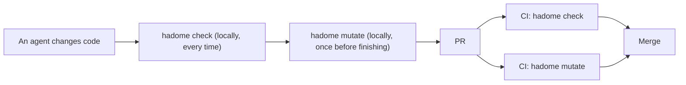
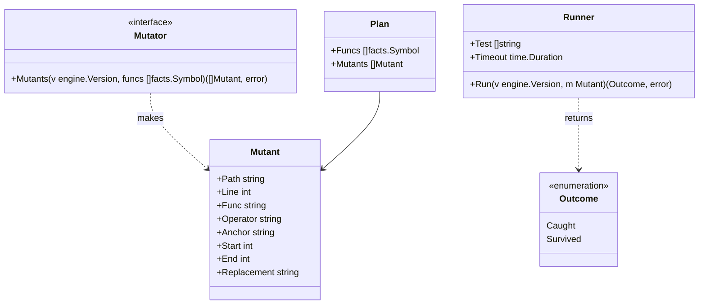
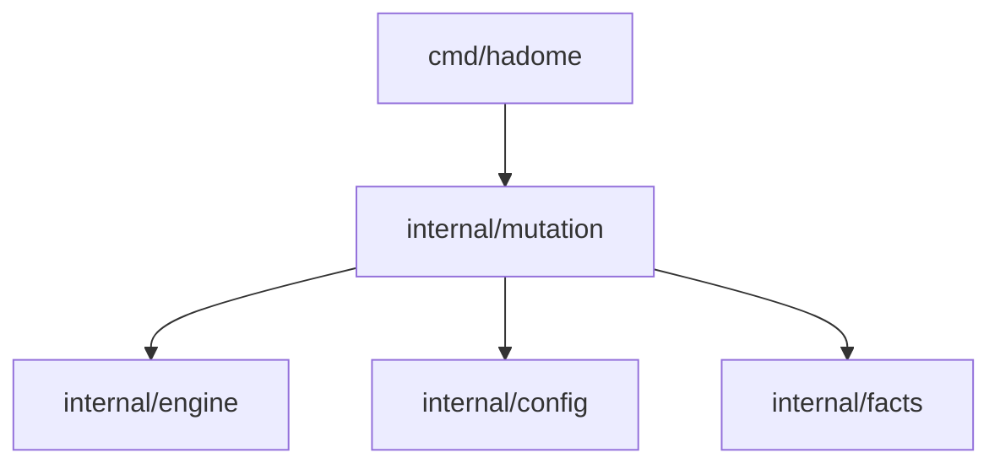

# Mutation

## Responsibility

Package `internal/mutation` breaks the code a change touched, a little and on purpose, and checks whether the tests notice. Broken code is called a **mutant**. When a test fails, the mutant is **caught**; when the tests pass, it **survived**.

Today's `tests/` rules only see what a test calls. A test can call code without checking its result, and then it guards nothing. Mutation asks "if the code breaks, does a test really fail?", so it measures what the tests guard more truly than now.

Does:

- Picks the functions the change touched, and asks the adapters to make mutants of them
- Copies the version's tree to disk, applies the mutants one at a time, and runs the test command from configuration
- Reports as regressions only the mutants that survive in head and that the change added

Does not:

- Guess the test command. Configuration always names it; hadome never calls `go`, `pytest`, `cargo` and the like on its own
- Call existing mutation tools (gremlins, mutmut, Stryker, PIT, cargo-mutants). This keeps the six languages behaving the same, and keeps hadome from chasing how outside tools are installed and what they print
- Break code the change did not touch. Breaking the whole repository every time would make the time depend on the repository's size, not the change's
- Run inside `hadome check`. It runs the tests many times, so it is a separate command, `hadome mutate`

## The development flow

`hadome check` and `hadome mutate` differ in speed and in how deep they check. So they take different places in the flow.

| | `hadome check` | `hadome mutate` |
|---|---|---|
| Checks | How tests are written, and what they call | Whether breaking the code fails a test |
| Runs code | No | Runs the configured test command |
| Time | Seconds | Minutes: the number of mutants × the test time |
| Agent, locally | Before finishing every change | Once before finishing, when configured |
| CI | Required on every PR | Required on every PR (recommended) |



### Keeping it in use

hadome cannot change a user's CI settings or branch protection. Whether it is required on PRs is for the repository's owner to decide. Within that, four things keep it in use.

1. Once in, it cannot be taken out without a person's review. A change that removes or weakens the `mutation` setting asks for review as `config/loosened` (exit code `3`), like other settings. An agent cannot drop it for being slow
2. To tell agents, the `hadome agents` block gains "when `mutation` is configured, run `hadome mutate` before finishing a change"
3. To show how to add it to CI, `docs/` gets a GitHub Actions example with `check` and `mutate` as separate jobs
4. To make starting easy, `hadome init` writes a `mutation` setting with a test command for the languages it found, as a comment. It never turns a guessed command on

## Shape



- The adapters implement `Mutator`, because only they read syntax trees. A mutant is a range of text and what replaces it; the adapters run no code, so their invariants (no code run, no process started) still hold
- `Runner` lives in this package. It copies the version's tree to disk, applies a mutant, runs the test command and restores the file. Like the gates (`internal/gate`), starting processes happens outside the engine
- The report's shape, exception markers and exit codes are the engine's, used as they are

The dependency diagram gains these arrows.



## Where to break

Only functions that are one of these:

- A function whose code the change changed (new functions included)
- A function called (`Test.Calls`) by a test the change rewrote. This catches a change that weakens only a test and leaves the code alone

## How to break

A few kinds only. Each changes one place, and most tests can notice it.

| Kind | Example |
|---|---|
| Flip a comparison | `<` → `>=`, `==` → `!=` |
| Negate a boolean | `ok` → `!ok`, `true` → `false` |
| Swap arithmetic | `+` → `-`, `*` → `/` |
| Return the zero value | `return total` → `return 0` (each language's zero value) |
| Remove a call statement | remove the line `store.Append(row)` |

A mutant's anchor is the function's name, the kind, and the normalised original line, with no line number. When a change moves the function, the mutant still matches.

## How to compare

Like the other rules, only what the change added is a regression.

1. In head, run every mutant in the places to break. A caught one is done
2. For each surviving mutant, look for a mutant with the same anchor in base
3. If base has none (a new or rewritten line), it is a regression: no test guards the new code
4. If base has one, run it in base too. If base caught it, it is a regression (the tests got weaker). If it survived in base as well, it is an old gap and is not reported

Base runs only what survived in head, so most of the time is one run of head.

A regression is reported as `mutation/survived`.

```json
{
  "rule": "mutation/survived",
  "file": "store/store.go",
  "line": 21,
  "message": "store.Append: changing `<` to `>=` does not fail any test",
  "why": "the code can do the opposite of what it does now and the tests still pass",
  "fix": "add a test that checks the result of this comparison"
}
```

A replacement may not change behaviour at all (an **equivalent mutant**), such as a loop where `i < n` and `i != n` give the same result. Such a mutant gets a reasoned exception marker (`gate:allow mutation/survived reason: <reason>`).

## Configuration

```yaml
mutation:
  test: [go, test, ./...]   # required; run in the root of the version's copy for each mutant
  timeout: 2m               # optional; the limit of one test run. Default: three times one run before breaking anything
  max-mutants: 100          # optional; how many mutants one run tries at most. Default: 100
```

- Before breaking anything, the test command runs once in head. If it fails, nothing is broken and the exit code is `2`: with tests that already fail, whether a mutant was caught cannot be told
- A timeout counts as caught: a mutant that made the tests stop finishing did not let them pass
- Removing `mutation`, lowering `max-mutants` or changing `test` loosens the rules and asks for a person's review

## Invariants

1. When the tests fail on a tree with nothing broken, `hadome mutate` gives no result and returns exit code `2`
2. The repository's working tree is never changed. Only a version copied to a temporary directory is broken
3. The same pair of versions and configuration always make the same mutants in the same order
4. A mutant that already survived in base never fails a change
5. Mutants that could not be tried (beyond the limit) are reported, never passed silently

## Deliberately left out

- Running mutants in parallel. One at a time keeps tests from flaking over what the test command shares (ports, temporary files). Add it when measurements call for it
- Caching results. A different pair of versions gives different results, so it starts without one
- A mode that breaks the whole repository. Add it when nightly CI or the like wants one
- Reusing each language's builds (why existing tools are fast). Making six languages behave the same comes first

## To decide

1. Whether mutants that could not be tried because of the limit are reported with exit code `3` (a person's review) or as information only. Recommended: `3`, which matches never passing silently (invariant 5)
2. Whether a mutant surviving in a new function is a regression. Recommended: yes, so that adding code means adding a test that guards it
3. Whether the default of `max-mutants` is 100. With a 10-second test run, that is about 17 minutes at most
